# KeQueryDpcWatchdogConfiguration

- RVA: `0x005B5800`–`0x005B59C2` (길이 `450` bytes)
- VA: `0x00000001405B5800`
- 실행 섹션: `.text`
- PDB 이름 있음: `예`; PDB Function 태그: `아니요`
- unwind 정보 RVA: `0x000C9D4C`
- 디코드: `118`개 명령, `450/450` bytes 표시
- 미해석 바이트: `0` (있으면 어셈블리에 `.byte`로 보존)

> 이 문서는 커널 이미지의 기계어와 PDB 기호를 분석해 생성했습니다. 4번과 5번은 함수 원형과 자료형을 바이너리 사용 방식에서 추정한 C 해석이며 원본 소스 복구 결과는 아닙니다.

## 1. Dependencies

- 직접 호출 지점: **6**; 고유 호출 대상: **6**
- 직접 호출자로 확인된 함수: **1**
- RIP 상대 이미지 참조: **8**

### Outgoing calls
- `0x005B588B` → [KeAbPreAcquire](../21/KeAbPreAcquire_function_00210230.md) (function, `0x00210230`)
- `0x005B58AF` → [ExfAcquirePushLockSharedEx](../21/ExfAcquirePushLockSharedEx_function_0021044C.md) (function, `0x0021044C`)
- `0x005B5974` → [ExfReleasePushLockShared](../26/ExfReleasePushLockShared_function_00263440.md) (function, `0x00263440`)
- `0x005B597C` → [KeAbPostRelease](../2E/KeAbPostRelease_function_002E1600.md) (function, `0x002E1600`)
- `0x005B598A` → [KiLeaveCriticalRegionUnsafe](../25/KiLeaveCriticalRegionUnsafe_function_0025F010.md) (function, `0x0025F010`)
- `0x005B599B` → [memcpy](../6C/memcpy_function_006C6840.md) (function, `0x006C6840`)

### Direct callers
- [ExpQuerySystemInformation](../../page/A5/ExpQuerySystemInformation_function_00A57858.md) at `0x00A5B2FC`

### Static image references
- `0x005B5881` → RVA `0x00F234F8` (`.data`; read)
- `0x005B58D7` → RVA `0x00FC5028` (`ALMOSTRO`; read)
- `0x005B58EB` → RVA `0x00FC5024` (`ALMOSTRO`; read)
- `0x005B58FF` → RVA `0x00FC5048` (`ALMOSTRO`; read)
- `0x005B5913` → RVA `0x00FC5034` (`ALMOSTRO`; read)
- `0x005B5927` → RVA `0x00FC502C` (`ALMOSTRO`; read)
- `0x005B593B` → RVA `0x00FC5040` (`ALMOSTRO`; read)
- `0x005B594F` → RVA `0x00FC503C` (`ALMOSTRO`; read)

## 2. Other-region calls and transfers

- 다른 실행 섹션으로 향하는 call: **0**
- 별도 외부 분기/꼬리 이동을 확인하지 못했습니다.

## 3. Assembly (complete function range)

```asm
005B5800  48 8B C4                        mov rax, rsp
005B5803  48 89 58 08                     mov qword ptr [rax + 8], rbx
005B5807  48 89 70 10                     mov qword ptr [rax + 0x10], rsi
005B580B  48 89 78 18                     mov qword ptr [rax + 0x18], rdi
005B580F  41 54                           push r12
005B5811  41 56                           push r14
005B5813  41 57                           push r15
005B5815  48 83 EC 40                     sub rsp, 0x40
005B5819  41 8B F8                        mov edi, r8d
005B581C  8B F2                           mov esi, edx
005B581E  4C 8B F9                        mov r15, rcx
005B5821  0F 57 C0                        xorps xmm0, xmm0
005B5824  0F 11 40 C8                     movups xmmword ptr [rax - 0x38], xmm0
005B5828  0F 11 40 D8                     movups xmmword ptr [rax - 0x28], xmm0
005B582C  41 81 E8 E4 00 00 00            sub r8d, 0xe4
005B5833  74 1F                           je 0x1405b5854
005B5835  41 83 F8 01                     cmp r8d, 1
005B5839  74 0A                           je 0x1405b5845
005B583B  BB 0D 00 00 C0                  mov ebx, 0xc000000d
005B5840  E9 60 01 00 00                  jmp 0x1405b59a5
005B5845  83 FE 20                        cmp esi, 0x20
005B5848  75 0F                           jne 0x1405b5859
005B584A  C7 44 24 20 02 00 00 00         mov dword ptr [rsp + 0x20], 2
005B5852  EB 17                           jmp 0x1405b586b
005B5854  83 FE 14                        cmp esi, 0x14
005B5857  74 0A                           je 0x1405b5863
005B5859  BB 04 00 00 C0                  mov ebx, 0xc0000004
005B585E  E9 42 01 00 00                  jmp 0x1405b59a5
005B5863  C7 44 24 20 01 00 00 00         mov dword ptr [rsp + 0x20], 1
005B586B  65 48 8B 04 25 88 01 00 00      mov rax, qword ptr gs:[0x188]
005B5874  66 FF 88 E4 01 00 00            dec word ptr [rax + 0x1e4]
005B587B  90                              nop
005B587C  45 33 C0                        xor r8d, r8d
005B587F  33 D2                           xor edx, edx
005B5881  4C 8D 25 70 DC 96 00            lea r12, [rip + 0x96dc70]
005B5888  49 8B CC                        mov rcx, r12
005B588B  E8 A0 A9 C5 FF                  call 0x140210230
005B5890  4C 8B F0                        mov r14, rax
005B5893  33 C0                           xor eax, eax
005B5895  44 8D 40 11                     lea r8d, [rax + 0x11]
005B5899  F0 4C 0F B1 05 56 DC 96 00      lock cmpxchg qword ptr [rip + 0x96dc56], r8
005B58A2  74 16                           je 0x1405b58ba
005B58A4  4D 8B CC                        mov r9, r12
005B58A7  4D 8B C6                        mov r8, r14
005B58AA  33 D2                           xor edx, edx
005B58AC  49 8B CC                        mov rcx, r12
005B58AF  E8 98 AB C5 FF                  call 0x14021044c
005B58B4  41 B8 11 00 00 00               mov r8d, 0x11
005B58BA  33 DB                           xor ebx, ebx
005B58BC  4D 85 F6                        test r14, r14
005B58BF  74 05                           je 0x1405b58c6
005B58C1  41 C6 46 0A 01                  mov byte ptr [r14 + 0xa], 1
005B58C6  81 EF E4 00 00 00               sub edi, 0xe4
005B58CC  74 45                           je 0x1405b5913
005B58CE  83 FF 01                        cmp edi, 1
005B58D1  0F 85 8C 00 00 00               jne 0x1405b5963
005B58D7  8B 05 4B F7 A0 00               mov eax, dword ptr [rip + 0xa0f74b]
005B58DD  85 C0                           test eax, eax
005B58DF  74 0A                           je 0x1405b58eb
005B58E1  0F BA 6C 24 20 0C               bts dword ptr [rsp + 0x20], 0xc
005B58E7  89 44 24 34                     mov dword ptr [rsp + 0x34], eax
005B58EB  8B 05 33 F7 A0 00               mov eax, dword ptr [rip + 0xa0f733]
005B58F1  85 C0                           test eax, eax
005B58F3  74 0A                           je 0x1405b58ff
005B58F5  0F BA 6C 24 20 0D               bts dword ptr [rsp + 0x20], 0xd
005B58FB  89 44 24 38                     mov dword ptr [rsp + 0x38], eax
005B58FF  8B 05 43 F7 A0 00               mov eax, dword ptr [rip + 0xa0f743]
005B5905  85 C0                           test eax, eax
005B5907  74 0A                           je 0x1405b5913
005B5909  0F BA 6C 24 20 0E               bts dword ptr [rsp + 0x20], 0xe
005B590F  89 44 24 3C                     mov dword ptr [rsp + 0x3c], eax
005B5913  8B 05 1B F7 A0 00               mov eax, dword ptr [rip + 0xa0f71b]
005B5919  85 C0                           test eax, eax
005B591B  74 0A                           je 0x1405b5927
005B591D  0F BA 6C 24 20 08               bts dword ptr [rsp + 0x20], 8
005B5923  89 44 24 24                     mov dword ptr [rsp + 0x24], eax
005B5927  8B 05 FF F6 A0 00               mov eax, dword ptr [rip + 0xa0f6ff]
005B592D  85 C0                           test eax, eax
005B592F  74 0A                           je 0x1405b593b
005B5931  0F BA 6C 24 20 09               bts dword ptr [rsp + 0x20], 9
005B5937  89 44 24 28                     mov dword ptr [rsp + 0x28], eax
005B593B  8B 0D FF F6 A0 00               mov ecx, dword ptr [rip + 0xa0f6ff]
005B5941  85 C9                           test ecx, ecx
005B5943  74 0A                           je 0x1405b594f
005B5945  0F BA 6C 24 20 0A               bts dword ptr [rsp + 0x20], 0xa
005B594B  89 4C 24 2C                     mov dword ptr [rsp + 0x2c], ecx
005B594F  8B 15 E7 F6 A0 00               mov edx, dword ptr [rip + 0xa0f6e7]
005B5955  85 D2                           test edx, edx
005B5957  74 0A                           je 0x1405b5963
005B5959  0F BA 6C 24 20 0B               bts dword ptr [rsp + 0x20], 0xb
005B595F  89 54 24 30                     mov dword ptr [rsp + 0x30], edx
005B5963  49 8B C0                        mov rax, r8
005B5966  F0 48 0F B1 1D 89 DB 96 00      lock cmpxchg qword ptr [rip + 0x96db89], rbx
005B596F  74 08                           je 0x1405b5979
005B5971  49 8B CC                        mov rcx, r12
005B5974  E8 C7 DA CA FF                  call 0x140263440
005B5979  49 8B CC                        mov rcx, r12
005B597C  E8 7F BC D2 FF                  call 0x1402e1600
005B5981  65 48 8B 0C 25 88 01 00 00      mov rcx, qword ptr gs:[0x188]
005B598A  E8 81 96 CA FF                  call 0x14025f010
005B598F  90                              nop
005B5990  4C 8B C6                        mov r8, rsi
005B5993  48 8D 54 24 20                  lea rdx, [rsp + 0x20]
005B5998  49 8B CF                        mov rcx, r15
005B599B  E8 A0 0E 11 00                  call 0x1406c6840
005B59A0  90                              nop
005B59A1  EB 02                           jmp 0x1405b59a5
005B59A3  8B D8                           mov ebx, eax
005B59A5  8B C3                           mov eax, ebx
005B59A7  48 8B 5C 24 60                  mov rbx, qword ptr [rsp + 0x60]
005B59AC  48 8B 74 24 68                  mov rsi, qword ptr [rsp + 0x68]
005B59B1  48 8B 7C 24 70                  mov rdi, qword ptr [rsp + 0x70]
005B59B6  48 83 C4 40                     add rsp, 0x40
005B59BA  41 5F                           pop r15
005B59BC  41 5E                           pop r14
005B59BE  41 5C                           pop r12
005B59C0  C3                              ret
005B59C1  CC                              int3
```

## 4. C-style interpretation (structured pseudocode)

```c
__int64 __fastcall KeQueryDpcWatchdogConfiguration(__int64 a1, int a2, int a3)
{
    __int64 result;
    __int64 v_rbx;
    __int64 v_rdi;
    __int64 v_rsp;
    unsigned int v_stack_m1C;
    unsigned int v_stack_m20;
    unsigned int v_stack_m24;
    unsigned int v_stack_m28;
    unsigned int v_stack_m2C;
    unsigned int v_stack_m30;
    unsigned int v_stack_m34;
    unsigned int v_stack_m38;
    unsigned __int64 v_stack_p10;
    unsigned __int64 v_stack_p18;
    unsigned __int64 v_stack_p8;

    *(unsigned __int64 *)(v_rsp + 8) = v_rbx;
    *(unsigned __int64 *)(v_rsp + 16) = v_rsi;
    *(unsigned __int64 *)(v_rsp + 24) = v_rdi;
    v_rsp = (v_rsp) - (64);
    *(unsigned __int64 *)(v_rsp - 56) = v_xmm0;
    *(unsigned __int64 *)(v_rsp - 40) = v_xmm0;
    a3 = (unsigned int)((a3) - (228));
    if (condition_is_equal) goto loc_005B5854;
    if (a3 == 1) goto loc_005B5845;
    goto loc_005B59A5;
loc_005B5845:
    if (((unsigned int)((unsigned int)(a2))) != 32) goto loc_005B5859;
    v_stack_m38 = 2;
    goto loc_005B586B;
loc_005B5854:
    if (((unsigned int)((unsigned int)(a2))) == 20) goto loc_005B5863;
loc_005B5859:
    goto loc_005B59A5;
loc_005B5863:
    v_stack_m38 = 1;
loc_005B586B:
    a3 = 0;
    a2 = 0;
    result = KeAbPreAcquire(v_rip + 9886832, a2, a3, a4);
    result = 0;
    if (!(condition_is_equal)) {
        a4 = v_rip + 9886832;
        a3 = 0;
        a2 = 0;
        a1 = v_rip + 9886832;
        result = ExfAcquirePushLockSharedEx(a1, a2, a3, a4);
        a3 = 17;
    }
    v_rbx = 0;
    if (result != 0) {
        *(unsigned __int8 *)(result + 10) = 1;
    }
    v_rdi = (unsigned int)(((unsigned int)(a3)) - (228));
    if (condition_is_equal) goto loc_005B5913;
    if (((unsigned int)(v_rdi)) != 1) goto loc_005B5963;
    if ((unsigned int)((unsigned int)(*(unsigned int *)(v_rip + 10549067))) != 0) {
        v_stack_m24 = (unsigned int)((unsigned int)(*(unsigned int *)(v_rip + 10549067)));
    }
    if ((unsigned int)((unsigned int)(*(unsigned int *)(v_rip + 10549043))) != 0) {
        v_stack_m20 = (unsigned int)((unsigned int)(*(unsigned int *)(v_rip + 10549043)));
    }
    if ((unsigned int)((unsigned int)(*(unsigned int *)(v_rip + 10549059))) != 0) {
        v_stack_m1C = (unsigned int)((unsigned int)(*(unsigned int *)(v_rip + 10549059)));
    }
    if ((unsigned int)((unsigned int)(*(unsigned int *)(v_rip + 10549019))) != 0) {
        v_stack_m34 = (unsigned int)((unsigned int)(*(unsigned int *)(v_rip + 10549019)));
    }
    if ((unsigned int)((unsigned int)(*(unsigned int *)(v_rip + 10548991))) != 0) {
        v_stack_m30 = (unsigned int)((unsigned int)(*(unsigned int *)(v_rip + 10548991)));
    }
    if ((unsigned int)((unsigned int)(*(unsigned int *)(v_rip + 10548991))) != 0) {
        v_stack_m2C = (unsigned int)((unsigned int)(*(unsigned int *)(v_rip + 10548991)));
    }
    if ((unsigned int)((unsigned int)(*(unsigned int *)(v_rip + 10548967))) != 0) {
        v_stack_m28 = (unsigned int)((unsigned int)(*(unsigned int *)(v_rip + 10548967)));
    }
    result = a3;
    if ((unsigned int)((unsigned int)(*(unsigned int *)(v_rip + 10548967))) != 0) {
        a1 = v_rip + 9886832;
        result = ExfReleasePushLockShared(a1, (unsigned int)(*(unsigned int *)(v_rip + 10548967)), a3, a4);
    }
    result = KeAbPostRelease(v_rip + 9886832, (unsigned int)(*(unsigned int *)(v_rip + 10548967)), a3, a4);
    result = KiLeaveCriticalRegionUnsafe(*(unsigned __int64 *)(gs_base + (0 + 392)), (unsigned int)(*(unsigned int *)(v_rip + 10548967)), a3, a4);
    result = memcpy(a1, v_stack_m38, (unsigned int)(a2), a4);
    goto loc_005B59A5;
loc_005B59A5:
    v_rsp = (v_rsp) + (64);
    return 0;
}
```

## 5. (Beta) C Style

```c
int64_t KeQueryDpcWatchdogConfiguration(int64_t Arg1, int32_t Arg2, int32_t Arg3)
{
    int64_t result;
    int64_t local_rbx;
    int64_t local_rdi;
    int64_t local_rsp;
    uint32_t v_stack_m1C;
    uint32_t v_stack_m20;
    uint32_t v_stack_m24;
    uint32_t v_stack_m28;
    uint32_t v_stack_m2C;
    uint32_t v_stack_m30;
    uint32_t v_stack_m34;
    uint32_t v_stack_m38;
    uint64_t v_stack_p10;
    uint64_t v_stack_p18;
    uint64_t v_stack_p8;

    *(uint64_t *)(local_rsp + 0x8) = local_rbx;
    *(uint64_t *)(local_rsp + 0x10) = local_rsi;
    *(uint64_t *)(local_rsp + 0x18) = local_rdi;
    local_rsp = (local_rsp) - (64);
    *(uint64_t *)(local_rsp - 0x38) = v_xmm0;
    *(uint64_t *)(local_rsp - 0x28) = v_xmm0;
    Arg3 = (uint32_t)((Arg3) - (228));
    if (condition_is_equal) goto loc_005B5854;
    if (Arg3 == 1) goto loc_005B5845;
    goto loc_005B59A5;
loc_005B5845:
    if (((uint32_t)((uint32_t)(Arg2))) != 32) goto loc_005B5859;
    v_stack_m38 = 2;
    goto loc_005B586B;
loc_005B5854:
    if (((uint32_t)((uint32_t)(Arg2))) == 20) goto loc_005B5863;
loc_005B5859:
    goto loc_005B59A5;
loc_005B5863:
    v_stack_m38 = 1;
loc_005B586B:
    Arg3 = 0;
    Arg2 = 0;
    result = KeAbPreAcquire(v_rip + 9886832, Arg2, Arg3, a4);
    result = 0;
    if (!(condition_is_equal)) {
        a4 = v_rip + 9886832;
        Arg3 = 0;
        Arg2 = 0;
        Arg1 = v_rip + 9886832;
        result = ExfAcquirePushLockSharedEx(Arg1, Arg2, Arg3, a4);
        Arg3 = 17;
    }
    local_rbx = 0;
    if (result != 0) {
        *(uint8_t *)(result + 0xA) = 1;
    }
    local_rdi = (uint32_t)(((uint32_t)(Arg3)) - (228));
    if (condition_is_equal) goto loc_005B5913;
    if (((uint32_t)(local_rdi)) != 1) goto loc_005B5963;
    if ((uint32_t)((uint32_t)(*(uint32_t *)(v_rip + 0xA0F74B))) != 0) {
        v_stack_m24 = (uint32_t)((uint32_t)(*(uint32_t *)(v_rip + 0xA0F74B)));
    }
    if ((uint32_t)((uint32_t)(*(uint32_t *)(v_rip + 0xA0F733))) != 0) {
        v_stack_m20 = (uint32_t)((uint32_t)(*(uint32_t *)(v_rip + 0xA0F733)));
    }
    if ((uint32_t)((uint32_t)(*(uint32_t *)(v_rip + 0xA0F743))) != 0) {
        v_stack_m1C = (uint32_t)((uint32_t)(*(uint32_t *)(v_rip + 0xA0F743)));
    }
    if ((uint32_t)((uint32_t)(*(uint32_t *)(v_rip + 0xA0F71B))) != 0) {
        v_stack_m34 = (uint32_t)((uint32_t)(*(uint32_t *)(v_rip + 0xA0F71B)));
    }
    if ((uint32_t)((uint32_t)(*(uint32_t *)(v_rip + 0xA0F6FF))) != 0) {
        v_stack_m30 = (uint32_t)((uint32_t)(*(uint32_t *)(v_rip + 0xA0F6FF)));
    }
    if ((uint32_t)((uint32_t)(*(uint32_t *)(v_rip + 0xA0F6FF))) != 0) {
        v_stack_m2C = (uint32_t)((uint32_t)(*(uint32_t *)(v_rip + 0xA0F6FF)));
    }
    if ((uint32_t)((uint32_t)(*(uint32_t *)(v_rip + 0xA0F6E7))) != 0) {
        v_stack_m28 = (uint32_t)((uint32_t)(*(uint32_t *)(v_rip + 0xA0F6E7)));
    }
    result = Arg3;
    if ((uint32_t)((uint32_t)(*(uint32_t *)(v_rip + 0xA0F6E7))) != 0) {
        Arg1 = v_rip + 9886832;
        result = ExfReleasePushLockShared(Arg1, (uint32_t)(*(uint32_t *)(v_rip + 0xA0F6E7)), Arg3, a4);
    }
    result = KeAbPostRelease(v_rip + 9886832, (uint32_t)(*(uint32_t *)(v_rip + 0xA0F6E7)), Arg3, a4);
    result = KiLeaveCriticalRegionUnsafe(*(uint64_t *)(gs_base + (0 + 0x188)), (uint32_t)(*(uint32_t *)(v_rip + 0xA0F6E7)), Arg3, a4);
    result = memcpy(Arg1, v_stack_m38, (uint32_t)(Arg2), a4);
    goto loc_005B59A5;
loc_005B59A5:
    local_rsp = (local_rsp) + (64);
    return 0;
}
```

## 6. Execution-region graph

[열기: 2D/3D 그래프와 함수 탐색 컨트롤 패널](../../../control-panel.html?section=text&rva=0x005B5800&view=graph)

- 2D 그래프는 위에서 아래로 흐르고, 3D 그래프는 빈 공간을 드래그해 회전합니다. Shift+드래그는 이동, 휠은 확대·축소, 함수 노드 선택은 대상 보고서 이동입니다.

### Static fallback

```mermaid
flowchart TD
  bb_005B5800[BB_005B5800]
  bb_005B5835[BB_005B5835]
  bb_005B583B[BB_005B583B]
  bb_005B5845[BB_005B5845]
  bb_005B584A[BB_005B584A]
  bb_005B5854[BB_005B5854]
  bb_005B5859[BB_005B5859]
  bb_005B5863[BB_005B5863]
  bb_005B586B[BB_005B586B]
  bb_005B58A4[BB_005B58A4]
  bb_005B58BA[BB_005B58BA]
  bb_005B58C1[BB_005B58C1]
  bb_005B58C6[BB_005B58C6]
  bb_005B58CE[BB_005B58CE]
  bb_005B58D7[BB_005B58D7]
  bb_005B58E1[BB_005B58E1]
  bb_005B58EB[BB_005B58EB]
  bb_005B58F5[BB_005B58F5]
  bb_005B58FF[BB_005B58FF]
  bb_005B5909[BB_005B5909]
  bb_005B5913[BB_005B5913]
  bb_005B591D[BB_005B591D]
  bb_005B5927[BB_005B5927]
  bb_005B5931[BB_005B5931]
  bb_005B593B[BB_005B593B]
  bb_005B5945[BB_005B5945]
  bb_005B594F[BB_005B594F]
  bb_005B5959[BB_005B5959]
  bb_005B5963[BB_005B5963]
  bb_005B5971[BB_005B5971]
  bb_005B5979[BB_005B5979]
  bb_005B59A3[BB_005B59A3]
  bb_005B59A5[BB_005B59A5]
  bb_005B59C1[BB_005B59C1]
  bb_005B5800 -->|branch| bb_005B5854
  bb_005B5800 -->|fallthrough| bb_005B5835
  bb_005B5835 -->|branch| bb_005B5845
  bb_005B5835 -->|fallthrough| bb_005B583B
  bb_005B583B -->|branch| bb_005B59A5
  bb_005B5845 -->|branch| bb_005B5859
  bb_005B5845 -->|fallthrough| bb_005B584A
  bb_005B584A -->|branch| bb_005B586B
  bb_005B5854 -->|branch| bb_005B5863
  bb_005B5854 -->|fallthrough| bb_005B5859
  bb_005B5859 -->|branch| bb_005B59A5
  bb_005B5863 -->|flow| bb_005B586B
  bb_005B586B -->|branch| bb_005B58BA
  bb_005B586B -->|fallthrough| bb_005B58A4
  bb_005B58A4 -->|flow| bb_005B58BA
  bb_005B58BA -->|branch| bb_005B58C6
  bb_005B58BA -->|fallthrough| bb_005B58C1
  bb_005B58C1 -->|flow| bb_005B58C6
  bb_005B58C6 -->|branch| bb_005B5913
  bb_005B58C6 -->|fallthrough| bb_005B58CE
  bb_005B58CE -->|branch| bb_005B5963
  bb_005B58CE -->|fallthrough| bb_005B58D7
  bb_005B58D7 -->|branch| bb_005B58EB
  bb_005B58D7 -->|fallthrough| bb_005B58E1
  bb_005B58E1 -->|flow| bb_005B58EB
  bb_005B58EB -->|branch| bb_005B58FF
  bb_005B58EB -->|fallthrough| bb_005B58F5
  bb_005B58F5 -->|flow| bb_005B58FF
  bb_005B58FF -->|branch| bb_005B5913
  bb_005B58FF -->|fallthrough| bb_005B5909
  bb_005B5909 -->|flow| bb_005B5913
  bb_005B5913 -->|branch| bb_005B5927
  bb_005B5913 -->|fallthrough| bb_005B591D
  bb_005B591D -->|flow| bb_005B5927
  bb_005B5927 -->|branch| bb_005B593B
  bb_005B5927 -->|fallthrough| bb_005B5931
  bb_005B5931 -->|flow| bb_005B593B
  bb_005B593B -->|branch| bb_005B594F
  bb_005B593B -->|fallthrough| bb_005B5945
  bb_005B5945 -->|flow| bb_005B594F
  bb_005B594F -->|branch| bb_005B5963
  bb_005B594F -->|fallthrough| bb_005B5959
  bb_005B5959 -->|flow| bb_005B5963
  bb_005B5963 -->|branch| bb_005B5979
  bb_005B5963 -->|fallthrough| bb_005B5971
  bb_005B5971 -->|flow| bb_005B5979
  bb_005B5979 -->|branch| bb_005B59A5
  bb_005B59A3 -->|flow| bb_005B59A5
```


