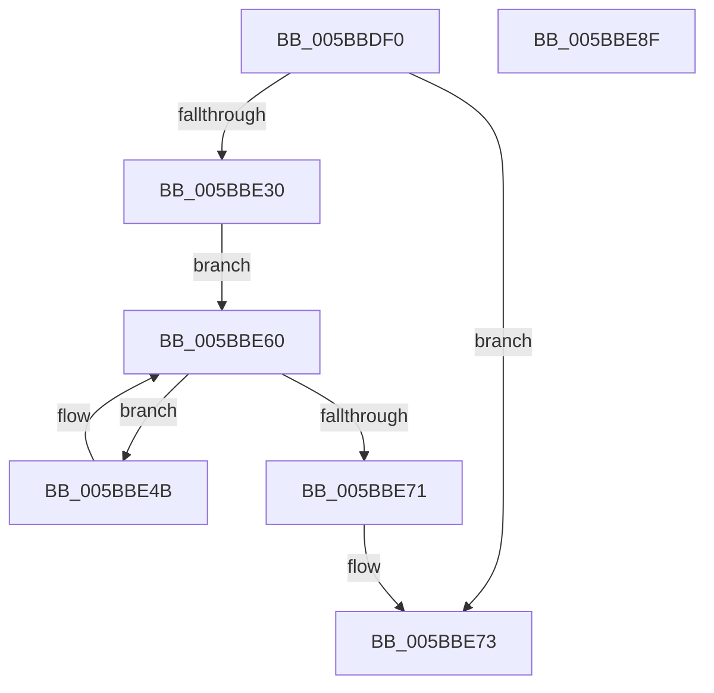

# KeQueryNodeActiveProcessorCount

- RVA: `0x005BBDF0`–`0x005BBE90` (길이 `160` bytes)
- VA: `0x00000001405BBDF0`
- 실행 섹션: `.text`
- PDB 이름 있음: `예`; PDB Function 태그: `아니요`
- unwind 정보 RVA: `0x000C40C4`
- 디코드: `45`개 명령, `160/160` bytes 표시
- 미해석 바이트: `0` (있으면 어셈블리에 `.byte`로 보존)

> 이 문서는 커널 이미지의 기계어와 PDB 기호를 분석해 생성했습니다. 4번과 5번은 함수 원형과 자료형을 바이너리 사용 방식에서 추정한 C 해석이며 원본 소스 복구 결과는 아닙니다.

## 1. Dependencies

- 직접 호출 지점: **4**; 고유 호출 대상: **4**
- 직접 호출자로 확인된 함수: **1**
- RIP 상대 이미지 참조: **3**

### Outgoing calls
- `0x005BBE44` → [KeInitializeSchedulerSubNodeEnumerationContext](../41/KeInitializeSchedulerSubNodeEnumerationContext_function_0041E4B0.md) (function, `0x0041E4B0`)
- `0x005BBE55` → [KiQuerySubNodeActiveAffinity](../43/KiQuerySubNodeActiveAffinity_function_0043F060.md) (function, `0x0043F060`)
- `0x005BBE68` → [KeEnumerateNextSchedulerSubNodeInNode](../25/KeEnumerateNextSchedulerSubNodeInNode_function_002566D8.md) (function, `0x002566D8`)
- `0x005BBE7A` → [_security_check_cookie](../6A/_security_check_cookie_function_006AC640.md) (function, `0x006AC640`)

### Direct callers
- [ExpGetNodeSubQueueConcurrencyCount](../65/ExpGetNodeSubQueueConcurrencyCount_function_0065A534.md) at `0x0065A546`

### Static image references
- `0x005BBE02` → RVA `0x00E0A740` (`.data`; read)
- `0x005BBE14` → RVA `0x00FC5000` (`ALMOSTRO`; read)
- `0x005BBE33` → RVA `0x00FCF6C0` (`CACHEALI`; read)

## 2. Other-region calls and transfers

- 다른 실행 섹션으로 향하는 call: **0**
- 별도 외부 분기/꼬리 이동을 확인하지 못했습니다.

## 3. Assembly (complete function range)

```asm
005BBDF0  48 89 5C 24 10                  mov qword ptr [rsp + 0x10], rbx
005BBDF5  48 89 7C 24 18                  mov qword ptr [rsp + 0x18], rdi
005BBDFA  55                              push rbp
005BBDFB  48 8B EC                        mov rbp, rsp
005BBDFE  48 83 EC 50                     sub rsp, 0x50
005BBE02  48 8B 05 37 E9 84 00            mov rax, qword ptr [rip + 0x84e937]
005BBE09  48 33 C4                        xor rax, rsp
005BBE0C  48 89 45 F8                     mov qword ptr [rbp - 8], rax
005BBE10  33 FF                           xor edi, edi
005BBE12  33 C0                           xor eax, eax
005BBE14  66 3B 0D E5 91 A0 00            cmp cx, word ptr [rip + 0xa091e5]
005BBE1B  0F 57 C0                        xorps xmm0, xmm0
005BBE1E  0F 11 45 E0                     movups xmmword ptr [rbp - 0x20], xmm0
005BBE22  48 89 45 F0                     mov qword ptr [rbp - 0x10], rax
005BBE26  48 89 7D D8                     mov qword ptr [rbp - 0x28], rdi
005BBE2A  66 89 7D D0                     mov word ptr [rbp - 0x30], di
005BBE2E  73 43                           jae 0x1405bbe73
005BBE30  0F B7 D1                        movzx edx, cx
005BBE33  48 8D 05 86 38 A1 00            lea rax, [rip + 0xa13886]
005BBE3A  48 8D 4D E0                     lea rcx, [rbp - 0x20]
005BBE3E  8B DF                           mov ebx, edi
005BBE40  48 8B 14 D0                     mov rdx, qword ptr [rax + rdx*8]
005BBE44  E8 67 26 E6 FF                  call 0x14041e4b0
005BBE49  EB 15                           jmp 0x1405bbe60
005BBE4B  48 8B 4D D8                     mov rcx, qword ptr [rbp - 0x28]
005BBE4F  4C 8D 45 D0                     lea r8, [rbp - 0x30]
005BBE53  33 D2                           xor edx, edx
005BBE55  E8 06 32 E8 FF                  call 0x14043f060
005BBE5A  0F B7 4D D0                     movzx ecx, word ptr [rbp - 0x30]
005BBE5E  03 D9                           add ebx, ecx
005BBE60  48 8D 55 D8                     lea rdx, [rbp - 0x28]
005BBE64  48 8D 4D E0                     lea rcx, [rbp - 0x20]
005BBE68  E8 6B A8 C9 FF                  call 0x1402566d8
005BBE6D  85 C0                           test eax, eax
005BBE6F  74 DA                           je 0x1405bbe4b
005BBE71  8B C3                           mov eax, ebx
005BBE73  48 8B 4D F8                     mov rcx, qword ptr [rbp - 8]
005BBE77  48 33 CC                        xor rcx, rsp
005BBE7A  E8 C1 07 0F 00                  call 0x1406ac640
005BBE7F  48 8B 5C 24 68                  mov rbx, qword ptr [rsp + 0x68]
005BBE84  48 8B 7C 24 70                  mov rdi, qword ptr [rsp + 0x70]
005BBE89  48 83 C4 50                     add rsp, 0x50
005BBE8D  5D                              pop rbp
005BBE8E  C3                              ret
005BBE8F  CC                              int3
```

## 4. C-style interpretation (structured pseudocode)

```c
__int64 __fastcall KeQueryNodeActiveProcessorCount(unsigned __int16 a1)
{
    __int64 result;
    __int64 v_rbx;
    __int64 v_rdi;
    __int64 v_rsp;
    unsigned __int64 v_stack_m10;
    unsigned __int64 v_stack_m18;
    unsigned __int64 v_stack_m28;
    unsigned __int64 v_stack_m30;
    unsigned __int16 v_stack_m38;
    unsigned __int64 v_stack_p10;
    unsigned __int64 v_stack_p18;

    v_stack_p10 = v_rbx;
    v_stack_p18 = v_rdi;
    v_rsp = (v_rsp) - (80);
    result = (*(unsigned __int64 *)(v_rip + 8710455)) ^ (v_rsp);
    v_stack_m10 = result;
    v_rdi = 0;
    result = 0;
    v_stack_m28 = v_xmm0;
    v_stack_m18 = 0;
    v_stack_m30 = 0;
    v_stack_m38 = 0;
    if (a1 >= (*(unsigned __int16 *)(v_rip + 10523109))) goto loc_005BBE73;
    result = KeInitializeSchedulerSubNodeEnumerationContext(v_stack_m28, *(unsigned __int64 *)(v_rip + 10565766 + a1 * 8), a3, a4);
    goto loc_005BBE60;
loc_005BBE4B:
    a2 = 0;
    result = KiQuerySubNodeActiveAffinity(v_stack_m30, a2, v_stack_m38, a4);
    v_rbx = (unsigned int)((0) + ((unsigned int)(v_stack_m38)));
loc_005BBE60:
    result = KeEnumerateNextSchedulerSubNodeInNode(v_stack_m28, v_stack_m30, v_stack_m38, a4);
    if ((unsigned int)(result) == 0) goto loc_005BBE4B;
loc_005BBE73:
    a1 = (v_stack_m10) ^ (v_rsp);
    result = _security_check_cookie(a1, v_stack_m30, v_stack_m38, a4);
    v_rsp = (v_rsp) + (80);
    return result;
}
```

## 5. (Beta) C Style

```c
int64_t KeQueryNodeActiveProcessorCount(uint16_t Arg1)
{
    int64_t result;
    int64_t local_rbx;
    int64_t local_rdi;
    int64_t local_rsp;
    uint64_t v_stack_m10;
    uint64_t v_stack_m18;
    uint64_t v_stack_m28;
    uint64_t v_stack_m30;
    uint16_t v_stack_m38;
    uint64_t v_stack_p10;
    uint64_t v_stack_p18;

    v_stack_p10 = local_rbx;
    v_stack_p18 = local_rdi;
    local_rsp = (local_rsp) - (80);
    result = (*(uint64_t *)(v_rip + 0x84E937)) ^ (local_rsp);
    v_stack_m10 = result;
    local_rdi = 0;
    result = 0;
    v_stack_m28 = v_xmm0;
    v_stack_m18 = 0;
    v_stack_m30 = 0;
    v_stack_m38 = 0;
    if (Arg1 >= (*(uint16_t *)(v_rip + 0xA091E5))) goto loc_005BBE73;
    result = KeInitializeSchedulerSubNodeEnumerationContext(v_stack_m28, *(uint64_t *)(v_rip + 0xA13886 + Arg1 * 8), a3, a4);
    goto loc_005BBE60;
loc_005BBE4B:
    a2 = 0;
    result = KiQuerySubNodeActiveAffinity(v_stack_m30, a2, v_stack_m38, a4);
    local_rbx = (uint32_t)((0) + ((uint32_t)(v_stack_m38)));
loc_005BBE60:
    result = KeEnumerateNextSchedulerSubNodeInNode(v_stack_m28, v_stack_m30, v_stack_m38, a4);
    if ((uint32_t)(result) == 0) goto loc_005BBE4B;
loc_005BBE73:
    Arg1 = (v_stack_m10) ^ (local_rsp);
    result = _security_check_cookie(Arg1, v_stack_m30, v_stack_m38, a4);
    local_rsp = (local_rsp) + (80);
    return result;
}
```

## 6. Execution-region graph

[열기: 2D/3D 그래프와 함수 탐색 컨트롤 패널](../../../control-panel.html?section=text&rva=0x005BBDF0&view=graph)

- 2D 그래프는 위에서 아래로 흐르고, 3D 그래프는 빈 공간을 드래그해 회전합니다. Shift+드래그는 이동, 휠은 확대·축소, 함수 노드 선택은 대상 보고서 이동입니다.

### Static fallback


