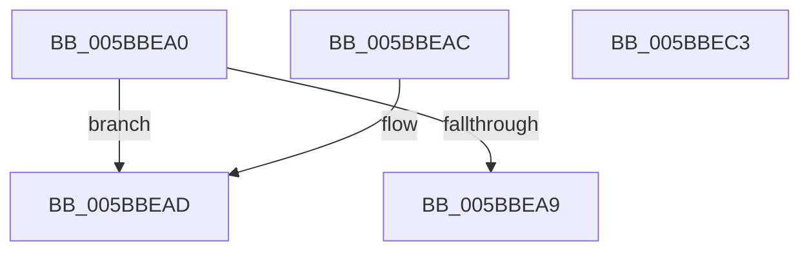

# KeQueryNodeMaximumProcessorCount

- RVA: `0x005BBEA0`–`0x005BBEC4` (길이 `36` bytes)
- VA: `0x00000001405BBEA0`
- 실행 섹션: `.text`
- PDB 이름 있음: `예`; PDB Function 태그: `아니요`
- unwind 정보 RVA: `0x000DB714`
- 디코드: `12`개 명령, `36/36` bytes 표시
- 미해석 바이트: `0` (있으면 어셈블리에 `.byte`로 보존)

> 이 문서는 커널 이미지의 기계어와 PDB 기호를 분석해 생성했습니다. 4번과 5번은 함수 원형과 자료형을 바이너리 사용 방식에서 추정한 C 해석이며 원본 소스 복구 결과는 아닙니다.

## 1. Dependencies

- 직접 호출 지점: **0**; 고유 호출 대상: **0**
- 직접 호출자로 확인된 함수: **0**
- RIP 상대 이미지 참조: **2**

### Outgoing calls
- 직접 디코드된 call 명령이 없습니다.

### Direct callers
- 이 함수 시작 RVA로 연결되는 직접 call은 확인되지 않았습니다. 간접 호출은 완전히 역산할 수 없습니다.

### Static image references
- `0x005BBEA0` → RVA `0x00FC5000` (`ALMOSTRO`; read)
- `0x005BBEB3` → RVA `0x00FCF6C0` (`CACHEALI`; read)

## 2. Other-region calls and transfers

- 다른 실행 섹션으로 향하는 call: **0**
- 별도 외부 분기/꼬리 이동을 확인하지 못했습니다.

## 3. Assembly (complete function range)

```asm
005BBEA0  66 3B 0D 59 91 A0 00            cmp cx, word ptr [rip + 0xa09159]
005BBEA7  72 04                           jb 0x1405bbead
005BBEA9  33 C0                           xor eax, eax
005BBEAB  C3                              ret
005BBEAC  CC                              int3
005BBEAD  0F AE E8                        lfence
005BBEB0  0F B7 C1                        movzx eax, cx
005BBEB3  48 8D 0D 06 38 A1 00            lea rcx, [rip + 0xa13806]
005BBEBA  48 8B 04 C1                     mov rax, qword ptr [rcx + rax*8]
005BBEBE  0F B7 40 08                     movzx eax, word ptr [rax + 8]
005BBEC2  C3                              ret
005BBEC3  CC                              int3
```

## 4. C-style interpretation (structured pseudocode)

```c
__int64 __fastcall KeQueryNodeMaximumProcessorCount(unsigned __int16 a1)
{
    __int64 result;

    if (a1 < (*(unsigned __int16 *)(v_rip + 10522969))) goto loc_005BBEAD;
    result = 0;
    return result;
loc_005BBEAD:
    return *(unsigned __int16 *)(*(unsigned __int64 *)(v_rip + 10565638 + a1 * 8) + 8);
}
```

## 5. (Beta) C Style

```c
int64_t KeQueryNodeMaximumProcessorCount(uint16_t Arg1)
{
    int64_t result;

    if (Arg1 < (*(uint16_t *)(v_rip + 0xA09159))) goto loc_005BBEAD;
    result = 0;
    return result;
loc_005BBEAD:
    return *(uint16_t *)(*(uint64_t *)(v_rip + 0xA13806 + Arg1 * 8) + 0x8);
}
```

## 6. Execution-region graph

[열기: 2D/3D 그래프와 함수 탐색 컨트롤 패널](../../../control-panel.html?section=text&rva=0x005BBEA0&view=graph)

- 2D 그래프는 위에서 아래로 흐르고, 3D 그래프는 빈 공간을 드래그해 회전합니다. Shift+드래그는 이동, 휠은 확대·축소, 함수 노드 선택은 대상 보고서 이동입니다.

### Static fallback


