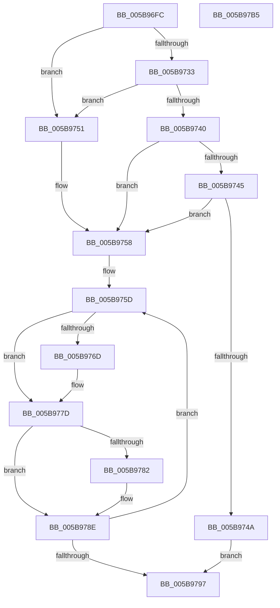

# KeQueryProcessAvailableCpus

- RVA: `0x005B96FC`–`0x005B97B6` (길이 `186` bytes)
- VA: `0x00000001405B96FC`
- 실행 섹션: `.text`
- PDB 이름 있음: `예`; PDB Function 태그: `아니요`
- unwind 정보 RVA: `0x00060300`
- 디코드: `56`개 명령, `186/186` bytes 표시
- 미해석 바이트: `0` (있으면 어셈블리에 `.byte`로 보존)

> 이 문서는 커널 이미지의 기계어와 PDB 기호를 분석해 생성했습니다. 4번과 5번은 함수 원형과 자료형을 바이너리 사용 방식에서 추정한 C 해석이며 원본 소스 복구 결과는 아닙니다.

## 1. Dependencies

- 직접 호출 지점: **4**; 고유 호출 대상: **4**
- 직접 호출자로 확인된 함수: **2**
- RIP 상대 이미지 참조: **2**

### Outgoing calls
- `0x005B9753` → [KiUpdateProcessAvailableCpuState](../3C/KiUpdateProcessAvailableCpuState_function_003C00B4.md) (function, `0x003C00B4`)
- `0x005B9760` → [RtlBeginReadTickLock](../39/RtlBeginReadTickLock_function_0039D2A0.md) (function, `0x0039D2A0`)
- `0x005B9778` → [KiCopyAffinityEx](../2C/KiCopyAffinityEx_function_002CE860.md) (function, `0x002CE860`)
- `0x005B9786` → [KeCountSetBitsAffinityEx](../2C/KeCountSetBitsAffinityEx_function_002CE6E0.md) (function, `0x002CE6E0`)

### Direct callers
- [PsQueryProcessAvailableCpus](../5E/PsQueryProcessAvailableCpus_function_005E32C0.md) at `0x005E32ED`
- [PsQueryProcessAvailableCpusCount](../5E/PsQueryProcessAvailableCpusCount_function_005E3310.md) at `0x005E3330`

### Static image references
- `0x005B9726` → RVA `0x00FC6BF8` (`ALMOSTRO`; read)
- `0x005B9733` → RVA `0x00F23458` (`.data`; read)

## 2. Other-region calls and transfers

- 다른 실행 섹션으로 향하는 call: **0**
- 별도 외부 분기/꼬리 이동을 확인하지 못했습니다.

## 3. Assembly (complete function range)

```asm
005B96FC  48 89 5C 24 08                  mov qword ptr [rsp + 8], rbx
005B9701  48 89 6C 24 10                  mov qword ptr [rsp + 0x10], rbp
005B9706  48 89 74 24 18                  mov qword ptr [rsp + 0x18], rsi
005B970B  57                              push rdi
005B970C  41 56                           push r14
005B970E  41 57                           push r15
005B9710  48 83 EC 20                     sub rsp, 0x20
005B9714  48 8B B9 C0 01 00 00            mov rdi, qword ptr [rcx + 0x1c0]
005B971B  33 DB                           xor ebx, ebx
005B971D  4D 8B F9                        mov r15, r9
005B9720  48 8B EA                        mov rbp, rdx
005B9723  48 8B 37                        mov rsi, qword ptr [rdi]
005B9726  48 8B 05 CB D4 A0 00            mov rax, qword ptr [rip + 0xa0d4cb]
005B972D  48 39 47 08                     cmp qword ptr [rdi + 8], rax
005B9731  75 1E                           jne 0x1405b9751
005B9733  48 8B 05 1E 9D 96 00            mov rax, qword ptr [rip + 0x969d1e]
005B973A  48 39 47 10                     cmp qword ptr [rdi + 0x10], rax
005B973E  75 11                           jne 0x1405b9751
005B9740  4D 85 C0                        test r8, r8
005B9743  74 13                           je 0x1405b9758
005B9745  49 39 30                        cmp qword ptr [r8], rsi
005B9748  75 0E                           jne 0x1405b9758
005B974A  BB 32 00 00 80                  mov ebx, 0x80000032
005B974F  EB 46                           jmp 0x1405b9797
005B9751  33 D2                           xor edx, edx
005B9753  E8 5C 69 E0 FF                  call 0x1403c00b4
005B9758  4C 8B 74 24 60                  mov r14, qword ptr [rsp + 0x60]
005B975D  48 8B CF                        mov rcx, rdi
005B9760  E8 3B 3B DE FF                  call 0x14039d2a0
005B9765  48 8B F0                        mov rsi, rax
005B9768  48 85 ED                        test rbp, rbp
005B976B  74 10                           je 0x1405b977d
005B976D  4C 8B 47 18                     mov r8, qword ptr [rdi + 0x18]
005B9771  48 8B CD                        mov rcx, rbp
005B9774  0F B7 55 02                     movzx edx, word ptr [rbp + 2]
005B9778  E8 E3 50 D1 FF                  call 0x1402ce860
005B977D  4D 85 F6                        test r14, r14
005B9780  74 0C                           je 0x1405b978e
005B9782  48 8B 4F 18                     mov rcx, qword ptr [rdi + 0x18]
005B9786  E8 55 4F D1 FF                  call 0x1402ce6e0
005B978B  41 89 06                        mov dword ptr [r14], eax
005B978E  90                              nop
005B978F  48 8B 0F                        mov rcx, qword ptr [rdi]
005B9792  48 3B CE                        cmp rcx, rsi
005B9795  75 C6                           jne 0x1405b975d
005B9797  48 8B 6C 24 48                  mov rbp, qword ptr [rsp + 0x48]
005B979C  8B C3                           mov eax, ebx
005B979E  48 8B 5C 24 40                  mov rbx, qword ptr [rsp + 0x40]
005B97A3  49 89 37                        mov qword ptr [r15], rsi
005B97A6  48 8B 74 24 50                  mov rsi, qword ptr [rsp + 0x50]
005B97AB  48 83 C4 20                     add rsp, 0x20
005B97AF  41 5F                           pop r15
005B97B1  41 5E                           pop r14
005B97B3  5F                              pop rdi
005B97B4  C3                              ret
005B97B5  CC                              int3
```

## 4. C-style interpretation (structured pseudocode)

```c
__int64 __fastcall KeQueryProcessAvailableCpus(__int64 a1, __int64 a2, __int64 a3, __int64 a4, __int64 a5)
{
    __int64 result;
    __int64 v_rbx;
    __int64 v_rsp;
    unsigned __int64 v_stack_p10;
    unsigned __int64 v_stack_p18;
    unsigned __int64 v_stack_p8;

    v_stack_p8 = v_rbx;
    v_stack_p10 = v_rbp;
    v_stack_p18 = v_rsi;
    v_rsp = (v_rsp) - (32);
    v_rbx = 0;
    if ((*(unsigned __int64 *)(*(unsigned __int64 *)(a1 + 448) + 8)) != (*(unsigned __int64 *)(v_rip + 10540235))) goto loc_005B9751;
    if ((*(unsigned __int64 *)(*(unsigned __int64 *)(a1 + 448) + 16)) != (*(unsigned __int64 *)(v_rip + 9870622))) goto loc_005B9751;
    if (a3 == 0) goto loc_005B9758;
    if ((*(unsigned __int64 *)(a3)) != (*(unsigned __int64 *)(*(unsigned __int64 *)(a1 + 448)))) goto loc_005B9758;
    goto loc_005B9797;
loc_005B9751:
    a2 = 0;
    result = KiUpdateProcessAvailableCpuState(a1, a2, a3, a4);
loc_005B9758:
loc_005B975D:
    result = RtlBeginReadTickLock(*(unsigned __int64 *)(a1 + 448), a2, a3, a4);
    if (0 != 0) {
        a3 = *(unsigned __int64 *)(*(unsigned __int64 *)(a1 + 448) + 24);
        a1 = 0;
        a2 = *(unsigned __int16 *)(a2 + 2);
        result = KiCopyAffinityEx(a1, a2, a3, a4);
    }
    if (a5 != 0) {
        a1 = *(unsigned __int64 *)(*(unsigned __int64 *)(a1 + 448) + 24);
        result = KeCountSetBitsAffinityEx(a1, a2, a3, a4);
        *(unsigned int *)(a5) = (unsigned int)(result);
    }
    if ((*(unsigned __int64 *)(*(unsigned __int64 *)(a1 + 448))) != result) goto loc_005B975D;
loc_005B9797:
    *(unsigned __int64 *)(a4) = result;
    v_rsp = (v_rsp) + (32);
    return (unsigned int)((unsigned int)((unsigned int)(0x80000032ULL)));
}
```

## 5. (Beta) C Style

```c
int64_t KeQueryProcessAvailableCpus(void *Arg1, int64_t Arg2, int64_t Arg3, void *Arg4, int64_t Arg5)
{
    uint8_t *arg1 = (uint8_t *)Arg1;
    uint8_t *arg4 = (uint8_t *)Arg4;

    int64_t result;
    int64_t local_rbx;
    int64_t local_rsp;
    uint64_t v_stack_p10;
    uint64_t v_stack_p18;
    uint64_t v_stack_p8;

    v_stack_p8 = local_rbx;
    v_stack_p10 = local_rbp;
    v_stack_p18 = local_rsi;
    local_rsp = (local_rsp) - (32);
    local_rbx = 0;
    if ((*(uint64_t *)(*(uint64_t *)(arg1 + 0x1C0) + 0x8)) != (*(uint64_t *)(v_rip + 0xA0D4CB))) goto loc_005B9751;
    if ((*(uint64_t *)(*(uint64_t *)(arg1 + 0x1C0) + 0x10)) != (*(uint64_t *)(v_rip + 0x969D1E))) goto loc_005B9751;
    if (Arg3 == 0) goto loc_005B9758;
    if ((*(uint64_t *)(Arg3)) != (*(uint64_t *)(*(uint64_t *)(arg1 + 0x1C0)))) goto loc_005B9758;
    goto loc_005B9797;
loc_005B9751:
    Arg2 = 0;
    result = KiUpdateProcessAvailableCpuState(Arg1, Arg2, Arg3, Arg4);
loc_005B9758:
loc_005B975D:
    result = RtlBeginReadTickLock(*(uint64_t *)(arg1 + 0x1C0), Arg2, Arg3, Arg4);
    if (0 != 0) {
        Arg3 = *(uint64_t *)(*(uint64_t *)(arg1 + 0x1C0) + 0x18);
        Arg1 = 0;
        Arg2 = *(uint16_t *)(Arg2 + 0x2);
        result = KiCopyAffinityEx(Arg1, Arg2, Arg3, Arg4);
    }
    if (Arg5 != 0) {
        Arg1 = *(uint64_t *)(*(uint64_t *)(arg1 + 0x1C0) + 0x18);
        result = KeCountSetBitsAffinityEx(Arg1, Arg2, Arg3, Arg4);
        *(uint32_t *)(Arg5) = (uint32_t)(result);
    }
    if ((*(uint64_t *)(*(uint64_t *)(arg1 + 0x1C0))) != result) goto loc_005B975D;
loc_005B9797:
    *(uint64_t *)(arg4) = result;
    local_rsp = (local_rsp) + (32);
    return (uint32_t)((uint32_t)((uint32_t)(0x80000032ULL)));
}
```

### 관측된 메모리 오프셋

구조체 형식이 확인되지 않은 접근은 인자 기준의 오프셋으로만 기록했습니다.

| 기준 인자 | 오프셋 표현 | 폭 (bit) | 접근 |
|---|---:|---:|---|
| `Arg1` | `+ 0x1C0` | `64` | `R` |
| `Arg4` | `+ 0x0` | `64` | `W` |

## 6. Execution-region graph

[열기: 2D/3D 그래프와 함수 탐색 컨트롤 패널](../../../control-panel.html?section=text&rva=0x005B96FC&view=graph)

- 2D 그래프는 위에서 아래로 흐르고, 3D 그래프는 빈 공간을 드래그해 회전합니다. Shift+드래그는 이동, 휠은 확대·축소, 함수 노드 선택은 대상 보고서 이동입니다.

### Static fallback


