# KeQuerySecureSpeculationInformation

- RVA: `0x005BEA14`–`0x005BEB5D` (길이 `329` bytes)
- VA: `0x00000001405BEA14`
- 실행 섹션: `.text`
- PDB 이름 있음: `예`; PDB Function 태그: `아니요`
- unwind 정보 RVA: `0x000CA584`
- 디코드: `104`개 명령, `329/329` bytes 표시
- 미해석 바이트: `0` (있으면 어셈블리에 `.byte`로 보존)

> 이 문서는 커널 이미지의 기계어와 PDB 기호를 분석해 생성했습니다. 4번과 5번은 함수 원형과 자료형을 바이너리 사용 방식에서 추정한 C 해석이며 원본 소스 복구 결과는 아닙니다.

## 1. Dependencies

- 직접 호출 지점: **5**; 고유 호출 대상: **4**
- 직접 호출자로 확인된 함수: **1**
- RIP 상대 이미지 참조: **1**

### Outgoing calls
- `0x005BEA44` → [memset](../6C/memset_function_006C6C40.md) (function, `0x006C6C40`)
- `0x005BEA4B` → [HvlQueryVsmConnection](../45/HvlQueryVsmConnection_function_0045D180.md) (function, `0x0045D180`)
- `0x005BEA63` → [VslpEnterIumSecureMode](../23/VslpEnterIumSecureMode_function_00235E50.md) (function, `0x00235E50`)
- `0x005BEA85` → [memset](../6C/memset_function_006C6C40.md) (function, `0x006C6C40`)
- `0x005BEB4C` → [_security_check_cookie](../6A/_security_check_cookie_function_006AC640.md) (function, `0x006AC640`)

### Direct callers
- [ExpQuerySystemInformation](../../page/A5/ExpQuerySystemInformation_function_00A57858.md) at `0x00A5B26A`

### Static image references
- `0x005BEA1F` → RVA `0x00E0A740` (`.data`; read)

## 2. Other-region calls and transfers

- 다른 실행 섹션으로 향하는 call: **0**
- 별도 외부 분기/꼬리 이동을 확인하지 못했습니다.

## 3. Assembly (complete function range)

```asm
005BEA14  40 53                           push rbx
005BEA16  56                              push rsi
005BEA17  57                              push rdi
005BEA18  48 81 EC A0 00 00 00            sub rsp, 0xa0
005BEA1F  48 8B 05 1A BD 84 00            mov rax, qword ptr [rip + 0x84bd1a]
005BEA26  48 33 C4                        xor rax, rsp
005BEA29  48 89 84 24 90 00 00 00         mov qword ptr [rsp + 0x90], rax
005BEA31  49 8B F0                        mov rsi, r8
005BEA34  8B FA                           mov edi, edx
005BEA36  48 8B D9                        mov rbx, rcx
005BEA39  33 D2                           xor edx, edx
005BEA3B  44 8D 42 68                     lea r8d, [rdx + 0x68]
005BEA3F  48 8D 4C 24 20                  lea rcx, [rsp + 0x20]
005BEA44  E8 F7 81 10 00                  call 0x1406c6c40
005BEA49  33 C9                           xor ecx, ecx
005BEA4B  E8 30 E7 E9 FF                  call 0x14045d180
005BEA50  84 C0                           test al, al
005BEA52  74 14                           je 0x1405bea68
005BEA54  BA 02 01 00 00                  mov edx, 0x102
005BEA59  4C 8D 4C 24 20                  lea r9, [rsp + 0x20]
005BEA5E  45 33 C0                        xor r8d, r8d
005BEA61  B1 02                           mov cl, 2
005BEA63  E8 E8 73 C7 FF                  call 0x140235e50
005BEA68  C7 06 08 00 00 00               mov dword ptr [rsi], 8
005BEA6E  83 FF 04                        cmp edi, 4
005BEA71  73 0A                           jae 0x1405bea7d
005BEA73  B8 04 00 00 C0                  mov eax, 0xc0000004
005BEA78  E9 C4 00 00 00                  jmp 0x1405beb41
005BEA7D  4C 8B C7                        mov r8, rdi
005BEA80  33 D2                           xor edx, edx
005BEA82  48 8B CB                        mov rcx, rbx
005BEA85  E8 B6 81 10 00                  call 0x1406c6c40
005BEA8A  8B 4C 24 30                     mov ecx, dword ptr [rsp + 0x30]
005BEA8E  F6 C1 01                        test cl, 1
005BEA91  74 03                           je 0x1405bea96
005BEA93  83 0B 01                        or dword ptr [rbx], 1
005BEA96  F6 C1 02                        test cl, 2
005BEA99  74 03                           je 0x1405bea9e
005BEA9B  83 0B 02                        or dword ptr [rbx], 2
005BEA9E  F6 C1 04                        test cl, 4
005BEAA1  74 0A                           je 0x1405beaad
005BEAA3  83 0B 04                        or dword ptr [rbx], 4
005BEAA6  8B 03                           mov eax, dword ptr [rbx]
005BEAA8  83 E0 F7                        and eax, 0xfffffff7
005BEAAB  EB 0D                           jmp 0x1405beaba
005BEAAD  F6 C1 08                        test cl, 8
005BEAB0  74 0A                           je 0x1405beabc
005BEAB2  83 0B 08                        or dword ptr [rbx], 8
005BEAB5  8B 03                           mov eax, dword ptr [rbx]
005BEAB7  83 E0 FB                        and eax, 0xfffffffb
005BEABA  89 03                           mov dword ptr [rbx], eax
005BEABC  B8 00 01 00 00                  mov eax, 0x100
005BEAC1  85 C8                           test eax, ecx
005BEAC3  74 03                           je 0x1405beac8
005BEAC5  83 0B 40                        or dword ptr [rbx], 0x40
005BEAC8  BA 00 02 00 00                  mov edx, 0x200
005BEACD  85 CA                           test edx, ecx
005BEACF  74 04                           je 0x1405bead5
005BEAD1  0F BA 2B 07                     bts dword ptr [rbx], 7
005BEAD5  41 B8 00 04 00 00               mov r8d, 0x400
005BEADB  41 85 C8                        test r8d, ecx
005BEADE  74 02                           je 0x1405beae2
005BEAE0  09 03                           or dword ptr [rbx], eax
005BEAE2  41 B9 00 20 00 00               mov r9d, 0x2000
005BEAE8  41 85 C9                        test r9d, ecx
005BEAEB  74 02                           je 0x1405beaef
005BEAED  09 13                           or dword ptr [rbx], edx
005BEAEF  BA 00 40 00 00                  mov edx, 0x4000
005BEAF4  85 CA                           test edx, ecx
005BEAF6  74 03                           je 0x1405beafb
005BEAF8  44 09 03                        or dword ptr [rbx], r8d
005BEAFB  B8 00 80 00 00                  mov eax, 0x8000
005BEB00  85 C8                           test eax, ecx
005BEB02  74 04                           je 0x1405beb08
005BEB04  0F BA 2B 0B                     bts dword ptr [rbx], 0xb
005BEB08  0F BA E1 0B                     bt ecx, 0xb
005BEB0C  73 04                           jae 0x1405beb12
005BEB0E  0F BA 2B 0C                     bts dword ptr [rbx], 0xc
005BEB12  0F BA E1 0C                     bt ecx, 0xc
005BEB16  73 03                           jae 0x1405beb1b
005BEB18  44 09 0B                        or dword ptr [rbx], r9d
005BEB1B  0F BA E1 10                     bt ecx, 0x10
005BEB1F  73 03                           jae 0x1405beb24
005BEB21  83 0B 20                        or dword ptr [rbx], 0x20
005BEB24  0F BA E1 11                     bt ecx, 0x11
005BEB28  73 03                           jae 0x1405beb2d
005BEB2A  83 0B 10                        or dword ptr [rbx], 0x10
005BEB2D  0F BA E1 12                     bt ecx, 0x12
005BEB31  73 02                           jae 0x1405beb35
005BEB33  09 13                           or dword ptr [rbx], edx
005BEB35  0F BA E1 13                     bt ecx, 0x13
005BEB39  73 02                           jae 0x1405beb3d
005BEB3B  09 03                           or dword ptr [rbx], eax
005BEB3D  33 C0                           xor eax, eax
005BEB3F  EB 00                           jmp 0x1405beb41
005BEB41  48 8B 8C 24 90 00 00 00         mov rcx, qword ptr [rsp + 0x90]
005BEB49  48 33 CC                        xor rcx, rsp
005BEB4C  E8 EF DA 0E 00                  call 0x1406ac640
005BEB51  48 81 C4 A0 00 00 00            add rsp, 0xa0
005BEB58  5F                              pop rdi
005BEB59  5E                              pop rsi
005BEB5A  5B                              pop rbx
005BEB5B  C3                              ret
005BEB5C  CC                              int3
```

## 4. C-style interpretation (structured pseudocode)

```c
__int64 __fastcall KeQuerySecureSpeculationInformation(__int64 a1, int a2, __int64 a3)
{
    __int64 result;
    __int64 v_rsp;
    unsigned __int64 v_stack_m28;
    unsigned int v_stack_m88;
    unsigned __int64 v_stack_m98;

    v_rsp = (v_rsp) - (160);
    result = (*(unsigned __int64 *)(v_rip + 8699162)) ^ (v_rsp);
    v_stack_m28 = result;
    a2 = 0;
    result = memset(v_stack_m98, a2, a2 + 104, a4);
    a1 = 0;
    result = HvlQueryVsmConnection(a1, a2, a2 + 104, a4);
    if ((unsigned __int8)(result) != 0) {
        a2 = 258;
        a4 = v_stack_m98;
        a3 = 0;
        a1 = 2;
        result = VslpEnterIumSecureMode(a1, a2, a3, a4);
    }
    *(unsigned int *)(a3) = 8;
    if (((unsigned int)((unsigned int)(a2))) >= 4) goto loc_005BEA7D;
    goto loc_005BEB41;
loc_005BEA7D:
    a2 = 0;
    result = memset(a1, a2, (unsigned int)(a2), a4);
    if ((((unsigned __int8)((unsigned int)(v_stack_m88))) & (1)) != 0) {
    }
    if ((((unsigned __int8)((unsigned int)(v_stack_m88))) & (2)) != 0) {
    }
    if ((((unsigned __int8)((unsigned int)(v_stack_m88))) & (4)) == 0) goto loc_005BEAAD;
    result = (unsigned int)(((unsigned int)(*(unsigned int *)(a1))) & (0xFFFFFFF7ULL));
    goto loc_005BEABA;
loc_005BEAAD:
    if ((((unsigned __int8)((unsigned int)(v_stack_m88))) & (8)) == 0) goto loc_005BEABC;
    result = (unsigned int)(((unsigned int)(*(unsigned int *)(a1))) & (0xFFFFFFFBULL));
loc_005BEABA:
    *(unsigned int *)(a1) = (unsigned int)(result);
loc_005BEABC:
    if (((256) & ((unsigned int)((unsigned int)(v_stack_m88)))) != 0) {
    }
    if (((512) & ((unsigned int)((unsigned int)(v_stack_m88)))) != 0) {
    }
    if ((((unsigned int)((unsigned int)(0x400ULL))) & ((unsigned int)((unsigned int)(v_stack_m88)))) != 0) {
    }
    if ((((unsigned int)((unsigned int)(0x2000ULL))) & ((unsigned int)((unsigned int)(v_stack_m88)))) != 0) {
    }
    if ((((unsigned int)((unsigned int)(0x4000ULL))) & ((unsigned int)((unsigned int)(v_stack_m88)))) != 0) {
    }
    if ((((unsigned int)((unsigned int)(0x8000ULL))) & ((unsigned int)((unsigned int)(v_stack_m88)))) != 0) {
    }
    if (!(condition_is_above_or_equal)) {
    }
    if (!(condition_is_above_or_equal)) {
    }
    if (!(condition_is_above_or_equal)) {
    }
    if (!(condition_is_above_or_equal)) {
    }
    if (!(condition_is_above_or_equal)) {
    }
    if (!(condition_is_above_or_equal)) {
    }
    result = 0;
    goto loc_005BEB41;
loc_005BEB41:
    a1 = (v_stack_m28) ^ (v_rsp);
    result = _security_check_cookie(a1, (unsigned int)(0x4000ULL), (unsigned int)(0x400ULL), (unsigned int)(0x2000ULL));
    v_rsp = (v_rsp) + (160);
    return result;
}
```

## 5. (Beta) C Style

```c
int64_t KeQuerySecureSpeculationInformation(void *Arg1, int32_t Arg2, void *Arg3)
{
    uint8_t *arg1 = (uint8_t *)Arg1;
    uint8_t *arg3 = (uint8_t *)Arg3;

    int64_t result;
    int64_t local_rsp;
    uint64_t v_stack_m28;
    uint32_t v_stack_m88;
    uint64_t v_stack_m98;

    local_rsp = (local_rsp) - (160);
    result = (*(uint64_t *)(v_rip + 0x84BD1A)) ^ (local_rsp);
    v_stack_m28 = result;
    Arg2 = 0;
    result = memset(v_stack_m98, Arg2, Arg2 + 104, a4);
    Arg1 = 0;
    result = HvlQueryVsmConnection(Arg1, Arg2, Arg2 + 104, a4);
    if ((uint8_t)(result) != 0) {
        Arg2 = 258;
        a4 = v_stack_m98;
        Arg3 = 0;
        Arg1 = 2;
        result = VslpEnterIumSecureMode(Arg1, Arg2, Arg3, a4);
    }
    *(uint32_t *)(arg3) = 8;
    if (((uint32_t)((uint32_t)(Arg2))) >= 4) goto loc_005BEA7D;
    goto loc_005BEB41;
loc_005BEA7D:
    Arg2 = 0;
    result = memset(Arg1, Arg2, (uint32_t)(Arg2), a4);
    if ((((uint8_t)((uint32_t)(v_stack_m88))) & (1)) != 0) {
    }
    if ((((uint8_t)((uint32_t)(v_stack_m88))) & (2)) != 0) {
    }
    if ((((uint8_t)((uint32_t)(v_stack_m88))) & (4)) == 0) goto loc_005BEAAD;
    result = (uint32_t)(((uint32_t)(*(uint32_t *)(arg1))) & (0xFFFFFFF7ULL));
    goto loc_005BEABA;
loc_005BEAAD:
    if ((((uint8_t)((uint32_t)(v_stack_m88))) & (8)) == 0) goto loc_005BEABC;
    result = (uint32_t)(((uint32_t)(*(uint32_t *)(arg1))) & (0xFFFFFFFBULL));
loc_005BEABA:
    *(uint32_t *)(arg1) = (uint32_t)(result);
loc_005BEABC:
    if (((256) & ((uint32_t)((uint32_t)(v_stack_m88)))) != 0) {
    }
    if (((512) & ((uint32_t)((uint32_t)(v_stack_m88)))) != 0) {
    }
    if ((((uint32_t)((uint32_t)(0x400ULL))) & ((uint32_t)((uint32_t)(v_stack_m88)))) != 0) {
    }
    if ((((uint32_t)((uint32_t)(0x2000ULL))) & ((uint32_t)((uint32_t)(v_stack_m88)))) != 0) {
    }
    if ((((uint32_t)((uint32_t)(0x4000ULL))) & ((uint32_t)((uint32_t)(v_stack_m88)))) != 0) {
    }
    if ((((uint32_t)((uint32_t)(0x8000ULL))) & ((uint32_t)((uint32_t)(v_stack_m88)))) != 0) {
    }
    if (!(condition_is_above_or_equal)) {
    }
    if (!(condition_is_above_or_equal)) {
    }
    if (!(condition_is_above_or_equal)) {
    }
    if (!(condition_is_above_or_equal)) {
    }
    if (!(condition_is_above_or_equal)) {
    }
    if (!(condition_is_above_or_equal)) {
    }
    result = 0;
    goto loc_005BEB41;
loc_005BEB41:
    Arg1 = (v_stack_m28) ^ (local_rsp);
    result = _security_check_cookie(Arg1, (uint32_t)(0x4000ULL), (uint32_t)(0x400ULL), (uint32_t)(0x2000ULL));
    local_rsp = (local_rsp) + (160);
    return result;
}
```

### 관측된 메모리 오프셋

구조체 형식이 확인되지 않은 접근은 인자 기준의 오프셋으로만 기록했습니다.

| 기준 인자 | 오프셋 표현 | 폭 (bit) | 접근 |
|---|---:|---:|---|
| `Arg1` | `+ 0x0` | `32` | `R` |
| `Arg1` | `+ 0x0` | `32` | `R/W` |
| `Arg1` | `+ 0x0` | `32` | `W` |
| `Arg3` | `+ 0x0` | `32` | `W` |

## 6. Execution-region graph

[열기: 2D/3D 그래프와 함수 탐색 컨트롤 패널](../../../control-panel.html?section=text&rva=0x005BEA14&view=graph)

- 2D 그래프는 위에서 아래로 흐르고, 3D 그래프는 빈 공간을 드래그해 회전합니다. Shift+드래그는 이동, 휠은 확대·축소, 함수 노드 선택은 대상 보고서 이동입니다.

### Static fallback

```mermaid
flowchart TD
  bb_005BEA14[BB_005BEA14]
  bb_005BEA54[BB_005BEA54]
  bb_005BEA68[BB_005BEA68]
  bb_005BEA73[BB_005BEA73]
  bb_005BEA7D[BB_005BEA7D]
  bb_005BEA93[BB_005BEA93]
  bb_005BEA96[BB_005BEA96]
  bb_005BEA9B[BB_005BEA9B]
  bb_005BEA9E[BB_005BEA9E]
  bb_005BEAA3[BB_005BEAA3]
  bb_005BEAAD[BB_005BEAAD]
  bb_005BEAB2[BB_005BEAB2]
  bb_005BEABA[BB_005BEABA]
  bb_005BEABC[BB_005BEABC]
  bb_005BEAC5[BB_005BEAC5]
  bb_005BEAC8[BB_005BEAC8]
  bb_005BEAD1[BB_005BEAD1]
  bb_005BEAD5[BB_005BEAD5]
  bb_005BEAE0[BB_005BEAE0]
  bb_005BEAE2[BB_005BEAE2]
  bb_005BEAED[BB_005BEAED]
  bb_005BEAEF[BB_005BEAEF]
  bb_005BEAF8[BB_005BEAF8]
  bb_005BEAFB[BB_005BEAFB]
  bb_005BEB04[BB_005BEB04]
  bb_005BEB08[BB_005BEB08]
  bb_005BEB0E[BB_005BEB0E]
  bb_005BEB12[BB_005BEB12]
  bb_005BEB18[BB_005BEB18]
  bb_005BEB1B[BB_005BEB1B]
  bb_005BEB21[BB_005BEB21]
  bb_005BEB24[BB_005BEB24]
  bb_005BEB2A[BB_005BEB2A]
  bb_005BEB2D[BB_005BEB2D]
  bb_005BEB33[BB_005BEB33]
  bb_005BEB35[BB_005BEB35]
  bb_005BEB3B[BB_005BEB3B]
  bb_005BEB3D[BB_005BEB3D]
  bb_005BEB41[BB_005BEB41]
  bb_005BEB5C[BB_005BEB5C]
  bb_005BEA14 -->|branch| bb_005BEA68
  bb_005BEA14 -->|fallthrough| bb_005BEA54
  bb_005BEA54 -->|flow| bb_005BEA68
  bb_005BEA68 -->|branch| bb_005BEA7D
  bb_005BEA68 -->|fallthrough| bb_005BEA73
  bb_005BEA73 -->|branch| bb_005BEB41
  bb_005BEA7D -->|branch| bb_005BEA96
  bb_005BEA7D -->|fallthrough| bb_005BEA93
  bb_005BEA93 -->|flow| bb_005BEA96
  bb_005BEA96 -->|branch| bb_005BEA9E
  bb_005BEA96 -->|fallthrough| bb_005BEA9B
  bb_005BEA9B -->|flow| bb_005BEA9E
  bb_005BEA9E -->|branch| bb_005BEAAD
  bb_005BEA9E -->|fallthrough| bb_005BEAA3
  bb_005BEAA3 -->|branch| bb_005BEABA
  bb_005BEAAD -->|branch| bb_005BEABC
  bb_005BEAAD -->|fallthrough| bb_005BEAB2
  bb_005BEAB2 -->|flow| bb_005BEABA
  bb_005BEABA -->|flow| bb_005BEABC
  bb_005BEABC -->|branch| bb_005BEAC8
  bb_005BEABC -->|fallthrough| bb_005BEAC5
  bb_005BEAC5 -->|flow| bb_005BEAC8
  bb_005BEAC8 -->|branch| bb_005BEAD5
  bb_005BEAC8 -->|fallthrough| bb_005BEAD1
  bb_005BEAD1 -->|flow| bb_005BEAD5
  bb_005BEAD5 -->|branch| bb_005BEAE2
  bb_005BEAD5 -->|fallthrough| bb_005BEAE0
  bb_005BEAE0 -->|flow| bb_005BEAE2
  bb_005BEAE2 -->|branch| bb_005BEAEF
  bb_005BEAE2 -->|fallthrough| bb_005BEAED
  bb_005BEAED -->|flow| bb_005BEAEF
  bb_005BEAEF -->|branch| bb_005BEAFB
  bb_005BEAEF -->|fallthrough| bb_005BEAF8
  bb_005BEAF8 -->|flow| bb_005BEAFB
  bb_005BEAFB -->|branch| bb_005BEB08
  bb_005BEAFB -->|fallthrough| bb_005BEB04
  bb_005BEB04 -->|flow| bb_005BEB08
  bb_005BEB08 -->|branch| bb_005BEB12
  bb_005BEB08 -->|fallthrough| bb_005BEB0E
  bb_005BEB0E -->|flow| bb_005BEB12
  bb_005BEB12 -->|branch| bb_005BEB1B
  bb_005BEB12 -->|fallthrough| bb_005BEB18
  bb_005BEB18 -->|flow| bb_005BEB1B
  bb_005BEB1B -->|branch| bb_005BEB24
  bb_005BEB1B -->|fallthrough| bb_005BEB21
  bb_005BEB21 -->|flow| bb_005BEB24
  bb_005BEB24 -->|branch| bb_005BEB2D
  bb_005BEB24 -->|fallthrough| bb_005BEB2A
  bb_005BEB2A -->|flow| bb_005BEB2D
  bb_005BEB2D -->|branch| bb_005BEB35
  bb_005BEB2D -->|fallthrough| bb_005BEB33
  bb_005BEB33 -->|flow| bb_005BEB35
  bb_005BEB35 -->|branch| bb_005BEB3D
  bb_005BEB35 -->|fallthrough| bb_005BEB3B
  bb_005BEB3B -->|flow| bb_005BEB3D
  bb_005BEB3D -->|branch| bb_005BEB41
```


