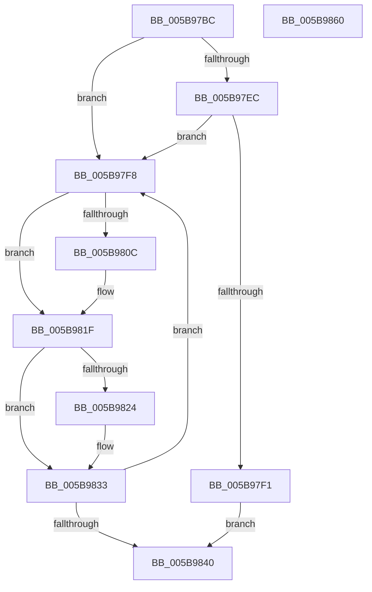

# KeQuerySystemAvailableCpus

- RVA: `0x005B97BC`–`0x005B9861` (길이 `165` bytes)
- VA: `0x00000001405B97BC`
- 실행 섹션: `.text`
- PDB 이름 있음: `예`; PDB Function 태그: `아니요`
- unwind 정보 RVA: `0x0007F3F8`
- 디코드: `46`개 명령, `165/165` bytes 표시
- 미해석 바이트: `0` (있으면 어셈블리에 `.byte`로 보존)

> 이 문서는 커널 이미지의 기계어와 PDB 기호를 분석해 생성했습니다. 4번과 5번은 함수 원형과 자료형을 바이너리 사용 방식에서 추정한 C 해석이며 원본 소스 복구 결과는 아닙니다.

## 1. Dependencies

- 직접 호출 지점: **3**; 고유 호출 대상: **3**
- 직접 호출자로 확인된 함수: **2**
- RIP 상대 이미지 참조: **2**

### Outgoing calls
- `0x005B97FF` → [RtlBeginReadTickLock](../39/RtlBeginReadTickLock_function_0039D2A0.md) (function, `0x0039D2A0`)
- `0x005B981A` → [KiCopyAffinityEx](../2C/KiCopyAffinityEx_function_002CE860.md) (function, `0x002CE860`)
- `0x005B982B` → [KeCountSetBitsAffinityEx](../2C/KeCountSetBitsAffinityEx_function_002CE6E0.md) (function, `0x002CE6E0`)

### Direct callers
- [PsQuerySystemAvailableCpus](../5E/PsQuerySystemAvailableCpus_function_005E3350.md) at `0x005E3375`
- [PsQuerySystemAvailableCpusCount](../5E/PsQuerySystemAvailableCpusCount_function_005E3390.md) at `0x005E33A8`

### Static image references
- `0x005B97D5` → RVA `0x00F23460` (`.data`; read)
- `0x005B9810` → RVA `0x00F22EA0` (`.data`; read)

## 2. Other-region calls and transfers

- 다른 실행 섹션으로 향하는 call: **0**
- 별도 외부 분기/꼬리 이동을 확인하지 못했습니다.

## 3. Assembly (complete function range)

```asm
005B97BC  48 8B C4                        mov rax, rsp
005B97BF  48 89 58 08                     mov qword ptr [rax + 8], rbx
005B97C3  48 89 70 10                     mov qword ptr [rax + 0x10], rsi
005B97C7  48 89 78 18                     mov qword ptr [rax + 0x18], rdi
005B97CB  4C 89 70 20                     mov qword ptr [rax + 0x20], r14
005B97CF  41 57                           push r15
005B97D1  48 83 EC 20                     sub rsp, 0x20
005B97D5  48 8B 3D 84 9C 96 00            mov rdi, qword ptr [rip + 0x969c84]
005B97DC  33 DB                           xor ebx, ebx
005B97DE  4D 8B F1                        mov r14, r9
005B97E1  4D 8B F8                        mov r15, r8
005B97E4  48 8B F1                        mov rsi, rcx
005B97E7  48 85 D2                        test rdx, rdx
005B97EA  74 0C                           je 0x1405b97f8
005B97EC  48 39 3A                        cmp qword ptr [rdx], rdi
005B97EF  75 07                           jne 0x1405b97f8
005B97F1  BB 32 00 00 80                  mov ebx, 0x80000032
005B97F6  EB 48                           jmp 0x1405b9840
005B97F8  48 8D 0D 61 9C 96 00            lea rcx, [rip + 0x969c61]
005B97FF  E8 9C 3A DE FF                  call 0x14039d2a0
005B9804  48 8B F8                        mov rdi, rax
005B9807  48 85 F6                        test rsi, rsi
005B980A  74 13                           je 0x1405b981f
005B980C  0F B7 56 02                     movzx edx, word ptr [rsi + 2]
005B9810  4C 8D 05 89 96 96 00            lea r8, [rip + 0x969689]
005B9817  48 8B CE                        mov rcx, rsi
005B981A  E8 41 50 D1 FF                  call 0x1402ce860
005B981F  4D 85 F6                        test r14, r14
005B9822  74 0F                           je 0x1405b9833
005B9824  48 8D 0D 75 96 96 00            lea rcx, [rip + 0x969675]
005B982B  E8 B0 4E D1 FF                  call 0x1402ce6e0
005B9830  41 89 06                        mov dword ptr [r14], eax
005B9833  90                              nop
005B9834  48 8B 0D 25 9C 96 00            mov rcx, qword ptr [rip + 0x969c25]
005B983B  48 3B CF                        cmp rcx, rdi
005B983E  75 B8                           jne 0x1405b97f8
005B9840  48 8B 74 24 38                  mov rsi, qword ptr [rsp + 0x38]
005B9845  8B C3                           mov eax, ebx
005B9847  48 8B 5C 24 30                  mov rbx, qword ptr [rsp + 0x30]
005B984C  4C 8B 74 24 48                  mov r14, qword ptr [rsp + 0x48]
005B9851  49 89 3F                        mov qword ptr [r15], rdi
005B9854  48 8B 7C 24 40                  mov rdi, qword ptr [rsp + 0x40]
005B9859  48 83 C4 20                     add rsp, 0x20
005B985D  41 5F                           pop r15
005B985F  C3                              ret
005B9860  CC                              int3
```

## 4. C-style interpretation (structured pseudocode)

```c
__int64 __fastcall KeQuerySystemAvailableCpus(__int64 a1, __int64 a2, __int64 a3, __int64 a4)
{
    __int64 result;
    __int64 v_rbx;
    __int64 v_rsp;
    unsigned __int64 v_stack_p10;
    unsigned __int64 v_stack_p18;
    unsigned __int64 v_stack_p20;
    unsigned __int64 v_stack_p8;

    *(unsigned __int64 *)(v_rsp + 8) = v_rbx;
    *(unsigned __int64 *)(v_rsp + 16) = v_rsi;
    *(unsigned __int64 *)(v_rsp + 24) = v_rdi;
    *(unsigned __int64 *)(v_rsp + 32) = v_r14;
    v_rsp = (v_rsp) - (32);
    v_rbx = 0;
    if (a2 == 0) goto loc_005B97F8;
    if ((*(unsigned __int64 *)(a2)) != (*(unsigned __int64 *)(v_rip + 9870468))) goto loc_005B97F8;
    goto loc_005B9840;
loc_005B97F8:
    result = RtlBeginReadTickLock(v_rip + 9870433, a2, a3, a4);
    if (a1 != 0) {
        a2 = *(unsigned __int16 *)(a1 + 2);
        a3 = v_rip + 9868937;
        a1 = a1;
        result = KiCopyAffinityEx(a1, a2, a3, a4);
    }
    if (a4 != 0) {
        a1 = v_rip + 9868917;
        result = KeCountSetBitsAffinityEx(a1, a2, a3, a4);
        *(unsigned int *)(a4) = (unsigned int)(result);
    }
    if ((*(unsigned __int64 *)(v_rip + 9870373)) != result) goto loc_005B97F8;
loc_005B9840:
    *(unsigned __int64 *)(a3) = result;
    v_rsp = (v_rsp) + (32);
    return (unsigned int)((unsigned int)((unsigned int)(0x80000032ULL)));
}
```

## 5. (Beta) C Style

```c
int64_t KeQuerySystemAvailableCpus(int64_t Arg1, int64_t Arg2, void *Arg3, int64_t Arg4)
{
    uint8_t *arg3 = (uint8_t *)Arg3;

    int64_t result;
    int64_t local_rbx;
    int64_t local_rsp;
    uint64_t v_stack_p10;
    uint64_t v_stack_p18;
    uint64_t v_stack_p20;
    uint64_t v_stack_p8;

    *(uint64_t *)(local_rsp + 0x8) = local_rbx;
    *(uint64_t *)(local_rsp + 0x10) = local_rsi;
    *(uint64_t *)(local_rsp + 0x18) = local_rdi;
    *(uint64_t *)(local_rsp + 0x20) = local_r14;
    local_rsp = (local_rsp) - (32);
    local_rbx = 0;
    if (Arg2 == 0) goto loc_005B97F8;
    if ((*(uint64_t *)(Arg2)) != (*(uint64_t *)(v_rip + 0x969C84))) goto loc_005B97F8;
    goto loc_005B9840;
loc_005B97F8:
    result = RtlBeginReadTickLock(v_rip + 9870433, Arg2, Arg3, Arg4);
    if (Arg1 != 0) {
        Arg2 = *(uint16_t *)(Arg1 + 0x2);
        Arg3 = v_rip + 9868937;
        Arg1 = Arg1;
        result = KiCopyAffinityEx(Arg1, Arg2, Arg3, Arg4);
    }
    if (Arg4 != 0) {
        Arg1 = v_rip + 9868917;
        result = KeCountSetBitsAffinityEx(Arg1, Arg2, Arg3, Arg4);
        *(uint32_t *)(Arg4) = (uint32_t)(result);
    }
    if ((*(uint64_t *)(v_rip + 0x969C25)) != result) goto loc_005B97F8;
loc_005B9840:
    *(uint64_t *)(arg3) = result;
    local_rsp = (local_rsp) + (32);
    return (uint32_t)((uint32_t)((uint32_t)(0x80000032ULL)));
}
```

### 관측된 메모리 오프셋

구조체 형식이 확인되지 않은 접근은 인자 기준의 오프셋으로만 기록했습니다.

| 기준 인자 | 오프셋 표현 | 폭 (bit) | 접근 |
|---|---:|---:|---|
| `Arg3` | `+ 0x0` | `64` | `W` |

## 6. Execution-region graph

[열기: 2D/3D 그래프와 함수 탐색 컨트롤 패널](../../../control-panel.html?section=text&rva=0x005B97BC&view=graph)

- 2D 그래프는 위에서 아래로 흐르고, 3D 그래프는 빈 공간을 드래그해 회전합니다. Shift+드래그는 이동, 휠은 확대·축소, 함수 노드 선택은 대상 보고서 이동입니다.

### Static fallback


