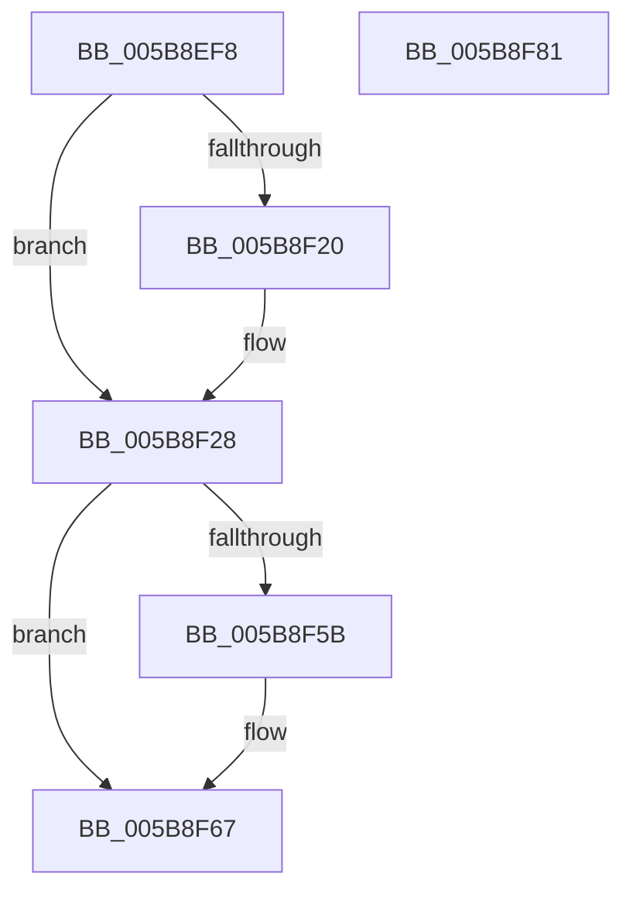

# KeQueryTotalSuspendCountThread

- RVA: `0x005B8EF8`–`0x005B8F82` (길이 `138` bytes)
- VA: `0x00000001405B8EF8`
- 실행 섹션: `.text`
- PDB 이름 있음: `예`; PDB Function 태그: `아니요`
- unwind 정보 RVA: `0x00060BC4`
- 디코드: `35`개 명령, `138/138` bytes 표시
- 미해석 바이트: `0` (있으면 어셈블리에 `.byte`로 보존)

> 이 문서는 커널 이미지의 기계어와 PDB 기호를 분석해 생성했습니다. 4번과 5번은 함수 원형과 자료형을 바이너리 사용 방식에서 추정한 C 해석이며 원본 소스 복구 결과는 아닙니다.

## 1. Dependencies

- 직접 호출 지점: **3**; 고유 호출 대상: **3**
- 직접 호출자로 확인된 함수: **1**
- RIP 상대 이미지 참조: **1**

### Outgoing calls
- `0x005B8F23` → [KiRaiseIrqlProcessIrqlFlags](../4F/KiRaiseIrqlProcessIrqlFlags_function_004F56FC.md) (function, `0x004F56FC`)
- `0x005B8F32` → [KiAcquireKobjectLockSafe](../25/KiAcquireKobjectLockSafe_function_00251C90.md) (function, `0x00251C90`)
- `0x005B8F62` → [KiLowerIrqlProcessIrqlFlags](../4F/KiLowerIrqlProcessIrqlFlags_function_004F5698.md) (function, `0x004F5698`)

### Direct callers
- [NtQueryInformationThread](../../page/AE/NtQueryInformationThread_function_00AE3760.md) at `0x00AE479F`

### Static image references
- `0x005B8F17` → RVA `0x00FC6D20` (`ALMOSTRO`; read)

## 2. Other-region calls and transfers

- 다른 실행 섹션으로 향하는 call: **0**
- 별도 외부 분기/꼬리 이동을 확인하지 못했습니다.

## 3. Assembly (complete function range)

```asm
005B8EF8  48 89 5C 24 08                  mov qword ptr [rsp + 8], rbx
005B8EFD  48 89 74 24 10                  mov qword ptr [rsp + 0x10], rsi
005B8F02  57                              push rdi
005B8F03  48 83 EC 20                     sub rsp, 0x20
005B8F07  48 8B F1                        mov rsi, rcx
005B8F0A  44 0F 20 C7                     mov rdi, cr8
005B8F0E  BA 02 00 00 00                  mov edx, 2
005B8F13  44 0F 22 C2                     mov cr8, rdx
005B8F17  83 3D 02 DE A0 00 00            cmp dword ptr [rip + 0xa0de02], 0
005B8F1E  74 08                           je 0x1405b8f28
005B8F20  40 8A CF                        mov cl, dil
005B8F23  E8 D4 C7 F3 FF                  call 0x1404f56fc
005B8F28  48 8D 9E E0 02 00 00            lea rbx, [rsi + 0x2e0]
005B8F2F  48 8B CB                        mov rcx, rbx
005B8F32  E8 59 8D C9 FF                  call 0x140251c90
005B8F37  8B 46 78                        mov eax, dword ptr [rsi + 0x78]
005B8F3A  0F BA E0 0E                     bt eax, 0xe
005B8F3E  0F BE 8E 84 02 00 00            movsx ecx, byte ptr [rsi + 0x284]
005B8F45  8D 71 01                        lea esi, [rcx + 1]
005B8F48  0F 43 F1                        cmovae esi, ecx
005B8F4B  F0 81 23 7F FF FF FF            lock and dword ptr [rbx], 0xffffff7f
005B8F52  83 3D C7 DD A0 00 00            cmp dword ptr [rip + 0xa0ddc7], 0
005B8F59  74 0C                           je 0x1405b8f67
005B8F5B  44 0F 20 C1                     mov rcx, cr8
005B8F5F  40 8A D7                        mov dl, dil
005B8F62  E8 31 C7 F3 FF                  call 0x1404f5698
005B8F67  40 0F B6 CF                     movzx ecx, dil
005B8F6B  44 0F 22 C1                     mov cr8, rcx
005B8F6F  48 8B 5C 24 30                  mov rbx, qword ptr [rsp + 0x30]
005B8F74  8B C6                           mov eax, esi
005B8F76  48 8B 74 24 38                  mov rsi, qword ptr [rsp + 0x38]
005B8F7B  48 83 C4 20                     add rsp, 0x20
005B8F7F  5F                              pop rdi
005B8F80  C3                              ret
005B8F81  CC                              int3
```

## 4. C-style interpretation (structured pseudocode)

```c
__int64 __fastcall KeQueryTotalSuspendCountThread(__int64 a1)
{
    __int64 result;
    __int64 v_rsi;
    __int64 v_rsp;
    unsigned __int64 v_stack_p10;
    unsigned __int64 v_stack_p8;

    v_stack_p8 = v_rbx;
    v_stack_p10 = v_rsi;
    v_rsp = (v_rsp) - (32);
    if ((*(unsigned int *)(v_rip + 10542594)) != 0) {
        a1 = (unsigned __int8)(v_cr8);
        result = KiRaiseIrqlProcessIrqlFlags(a1, 2, a3, a4);
    }
    result = KiAcquireKobjectLockSafe(a1 + 736, 2, a3, a4);
    v_rsi = (__int8)(*(unsigned __int8 *)(a1 + 644)) + 1;
    if ((*(unsigned int *)(v_rip + 10542594)) >= 0) { v_rsi = (unsigned int)((__int8)(*(unsigned __int8 *)(a1 + 644))); }
    result = (unsigned int)(*(unsigned int *)(a1 + 120));
    if ((*(unsigned int *)(v_rip + 10542535)) != 0) {
        a1 = 2;
        a2 = (unsigned __int8)(v_cr8);
        result = KiLowerIrqlProcessIrqlFlags(a1, a2, a3, a4);
    }
    v_rsp = (v_rsp) + (32);
    return (unsigned int)((unsigned int)(v_rsi));
}
```

## 5. (Beta) C Style

```c
int64_t KeQueryTotalSuspendCountThread(void *Arg1)
{
    uint8_t *arg1 = (uint8_t *)Arg1;

    int64_t result;
    int64_t local_rsi;
    int64_t local_rsp;
    uint64_t v_stack_p10;
    uint64_t v_stack_p8;

    v_stack_p8 = local_rbx;
    v_stack_p10 = local_rsi;
    local_rsp = (local_rsp) - (32);
    if ((*(uint32_t *)(v_rip + 0xA0DE02)) != 0) {
        Arg1 = (uint8_t)(v_cr8);
        result = KiRaiseIrqlProcessIrqlFlags(Arg1, 2, a3, a4);
    }
    result = KiAcquireKobjectLockSafe(Arg1 + 736, 2, a3, a4);
    local_rsi = (int8_t)(*(uint8_t *)(arg1 + 0x284)) + 1;
    if ((*(uint32_t *)(v_rip + 0xA0DE02)) >= 0) { local_rsi = (uint32_t)((int8_t)(*(uint8_t *)(arg1 + 0x284))); }
    result = (uint32_t)(*(uint32_t *)(arg1 + 0x78));
    if ((*(uint32_t *)(v_rip + 0xA0DDC7)) != 0) {
        Arg1 = 2;
        a2 = (uint8_t)(v_cr8);
        result = KiLowerIrqlProcessIrqlFlags(Arg1, a2, a3, a4);
    }
    local_rsp = (local_rsp) + (32);
    return (uint32_t)((uint32_t)(local_rsi));
}
```

### 관측된 메모리 오프셋

구조체 형식이 확인되지 않은 접근은 인자 기준의 오프셋으로만 기록했습니다.

| 기준 인자 | 오프셋 표현 | 폭 (bit) | 접근 |
|---|---:|---:|---|
| `Arg1` | `+ 0x0` | `32` | `R/W` |
| `Arg1` | `+ 0x78` | `32` | `R` |
| `Arg1` | `+ 0x284` | `8` | `R` |
| `Arg1` | `+ 0x2E0` | `64` | `R` |

## 6. Execution-region graph

[열기: 2D/3D 그래프와 함수 탐색 컨트롤 패널](../../../control-panel.html?section=text&rva=0x005B8EF8&view=graph)

- 2D 그래프는 위에서 아래로 흐르고, 3D 그래프는 빈 공간을 드래그해 회전합니다. Shift+드래그는 이동, 휠은 확대·축소, 함수 노드 선택은 대상 보고서 이동입니다.

### Static fallback


