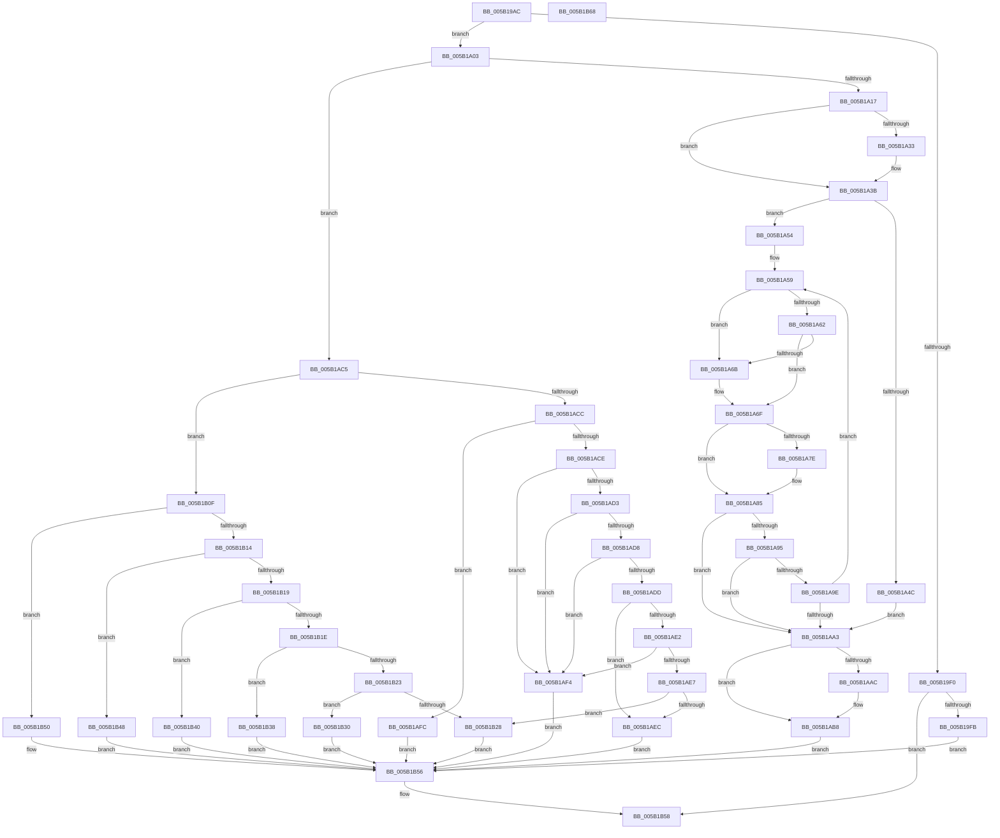

# KeQueryWakeSource

- RVA: `0x005B19AC`–`0x005B1B69` (길이 `445` bytes)
- VA: `0x00000001405B19AC`
- 실행 섹션: `.text`
- PDB 이름 있음: `예`; PDB Function 태그: `아니요`
- unwind 정보 RVA: `0x00060BC4`
- 디코드: `127`개 명령, `445/445` bytes 표시
- 미해석 바이트: `0` (있으면 어셈블리에 `.byte`로 보존)

> 이 문서는 커널 이미지의 기계어와 PDB 기호를 분석해 생성했습니다. 4번과 5번은 함수 원형과 자료형을 바이너리 사용 방식에서 추정한 C 해석이며 원본 소스 복구 결과는 아닙니다.

## 1. Dependencies

- 직접 호출 지점: **5**; 고유 호출 대상: **5**
- 직접 호출자로 확인된 함수: **1**
- RIP 상대 이미지 참조: **2**

### Outgoing calls
- `0x005B19D4` → [memset](../6C/memset_function_006C6C40.md) (function, `0x006C6C40`)
- `0x005B19E7` → [guard_dispatch_icall](../6B/guard_dispatch_icall_function_006BAAD0.md) (function, `0x006BAAD0`)
- `0x005B1A36` → [KiRaiseIrqlProcessIrqlFlags](../4F/KiRaiseIrqlProcessIrqlFlags_function_004F56FC.md) (function, `0x004F56FC`)
- `0x005B1A3F` → [KiGetInterruptObjectFromVector](../39/KiGetInterruptObjectFromVector_function_0039F2B8.md) (function, `0x0039F2B8`)
- `0x005B1AB3` → [KiLowerIrqlProcessIrqlFlags](../4F/KiLowerIrqlProcessIrqlFlags_function_004F5698.md) (function, `0x004F5698`)

### Direct callers
- [sub_006DCEEE](../6D/Unknown_function_006DCEEE.md) at `0x006DD287`

### Static image references
- `0x005B19D9` → RVA `0x00E00B48` (`.data`; read)
- `0x005B1A2A` → RVA `0x00FC6D20` (`ALMOSTRO`; read)

## 2. Other-region calls and transfers

- 다른 실행 섹션으로 향하는 call: **0**
- 별도 외부 분기/꼬리 이동을 확인하지 못했습니다.

## 3. Assembly (complete function range)

```asm
005B19AC  48 89 5C 24 08                  mov qword ptr [rsp + 8], rbx
005B19B1  48 89 74 24 10                  mov qword ptr [rsp + 0x10], rsi
005B19B6  57                              push rdi
005B19B7  48 83 EC 20                     sub rsp, 0x20
005B19BB  83 64 24 48 00                  and dword ptr [rsp + 0x48], 0
005B19C0  49 8B F8                        mov rdi, r8
005B19C3  48 8B DA                        mov rbx, rdx
005B19C6  48 8B F1                        mov rsi, rcx
005B19C9  48 8B CF                        mov rcx, rdi
005B19CC  33 D2                           xor edx, edx
005B19CE  41 B8 88 00 00 00               mov r8d, 0x88
005B19D4  E8 67 52 11 00                  call 0x1406c6c40
005B19D9  48 8B 05 68 F1 84 00            mov rax, qword ptr [rip + 0x84f168]
005B19E0  48 8D 4C 24 48                  lea rcx, [rsp + 0x48]
005B19E5  33 D2                           xor edx, edx
005B19E7  E8 E4 90 10 00                  call 0x1406baad0
005B19EC  85 C0                           test eax, eax
005B19EE  79 13                           jns 0x1405b1a03
005B19F0  3D 01 00 00 C0                  cmp eax, 0xc0000001
005B19F5  0F 85 5D 01 00 00               jne 0x1405b1b58
005B19FB  83 23 00                        and dword ptr [rbx], 0
005B19FE  E9 53 01 00 00                  jmp 0x1405b1b56
005B1A03  8B 44 24 48                     mov eax, dword ptr [rsp + 0x48]
005B1A07  05 2F FF FF FF                  add eax, 0xffffff2f
005B1A0C  A9 FD FF FF FF                  test eax, 0xfffffffd
005B1A11  0F 84 AE 00 00 00               je 0x1405b1ac5
005B1A17  C7 03 80 00 00 00               mov dword ptr [rbx], 0x80
005B1A1D  44 0F 20 C6                     mov rsi, cr8
005B1A21  BA 0F 00 00 00                  mov edx, 0xf
005B1A26  44 0F 22 C2                     mov cr8, rdx
005B1A2A  83 3D EF 52 A1 00 00            cmp dword ptr [rip + 0xa152ef], 0
005B1A31  74 08                           je 0x1405b1a3b
005B1A33  40 8A CE                        mov cl, sil
005B1A36  E8 C1 3C F4 FF                  call 0x1404f56fc
005B1A3B  8B 4C 24 48                     mov ecx, dword ptr [rsp + 0x48]
005B1A3F  E8 74 D8 DE FF                  call 0x14039f2b8
005B1A44  4C 8B C0                        mov r8, rax
005B1A47  48 85 C0                        test rax, rax
005B1A4A  75 08                           jne 0x1405b1a54
005B1A4C  C7 03 02 00 00 00               mov dword ptr [rbx], 2
005B1A52  EB 4F                           jmp 0x1405b1aa3
005B1A54  33 D2                           xor edx, edx
005B1A56  49 8B C8                        mov rcx, r8
005B1A59  4C 8B 49 20                     mov r9, qword ptr [rcx + 0x20]
005B1A5D  4D 85 C9                        test r9, r9
005B1A60  75 09                           jne 0x1405b1a6b
005B1A62  4C 8B 49 18                     mov r9, qword ptr [rcx + 0x18]
005B1A66  4D 85 C9                        test r9, r9
005B1A69  74 04                           je 0x1405b1a6f
005B1A6B  4C 89 0C D7                     mov qword ptr [rdi + rdx*8], r9
005B1A6F  48 8B 81 A0 00 00 00            mov rax, qword ptr [rcx + 0xa0]
005B1A76  45 33 C9                        xor r9d, r9d
005B1A79  48 85 C0                        test rax, rax
005B1A7C  74 07                           je 0x1405b1a85
005B1A7E  4C 8B 88 E0 01 00 00            mov r9, qword ptr [rax + 0x1e0]
005B1A85  4C 89 4C D7 18                  mov qword ptr [rdi + rdx*8 + 0x18], r9
005B1A8A  FF C2                           inc edx
005B1A8C  48 8B 49 08                     mov rcx, qword ptr [rcx + 8]
005B1A90  48 85 C9                        test rcx, rcx
005B1A93  74 0E                           je 0x1405b1aa3
005B1A95  48 83 C1 F8                     add rcx, -8
005B1A99  49 3B C8                        cmp rcx, r8
005B1A9C  74 05                           je 0x1405b1aa3
005B1A9E  83 FA 03                        cmp edx, 3
005B1AA1  72 B6                           jb 0x1405b1a59
005B1AA3  83 3D 76 52 A1 00 00            cmp dword ptr [rip + 0xa15276], 0
005B1AAA  74 0C                           je 0x1405b1ab8
005B1AAC  44 0F 20 C1                     mov rcx, cr8
005B1AB0  40 8A D6                        mov dl, sil
005B1AB3  E8 E0 3B F4 FF                  call 0x1404f5698
005B1AB8  40 0F B6 C6                     movzx eax, sil
005B1ABC  44 0F 22 C0                     mov cr8, rax
005B1AC0  E9 91 00 00 00                  jmp 0x1405b1b56
005B1AC5  8B 0E                           mov ecx, dword ptr [rsi]
005B1AC7  83 F9 07                        cmp ecx, 7
005B1ACA  7F 43                           jg 0x1405b1b0f
005B1ACC  74 2E                           je 0x1405b1afc
005B1ACE  83 E9 01                        sub ecx, 1
005B1AD1  74 21                           je 0x1405b1af4
005B1AD3  83 E9 01                        sub ecx, 1
005B1AD6  74 1C                           je 0x1405b1af4
005B1AD8  83 E9 01                        sub ecx, 1
005B1ADB  74 17                           je 0x1405b1af4
005B1ADD  83 E9 01                        sub ecx, 1
005B1AE0  74 0A                           je 0x1405b1aec
005B1AE2  83 E9 01                        sub ecx, 1
005B1AE5  74 0D                           je 0x1405b1af4
005B1AE7  83 F9 01                        cmp ecx, 1
005B1AEA  75 3C                           jne 0x1405b1b28
005B1AEC  C7 03 05 00 00 00               mov dword ptr [rbx], 5
005B1AF2  EB 62                           jmp 0x1405b1b56
005B1AF4  C7 03 08 00 00 00               mov dword ptr [rbx], 8
005B1AFA  EB 5A                           jmp 0x1405b1b56
005B1AFC  8A 46 04                        mov al, byte ptr [rsi + 4]
005B1AFF  88 07                           mov byte ptr [rdi], al
005B1B01  8A 46 05                        mov al, byte ptr [rsi + 5]
005B1B04  88 47 02                        mov byte ptr [rdi + 2], al
005B1B07  C7 03 81 00 00 00               mov dword ptr [rbx], 0x81
005B1B0D  EB 47                           jmp 0x1405b1b56
005B1B0F  83 E9 08                        sub ecx, 8
005B1B12  74 3C                           je 0x1405b1b50
005B1B14  83 E9 01                        sub ecx, 1
005B1B17  74 2F                           je 0x1405b1b48
005B1B19  83 E9 01                        sub ecx, 1
005B1B1C  74 22                           je 0x1405b1b40
005B1B1E  83 E9 01                        sub ecx, 1
005B1B21  74 15                           je 0x1405b1b38
005B1B23  83 F9 01                        cmp ecx, 1
005B1B26  74 08                           je 0x1405b1b30
005B1B28  C7 03 01 00 00 00               mov dword ptr [rbx], 1
005B1B2E  EB 26                           jmp 0x1405b1b56
005B1B30  C7 03 0B 00 00 00               mov dword ptr [rbx], 0xb
005B1B36  EB 1E                           jmp 0x1405b1b56
005B1B38  C7 03 0A 00 00 00               mov dword ptr [rbx], 0xa
005B1B3E  EB 16                           jmp 0x1405b1b56
005B1B40  C7 03 09 00 00 00               mov dword ptr [rbx], 9
005B1B46  EB 0E                           jmp 0x1405b1b56
005B1B48  C7 03 07 00 00 00               mov dword ptr [rbx], 7
005B1B4E  EB 06                           jmp 0x1405b1b56
005B1B50  C7 03 06 00 00 00               mov dword ptr [rbx], 6
005B1B56  33 C0                           xor eax, eax
005B1B58  48 8B 5C 24 30                  mov rbx, qword ptr [rsp + 0x30]
005B1B5D  48 8B 74 24 38                  mov rsi, qword ptr [rsp + 0x38]
005B1B62  48 83 C4 20                     add rsp, 0x20
005B1B66  5F                              pop rdi
005B1B67  C3                              ret
005B1B68  CC                              int3
```

## 4. C-style interpretation (structured pseudocode)

```c
__int64 __fastcall KeQueryWakeSource(__int64 a1, __int64 a2, __int64 a3)
{
    __int64 result;
    __int64 v_rsp;
    unsigned __int64 v_stack_p10;
    unsigned int v_stack_p20;
    unsigned __int64 v_stack_p8;

    v_stack_p8 = v_rbx;
    v_stack_p10 = v_rsi;
    v_rsp = (v_rsp) - (32);
    a2 = 0;
    result = memset(a3, a2, 136, a4);
    a2 = 0;
    result = guard_dispatch_icall(v_stack_p20, a2, 136, a4);
    if (!sign_flag) goto loc_005B1A03;
    if (((unsigned int)(result)) != 0xC0000001ULL) goto loc_005B1B58;
    goto loc_005B1B56;
loc_005B1A03:
    result = (unsigned int)(((unsigned int)(v_stack_p20)) + (0xFFFFFF2FULL));
    if ((((unsigned int)(result)) & (0xFFFFFFFDULL)) == 0) goto loc_005B1AC5;
    *(unsigned int *)(a2) = 128;
    if ((*(unsigned int *)(v_rip + 10572527)) != 0) {
        a1 = (unsigned __int8)(v_cr8);
        result = KiRaiseIrqlProcessIrqlFlags(a1, 15, 136, a4);
    }
    result = KiGetInterruptObjectFromVector((unsigned int)(v_stack_p20), 15, 136, a4);
    if (result != 0) goto loc_005B1A54;
    *(unsigned int *)(a2) = 2;
    goto loc_005B1AA3;
loc_005B1A54:
    a2 = 0;
loc_005B1A59:
    if (*(unsigned __int64 *)(result + 32) != 0) goto loc_005B1A6B;
    if (*(unsigned __int64 *)(result + 24) != 0) {
        *(unsigned __int64 *)(a3 + a2 * 8) = *(unsigned __int64 *)(result + 24);
    }
    a4 = 0;
    if (*(unsigned __int64 *)(result + 160) != 0) {
        a4 = *(unsigned __int64 *)(*(unsigned __int64 *)(result + 160) + 480);
    }
    *(unsigned __int64 *)(a3 + a2 * 8 + 24) = a4;
    a2 = (unsigned int)((a2) + 1);
    if (*(unsigned __int64 *)(result + 8) == 0) goto loc_005B1AA3;
    a1 = (*(unsigned __int64 *)(result + 8)) + (-8);
    if (a1 == result) goto loc_005B1AA3;
    if (((unsigned int)(a2)) < 3) goto loc_005B1A59;
loc_005B1AA3:
    result = *(unsigned __int64 *)(result + 160);
    if ((*(unsigned int *)(v_rip + 10572406)) != 0) {
        a1 = 15;
        a2 = (unsigned __int8)(v_cr8);
        result = KiLowerIrqlProcessIrqlFlags(a1, a2, result, a4);
    }
    goto loc_005B1B56;
loc_005B1AC5:
    if (((unsigned int)((unsigned int)(*(unsigned int *)(v_cr8)))) > 7) goto loc_005B1B0F;
    if (((unsigned int)((unsigned int)(*(unsigned int *)(v_cr8)))) == 7) goto loc_005B1AFC;
    a1 = (unsigned int)(((unsigned int)(*(unsigned int *)(v_cr8))) - (1));
    if (condition_is_equal) goto loc_005B1AF4;
    a1 = (unsigned int)((a1) - (1));
    if (condition_is_equal) goto loc_005B1AF4;
    a1 = (unsigned int)((a1) - (1));
    if (condition_is_equal) goto loc_005B1AF4;
    a1 = (unsigned int)((a1) - (1));
    if (condition_is_equal) goto loc_005B1AEC;
    a1 = (unsigned int)((a1) - (1));
    if (condition_is_equal) goto loc_005B1AF4;
    if (((unsigned int)(a1)) != 1) goto loc_005B1B28;
loc_005B1AEC:
    *(unsigned int *)(a2) = 5;
    goto loc_005B1B56;
loc_005B1AF4:
    *(unsigned int *)(a2) = 8;
    goto loc_005B1B56;
loc_005B1AFC:
    *(unsigned __int8 *)(a3) = (unsigned __int8)(*(unsigned __int8 *)(v_cr8 + 4));
    *(unsigned __int8 *)(a3 + 2) = (unsigned __int8)(*(unsigned __int8 *)(v_cr8 + 5));
    *(unsigned int *)(a2) = 129;
    goto loc_005B1B56;
loc_005B1B0F:
    a1 = (unsigned int)((a1) - (8));
    if (condition_is_equal) goto loc_005B1B50;
    a1 = (unsigned int)((a1) - (1));
    if (condition_is_equal) goto loc_005B1B48;
    a1 = (unsigned int)((a1) - (1));
    if (condition_is_equal) goto loc_005B1B40;
    a1 = (unsigned int)((a1) - (1));
    if (condition_is_equal) goto loc_005B1B38;
    if (((unsigned int)(a1)) == 1) goto loc_005B1B30;
loc_005B1B28:
    *(unsigned int *)(a2) = 1;
    goto loc_005B1B56;
loc_005B1B30:
    *(unsigned int *)(a2) = 11;
    goto loc_005B1B56;
loc_005B1B38:
    *(unsigned int *)(a2) = 10;
    goto loc_005B1B56;
loc_005B1B40:
    *(unsigned int *)(a2) = 9;
    goto loc_005B1B56;
loc_005B1B48:
    *(unsigned int *)(a2) = 7;
    goto loc_005B1B56;
loc_005B1B50:
    *(unsigned int *)(a2) = 6;
loc_005B1B56:
    result = 0;
loc_005B1B58:
    v_rsp = (v_rsp) + (32);
    return result;
}
```

## 5. (Beta) C Style

```c
int64_t KeQueryWakeSource(void *Arg1, void *Arg2, void *Arg3)
{
    uint8_t *arg1 = (uint8_t *)Arg1;
    uint8_t *arg2 = (uint8_t *)Arg2;
    uint8_t *arg3 = (uint8_t *)Arg3;

    int64_t result;
    int64_t local_rsp;
    uint64_t v_stack_p10;
    uint32_t v_stack_p20;
    uint64_t v_stack_p8;

    v_stack_p8 = local_rbx;
    v_stack_p10 = local_rsi;
    local_rsp = (local_rsp) - (32);
    Arg2 = 0;
    result = memset(Arg3, Arg2, 136, a4);
    Arg2 = 0;
    result = guard_dispatch_icall(v_stack_p20, Arg2, 136, a4);
    if (!sign_flag) goto loc_005B1A03;
    if (((uint32_t)(result)) != 0xC0000001ULL) goto loc_005B1B58;
    goto loc_005B1B56;
loc_005B1A03:
    result = (uint32_t)(((uint32_t)(v_stack_p20)) + (0xFFFFFF2FULL));
    if ((((uint32_t)(result)) & (0xFFFFFFFDULL)) == 0) goto loc_005B1AC5;
    *(uint32_t *)(arg2) = 128;
    if ((*(uint32_t *)(v_rip + 0xA152EF)) != 0) {
        Arg1 = (uint8_t)(v_cr8);
        result = KiRaiseIrqlProcessIrqlFlags(Arg1, 15, 136, a4);
    }
    result = KiGetInterruptObjectFromVector((uint32_t)(v_stack_p20), 15, 136, a4);
    if (result != 0) goto loc_005B1A54;
    *(uint32_t *)(arg2) = 2;
    goto loc_005B1AA3;
loc_005B1A54:
    Arg2 = 0;
loc_005B1A59:
    if (*(uint64_t *)(result + 0x20) != 0) goto loc_005B1A6B;
    if (*(uint64_t *)(result + 0x18) != 0) {
        *(uint64_t *)(arg3 + arg2 * 8) = *(uint64_t *)(result + 0x18);
    }
    a4 = 0;
    if (*(uint64_t *)(result + 0xA0) != 0) {
        a4 = *(uint64_t *)(*(uint64_t *)(result + 0xA0) + 0x1E0);
    }
    *(uint64_t *)(arg3 + arg2 * 8 + 0x18) = a4;
    Arg2 = (uint32_t)((Arg2) + 1);
    if (*(uint64_t *)(result + 0x8) == 0) goto loc_005B1AA3;
    Arg1 = (*(uint64_t *)(result + 0x8)) + (-8);
    if (Arg1 == result) goto loc_005B1AA3;
    if (((uint32_t)(Arg2)) < 3) goto loc_005B1A59;
loc_005B1AA3:
    result = *(uint64_t *)(result + 0xA0);
    if ((*(uint32_t *)(v_rip + 0xA15276)) != 0) {
        Arg1 = 15;
        Arg2 = (uint8_t)(v_cr8);
        result = KiLowerIrqlProcessIrqlFlags(Arg1, Arg2, result, a4);
    }
    goto loc_005B1B56;
loc_005B1AC5:
    if (((uint32_t)((uint32_t)(*(uint32_t *)(v_cr8)))) > 7) goto loc_005B1B0F;
    if (((uint32_t)((uint32_t)(*(uint32_t *)(v_cr8)))) == 7) goto loc_005B1AFC;
    Arg1 = (uint32_t)(((uint32_t)(*(uint32_t *)(v_cr8))) - (1));
    if (condition_is_equal) goto loc_005B1AF4;
    Arg1 = (uint32_t)((Arg1) - (1));
    if (condition_is_equal) goto loc_005B1AF4;
    Arg1 = (uint32_t)((Arg1) - (1));
    if (condition_is_equal) goto loc_005B1AF4;
    Arg1 = (uint32_t)((Arg1) - (1));
    if (condition_is_equal) goto loc_005B1AEC;
    Arg1 = (uint32_t)((Arg1) - (1));
    if (condition_is_equal) goto loc_005B1AF4;
    if (((uint32_t)(Arg1)) != 1) goto loc_005B1B28;
loc_005B1AEC:
    *(uint32_t *)(arg2) = 5;
    goto loc_005B1B56;
loc_005B1AF4:
    *(uint32_t *)(arg2) = 8;
    goto loc_005B1B56;
loc_005B1AFC:
    *(uint8_t *)(arg3) = (uint8_t)(*(uint8_t *)(v_cr8 + 0x4));
    *(uint8_t *)(arg3 + 0x2) = (uint8_t)(*(uint8_t *)(v_cr8 + 0x5));
    *(uint32_t *)(arg2) = 129;
    goto loc_005B1B56;
loc_005B1B0F:
    Arg1 = (uint32_t)((Arg1) - (8));
    if (condition_is_equal) goto loc_005B1B50;
    Arg1 = (uint32_t)((Arg1) - (1));
    if (condition_is_equal) goto loc_005B1B48;
    Arg1 = (uint32_t)((Arg1) - (1));
    if (condition_is_equal) goto loc_005B1B40;
    Arg1 = (uint32_t)((Arg1) - (1));
    if (condition_is_equal) goto loc_005B1B38;
    if (((uint32_t)(Arg1)) == 1) goto loc_005B1B30;
loc_005B1B28:
    *(uint32_t *)(arg2) = 1;
    goto loc_005B1B56;
loc_005B1B30:
    *(uint32_t *)(arg2) = 11;
    goto loc_005B1B56;
loc_005B1B38:
    *(uint32_t *)(arg2) = 10;
    goto loc_005B1B56;
loc_005B1B40:
    *(uint32_t *)(arg2) = 9;
    goto loc_005B1B56;
loc_005B1B48:
    *(uint32_t *)(arg2) = 7;
    goto loc_005B1B56;
loc_005B1B50:
    *(uint32_t *)(arg2) = 6;
loc_005B1B56:
    result = 0;
loc_005B1B58:
    local_rsp = (local_rsp) + (32);
    return result;
}
```

### 관측된 메모리 오프셋

구조체 형식이 확인되지 않은 접근은 인자 기준의 오프셋으로만 기록했습니다.

| 기준 인자 | 오프셋 표현 | 폭 (bit) | 접근 |
|---|---:|---:|---|
| `Arg1` | `+ 0x0` | `32` | `R` |
| `Arg1` | `+ 0x4` | `8` | `R` |
| `Arg1` | `+ 0x5` | `8` | `R` |
| `Arg2` | `+ 0x0` | `32` | `R/W` |
| `Arg2` | `+ 0x0` | `32` | `W` |
| `Arg3` | `+ 0x0` | `8` | `W` |
| `Arg3` | `+ 0x0 + rdx*8` | `64` | `W` |
| `Arg3` | `+ 0x2` | `8` | `W` |
| `Arg3` | `+ 0x18 + rdx*8` | `64` | `W` |

## 6. Execution-region graph

[열기: 2D/3D 그래프와 함수 탐색 컨트롤 패널](../../../control-panel.html?section=text&rva=0x005B19AC&view=graph)

- 2D 그래프는 위에서 아래로 흐르고, 3D 그래프는 빈 공간을 드래그해 회전합니다. Shift+드래그는 이동, 휠은 확대·축소, 함수 노드 선택은 대상 보고서 이동입니다.

### Static fallback


