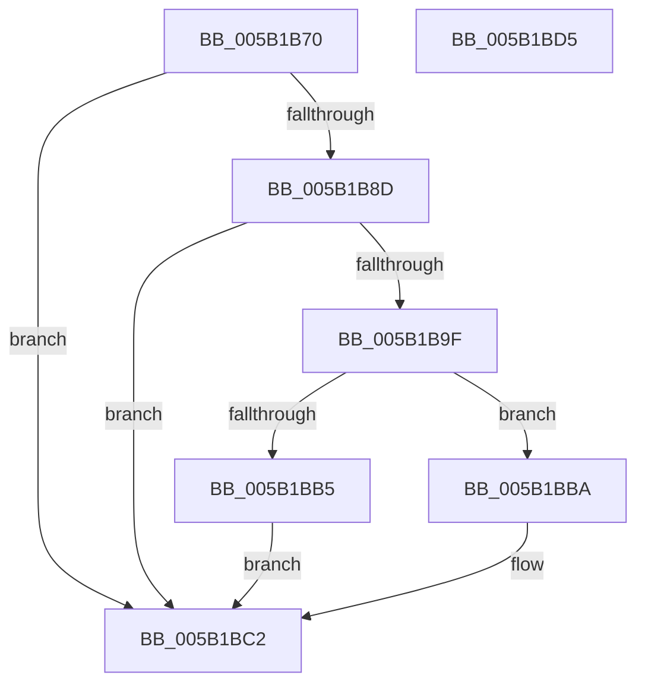

# KeRegisterBoundCallback

- RVA: `0x005B1B70`–`0x005B1BD6` (길이 `102` bytes)
- VA: `0x00000001405B1B70`
- 실행 섹션: `.text`
- PDB 이름 있음: `예`; PDB Function 태그: `아니요`
- unwind 정보 RVA: `0x00060BC4`
- 디코드: `32`개 명령, `102/102` bytes 표시
- 미해석 바이트: `0` (있으면 어셈블리에 `.byte`로 보존)

> 이 문서는 커널 이미지의 기계어와 PDB 기호를 분석해 생성했습니다. 4번과 5번은 함수 원형과 자료형을 바이너리 사용 방식에서 추정한 C 해석이며 원본 소스 복구 결과는 아닙니다.

## 1. Dependencies

- 직접 호출 지점: **4**; 고유 호출 대상: **4**
- 직접 호출자로 확인된 함수: **0**
- RIP 상대 이미지 참조: **1**

### Outgoing calls
- `0x005B1B84` → [MmVerifyCallbackFunction](../../page/AC/MmVerifyCallbackFunction_function_00AC1B84.md) (function, `0x00AC1B84`)
- `0x005B1B92` → [ExAllocateCallBack](../../page/AA/ExAllocateCallBack_function_00AA1AE0.md) (function, `0x00AA1AE0`)
- `0x005B1BAC` → [ExCompareExchangeCallBack](../41/ExCompareExchangeCallBack_function_0041BCD0.md) (function, `0x0041BCD0`)
- `0x005B1BBD` → [AlpcpFreeBuffer](../../page/90/AlpcpFreeBuffer_function_009071C0.md) (function, `0x009071C0`)

### Direct callers
- 이 함수 시작 RVA로 연결되는 직접 call은 확인되지 않았습니다. 간접 호출은 완전히 역산할 수 없습니다.

### Static image references
- `0x005B1BA2` → RVA `0x00F475B8` (`.data`; read)

## 2. Other-region calls and transfers

- 다른 실행 섹션으로 향하는 call: **3**
  - `0x005B1B84` → [MmVerifyCallbackFunction](../../page/AC/MmVerifyCallbackFunction_function_00AC1B84.md) (`.text` → `PAGE`)
  - `0x005B1B92` → [ExAllocateCallBack](../../page/AA/ExAllocateCallBack_function_00AA1AE0.md) (`.text` → `PAGE`)
  - `0x005B1BBD` → [AlpcpFreeBuffer](../../page/90/AlpcpFreeBuffer_function_009071C0.md) (`.text` → `PAGE`)
- 별도 외부 분기/꼬리 이동을 확인하지 못했습니다.

## 3. Assembly (complete function range)

```asm
005B1B70  48 89 5C 24 08                  mov qword ptr [rsp + 8], rbx
005B1B75  48 89 74 24 10                  mov qword ptr [rsp + 0x10], rsi
005B1B7A  57                              push rdi
005B1B7B  48 83 EC 20                     sub rsp, 0x20
005B1B7F  48 8B F9                        mov rdi, rcx
005B1B82  33 DB                           xor ebx, ebx
005B1B84  E8 FB FF 50 00                  call 0x140ac1b84
005B1B89  85 C0                           test eax, eax
005B1B8B  74 35                           je 0x1405b1bc2
005B1B8D  33 D2                           xor edx, edx
005B1B8F  48 8B CF                        mov rcx, rdi
005B1B92  E8 49 FF 4E 00                  call 0x140aa1ae0
005B1B97  48 8B F0                        mov rsi, rax
005B1B9A  48 85 C0                        test rax, rax
005B1B9D  74 23                           je 0x1405b1bc2
005B1B9F  45 33 C0                        xor r8d, r8d
005B1BA2  48 8D 0D 0F 5A 99 00            lea rcx, [rip + 0x995a0f]
005B1BA9  48 8B D0                        mov rdx, rax
005B1BAC  E8 1F A1 E6 FF                  call 0x14041bcd0
005B1BB1  84 C0                           test al, al
005B1BB3  74 05                           je 0x1405b1bba
005B1BB5  48 8B DF                        mov rbx, rdi
005B1BB8  EB 08                           jmp 0x1405b1bc2
005B1BBA  48 8B CE                        mov rcx, rsi
005B1BBD  E8 FE 55 35 00                  call 0x1409071c0
005B1BC2  48 8B 74 24 38                  mov rsi, qword ptr [rsp + 0x38]
005B1BC7  48 8B C3                        mov rax, rbx
005B1BCA  48 8B 5C 24 30                  mov rbx, qword ptr [rsp + 0x30]
005B1BCF  48 83 C4 20                     add rsp, 0x20
005B1BD3  5F                              pop rdi
005B1BD4  C3                              ret
005B1BD5  CC                              int3
```

## 4. C-style interpretation (structured pseudocode)

```c
__int64 __fastcall KeRegisterBoundCallback(__int64 a1, int a2, int a3)
{
    __int64 result;
    __int64 v_rbx;
    __int64 v_rsp;
    unsigned __int64 v_stack_p10;
    unsigned __int64 v_stack_p8;

    v_stack_p8 = v_rbx;
    v_stack_p10 = v_rsi;
    v_rsp = (v_rsp) - (32);
    v_rbx = 0;
    result = MmVerifyCallbackFunction(a1, a2, a3, a4);
    if ((unsigned int)(result) == 0) goto loc_005B1BC2;
    a2 = 0;
    result = ExAllocateCallBack(a1, a2, a3, a4);
    if (result == 0) goto loc_005B1BC2;
    a3 = 0;
    result = ExCompareExchangeCallBack(v_rip + 10050063, result, a3, a4);
    if ((unsigned __int8)(result) == 0) goto loc_005B1BBA;
    goto loc_005B1BC2;
loc_005B1BBA:
    result = AlpcpFreeBuffer(result, result, a3, a4);
loc_005B1BC2:
    v_rsp = (v_rsp) + (32);
    return a1;
}
```

## 5. (Beta) C Style

```c
int64_t KeRegisterBoundCallback(int64_t Arg1, int32_t Arg2, int32_t Arg3)
{
    int64_t result;
    int64_t local_rbx;
    int64_t local_rsp;
    uint64_t v_stack_p10;
    uint64_t v_stack_p8;

    v_stack_p8 = local_rbx;
    v_stack_p10 = local_rsi;
    local_rsp = (local_rsp) - (32);
    local_rbx = 0;
    result = MmVerifyCallbackFunction(Arg1, Arg2, Arg3, a4);
    if ((uint32_t)(result) == 0) goto loc_005B1BC2;
    Arg2 = 0;
    result = ExAllocateCallBack(Arg1, Arg2, Arg3, a4);
    if (result == 0) goto loc_005B1BC2;
    Arg3 = 0;
    result = ExCompareExchangeCallBack(v_rip + 10050063, result, Arg3, a4);
    if ((uint8_t)(result) == 0) goto loc_005B1BBA;
    goto loc_005B1BC2;
loc_005B1BBA:
    result = AlpcpFreeBuffer(result, result, Arg3, a4);
loc_005B1BC2:
    local_rsp = (local_rsp) + (32);
    return Arg1;
}
```

## 6. Execution-region graph

[열기: 2D/3D 그래프와 함수 탐색 컨트롤 패널](../../../control-panel.html?section=text&rva=0x005B1B70&view=graph)

- 2D 그래프는 위에서 아래로 흐르고, 3D 그래프는 빈 공간을 드래그해 회전합니다. Shift+드래그는 이동, 휠은 확대·축소, 함수 노드 선택은 대상 보고서 이동입니다.

### Static fallback


