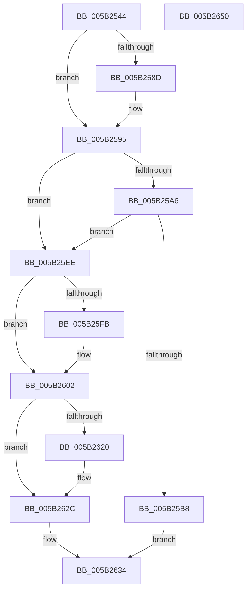

# KeRegisterObjectDpc

- RVA: `0x005B2544`–`0x005B2651` (길이 `269` bytes)
- VA: `0x00000001405B2544`
- 실행 섹션: `.text`
- PDB 이름 있음: `예`; PDB Function 태그: `아니요`
- unwind 정보 RVA: `0x00084C9C`
- 디코드: `72`개 명령, `269/269` bytes 표시
- 미해석 바이트: `0` (있으면 어셈블리에 `.byte`로 보존)

> 이 문서는 커널 이미지의 기계어와 PDB 기호를 분석해 생성했습니다. 4번과 5번은 함수 원형과 자료형을 바이너리 사용 방식에서 추정한 C 해석이며 원본 소스 복구 결과는 아닙니다.

## 1. Dependencies

- 직접 호출 지점: **6**; 고유 호출 대상: **6**
- 직접 호출자로 확인된 함수: **1**
- RIP 상대 이미지 참조: **1**

### Outgoing calls
- `0x005B2590` → [KiRaiseIrqlProcessIrqlFlags](../4F/KiRaiseIrqlProcessIrqlFlags_function_004F56FC.md) (function, `0x004F56FC`)
- `0x005B259B` → [KiAcquireKobjectLockSafe](../25/KiAcquireKobjectLockSafe_function_00251C90.md) (function, `0x00251C90`)
- `0x005B25A9` → [KiWaitSatisfyOther](../41/KiWaitSatisfyOther_function_0041C870.md) (function, `0x0041C870`)
- `0x005B25C5` → [KeInsertQueueDpc](../20/KeInsertQueueDpc_function_00207C50.md) (function, `0x00207C50`)
- `0x005B25E7` → [KiExitDispatcher](../25/KiExitDispatcher_function_00251CF0.md) (function, `0x00251CF0`)
- `0x005B2627` → [KiLowerIrqlProcessIrqlFlags](../4F/KiLowerIrqlProcessIrqlFlags_function_004F5698.md) (function, `0x004F5698`)

### Direct callers
- [ExQueueDpcEventWait](../65/ExQueueDpcEventWait_function_00659660.md) at `0x00659680`

### Static image references
- `0x005B2584` → RVA `0x00FC6D20` (`ALMOSTRO`; read)

## 2. Other-region calls and transfers

- 다른 실행 섹션으로 향하는 call: **0**
- 별도 외부 분기/꼬리 이동을 확인하지 못했습니다.

## 3. Assembly (complete function range)

```asm
005B2544  48 89 5C 24 08                  mov qword ptr [rsp + 8], rbx
005B2549  48 89 6C 24 10                  mov qword ptr [rsp + 0x10], rbp
005B254E  48 89 74 24 18                  mov qword ptr [rsp + 0x18], rsi
005B2553  57                              push rdi
005B2554  41 56                           push r14
005B2556  41 57                           push r15
005B2558  48 83 EC 30                     sub rsp, 0x30
005B255C  45 8A F1                        mov r14b, r9b
005B255F  66 41 C7 40 10 04 04            mov word ptr [r8 + 0x10], 0x404
005B2566  49 8B F8                        mov rdi, r8
005B2569  49 89 50 18                     mov qword ptr [r8 + 0x18], rdx
005B256D  4C 8B FA                        mov r15, rdx
005B2570  49 89 48 20                     mov qword ptr [r8 + 0x20], rcx
005B2574  48 8B D9                        mov rbx, rcx
005B2577  44 0F 20 C6                     mov rsi, cr8
005B257B  BA 02 00 00 00                  mov edx, 2
005B2580  44 0F 22 C2                     mov cr8, rdx
005B2584  83 3D 95 47 A1 00 00            cmp dword ptr [rip + 0xa14795], 0
005B258B  74 08                           je 0x1405b2595
005B258D  40 8A CE                        mov cl, sil
005B2590  E8 67 31 F4 FF                  call 0x1404f56fc
005B2595  48 8B CB                        mov rcx, rbx
005B2598  40 32 ED                        xor bpl, bpl
005B259B  E8 F0 F6 C9 FF                  call 0x140251c90
005B25A0  83 7B 04 00                     cmp dword ptr [rbx + 4], 0
005B25A4  7E 48                           jle 0x1405b25ee
005B25A6  48 8B CB                        mov rcx, rbx
005B25A9  E8 C2 A2 E6 FF                  call 0x14041c870
005B25AE  BD 01 00 00 00                  mov ebp, 1
005B25B3  45 84 F6                        test r14b, r14b
005B25B6  75 36                           jne 0x1405b25ee
005B25B8  4C 8B C7                        mov r8, rdi
005B25BB  C6 47 11 05                     mov byte ptr [rdi + 0x11], 5
005B25BF  48 8B D3                        mov rdx, rbx
005B25C2  49 8B CF                        mov rcx, r15
005B25C5  E8 86 56 C5 FF                  call 0x140207c50
005B25CA  F0 81 23 7F FF FF FF            lock and dword ptr [rbx], 0xffffff7f
005B25D1  65 48 8B 0C 25 20 00 00 00      mov rcx, qword ptr gs:[0x20]
005B25DA  45 33 C9                        xor r9d, r9d
005B25DD  44 8B C5                        mov r8d, ebp
005B25E0  40 88 74 24 20                  mov byte ptr [rsp + 0x20], sil
005B25E5  33 D2                           xor edx, edx
005B25E7  E8 04 F7 C9 FF                  call 0x140251cf0
005B25EC  EB 46                           jmp 0x1405b2634
005B25EE  48 8D 43 08                     lea rax, [rbx + 8]
005B25F2  48 8B 48 08                     mov rcx, qword ptr [rax + 8]
005B25F6  48 39 01                        cmp qword ptr [rcx], rax
005B25F9  74 07                           je 0x1405b2602
005B25FB  B9 03 00 00 00                  mov ecx, 3
005B2600  CD 29                           int 0x29
005B2602  48 89 07                        mov qword ptr [rdi], rax
005B2605  48 89 4F 08                     mov qword ptr [rdi + 8], rcx
005B2609  48 89 39                        mov qword ptr [rcx], rdi
005B260C  48 89 78 08                     mov qword ptr [rax + 8], rdi
005B2610  F0 81 23 7F FF FF FF            lock and dword ptr [rbx], 0xffffff7f
005B2617  83 3D 02 47 A1 00 00            cmp dword ptr [rip + 0xa14702], 0
005B261E  74 0C                           je 0x1405b262c
005B2620  44 0F 20 C1                     mov rcx, cr8
005B2624  40 8A D6                        mov dl, sil
005B2627  E8 6C 30 F4 FF                  call 0x1404f5698
005B262C  40 0F B6 C6                     movzx eax, sil
005B2630  44 0F 22 C0                     mov cr8, rax
005B2634  48 8B 5C 24 50                  mov rbx, qword ptr [rsp + 0x50]
005B2639  40 8A C5                        mov al, bpl
005B263C  48 8B 6C 24 58                  mov rbp, qword ptr [rsp + 0x58]
005B2641  48 8B 74 24 60                  mov rsi, qword ptr [rsp + 0x60]
005B2646  48 83 C4 30                     add rsp, 0x30
005B264A  41 5F                           pop r15
005B264C  41 5E                           pop r14
005B264E  5F                              pop rdi
005B264F  C3                              ret
005B2650  CC                              int3
```

## 4. C-style interpretation (structured pseudocode)

```c
__int64 __fastcall KeRegisterObjectDpc(__int64 a1, __int64 a2, __int64 a3, int a4)
{
    __int64 result;
    __int64 v_rbp;
    __int64 v_rsp;
    unsigned __int8 v_stack_m28;
    unsigned __int64 v_stack_p10;
    unsigned __int64 v_stack_p18;
    unsigned __int64 v_stack_p8;

    v_stack_p8 = v_rbx;
    v_stack_p10 = v_rbp;
    v_stack_p18 = v_rsi;
    v_rsp = (v_rsp) - (48);
    *(unsigned __int16 *)(a3 + 16) = 0x404ULL;
    *(unsigned __int64 *)(a3 + 24) = a2;
    *(unsigned __int64 *)(a3 + 32) = a1;
    if ((*(unsigned int *)(v_rip + 10569621)) != 0) {
        a1 = (unsigned __int8)(v_cr8);
        result = KiRaiseIrqlProcessIrqlFlags(a1, 2, a3, a4);
    }
    v_rbp = 0;
    result = KiAcquireKobjectLockSafe(a1, 2, a3, a4);
    if ((*(unsigned int *)(a1 + 4)) <= 0) goto loc_005B25EE;
    result = KiWaitSatisfyOther(a1, 2, a3, a4);
    if ((unsigned __int8)((unsigned __int8)(a4)) != 0) goto loc_005B25EE;
    *(unsigned __int8 *)(a3 + 17) = 5;
    result = KeInsertQueueDpc(a2, a1, a3, a4);
    a4 = 0;
    v_stack_m28 = (unsigned __int8)(v_cr8);
    a2 = 0;
    result = KiExitDispatcher(*(unsigned __int64 *)(gs_base + (0 + 32)), a2, 1, a4);
    goto loc_005B2634;
loc_005B25EE:
    if ((*(unsigned __int64 *)(*(unsigned __int64 *)(a1 + 8 + 8))) != (a1 + 8)) {
        a1 = 3;
    }
    *(unsigned __int64 *)(a3) = a1 + 8;
    *(unsigned __int64 *)(a3 + 8) = a1;
    *(unsigned __int64 *)(a1) = a3;
    *(unsigned __int64 *)(a1 + 8 + 8) = a3;
    result = a1 + 8;
    if ((*(unsigned int *)(v_rip + 10569474)) != 0) {
        a1 = 2;
        a2 = (unsigned __int8)(v_cr8);
        result = KiLowerIrqlProcessIrqlFlags(a1, a2, 1, a4);
    }
loc_005B2634:
    v_rsp = (v_rsp) + (48);
    return 1;
}
```

## 5. (Beta) C Style

```c
int64_t KeRegisterObjectDpc(void *Arg1, int64_t Arg2, void *Arg3, int32_t Arg4)
{
    uint8_t *arg1 = (uint8_t *)Arg1;
    uint8_t *arg3 = (uint8_t *)Arg3;

    int64_t result;
    int64_t local_rbp;
    int64_t local_rsp;
    uint8_t v_stack_m28;
    uint64_t v_stack_p10;
    uint64_t v_stack_p18;
    uint64_t v_stack_p8;

    v_stack_p8 = local_rbx;
    v_stack_p10 = local_rbp;
    v_stack_p18 = local_rsi;
    local_rsp = (local_rsp) - (48);
    *(uint16_t *)(arg3 + 0x10) = 0x404ULL;
    *(uint64_t *)(arg3 + 0x18) = Arg2;
    *(void **)(arg3 + 0x20) = Arg1;
    if ((*(uint32_t *)(v_rip + 0xA14795)) != 0) {
        Arg1 = (uint8_t)(v_cr8);
        result = KiRaiseIrqlProcessIrqlFlags(Arg1, 2, Arg3, Arg4);
    }
    local_rbp = 0;
    result = KiAcquireKobjectLockSafe(Arg1, 2, Arg3, Arg4);
    if ((*(uint32_t *)(arg1 + 0x4)) <= 0) goto loc_005B25EE;
    result = KiWaitSatisfyOther(Arg1, 2, Arg3, Arg4);
    if ((uint8_t)((uint8_t)(Arg4)) != 0) goto loc_005B25EE;
    *(uint8_t *)(arg3 + 0x11) = 5;
    result = KeInsertQueueDpc(Arg2, Arg1, Arg3, Arg4);
    Arg4 = 0;
    v_stack_m28 = (uint8_t)(v_cr8);
    Arg2 = 0;
    result = KiExitDispatcher(*(uint64_t *)(gs_base + (0 + 0x20)), Arg2, 1, Arg4);
    goto loc_005B2634;
loc_005B25EE:
    if ((*(uint64_t *)(*(uint64_t *)(arg1 + 0x8 + 0x8))) != (Arg1 + 8)) {
        Arg1 = 3;
    }
    *(void **)(arg3) = Arg1 + 8;
    *(void **)(arg3 + 0x8) = Arg1;
    *(void **)(arg1) = Arg3;
    *(void **)(arg1 + 0x8 + 0x8) = Arg3;
    result = Arg1 + 8;
    if ((*(uint32_t *)(v_rip + 0xA14702)) != 0) {
        Arg1 = 2;
        Arg2 = (uint8_t)(v_cr8);
        result = KiLowerIrqlProcessIrqlFlags(Arg1, Arg2, 1, Arg4);
    }
loc_005B2634:
    local_rsp = (local_rsp) + (48);
    return 1;
}
```

### 관측된 메모리 오프셋

구조체 형식이 확인되지 않은 접근은 인자 기준의 오프셋으로만 기록했습니다.

| 기준 인자 | 오프셋 표현 | 폭 (bit) | 접근 |
|---|---:|---:|---|
| `Arg1` | `+ 0x0` | `32` | `R/W` |
| `Arg1` | `+ 0x4` | `32` | `R` |
| `Arg1` | `+ 0x8` | `64` | `R` |
| `Arg1` | `+ 0x8` | `64` | `W` |
| `Arg3` | `+ 0x0` | `64` | `W` |
| `Arg3` | `+ 0x8` | `64` | `W` |
| `Arg3` | `+ 0x10` | `16` | `W` |
| `Arg3` | `+ 0x11` | `8` | `W` |
| `Arg3` | `+ 0x18` | `64` | `W` |
| `Arg3` | `+ 0x20` | `64` | `W` |

## 6. Execution-region graph

[열기: 2D/3D 그래프와 함수 탐색 컨트롤 패널](../../../control-panel.html?section=text&rva=0x005B2544&view=graph)

- 2D 그래프는 위에서 아래로 흐르고, 3D 그래프는 빈 공간을 드래그해 회전합니다. Shift+드래그는 이동, 휠은 확대·축소, 함수 노드 선택은 대상 보고서 이동입니다.

### Static fallback


