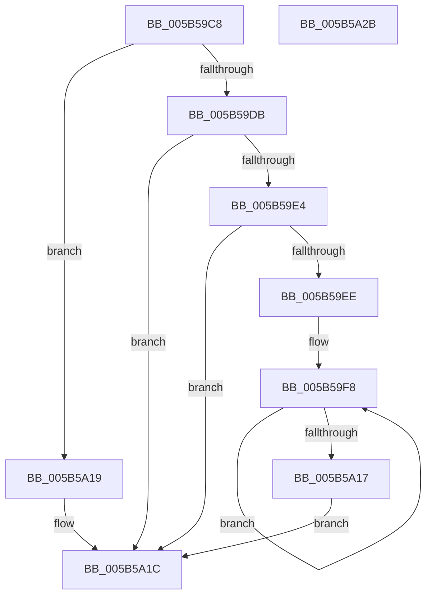

# KeRelaxTimingConstraints

- RVA: `0x005B59C8`–`0x005B5A2C` (길이 `100` bytes)
- VA: `0x00000001405B59C8`
- 실행 섹션: `.text`
- PDB 이름 있음: `예`; PDB Function 태그: `아니요`
- unwind 정보 RVA: `0x0005C788`
- 디코드: `27`개 명령, `100/100` bytes 표시
- 미해석 바이트: `0` (있으면 어셈블리에 `.byte`로 보존)

> 이 문서는 커널 이미지의 기계어와 PDB 기호를 분석해 생성했습니다. 4번과 5번은 함수 원형과 자료형을 바이너리 사용 방식에서 추정한 C 해석이며 원본 소스 복구 결과는 아닙니다.

## 1. Dependencies

- 직접 호출 지점: **1**; 고유 호출 대상: **1**
- 직접 호출자로 확인된 함수: **3**
- RIP 상대 이미지 참조: **4**

### Outgoing calls
- `0x005B5A09` → [KiResetGlobalDpcWatchdogProfiler](../4F/KiResetGlobalDpcWatchdogProfiler_function_004FAEF8.md) (function, `0x004FAEF8`)

### Direct callers
- [KiDeferDpcWatchdogViolation](../44/KiDeferDpcWatchdogViolation_function_0044F37C.md) at `0x0044F39D`
- [KdEnableDebugger](KdEnableDebugger_function_005B0A40.md) at `0x005B0A4F`
- [KdEnableDebugger](KdEnableDebugger_function_005B0A40.md) at `0x005B0A62`
- [KeInitSystem](../../init/C7/KeInitSystem_function_00C71660.md) at `0x00C71823`

### Static image references
- `0x005B59CC` → RVA `0x00FC6AF3` (`ALMOSTRO`; read)
- `0x005B59E4` → RVA `0x00FC6A80` (`ALMOSTRO`; read)
- `0x005B59EE` → RVA `0x00FC8C40` (`ALMOSTRO`; read)
- `0x005B5A1C` → RVA `0x00FC6AF3` (`ALMOSTRO`; write)

## 2. Other-region calls and transfers

- 다른 실행 섹션으로 향하는 call: **0**
- 별도 외부 분기/꼬리 이동을 확인하지 못했습니다.

## 3. Assembly (complete function range)

```asm
005B59C8  48 83 EC 28                     sub rsp, 0x28
005B59CC  80 3D 20 11 A1 00 00            cmp byte ptr [rip + 0xa11120], 0
005B59D3  41 0F 94 C1                     sete r9b
005B59D7  85 C9                           test ecx, ecx
005B59D9  75 3E                           jne 0x1405b5a19
005B59DB  44 8D 41 01                     lea r8d, [rcx + 1]
005B59DF  45 84 C9                        test r9b, r9b
005B59E2  74 38                           je 0x1405b5a1c
005B59E4  8B 05 96 10 A1 00               mov eax, dword ptr [rip + 0xa11096]
005B59EA  85 C0                           test eax, eax
005B59EC  74 2E                           je 0x1405b5a1c
005B59EE  4C 8D 15 4B 32 A1 00            lea r10, [rip + 0xa1324b]
005B59F5  44 8B D8                        mov r11d, eax
005B59F8  49 8B 0A                        mov rcx, qword ptr [r10]
005B59FB  83 A1 AC 83 00 00 00            and dword ptr [rcx + 0x83ac], 0
005B5A02  83 A1 5C 86 00 00 00            and dword ptr [rcx + 0x865c], 0
005B5A09  E8 EA 54 F4 FF                  call 0x1404faef8
005B5A0E  4D 8D 52 08                     lea r10, [r10 + 8]
005B5A12  4D 2B D8                        sub r11, r8
005B5A15  75 E1                           jne 0x1405b59f8
005B5A17  EB 03                           jmp 0x1405b5a1c
005B5A19  45 32 C0                        xor r8b, r8b
005B5A1C  44 88 05 D0 10 A1 00            mov byte ptr [rip + 0xa110d0], r8b
005B5A23  41 8A C1                        mov al, r9b
005B5A26  48 83 C4 28                     add rsp, 0x28
005B5A2A  C3                              ret
005B5A2B  CC                              int3
```

## 4. C-style interpretation (structured pseudocode)

```c
__int64 __fastcall KeRelaxTimingConstraints(__int64 a1)
{
    __int64 result;
    __int64 v_r11;
    __int64 v_rsp;

    v_rsp = (v_rsp) - (40);
    a4 = ((*(unsigned __int8 *)(v_rip + 10555680)) == 0) ? 1 : 0;
    if ((unsigned int)(a1) != 0) goto loc_005B5A19;
    if ((unsigned __int8)(a4) == 0) goto loc_005B5A1C;
    if ((unsigned int)((unsigned int)(*(unsigned int *)(v_rip + 10555542))) == 0) goto loc_005B5A1C;
loc_005B59F8:
    result = KiResetGlobalDpcWatchdogProfiler(*(unsigned __int64 *)(v_rip + 10564171), a2, a1 + 1, a4);
    v_r11 = ((unsigned int)((unsigned int)((unsigned int)(*(unsigned int *)(v_rip + 10555542))))) - (a1 + 1);
    if (condition_is_not_equal) goto loc_005B59F8;
    goto loc_005B5A1C;
loc_005B5A19:
    a3 = 0;
loc_005B5A1C:
    *(unsigned __int8 *)(v_rip + 10555600) = 0;
    v_rsp = (v_rsp) + (40);
    return (unsigned __int8)(a4);
}
```

## 5. (Beta) C Style

```c
int64_t KeRelaxTimingConstraints(int64_t Arg1)
{
    int64_t result;
    int64_t local_r11;
    int64_t local_rsp;

    local_rsp = (local_rsp) - (40);
    a4 = ((*(uint8_t *)(v_rip + 0xA11120)) == 0) ? 1 : 0;
    if ((uint32_t)(Arg1) != 0) goto loc_005B5A19;
    if ((uint8_t)(a4) == 0) goto loc_005B5A1C;
    if ((uint32_t)((uint32_t)(*(uint32_t *)(v_rip + 0xA11096))) == 0) goto loc_005B5A1C;
loc_005B59F8:
    result = KiResetGlobalDpcWatchdogProfiler(*(uint64_t *)(v_rip + 0xA1324B), a2, Arg1 + 1, a4);
    local_r11 = ((uint32_t)((uint32_t)((uint32_t)(*(uint32_t *)(v_rip + 0xA11096))))) - (Arg1 + 1);
    if (condition_is_not_equal) goto loc_005B59F8;
    goto loc_005B5A1C;
loc_005B5A19:
    a3 = 0;
loc_005B5A1C:
    *(uint8_t *)(v_rip + 0xA110D0) = 0;
    local_rsp = (local_rsp) + (40);
    return (uint8_t)(a4);
}
```

## 6. Execution-region graph

[열기: 2D/3D 그래프와 함수 탐색 컨트롤 패널](../../../control-panel.html?section=text&rva=0x005B59C8&view=graph)

- 2D 그래프는 위에서 아래로 흐르고, 3D 그래프는 빈 공간을 드래그해 회전합니다. Shift+드래그는 이동, 휠은 확대·축소, 함수 노드 선택은 대상 보고서 이동입니다.

### Static fallback


