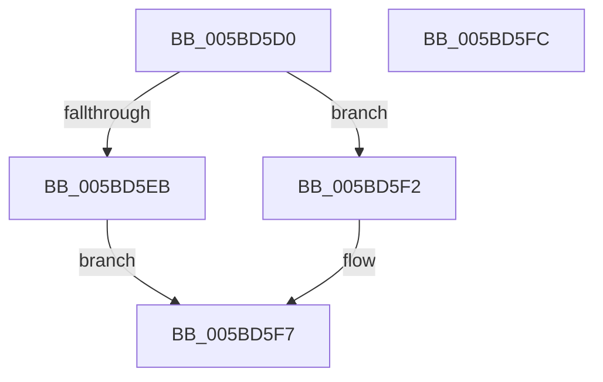

# KeReleaseSpinLockForDpc

- RVA: `0x005BD5D0`–`0x005BD5FD` (길이 `45` bytes)
- VA: `0x00000001405BD5D0`
- 실행 섹션: `.text`
- PDB 이름 있음: `예`; PDB Function 태그: `아니요`
- unwind 정보 RVA: `0x0005C788`
- 디코드: `11`개 명령, `45/45` bytes 표시
- 미해석 바이트: `0` (있으면 어셈블리에 `.byte`로 보존)

> 이 문서는 커널 이미지의 기계어와 PDB 기호를 분석해 생성했습니다. 4번과 5번은 함수 원형과 자료형을 바이너리 사용 방식에서 추정한 C 해석이며 원본 소스 복구 결과는 아닙니다.

## 1. Dependencies

- 직접 호출 지점: **2**; 고유 호출 대상: **2**
- 직접 호출자로 확인된 함수: **0**
- RIP 상대 이미지 참조: **0**

### Outgoing calls
- `0x005BD5EB` → [KeReleaseSpinLock](../39/KeReleaseSpinLock_function_00392BA0.md) (function, `0x00392BA0`)
- `0x005BD5F2` → [KxReleaseSpinLock](../20/KxReleaseSpinLock_function_00206670.md) (function, `0x00206670`)

### Direct callers
- 이 함수 시작 RVA로 연결되는 직접 call은 확인되지 않았습니다. 간접 호출은 완전히 역산할 수 없습니다.

### Static image references
- 디코드된 RIP-relative 메모리 참조가 없습니다.

## 2. Other-region calls and transfers

- 다른 실행 섹션으로 향하는 call: **0**
- 별도 외부 분기/꼬리 이동을 확인하지 못했습니다.

## 3. Assembly (complete function range)

```asm
005BD5D0  48 83 EC 28                     sub rsp, 0x28
005BD5D4  65 48 8B 04 25 20 00 00 00      mov rax, qword ptr gs:[0x20]
005BD5DD  44 8B 80 BC 38 00 00            mov r8d, dword ptr [rax + 0x38bc]
005BD5E4  41 0F BA E0 10                  bt r8d, 0x10
005BD5E9  73 07                           jae 0x1405bd5f2
005BD5EB  E8 B0 55 DD FF                  call 0x140392ba0
005BD5F0  EB 05                           jmp 0x1405bd5f7
005BD5F2  E8 79 90 C4 FF                  call 0x140206670
005BD5F7  48 83 C4 28                     add rsp, 0x28
005BD5FB  C3                              ret
005BD5FC  CC                              int3
```

## 4. C-style interpretation (structured pseudocode)

```c
__int64 __fastcall KeReleaseSpinLockForDpc(void)
{
    __int64 result;
    __int64 v_rsp;

    v_rsp = (v_rsp) - (40);
    if (condition_is_above_or_equal) goto loc_005BD5F2;
    result = KeReleaseSpinLock(a1, a2, (unsigned int)(*(unsigned int *)(*(unsigned __int64 *)(gs_base + (0 + 32)) + 14524)), a4);
    goto loc_005BD5F7;
loc_005BD5F2:
    result = KxReleaseSpinLock(a1, a2, (unsigned int)(*(unsigned int *)(*(unsigned __int64 *)(gs_base + (0 + 32)) + 14524)), a4);
loc_005BD5F7:
    v_rsp = (v_rsp) + (40);
    return result;
}
```

## 5. (Beta) C Style

```c
void KeReleaseSpinLockForDpc(void)
{
    int64_t result;
    int64_t local_rsp;

    local_rsp = (local_rsp) - (40);
    if (condition_is_above_or_equal) goto loc_005BD5F2;
    result = KeReleaseSpinLock(a1, a2, (uint32_t)(*(uint32_t *)(*(uint64_t *)(gs_base + (0 + 0x20)) + 0x38BC)), a4);
    goto loc_005BD5F7;
loc_005BD5F2:
    result = KxReleaseSpinLock(a1, a2, (uint32_t)(*(uint32_t *)(*(uint64_t *)(gs_base + (0 + 0x20)) + 0x38BC)), a4);
loc_005BD5F7:
    local_rsp = (local_rsp) + (40);
    return result;
}
```

## 6. Execution-region graph

[열기: 2D/3D 그래프와 함수 탐색 컨트롤 패널](../../../control-panel.html?section=text&rva=0x005BD5D0&view=graph)

- 2D 그래프는 위에서 아래로 흐르고, 3D 그래프는 빈 공간을 드래그해 회전합니다. Shift+드래그는 이동, 휠은 확대·축소, 함수 노드 선택은 대상 보고서 이동입니다.

### Static fallback


