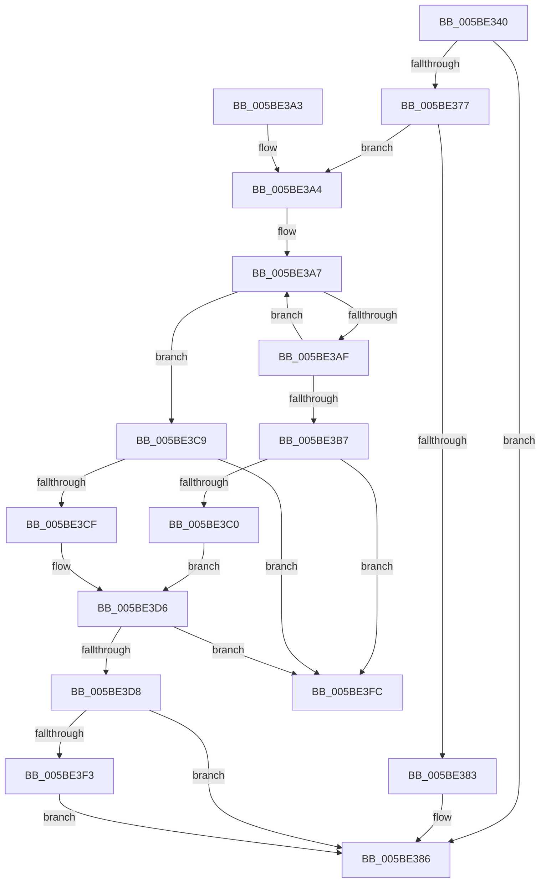

# KeRemoveByKeyDeviceQueueIfBusy

- RVA: `0x005BE340`–`0x005BE403` (길이 `195` bytes)
- VA: `0x00000001405BE340`
- 실행 섹션: `.text`
- PDB 이름 있음: `예`; PDB Function 태그: `아니요`
- unwind 정보 RVA: `0x000CA53C`
- 디코드: `62`개 명령, `195/195` bytes 표시
- 미해석 바이트: `0` (있으면 어셈블리에 `.byte`로 보존)

> 이 문서는 커널 이미지의 기계어와 PDB 기호를 분석해 생성했습니다. 4번과 5번은 함수 원형과 자료형을 바이너리 사용 방식에서 추정한 C 해석이며 원본 소스 복구 결과는 아닙니다.

## 1. Dependencies

- 직접 호출 지점: **2**; 고유 호출 대상: **2**
- 직접 호출자로 확인된 함수: **0**
- RIP 상대 이미지 참조: **0**

### Outgoing calls
- `0x005BE36D` → [KeAcquireInStackQueuedSpinLockForDpc](../45/KeAcquireInStackQueuedSpinLockForDpc_function_0045FE50.md) (function, `0x0045FE50`)
- `0x005BE38B` → [KeReleaseInStackQueuedSpinLockForDpc](../46/KeReleaseInStackQueuedSpinLockForDpc_function_0046A3E0.md) (function, `0x0046A3E0`)

### Direct callers
- 이 함수 시작 RVA로 연결되는 직접 call은 확인되지 않았습니다. 간접 호출은 완전히 역산할 수 없습니다.

### Static image references
- 디코드된 RIP-relative 메모리 참조가 없습니다.

## 2. Other-region calls and transfers

- 다른 실행 섹션으로 향하는 call: **0**
- 별도 외부 분기/꼬리 이동을 확인하지 못했습니다.

## 3. Assembly (complete function range)

```asm
005BE340  4C 8B DC                        mov r11, rsp
005BE343  49 89 5B 08                     mov qword ptr [r11 + 8], rbx
005BE347  49 89 73 10                     mov qword ptr [r11 + 0x10], rsi
005BE34B  57                              push rdi
005BE34C  48 83 EC 40                     sub rsp, 0x40
005BE350  0F 57 C0                        xorps xmm0, xmm0
005BE353  8B F2                           mov esi, edx
005BE355  48 8B F9                        mov rdi, rcx
005BE358  49 8D 53 D8                     lea rdx, [r11 - 0x28]
005BE35C  33 C0                           xor eax, eax
005BE35E  48 83 C1 18                     add rcx, 0x18
005BE362  0F 11 44 24 20                  movups xmmword ptr [rsp + 0x20], xmm0
005BE367  49 89 43 E8                     mov qword ptr [r11 - 0x18], rax
005BE36B  33 DB                           xor ebx, ebx
005BE36D  E8 DE 1A EA FF                  call 0x14045fe50
005BE372  38 5F 20                        cmp byte ptr [rdi + 0x20], bl
005BE375  74 0F                           je 0x1405be386
005BE377  48 8D 47 08                     lea rax, [rdi + 8]
005BE37B  48 8B 10                        mov rdx, qword ptr [rax]
005BE37E  48 3B D0                        cmp rdx, rax
005BE381  75 21                           jne 0x1405be3a4
005BE383  88 5F 20                        mov byte ptr [rdi + 0x20], bl
005BE386  48 8D 4C 24 20                  lea rcx, [rsp + 0x20]
005BE38B  E8 50 C0 EA FF                  call 0x14046a3e0
005BE390  48 8B 74 24 58                  mov rsi, qword ptr [rsp + 0x58]
005BE395  48 8B C3                        mov rax, rbx
005BE398  48 8B 5C 24 50                  mov rbx, qword ptr [rsp + 0x50]
005BE39D  48 83 C4 40                     add rsp, 0x40
005BE3A1  5F                              pop rdi
005BE3A2  C3                              ret
005BE3A3  CC                              int3
005BE3A4  48 8B DA                        mov rbx, rdx
005BE3A7  48 8B 0B                        mov rcx, qword ptr [rbx]
005BE3AA  3B 73 10                        cmp esi, dword ptr [rbx + 0x10]
005BE3AD  76 1A                           jbe 0x1405be3c9
005BE3AF  48 8B D9                        mov rbx, rcx
005BE3B2  48 3B C8                        cmp rcx, rax
005BE3B5  75 F0                           jne 0x1405be3a7
005BE3B7  48 8B DA                        mov rbx, rdx
005BE3BA  48 39 42 08                     cmp qword ptr [rdx + 8], rax
005BE3BE  75 3C                           jne 0x1405be3fc
005BE3C0  48 8B 0A                        mov rcx, qword ptr [rdx]
005BE3C3  48 39 51 08                     cmp qword ptr [rcx + 8], rdx
005BE3C7  EB 0D                           jmp 0x1405be3d6
005BE3C9  48 39 59 08                     cmp qword ptr [rcx + 8], rbx
005BE3CD  75 2D                           jne 0x1405be3fc
005BE3CF  48 8B 43 08                     mov rax, qword ptr [rbx + 8]
005BE3D3  48 39 18                        cmp qword ptr [rax], rbx
005BE3D6  75 24                           jne 0x1405be3fc
005BE3D8  48 89 08                        mov qword ptr [rax], rcx
005BE3DB  48 89 41 08                     mov qword ptr [rcx + 8], rax
005BE3DF  C6 43 14 00                     mov byte ptr [rbx + 0x14], 0
005BE3E3  48 8B 4F 20                     mov rcx, qword ptr [rdi + 0x20]
005BE3E7  48 8B C1                        mov rax, rcx
005BE3EA  48 C1 F8 08                     sar rax, 8
005BE3EE  48 3B D8                        cmp rbx, rax
005BE3F1  75 93                           jne 0x1405be386
005BE3F3  0F B6 C1                        movzx eax, cl
005BE3F6  48 89 47 20                     mov qword ptr [rdi + 0x20], rax
005BE3FA  EB 8A                           jmp 0x1405be386
005BE3FC  B9 03 00 00 00                  mov ecx, 3
005BE401  CD 29                           int 0x29
```

## 4. C-style interpretation (structured pseudocode)

```c
__int64 __fastcall KeRemoveByKeyDeviceQueueIfBusy(__int64 a1, int a2)
{
    __int64 result;
    __int64 v_rbx;
    __int64 v_rsp;
    unsigned __int64 v_stack_m28;
    unsigned __int64 v_stack_p10;
    unsigned __int64 v_stack_p8;

    *(unsigned __int64 *)(v_rsp + 8) = v_rbx;
    *(unsigned __int64 *)(v_rsp + 16) = v_rsi;
    v_rsp = (v_rsp) - (64);
    result = 0;
    a1 = (a1) + (24);
    v_stack_m28 = v_xmm0;
    *(unsigned __int64 *)(v_rsp - 24) = 0;
    v_rbx = 0;
    result = KeAcquireInStackQueuedSpinLockForDpc(a1, v_rsp - 40, a3, a4);
    if ((*(unsigned __int8 *)(a1 + 32)) == 0) goto loc_005BE386;
    if ((*(unsigned __int64 *)(a1 + 8)) != (a1 + 8)) goto loc_005BE3A4;
    *(unsigned __int8 *)(a1 + 32) = 0;
loc_005BE386:
    result = KeReleaseInStackQueuedSpinLockForDpc(v_stack_m28, *(unsigned __int64 *)(a1 + 8), a3, a4);
    v_rsp = (v_rsp) + (64);
    return 0;
loc_005BE3A4:
loc_005BE3A7:
    if (((unsigned int)(v_stack_p10)) <= (*(unsigned int *)(*(unsigned __int64 *)(a1 + 8) + 16))) goto loc_005BE3C9;
    if ((*(unsigned __int64 *)(*(unsigned __int64 *)(a1 + 8))) != 0) goto loc_005BE3A7;
    if ((*(unsigned __int64 *)(*(unsigned __int64 *)(a1 + 8) + 8)) != 0) goto loc_005BE3FC;
    goto loc_005BE3D6;
loc_005BE3C9:
    if ((*(unsigned __int64 *)(*(unsigned __int64 *)(*(unsigned __int64 *)(a1 + 8)) + 8)) != (*(unsigned __int64 *)(a1 + 8))) goto loc_005BE3FC;
loc_005BE3D6:
    if ((*(unsigned __int64 *)(*(unsigned __int64 *)(*(unsigned __int64 *)(a1 + 8) + 8))) != (*(unsigned __int64 *)(a1 + 8))) goto loc_005BE3FC;
    *(unsigned __int64 *)(*(unsigned __int64 *)(*(unsigned __int64 *)(a1 + 8) + 8)) = *(unsigned __int64 *)(*(unsigned __int64 *)(a1 + 8));
    *(unsigned __int64 *)(*(unsigned __int64 *)(*(unsigned __int64 *)(a1 + 8)) + 8) = *(unsigned __int64 *)(*(unsigned __int64 *)(a1 + 8) + 8);
    *(unsigned __int8 *)(*(unsigned __int64 *)(a1 + 8) + 20) = 0;
    result = (*(unsigned __int64 *)(a1 + 32)) >> (8);
    if ((*(unsigned __int64 *)(a1 + 8)) != result) goto loc_005BE386;
    *(unsigned __int64 *)(a1 + 32) = (unsigned __int8)(*(unsigned __int64 *)(a1 + 32));
    goto loc_005BE386;
loc_005BE3FC:
    return (unsigned __int8)(*(unsigned __int64 *)(a1 + 32));
}
```

## 5. (Beta) C Style

```c
int64_t KeRemoveByKeyDeviceQueueIfBusy(void *Arg1, int32_t Arg2)
{
    uint8_t *arg1 = (uint8_t *)Arg1;

    int64_t result;
    int64_t local_rbx;
    int64_t local_rsp;
    uint64_t v_stack_m28;
    uint64_t v_stack_p10;
    uint64_t v_stack_p8;

    *(uint64_t *)(local_rsp + 0x8) = local_rbx;
    *(uint64_t *)(local_rsp + 0x10) = local_rsi;
    local_rsp = (local_rsp) - (64);
    result = 0;
    Arg1 = (Arg1) + (24);
    v_stack_m28 = v_xmm0;
    *(uint64_t *)(local_rsp - 0x18) = 0;
    local_rbx = 0;
    result = KeAcquireInStackQueuedSpinLockForDpc(Arg1, local_rsp - 40, a3, a4);
    if ((*(uint8_t *)(arg1 + 0x20)) == 0) goto loc_005BE386;
    if ((*(uint64_t *)(arg1 + 0x8)) != (Arg1 + 8)) goto loc_005BE3A4;
    *(uint8_t *)(arg1 + 0x20) = 0;
loc_005BE386:
    result = KeReleaseInStackQueuedSpinLockForDpc(v_stack_m28, *(uint64_t *)(arg1 + 0x8), a3, a4);
    local_rsp = (local_rsp) + (64);
    return 0;
loc_005BE3A4:
loc_005BE3A7:
    if (((uint32_t)(v_stack_p10)) <= (*(uint32_t *)(*(uint64_t *)(arg1 + 0x8) + 0x10))) goto loc_005BE3C9;
    if ((*(uint64_t *)(*(uint64_t *)(arg1 + 0x8))) != 0) goto loc_005BE3A7;
    if ((*(uint64_t *)(*(uint64_t *)(arg1 + 0x8) + 0x8)) != 0) goto loc_005BE3FC;
    goto loc_005BE3D6;
loc_005BE3C9:
    if ((*(uint64_t *)(*(uint64_t *)(*(uint64_t *)(arg1 + 0x8)) + 0x8)) != (*(uint64_t *)(arg1 + 0x8))) goto loc_005BE3FC;
loc_005BE3D6:
    if ((*(uint64_t *)(*(uint64_t *)(*(uint64_t *)(arg1 + 0x8) + 0x8))) != (*(uint64_t *)(arg1 + 0x8))) goto loc_005BE3FC;
    *(uint64_t *)(*(uint64_t *)(*(uint64_t *)(arg1 + 0x8) + 0x8)) = *(uint64_t *)(*(uint64_t *)(arg1 + 0x8));
    *(uint64_t *)(*(uint64_t *)(*(uint64_t *)(arg1 + 0x8)) + 0x8) = *(uint64_t *)(*(uint64_t *)(arg1 + 0x8) + 0x8);
    *(uint8_t *)(*(uint64_t *)(arg1 + 0x8) + 0x14) = 0;
    result = (*(uint64_t *)(arg1 + 0x20)) >> (8);
    if ((*(uint64_t *)(arg1 + 0x8)) != result) goto loc_005BE386;
    *(uint64_t *)(arg1 + 0x20) = (uint8_t)(*(uint64_t *)(arg1 + 0x20));
    goto loc_005BE386;
loc_005BE3FC:
    return (uint8_t)(*(uint64_t *)(arg1 + 0x20));
}
```

### 관측된 메모리 오프셋

구조체 형식이 확인되지 않은 접근은 인자 기준의 오프셋으로만 기록했습니다.

| 기준 인자 | 오프셋 표현 | 폭 (bit) | 접근 |
|---|---:|---:|---|
| `Arg1` | `+ 0x0` | `64` | `R` |
| `Arg1` | `+ 0x8` | `64` | `R` |
| `Arg1` | `+ 0x20` | `8` | `R` |
| `Arg1` | `+ 0x20` | `8` | `W` |
| `Arg1` | `+ 0x20` | `64` | `R` |
| `Arg1` | `+ 0x20` | `64` | `W` |

## 6. Execution-region graph

[열기: 2D/3D 그래프와 함수 탐색 컨트롤 패널](../../../control-panel.html?section=text&rva=0x005BE340&view=graph)

- 2D 그래프는 위에서 아래로 흐르고, 3D 그래프는 빈 공간을 드래그해 회전합니다. Shift+드래그는 이동, 휠은 확대·축소, 함수 노드 선택은 대상 보고서 이동입니다.

### Static fallback


