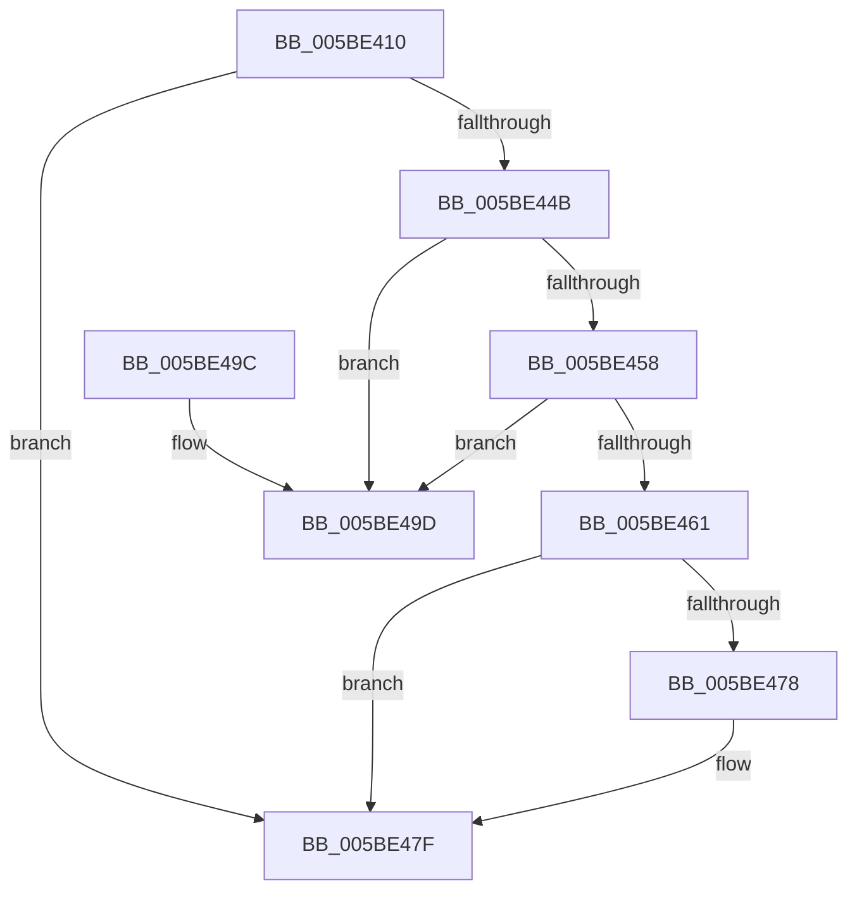

# KeRemoveEntryDeviceQueue

- RVA: `0x005BE410`–`0x005BE4A4` (길이 `148` bytes)
- VA: `0x00000001405BE410`
- 실행 섹션: `.text`
- PDB 이름 있음: `예`; PDB Function 태그: `아니요`
- unwind 정보 RVA: `0x000A9B4C`
- 디코드: `44`개 명령, `148/148` bytes 표시
- 미해석 바이트: `0` (있으면 어셈블리에 `.byte`로 보존)

> 이 문서는 커널 이미지의 기계어와 PDB 기호를 분석해 생성했습니다. 4번과 5번은 함수 원형과 자료형을 바이너리 사용 방식에서 추정한 C 해석이며 원본 소스 복구 결과는 아닙니다.

## 1. Dependencies

- 직접 호출 지점: **2**; 고유 호출 대상: **2**
- 직접 호출자로 확인된 함수: **1**
- RIP 상대 이미지 참조: **0**

### Outgoing calls
- `0x005BE43C` → [KeAcquireInStackQueuedSpinLock](../27/KeAcquireInStackQueuedSpinLock_function_002757A0.md) (function, `0x002757A0`)
- `0x005BE484` → [KeReleaseInStackQueuedSpinLock](../34/KeReleaseInStackQueuedSpinLock_function_00342CE0.md) (function, `0x00342CE0`)

### Direct callers
- [DifKeRemoveEntryDeviceQueueWrapper](../63/DifKeRemoveEntryDeviceQueueWrapper_function_00632200.md) at `0x006322D4`

### Static image references
- 디코드된 RIP-relative 메모리 참조가 없습니다.

## 2. Other-region calls and transfers

- 다른 실행 섹션으로 향하는 call: **0**
- 별도 외부 분기/꼬리 이동을 확인하지 못했습니다.

## 3. Assembly (complete function range)

```asm
005BE410  4C 8B DC                        mov r11, rsp
005BE413  49 89 5B 08                     mov qword ptr [r11 + 8], rbx
005BE417  49 89 73 10                     mov qword ptr [r11 + 0x10], rsi
005BE41B  57                              push rdi
005BE41C  48 83 EC 40                     sub rsp, 0x40
005BE420  0F 57 C0                        xorps xmm0, xmm0
005BE423  48 8B DA                        mov rbx, rdx
005BE426  48 8B F9                        mov rdi, rcx
005BE429  49 8D 53 D8                     lea rdx, [r11 - 0x28]
005BE42D  33 C0                           xor eax, eax
005BE42F  48 83 C1 18                     add rcx, 0x18
005BE433  0F 11 44 24 20                  movups xmmword ptr [rsp + 0x20], xmm0
005BE438  49 89 43 E8                     mov qword ptr [r11 - 0x18], rax
005BE43C  E8 5F 73 CB FF                  call 0x1402757a0
005BE441  40 8A 73 14                     mov sil, byte ptr [rbx + 0x14]
005BE445  40 80 FE 01                     cmp sil, 1
005BE449  75 34                           jne 0x1405be47f
005BE44B  C6 43 14 00                     mov byte ptr [rbx + 0x14], 0
005BE44F  48 8B 0B                        mov rcx, qword ptr [rbx]
005BE452  48 39 59 08                     cmp qword ptr [rcx + 8], rbx
005BE456  75 45                           jne 0x1405be49d
005BE458  48 8B 43 08                     mov rax, qword ptr [rbx + 8]
005BE45C  48 39 18                        cmp qword ptr [rax], rbx
005BE45F  75 3C                           jne 0x1405be49d
005BE461  48 89 08                        mov qword ptr [rax], rcx
005BE464  48 89 41 08                     mov qword ptr [rcx + 8], rax
005BE468  48 8B 4F 20                     mov rcx, qword ptr [rdi + 0x20]
005BE46C  48 8B C1                        mov rax, rcx
005BE46F  48 C1 F8 08                     sar rax, 8
005BE473  48 3B D8                        cmp rbx, rax
005BE476  75 07                           jne 0x1405be47f
005BE478  0F B6 C1                        movzx eax, cl
005BE47B  48 89 47 20                     mov qword ptr [rdi + 0x20], rax
005BE47F  48 8D 4C 24 20                  lea rcx, [rsp + 0x20]
005BE484  E8 57 48 D8 FF                  call 0x140342ce0
005BE489  48 8B 5C 24 50                  mov rbx, qword ptr [rsp + 0x50]
005BE48E  40 8A C6                        mov al, sil
005BE491  48 8B 74 24 58                  mov rsi, qword ptr [rsp + 0x58]
005BE496  48 83 C4 40                     add rsp, 0x40
005BE49A  5F                              pop rdi
005BE49B  C3                              ret
005BE49C  CC                              int3
005BE49D  B9 03 00 00 00                  mov ecx, 3
005BE4A2  CD 29                           int 0x29
```

## 4. C-style interpretation (structured pseudocode)

```c
__int64 __fastcall KeRemoveEntryDeviceQueue(__int64 a1, __int64 a2)
{
    __int64 result;
    __int64 v_rsp;
    unsigned __int64 v_stack_m28;
    unsigned __int64 v_stack_p10;
    unsigned __int64 v_stack_p8;

    *(unsigned __int64 *)(v_rsp + 8) = v_rbx;
    *(unsigned __int64 *)(v_rsp + 16) = v_rsi;
    v_rsp = (v_rsp) - (64);
    result = 0;
    a1 = (a1) + (24);
    v_stack_m28 = v_xmm0;
    *(unsigned __int64 *)(v_rsp - 24) = 0;
    result = KeAcquireInStackQueuedSpinLock(a1, v_rsp - 40, a3, a4);
    if (((unsigned __int8)(*(unsigned __int8 *)(a2 + 20))) != 1) goto loc_005BE47F;
    *(unsigned __int8 *)(a2 + 20) = 0;
    if ((*(unsigned __int64 *)(*(unsigned __int64 *)(a2) + 8)) != a2) goto loc_005BE49D;
    if ((*(unsigned __int64 *)(*(unsigned __int64 *)(a2 + 8))) != a2) goto loc_005BE49D;
    *(unsigned __int64 *)(*(unsigned __int64 *)(a2 + 8)) = *(unsigned __int64 *)(a2);
    *(unsigned __int64 *)(*(unsigned __int64 *)(a2) + 8) = *(unsigned __int64 *)(a2 + 8);
    result = (*(unsigned __int64 *)(a1 + 32)) >> (8);
    if (a2 == result) {
        result = (unsigned __int8)(*(unsigned __int64 *)(a1 + 32));
        *(unsigned __int64 *)(a1 + 32) = result;
    }
    result = KeReleaseInStackQueuedSpinLock(v_stack_m28, v_rsp - 40, a3, a4);
    v_rsp = (v_rsp) + (64);
    return (unsigned __int8)(*(unsigned __int8 *)(a2 + 20));
loc_005BE49D:
    return (unsigned __int8)(*(unsigned __int8 *)(a2 + 20));
}
```

## 5. (Beta) C Style

```c
int64_t KeRemoveEntryDeviceQueue(void *Arg1, void *Arg2)
{
    uint8_t *arg1 = (uint8_t *)Arg1;
    uint8_t *arg2 = (uint8_t *)Arg2;

    int64_t result;
    int64_t local_rsp;
    uint64_t v_stack_m28;
    uint64_t v_stack_p10;
    uint64_t v_stack_p8;

    *(uint64_t *)(local_rsp + 0x8) = local_rbx;
    *(uint64_t *)(local_rsp + 0x10) = local_rsi;
    local_rsp = (local_rsp) - (64);
    result = 0;
    Arg1 = (Arg1) + (24);
    v_stack_m28 = v_xmm0;
    *(uint64_t *)(local_rsp - 0x18) = 0;
    result = KeAcquireInStackQueuedSpinLock(Arg1, local_rsp - 40, a3, a4);
    if (((uint8_t)(*(uint8_t *)(arg2 + 0x14))) != 1) goto loc_005BE47F;
    *(uint8_t *)(arg2 + 0x14) = 0;
    if ((*(uint64_t *)(*(uint64_t *)(arg2) + 0x8)) != Arg2) goto loc_005BE49D;
    if ((*(uint64_t *)(*(uint64_t *)(arg2 + 0x8))) != Arg2) goto loc_005BE49D;
    *(uint64_t *)(*(uint64_t *)(arg2 + 0x8)) = *(uint64_t *)(arg2);
    *(uint64_t *)(*(uint64_t *)(arg2) + 0x8) = *(uint64_t *)(arg2 + 0x8);
    result = (*(uint64_t *)(arg1 + 0x20)) >> (8);
    if (Arg2 == result) {
        result = (uint8_t)(*(uint64_t *)(arg1 + 0x20));
        *(uint64_t *)(arg1 + 0x20) = result;
    }
    result = KeReleaseInStackQueuedSpinLock(v_stack_m28, local_rsp - 40, a3, a4);
    local_rsp = (local_rsp) + (64);
    return (uint8_t)(*(uint8_t *)(arg2 + 0x14));
loc_005BE49D:
    return (uint8_t)(*(uint8_t *)(arg2 + 0x14));
}
```

### 관측된 메모리 오프셋

구조체 형식이 확인되지 않은 접근은 인자 기준의 오프셋으로만 기록했습니다.

| 기준 인자 | 오프셋 표현 | 폭 (bit) | 접근 |
|---|---:|---:|---|
| `Arg1` | `+ 0x20` | `64` | `R` |
| `Arg1` | `+ 0x20` | `64` | `W` |
| `Arg2` | `+ 0x0` | `64` | `R` |
| `Arg2` | `+ 0x8` | `64` | `R` |
| `Arg2` | `+ 0x14` | `8` | `R` |
| `Arg2` | `+ 0x14` | `8` | `W` |

## 6. Execution-region graph

[열기: 2D/3D 그래프와 함수 탐색 컨트롤 패널](../../../control-panel.html?section=text&rva=0x005BE410&view=graph)

- 2D 그래프는 위에서 아래로 흐르고, 3D 그래프는 빈 공간을 드래그해 회전합니다. Shift+드래그는 이동, 휠은 확대·축소, 함수 노드 선택은 대상 보고서 이동입니다.

### Static fallback


