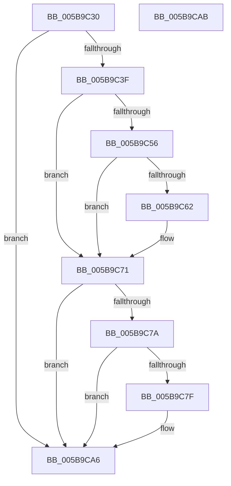

# KeRestoreSupervisorState

- RVA: `0x005B9C30`–`0x005B9CAC` (길이 `124` bytes)
- VA: `0x00000001405B9C30`
- 실행 섹션: `.text`
- PDB 이름 있음: `예`; PDB Function 태그: `아니요`
- unwind 정보 RVA: `0x0005C788`
- 디코드: `30`개 명령, `124/124` bytes 표시
- 미해석 바이트: `0` (있으면 어셈블리에 `.byte`로 보존)

> 이 문서는 커널 이미지의 기계어와 PDB 기호를 분석해 생성했습니다. 4번과 5번은 함수 원형과 자료형을 바이너리 사용 방식에서 추정한 C 해석이며 원본 소스 복구 결과는 아닙니다.

## 1. Dependencies

- 직접 호출 지점: **2**; 고유 호출 대상: **2**
- 직접 호출자로 확인된 함수: **3**
- RIP 상대 이미지 참조: **3**

### Outgoing calls
- `0x005B9C6C` → [RtlXRestoreS](../3D/RtlXRestoreS_function_003D63C4.md) (function, `0x003D63C4`)
- `0x005B9CA1` → [KiRestoreIptState](../4C/KiRestoreIptState_function_004C3E4C.md) (function, `0x004C3E4C`)

### Direct callers
- [IopLiveDumpProcessCorralStateChange](../47/IopLiveDumpProcessCorralStateChange_function_00471C7C.md) at `0x00471D45`
- [KiFreezeTargetExecution](../5C/KiFreezeTargetExecution_function_005C30A0.md) at `0x005C32CA`
- [KdExitDebugger](../../pagekd/B8/KdExitDebugger_function_00B85008.md) at `0x00B850C8`

### Static image references
- `0x005B9C49` → RVA `0x00FC6B30` (`ALMOSTRO`; read)
- `0x005B9C56` → RVA `0x00FC6C60` (`ALMOSTRO`; read)
- `0x005B9C71` → RVA `0x00FC6B94` (`ALMOSTRO`; read)

## 2. Other-region calls and transfers

- 다른 실행 섹션으로 향하는 call: **0**
- 별도 외부 분기/꼬리 이동을 확인하지 못했습니다.

## 3. Assembly (complete function range)

```asm
005B9C30  48 83 EC 28                     sub rsp, 0x28
005B9C34  4C 8B C2                        mov r8, rdx
005B9C37  4C 8B D1                        mov r10, rcx
005B9C3A  48 85 C9                        test rcx, rcx
005B9C3D  74 67                           je 0x1405b9ca6
005B9C3F  4C 8B CA                        mov r9, rdx
005B9C42  41 81 E1 00 01 00 00            and r9d, 0x100
005B9C49  48 F7 05 DC CE A0 00 00 00 80 00  test qword ptr [rip + 0xa0cedc], 0x800000
005B9C54  74 1B                           je 0x1405b9c71
005B9C56  48 8B 15 03 D0 A0 00            mov rdx, qword ptr [rip + 0xa0d003]
005B9C5D  48 85 D2                        test rdx, rdx
005B9C60  74 0F                           je 0x1405b9c71
005B9C62  49 23 D0                        and rdx, r8
005B9C65  48 81 C1 00 FE FF FF            add rcx, -0x200
005B9C6C  E8 53 C7 E1 FF                  call 0x1403d63c4
005B9C71  83 3D 1C CF A0 00 00            cmp dword ptr [rip + 0xa0cf1c], 0
005B9C78  74 2C                           je 0x1405b9ca6
005B9C7A  4D 85 C9                        test r9, r9
005B9C7D  74 27                           je 0x1405b9ca6
005B9C7F  48 B8 00 06 00 00 80 F7 FF FF   movabs rax, 0xfffff78000000600
005B9C89  49 83 C2 40                     add r10, 0x40
005B9C8D  8B 08                           mov ecx, dword ptr [rax]
005B9C8F  48 B8 E8 03 00 00 80 F7 FF FF   movabs rax, 0xfffff780000003e8
005B9C99  8B 00                           mov eax, dword ptr [rax]
005B9C9B  48 2B C8                        sub rcx, rax
005B9C9E  49 03 CA                        add rcx, r10
005B9CA1  E8 A6 A1 F0 FF                  call 0x1404c3e4c
005B9CA6  48 83 C4 28                     add rsp, 0x28
005B9CAA  C3                              ret
005B9CAB  CC                              int3
```

## 4. C-style interpretation (structured pseudocode)

```c
__int64 __fastcall KeRestoreSupervisorState(__int64 a1, __int64 a2)
{
    __int64 result;
    __int64 v_r10;
    __int64 v_rsp;

    v_rsp = (v_rsp) - (40);
    if (a1 == 0) goto loc_005B9CA6;
    a4 = (unsigned int)((a2) & (256));
    if (((*(unsigned __int64 *)(v_rip + 10538716)) & (0x800000ULL)) == 0) goto loc_005B9C71;
    if (*(unsigned __int64 *)(v_rip + 10539011) != 0) {
        a2 = (*(unsigned __int64 *)(v_rip + 10539011)) & (a2);
        a1 = (a1) + (-512);
        result = RtlXRestoreS(a1, a2, a2, a4);
    }
    if ((*(unsigned int *)(v_rip + 10538780)) == 0) goto loc_005B9CA6;
    v_r10 = a1;
    if (a4 != 0) {
        v_r10 = (a1) + (64);
        a1 = *(unsigned int *)(result);
        result = *(unsigned int *)(result);
        a1 = (a1) - (result);
        a1 = (a1) + (v_r10);
        result = KiRestoreIptState(a1, a2, a2, a4);
    }
    v_rsp = (v_rsp) + (40);
    return result;
}
```

## 5. (Beta) C Style

```c
int64_t KeRestoreSupervisorState(int64_t Arg1, int64_t Arg2)
{
    int64_t result;
    int64_t local_r10;
    int64_t local_rsp;

    local_rsp = (local_rsp) - (40);
    if (Arg1 == 0) goto loc_005B9CA6;
    a4 = (uint32_t)((Arg2) & (256));
    if (((*(uint64_t *)(v_rip + 0xA0CEDC)) & (0x800000ULL)) == 0) goto loc_005B9C71;
    if (*(uint64_t *)(v_rip + 0xA0D003) != 0) {
        Arg2 = (*(uint64_t *)(v_rip + 0xA0D003)) & (Arg2);
        Arg1 = (Arg1) + (-512);
        result = RtlXRestoreS(Arg1, Arg2, Arg2, a4);
    }
    if ((*(uint32_t *)(v_rip + 0xA0CF1C)) == 0) goto loc_005B9CA6;
    local_r10 = Arg1;
    if (a4 != 0) {
        local_r10 = (Arg1) + (64);
        Arg1 = *(uint32_t *)(result);
        result = *(uint32_t *)(result);
        Arg1 = (Arg1) - (result);
        Arg1 = (Arg1) + (local_r10);
        result = KiRestoreIptState(Arg1, Arg2, Arg2, a4);
    }
    local_rsp = (local_rsp) + (40);
    return result;
}
```

## 6. Execution-region graph

[열기: 2D/3D 그래프와 함수 탐색 컨트롤 패널](../../../control-panel.html?section=text&rva=0x005B9C30&view=graph)

- 2D 그래프는 위에서 아래로 흐르고, 3D 그래프는 빈 공간을 드래그해 회전합니다. Shift+드래그는 이동, 휠은 확대·축소, 함수 노드 선택은 대상 보고서 이동입니다.

### Static fallback


