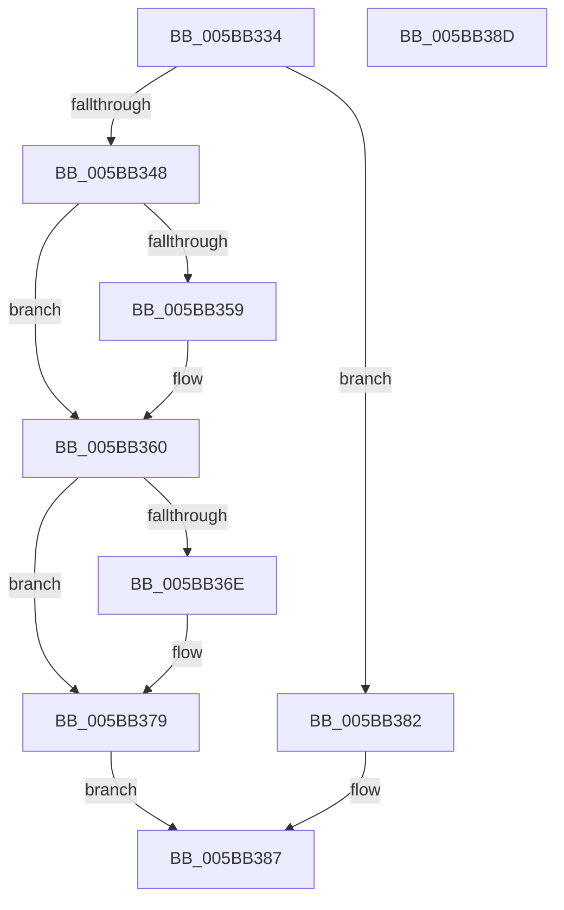

# KeResumeClockTimerSafe

- RVA: `0x005BB334`–`0x005BB38E` (길이 `90` bytes)
- VA: `0x00000001405BB334`
- 실행 섹션: `.text`
- PDB 이름 있음: `예`; PDB Function 태그: `아니요`
- unwind 정보 RVA: `0x0005CF00`
- 디코드: `26`개 명령, `90/90` bytes 표시
- 미해석 바이트: `0` (있으면 어셈블리에 `.byte`로 보존)

> 이 문서는 커널 이미지의 기계어와 PDB 기호를 분석해 생성했습니다. 4번과 5번은 함수 원형과 자료형을 바이너리 사용 방식에서 추정한 C 해석이며 원본 소스 복구 결과는 아닙니다.

## 1. Dependencies

- 직접 호출 지점: **5**; 고유 호출 대상: **4**
- 직접 호출자로 확인된 함수: **3**
- RIP 상대 이미지 참조: **1**

### Outgoing calls
- `0x005BB33A` → [KeGetEffectiveIrql](../2F/KeGetEffectiveIrql_function_002F8030.md) (function, `0x002F8030`)
- `0x005BB35B` → [KiRaiseIrqlProcessIrqlFlags](../4F/KiRaiseIrqlProcessIrqlFlags_function_004F56FC.md) (function, `0x004F56FC`)
- `0x005BB360` → [KiResumeClockTimer](../4F/KiResumeClockTimer_function_004F6420.md) (function, `0x004F6420`)
- `0x005BB374` → [KiLowerIrqlProcessIrqlFlags](../4F/KiLowerIrqlProcessIrqlFlags_function_004F5698.md) (function, `0x004F5698`)
- `0x005BB382` → [KiResumeClockTimer](../4F/KiResumeClockTimer_function_004F6420.md) (function, `0x004F6420`)

### Direct callers
- [IopLiveDumpProcessCorralStateChange](../47/IopLiveDumpProcessCorralStateChange_function_00471C7C.md) at `0x00471DB8`
- [PnprQuiesceProcessorDpc](../../pagelk/B6/PnprQuiesceProcessorDpc_function_00B64B50.md) at `0x00B64D65`
- [PnprWakeProcessors](../../pagelk/B6/PnprWakeProcessors_function_00B65694.md) at `0x00B656EE`

### Static image references
- `0x005BB350` → RVA `0x00FC6D20` (`ALMOSTRO`; read)

## 2. Other-region calls and transfers

- 다른 실행 섹션으로 향하는 call: **0**
- 별도 외부 분기/꼬리 이동을 확인하지 못했습니다.

## 3. Assembly (complete function range)

```asm
005BB334  40 53                           push rbx
005BB336  48 83 EC 20                     sub rsp, 0x20
005BB33A  E8 F1 CC D3 FF                  call 0x1402f8030
005BB33F  BA 0D 00 00 00                  mov edx, 0xd
005BB344  3A C2                           cmp al, dl
005BB346  73 3A                           jae 0x1405bb382
005BB348  44 0F 20 C3                     mov rbx, cr8
005BB34C  44 0F 22 C2                     mov cr8, rdx
005BB350  83 3D C9 B9 A0 00 00            cmp dword ptr [rip + 0xa0b9c9], 0
005BB357  74 07                           je 0x1405bb360
005BB359  8A CB                           mov cl, bl
005BB35B  E8 9C A3 F3 FF                  call 0x1404f56fc
005BB360  E8 BB B0 F3 FF                  call 0x1404f6420
005BB365  83 3D B4 B9 A0 00 00            cmp dword ptr [rip + 0xa0b9b4], 0
005BB36C  74 0B                           je 0x1405bb379
005BB36E  44 0F 20 C1                     mov rcx, cr8
005BB372  8A D3                           mov dl, bl
005BB374  E8 1F A3 F3 FF                  call 0x1404f5698
005BB379  0F B6 C3                        movzx eax, bl
005BB37C  44 0F 22 C0                     mov cr8, rax
005BB380  EB 05                           jmp 0x1405bb387
005BB382  E8 99 B0 F3 FF                  call 0x1404f6420
005BB387  48 83 C4 20                     add rsp, 0x20
005BB38B  5B                              pop rbx
005BB38C  C3                              ret
005BB38D  CC                              int3
```

## 4. C-style interpretation (structured pseudocode)

```c
__int64 __fastcall KeResumeClockTimerSafe(void)
{
    __int64 result;
    __int64 v_rsp;

    v_rsp = (v_rsp) - (32);
    result = KeGetEffectiveIrql(a1, a2, a3, a4);
    if (((unsigned __int8)(result)) >= 13) goto loc_005BB382;
    if ((*(unsigned int *)(v_rip + 10533321)) != 0) {
        a1 = (unsigned __int8)(v_cr8);
        result = KiRaiseIrqlProcessIrqlFlags(a1, 13, a3, a4);
    }
    result = KiResumeClockTimer(a1, 13, a3, a4);
    if ((*(unsigned int *)(v_rip + 10533300)) != 0) {
        a1 = 13;
        a2 = (unsigned __int8)(v_cr8);
        result = KiLowerIrqlProcessIrqlFlags(a1, a2, a3, a4);
    }
    goto loc_005BB387;
loc_005BB382:
    result = KiResumeClockTimer(a1, a2, a3, a4);
loc_005BB387:
    v_rsp = (v_rsp) + (32);
    return result;
}
```

## 5. (Beta) C Style

```c
void KeResumeClockTimerSafe(void)
{
    int64_t result;
    int64_t local_rsp;

    local_rsp = (local_rsp) - (32);
    result = KeGetEffectiveIrql(a1, a2, a3, a4);
    if (((uint8_t)(result)) >= 13) goto loc_005BB382;
    if ((*(uint32_t *)(v_rip + 0xA0B9C9)) != 0) {
        a1 = (uint8_t)(v_cr8);
        result = KiRaiseIrqlProcessIrqlFlags(a1, 13, a3, a4);
    }
    result = KiResumeClockTimer(a1, 13, a3, a4);
    if ((*(uint32_t *)(v_rip + 0xA0B9B4)) != 0) {
        a1 = 13;
        a2 = (uint8_t)(v_cr8);
        result = KiLowerIrqlProcessIrqlFlags(a1, a2, a3, a4);
    }
    goto loc_005BB387;
loc_005BB382:
    result = KiResumeClockTimer(a1, a2, a3, a4);
loc_005BB387:
    local_rsp = (local_rsp) + (32);
    return result;
}
```

## 6. Execution-region graph

[열기: 2D/3D 그래프와 함수 탐색 컨트롤 패널](../../../control-panel.html?section=text&rva=0x005BB334&view=graph)

- 2D 그래프는 위에서 아래로 흐르고, 3D 그래프는 빈 공간을 드래그해 회전합니다. Shift+드래그는 이동, 휠은 확대·축소, 함수 노드 선택은 대상 보고서 이동입니다.

### Static fallback


