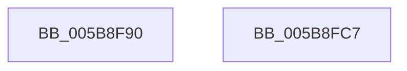

# KeRevertToUserAffinityThread

- RVA: `0x005B8F90`–`0x005B8FC8` (길이 `56` bytes)
- VA: `0x00000001405B8F90`
- 실행 섹션: `.text`
- PDB 이름 있음: `예`; PDB Function 태그: `아니요`
- unwind 정보 RVA: `0x000BFA7C`
- 디코드: `14`개 명령, `56/56` bytes 표시
- 미해석 바이트: `0` (있으면 어셈블리에 `.byte`로 보존)

> 이 문서는 커널 이미지의 기계어와 PDB 기호를 분석해 생성했습니다. 4번과 5번은 함수 원형과 자료형을 바이너리 사용 방식에서 추정한 C 해석이며 원본 소스 복구 결과는 아닙니다.

## 1. Dependencies

- 직접 호출 지점: **2**; 고유 호출 대상: **2**
- 직접 호출자로 확인된 함수: **0**
- RIP 상대 이미지 참조: **1**

### Outgoing calls
- `0x005B8FB0` → [KeRevertToUserGroupAffinityThread](../39/KeRevertToUserGroupAffinityThread_function_00398EC0.md) (function, `0x00398EC0`)
- `0x005B8FBD` → [_security_check_cookie](../6A/_security_check_cookie_function_006AC640.md) (function, `0x006AC640`)

### Direct callers
- 이 함수 시작 RVA로 연결되는 직접 call은 확인되지 않았습니다. 간접 호출은 완전히 역산할 수 없습니다.

### Static image references
- `0x005B8F94` → RVA `0x00E0A740` (`.data`; read)

## 2. Other-region calls and transfers

- 다른 실행 섹션으로 향하는 call: **0**
- 별도 외부 분기/꼬리 이동을 확인하지 못했습니다.

## 3. Assembly (complete function range)

```asm
005B8F90  48 83 EC 48                     sub rsp, 0x48
005B8F94  48 8B 05 A5 17 85 00            mov rax, qword ptr [rip + 0x8517a5]
005B8F9B  48 33 C4                        xor rax, rsp
005B8F9E  48 89 44 24 30                  mov qword ptr [rsp + 0x30], rax
005B8FA3  0F 57 C0                        xorps xmm0, xmm0
005B8FA6  48 8D 4C 24 20                  lea rcx, [rsp + 0x20]
005B8FAB  0F 11 44 24 20                  movups xmmword ptr [rsp + 0x20], xmm0
005B8FB0  E8 0B FF DD FF                  call 0x140398ec0
005B8FB5  48 8B 4C 24 30                  mov rcx, qword ptr [rsp + 0x30]
005B8FBA  48 33 CC                        xor rcx, rsp
005B8FBD  E8 7E 36 0F 00                  call 0x1406ac640
005B8FC2  48 83 C4 48                     add rsp, 0x48
005B8FC6  C3                              ret
005B8FC7  CC                              int3
```

## 4. C-style interpretation (structured pseudocode)

```c
__int64 __fastcall KeRevertToUserAffinityThread(void)
{
    __int64 result;
    __int64 v_rsp;
    unsigned __int64 v_stack_m18;
    unsigned __int64 v_stack_m28;

    v_rsp = (v_rsp) - (72);
    result = (*(unsigned __int64 *)(v_rip + 8722341)) ^ (v_rsp);
    v_stack_m18 = result;
    v_stack_m28 = v_xmm0;
    result = KeRevertToUserGroupAffinityThread(v_stack_m28, a2, a3, a4);
    a1 = (v_stack_m18) ^ (v_rsp);
    result = _security_check_cookie(a1, a2, a3, a4);
    v_rsp = (v_rsp) + (72);
    return result;
}
```

## 5. (Beta) C Style

```c
void KeRevertToUserAffinityThread(void)
{
    int64_t result;
    int64_t local_rsp;
    uint64_t v_stack_m18;
    uint64_t v_stack_m28;

    local_rsp = (local_rsp) - (72);
    result = (*(uint64_t *)(v_rip + 0x8517A5)) ^ (local_rsp);
    v_stack_m18 = result;
    v_stack_m28 = v_xmm0;
    result = KeRevertToUserGroupAffinityThread(v_stack_m28, a2, a3, a4);
    a1 = (v_stack_m18) ^ (local_rsp);
    result = _security_check_cookie(a1, a2, a3, a4);
    local_rsp = (local_rsp) + (72);
    return result;
}
```

## 6. Execution-region graph

[열기: 2D/3D 그래프와 함수 탐색 컨트롤 패널](../../../control-panel.html?section=text&rva=0x005B8F90&view=graph)

- 2D 그래프는 위에서 아래로 흐르고, 3D 그래프는 빈 공간을 드래그해 회전합니다. Shift+드래그는 이동, 휠은 확대·축소, 함수 노드 선택은 대상 보고서 이동입니다.

### Static fallback


