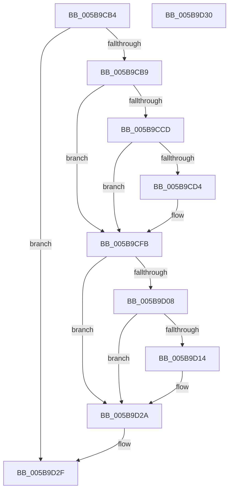

# KeSaveSupervisorState

- RVA: `0x005B9CB4`–`0x005B9D31` (길이 `125` bytes)
- VA: `0x00000001405B9CB4`
- 실행 섹션: `.text`
- PDB 이름 있음: `예`; PDB Function 태그: `아니요`
- unwind 정보 RVA: `0x000805BC`
- 디코드: `32`개 명령, `125/125` bytes 표시
- 미해석 바이트: `0` (있으면 어셈블리에 `.byte`로 보존)

> 이 문서는 커널 이미지의 기계어와 PDB 기호를 분석해 생성했습니다. 4번과 5번은 함수 원형과 자료형을 바이너리 사용 방식에서 추정한 C 해석이며 원본 소스 복구 결과는 아닙니다.

## 1. Dependencies

- 직접 호출 지점: **2**; 고유 호출 대상: **2**
- 직접 호출자로 확인된 함수: **5**
- RIP 상대 이미지 참조: **3**

### Outgoing calls
- `0x005B9CF6` → [KiSaveIptState](../4C/KiSaveIptState_function_004C8C44.md) (function, `0x004C8C44`)
- `0x005B9D25` → [RtlXSaveS](../3D/RtlXSaveS_function_003D8CE4.md) (function, `0x003D8CE4`)

### Direct callers
- [IopLiveDumpProcessCorralStateChange](../47/IopLiveDumpProcessCorralStateChange_function_00471C7C.md) at `0x00471D7B`
- [IopLiveDumpCollectPages](../59/IopLiveDumpCollectPages_function_0059B328.md) at `0x0059B4D9`
- [KeBugCheck2](KeBugCheck2_function_005B27D0.md) at `0x005B2B45`
- [KiFreezeTargetExecution](../5C/KiFreezeTargetExecution_function_005C30A0.md) at `0x005C3153`
- [KdEnterDebugger](../../pagekd/B8/KdEnterDebugger_function_00B8A96C.md) at `0x00B8AA2E`

### Static image references
- `0x005B9CBE` → RVA `0x00FC6B94` (`ALMOSTRO`; read)
- `0x005B9CFB` → RVA `0x00FC6B30` (`ALMOSTRO`; read)
- `0x005B9D08` → RVA `0x00FC6C60` (`ALMOSTRO`; read)

## 2. Other-region calls and transfers

- 다른 실행 섹션으로 향하는 call: **0**
- 별도 외부 분기/꼬리 이동을 확인하지 못했습니다.

## 3. Assembly (complete function range)

```asm
005B9CB4  48 85 C9                        test rcx, rcx
005B9CB7  74 76                           je 0x1405b9d2f
005B9CB9  53                              push rbx
005B9CBA  48 83 EC 20                     sub rsp, 0x20
005B9CBE  83 3D CF CE A0 00 00            cmp dword ptr [rip + 0xa0cecf], 0
005B9CC5  4C 8B DA                        mov r11, rdx
005B9CC8  48 8B D9                        mov rbx, rcx
005B9CCB  74 2E                           je 0x1405b9cfb
005B9CCD  48 0F BA E2 08                  bt rdx, 8
005B9CD2  73 27                           jae 0x1405b9cfb
005B9CD4  48 B8 00 06 00 00 80 F7 FF FF   movabs rax, 0xfffff78000000600
005B9CDE  8B 08                           mov ecx, dword ptr [rax]
005B9CE0  48 B8 E8 03 00 00 80 F7 FF FF   movabs rax, 0xfffff780000003e8
005B9CEA  8B 00                           mov eax, dword ptr [rax]
005B9CEC  48 2B C8                        sub rcx, rax
005B9CEF  48 83 C1 40                     add rcx, 0x40
005B9CF3  48 03 CB                        add rcx, rbx
005B9CF6  E8 49 EF F0 FF                  call 0x1404c8c44
005B9CFB  48 F7 05 2A CE A0 00 00 00 80 00  test qword ptr [rip + 0xa0ce2a], 0x800000
005B9D06  74 22                           je 0x1405b9d2a
005B9D08  48 8B 05 51 CF A0 00            mov rax, qword ptr [rip + 0xa0cf51]
005B9D0F  48 85 C0                        test rax, rax
005B9D12  74 16                           je 0x1405b9d2a
005B9D14  4C 23 D8                        and r11, rax
005B9D17  48 8D 8B 00 FE FF FF            lea rcx, [rbx - 0x200]
005B9D1E  49 8B D3                        mov rdx, r11
005B9D21  4C 89 5B 08                     mov qword ptr [rbx + 8], r11
005B9D25  E8 BA EF E1 FF                  call 0x1403d8ce4
005B9D2A  48 83 C4 20                     add rsp, 0x20
005B9D2E  5B                              pop rbx
005B9D2F  C3                              ret
005B9D30  CC                              int3
```

## 4. C-style interpretation (structured pseudocode)

```c
__int64 __fastcall KeSaveSupervisorState(__int64 a1, __int64 a2)
{
    __int64 result;
    __int64 v_r11;
    __int64 v_rsp;

    if (a1 == 0) goto loc_005B9D2F;
    v_rsp = (v_rsp) - (32);
    if ((*(unsigned int *)(v_rip + 10538703)) == 0) goto loc_005B9CFB;
    if ((*(unsigned int *)(v_rip + 10538703)) < 0) {
        a1 = *(unsigned int *)(result);
        result = *(unsigned int *)(result);
        a1 = (a1) - (result);
        a1 = (a1) + (64);
        a1 = (a1) + (a1);
        result = KiSaveIptState(a1, a2, a3, a4);
    }
    if (((*(unsigned __int64 *)(v_rip + 10538538)) & (0x800000ULL)) == 0) goto loc_005B9D2A;
    result = *(unsigned __int64 *)(v_rip + 10538833);
    v_r11 = a2;
    if (*(unsigned __int64 *)(v_rip + 10538833) != 0) {
        v_r11 = (a2) & (*(unsigned __int64 *)(v_rip + 10538833));
        a1 = a1 - 512;
        a2 = v_r11;
        *(unsigned __int64 *)(a1 + 8) = v_r11;
        result = RtlXSaveS(a1, a2, a3, a4);
    }
    v_rsp = (v_rsp) + (32);
loc_005B9D2F:
    return result;
}
```

## 5. (Beta) C Style

```c
int64_t KeSaveSupervisorState(int64_t Arg1, int64_t Arg2)
{
    int64_t result;
    int64_t local_r11;
    int64_t local_rsp;

    if (Arg1 == 0) goto loc_005B9D2F;
    local_rsp = (local_rsp) - (32);
    if ((*(uint32_t *)(v_rip + 0xA0CECF)) == 0) goto loc_005B9CFB;
    if ((*(uint32_t *)(v_rip + 0xA0CECF)) < 0) {
        Arg1 = *(uint32_t *)(result);
        result = *(uint32_t *)(result);
        Arg1 = (Arg1) - (result);
        Arg1 = (Arg1) + (64);
        Arg1 = (Arg1) + (Arg1);
        result = KiSaveIptState(Arg1, Arg2, a3, a4);
    }
    if (((*(uint64_t *)(v_rip + 0xA0CE2A)) & (0x800000ULL)) == 0) goto loc_005B9D2A;
    result = *(uint64_t *)(v_rip + 0xA0CF51);
    local_r11 = Arg2;
    if (*(uint64_t *)(v_rip + 0xA0CF51) != 0) {
        local_r11 = (Arg2) & (*(uint64_t *)(v_rip + 0xA0CF51));
        Arg1 = Arg1 - 512;
        Arg2 = local_r11;
        *(uint64_t *)(Arg1 + 0x8) = local_r11;
        result = RtlXSaveS(Arg1, Arg2, a3, a4);
    }
    local_rsp = (local_rsp) + (32);
loc_005B9D2F:
    return result;
}
```

## 6. Execution-region graph

[열기: 2D/3D 그래프와 함수 탐색 컨트롤 패널](../../../control-panel.html?section=text&rva=0x005B9CB4&view=graph)

- 2D 그래프는 위에서 아래로 흐르고, 3D 그래프는 빈 공간을 드래그해 회전합니다. Shift+드래그는 이동, 휠은 확대·축소, 함수 노드 선택은 대상 보고서 이동입니다.

### Static fallback


