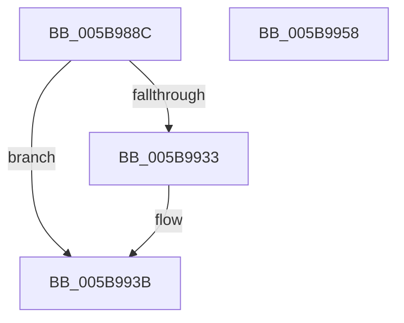

# KeSecureProcess

- RVA: `0x005B988C`–`0x005B9959` (길이 `205` bytes)
- VA: `0x00000001405B988C`
- 실행 섹션: `.text`
- PDB 이름 있음: `예`; PDB Function 태그: `아니요`
- unwind 정보 RVA: `0x000CA0A0`
- 디코드: `53`개 명령, `205/205` bytes 표시
- 미해석 바이트: `0` (있으면 어셈블리에 `.byte`로 보존)

> 이 문서는 커널 이미지의 기계어와 PDB 기호를 분석해 생성했습니다. 4번과 5번은 함수 원형과 자료형을 바이너리 사용 방식에서 추정한 C 해석이며 원본 소스 복구 결과는 아닙니다.

## 1. Dependencies

- 직접 호출 지점: **4**; 고유 호출 대상: **4**
- 직접 호출자로 확인된 함수: **1**
- RIP 상대 이미지 참조: **1**

### Outgoing calls
- `0x005B98DB` → [KiStackAttachProcess](../21/KiStackAttachProcess_function_00216820.md) (function, `0x00216820`)
- `0x005B9919` → [VslInitializeSecureProcess](../58/VslInitializeSecureProcess_function_0058EA00.md) (function, `0x0058EA00`)
- `0x005B9927` → [KiUnstackDetachProcess](../21/KiUnstackDetachProcess_function_00217D30.md) (function, `0x00217D30`)
- `0x005B9945` → [_security_check_cookie](../6A/_security_check_cookie_function_006AC640.md) (function, `0x006AC640`)

### Direct callers
- [PspAllocateProcess](../../page/A1/PspAllocateProcess_function_00A13B3C.md) at `0x00A162E2`

### Static image references
- `0x005B989A` → RVA `0x00E0A740` (`.data`; read)

## 2. Other-region calls and transfers

- 다른 실행 섹션으로 향하는 call: **0**
- 별도 외부 분기/꼬리 이동을 확인하지 못했습니다.

## 3. Assembly (complete function range)

```asm
005B988C  40 53                           push rbx
005B988E  55                              push rbp
005B988F  56                              push rsi
005B9890  57                              push rdi
005B9891  41 56                           push r14
005B9893  48 81 EC 80 00 00 00            sub rsp, 0x80
005B989A  48 8B 05 9F 0E 85 00            mov rax, qword ptr [rip + 0x850e9f]
005B98A1  48 33 C4                        xor rax, rsp
005B98A4  48 89 44 24 78                  mov qword ptr [rsp + 0x78], rax
005B98A9  48 8B 9C 24 D8 00 00 00         mov rbx, qword ptr [rsp + 0xd8]
005B98B1  0F 57 C0                        xorps xmm0, xmm0
005B98B4  49 8B F0                        mov rsi, r8
005B98B7  C6 44 24 40 00                  mov byte ptr [rsp + 0x40], 0
005B98BC  48 8B FA                        mov rdi, rdx
005B98BF  4C 8D 44 24 48                  lea r8, [rsp + 0x48]
005B98C4  33 D2                           xor edx, edx
005B98C6  49 8B E9                        mov rbp, r9
005B98C9  0F 11 44 24 48                  movups xmmword ptr [rsp + 0x48], xmm0
005B98CE  4C 8B F1                        mov r14, rcx
005B98D1  0F 11 44 24 58                  movups xmmword ptr [rsp + 0x58], xmm0
005B98D6  0F 11 44 24 68                  movups xmmword ptr [rsp + 0x68], xmm0
005B98DB  E8 40 CF C5 FF                  call 0x140216820
005B98E0  49 8B 8E 70 01 00 00            mov rcx, qword ptr [r14 + 0x170]
005B98E7  48 8D 44 24 40                  lea rax, [rsp + 0x40]
005B98EC  48 89 44 24 38                  mov qword ptr [rsp + 0x38], rax
005B98F1  4C 8B CD                        mov r9, rbp
005B98F4  48 8B 84 24 E0 00 00 00         mov rax, qword ptr [rsp + 0xe0]
005B98FC  4C 8B C6                        mov r8, rsi
005B98FF  48 89 44 24 30                  mov qword ptr [rsp + 0x30], rax
005B9904  48 8B D7                        mov rdx, rdi
005B9907  48 8B 84 24 D0 00 00 00         mov rax, qword ptr [rsp + 0xd0]
005B990F  48 89 5C 24 28                  mov qword ptr [rsp + 0x28], rbx
005B9914  48 89 44 24 20                  mov qword ptr [rsp + 0x20], rax
005B9919  E8 E2 50 FD FF                  call 0x14058ea00
005B991E  33 D2                           xor edx, edx
005B9920  48 8D 4C 24 48                  lea rcx, [rsp + 0x48]
005B9925  8B D8                           mov ebx, eax
005B9927  E8 04 E4 C5 FF                  call 0x140217d30
005B992C  80 7C 24 40 00                  cmp byte ptr [rsp + 0x40], 0
005B9931  74 08                           je 0x1405b993b
005B9933  49 83 8E 70 01 00 00 02         or qword ptr [r14 + 0x170], 2
005B993B  8B C3                           mov eax, ebx
005B993D  48 8B 4C 24 78                  mov rcx, qword ptr [rsp + 0x78]
005B9942  48 33 CC                        xor rcx, rsp
005B9945  E8 F6 2C 0F 00                  call 0x1406ac640
005B994A  48 81 C4 80 00 00 00            add rsp, 0x80
005B9951  41 5E                           pop r14
005B9953  5F                              pop rdi
005B9954  5E                              pop rsi
005B9955  5D                              pop rbp
005B9956  5B                              pop rbx
005B9957  C3                              ret
005B9958  CC                              int3
```

## 4. C-style interpretation (structured pseudocode)

```c
__int64 __fastcall KeSecureProcess(__int64 a1, __int64 a2, __int64 a3, __int64 a4, __int64 a5, __int64 a6, __int64 a7)
{
    __int64 result;
    __int64 v_rsp;
    unsigned __int64 v_stack_m30;
    unsigned __int64 v_stack_m40;
    unsigned __int64 v_stack_m50;
    unsigned __int64 v_stack_m60;
    unsigned __int8 v_stack_m68;
    unsigned __int64 v_stack_m70;
    unsigned __int64 v_stack_m78;
    unsigned __int64 v_stack_m80;
    unsigned __int64 v_stack_m88;

    v_rsp = (v_rsp) - (128);
    result = (*(unsigned __int64 *)(v_rip + 8720031)) ^ (v_rsp);
    v_stack_m30 = result;
    v_stack_m68 = 0;
    a2 = 0;
    v_stack_m60 = v_xmm0;
    v_stack_m50 = v_xmm0;
    v_stack_m40 = v_xmm0;
    result = KiStackAttachProcess(a1, a2, v_stack_m60, a4);
    v_stack_m70 = v_stack_m68;
    v_stack_m78 = a7;
    v_stack_m80 = a6;
    v_stack_m88 = a5;
    result = VslInitializeSecureProcess(*(unsigned __int64 *)(a1 + 368), 0, a3, a4);
    a2 = 0;
    result = KiUnstackDetachProcess(v_stack_m60, a2, a3, a4);
    if (v_stack_m68 != 0) {
    }
    a1 = (v_stack_m30) ^ (v_rsp);
    result = _security_check_cookie(a1, a2, a3, a4);
    v_rsp = (v_rsp) + (128);
    return result;
}
```

## 5. (Beta) C Style

```c
int64_t KeSecureProcess(void *Arg1, int64_t Arg2, int64_t Arg3, int64_t Arg4, int64_t Arg5, int64_t Arg6, int64_t Arg7)
{
    uint8_t *arg1 = (uint8_t *)Arg1;

    int64_t result;
    int64_t local_rsp;
    uint64_t v_stack_m30;
    uint64_t v_stack_m40;
    uint64_t v_stack_m50;
    uint64_t v_stack_m60;
    uint8_t v_stack_m68;
    uint64_t v_stack_m70;
    uint64_t v_stack_m78;
    uint64_t v_stack_m80;
    uint64_t v_stack_m88;

    local_rsp = (local_rsp) - (128);
    result = (*(uint64_t *)(v_rip + 0x850E9F)) ^ (local_rsp);
    v_stack_m30 = result;
    v_stack_m68 = 0;
    Arg2 = 0;
    v_stack_m60 = v_xmm0;
    v_stack_m50 = v_xmm0;
    v_stack_m40 = v_xmm0;
    result = KiStackAttachProcess(Arg1, Arg2, v_stack_m60, Arg4);
    v_stack_m70 = v_stack_m68;
    v_stack_m78 = Arg7;
    v_stack_m80 = Arg6;
    v_stack_m88 = Arg5;
    result = VslInitializeSecureProcess(*(uint64_t *)(arg1 + 0x170), 0, Arg3, Arg4);
    Arg2 = 0;
    result = KiUnstackDetachProcess(v_stack_m60, Arg2, Arg3, Arg4);
    if (v_stack_m68 != 0) {
    }
    Arg1 = (v_stack_m30) ^ (local_rsp);
    result = _security_check_cookie(Arg1, Arg2, Arg3, Arg4);
    local_rsp = (local_rsp) + (128);
    return result;
}
```

### 관측된 메모리 오프셋

구조체 형식이 확인되지 않은 접근은 인자 기준의 오프셋으로만 기록했습니다.

| 기준 인자 | 오프셋 표현 | 폭 (bit) | 접근 |
|---|---:|---:|---|
| `Arg1` | `+ 0x170` | `64` | `R` |
| `Arg1` | `+ 0x170` | `64` | `R/W` |

## 6. Execution-region graph

[열기: 2D/3D 그래프와 함수 탐색 컨트롤 패널](../../../control-panel.html?section=text&rva=0x005B988C&view=graph)

- 2D 그래프는 위에서 아래로 흐르고, 3D 그래프는 빈 공간을 드래그해 회전합니다. Shift+드래그는 이동, 휠은 확대·축소, 함수 노드 선택은 대상 보고서 이동입니다.

### Static fallback


