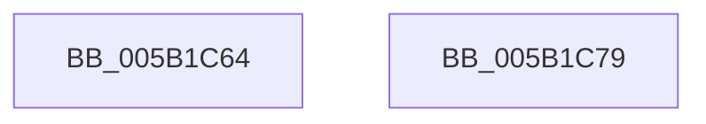

# KeSetMaxDynamicTickDuration

- RVA: `0x005B1C64`–`0x005B1C7A` (길이 `22` bytes)
- VA: `0x00000001405B1C64`
- 실행 섹션: `.text`
- PDB 이름 있음: `예`; PDB Function 태그: `아니요`
- unwind 정보 RVA: `0x000DB714`
- 디코드: `6`개 명령, `22/22` bytes 표시
- 미해석 바이트: `0` (있으면 어셈블리에 `.byte`로 보존)

> 이 문서는 커널 이미지의 기계어와 PDB 기호를 분석해 생성했습니다. 4번과 5번은 함수 원형과 자료형을 바이너리 사용 방식에서 추정한 C 해석이며 원본 소스 복구 결과는 아닙니다.

## 1. Dependencies

- 직접 호출 지점: **0**; 고유 호출 대상: **0**
- 직접 호출자로 확인된 함수: **1**
- RIP 상대 이미지 참조: **2**

### Outgoing calls
- 직접 디코드된 call 명령이 없습니다.

### Direct callers
- [PopEnforceDeepSleep](../../page/AC/PopEnforceDeepSleep_function_00AC3E1C.md) at `0x00AC3E6F`
- [PopEnforceDeepSleep](../../page/AC/PopEnforceDeepSleep_function_00AC3E1C.md) at `0x00AC3EA0`

### Static image references
- `0x005B1C64` → RVA `0x00FC6AA0` (`ALMOSTRO`; read)
- `0x005B1C71` → RVA `0x00FC5128` (`ALMOSTRO`; read/write)

## 2. Other-region calls and transfers

- 다른 실행 섹션으로 향하는 call: **0**
- 별도 외부 분기/꼬리 이동을 확인하지 못했습니다.

## 3. Assembly (complete function range)

```asm
005B1C64  8B 05 36 4E A1 00               mov eax, dword ptr [rip + 0xa14e36]
005B1C6A  48 3B C1                        cmp rax, rcx
005B1C6D  48 0F 42 C8                     cmovb rcx, rax
005B1C71  48 87 0D B0 34 A1 00            xchg qword ptr [rip + 0xa134b0], rcx
005B1C78  C3                              ret
005B1C79  CC                              int3
```

## 4. C-style interpretation (structured pseudocode)

```c
__int64 __fastcall KeSetMaxDynamicTickDuration(__int64 a1)
{
    if (((unsigned int)(*(unsigned int *)(v_rip + 10571318))) < a1) { a1 = (unsigned int)(*(unsigned int *)(v_rip + 10571318)); }
    return (unsigned int)(*(unsigned int *)(v_rip + 10571318));
}
```

## 5. (Beta) C Style

```c
int64_t KeSetMaxDynamicTickDuration(int64_t Arg1)
{
    if (((uint32_t)(*(uint32_t *)(v_rip + 0xA14E36))) < Arg1) { Arg1 = (uint32_t)(*(uint32_t *)(v_rip + 0xA14E36)); }
    return (uint32_t)(*(uint32_t *)(v_rip + 0xA14E36));
}
```

## 6. Execution-region graph

[열기: 2D/3D 그래프와 함수 탐색 컨트롤 패널](../../../control-panel.html?section=text&rva=0x005B1C64&view=graph)

- 2D 그래프는 위에서 아래로 흐르고, 3D 그래프는 빈 공간을 드래그해 회전합니다. Shift+드래그는 이동, 휠은 확대·축소, 함수 노드 선택은 대상 보고서 이동입니다.

### Static fallback


