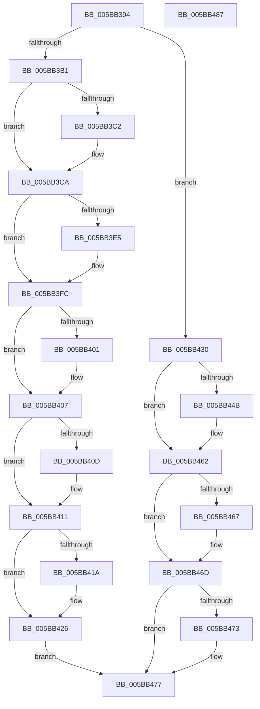

# KeSuspendClockTimerSafe

- RVA: `0x005BB394`–`0x005BB488` (길이 `244` bytes)
- VA: `0x00000001405BB394`
- 실행 섹션: `.text`
- PDB 이름 있음: `예`; PDB Function 태그: `아니요`
- unwind 정보 RVA: `0x000CA1A4`
- 디코드: `58`개 명령, `244/244` bytes 표시
- 미해석 바이트: `0` (있으면 어셈블리에 `.byte`로 보존)

> 이 문서는 커널 이미지의 기계어와 PDB 기호를 분석해 생성했습니다. 4번과 5번은 함수 원형과 자료형을 바이너리 사용 방식에서 추정한 C 해석이며 원본 소스 복구 결과는 아닙니다.

## 1. Dependencies

- 직접 호출 지점: **5**; 고유 호출 대상: **4**
- 직접 호출자로 확인된 함수: **3**
- RIP 상대 이미지 참조: **5**

### Outgoing calls
- `0x005BB3A3` → [KeGetEffectiveIrql](../2F/KeGetEffectiveIrql_function_002F8030.md) (function, `0x002F8030`)
- `0x005BB3C5` → [KiRaiseIrqlProcessIrqlFlags](../4F/KiRaiseIrqlProcessIrqlFlags_function_004F56FC.md) (function, `0x004F56FC`)
- `0x005BB3EC` → [guard_dispatch_icall](../6B/guard_dispatch_icall_function_006BAAD0.md) (function, `0x006BAAD0`)
- `0x005BB421` → [KiLowerIrqlProcessIrqlFlags](../4F/KiLowerIrqlProcessIrqlFlags_function_004F5698.md) (function, `0x004F5698`)
- `0x005BB452` → [guard_dispatch_icall](../6B/guard_dispatch_icall_function_006BAAD0.md) (function, `0x006BAAD0`)

### Direct callers
- [IopLiveDumpProcessCorralStateChange](../47/IopLiveDumpProcessCorralStateChange_function_00471C7C.md) at `0x00471DD2`
- [PnprQuiesceProcessorDpc](../../pagelk/B6/PnprQuiesceProcessorDpc_function_00B64B50.md) at `0x00B64C77`
- [PnprQuiesceProcessors](../../pagelk/B6/PnprQuiesceProcessors_function_00B64FB4.md) at `0x00B65226`

### Static image references
- `0x005BB3B9` → RVA `0x00FC6D20` (`ALMOSTRO`; read)
- `0x005BB3D3` → RVA `0x00FCF000` (`CACHEALI`; read)
- `0x005BB3D9` → RVA `0x00F21FB0` (`.data`; read)
- `0x005BB3E5` → RVA `0x00E00AE8` (`.data`; read)
- `0x005BB401` → RVA `0x00F21F24` (`.data`; read/write)

## 2. Other-region calls and transfers

- 다른 실행 섹션으로 향하는 call: **0**
- 별도 외부 분기/꼬리 이동을 확인하지 못했습니다.

## 3. Assembly (complete function range)

```asm
005BB394  48 89 6C 24 08                  mov qword ptr [rsp + 8], rbp
005BB399  48 89 74 24 10                  mov qword ptr [rsp + 0x10], rsi
005BB39E  57                              push rdi
005BB39F  48 83 EC 20                     sub rsp, 0x20
005BB3A3  E8 88 CC D3 FF                  call 0x1402f8030
005BB3A8  BA 0D 00 00 00                  mov edx, 0xd
005BB3AD  3A C2                           cmp al, dl
005BB3AF  73 7F                           jae 0x1405bb430
005BB3B1  44 0F 20 C6                     mov rsi, cr8
005BB3B5  44 0F 22 C2                     mov cr8, rdx
005BB3B9  83 3D 60 B9 A0 00 00            cmp dword ptr [rip + 0xa0b960], 0
005BB3C0  74 08                           je 0x1405bb3ca
005BB3C2  40 8A CE                        mov cl, sil
005BB3C5  E8 32 A3 F3 FF                  call 0x1404f56fc
005BB3CA  65 48 8B 3C 25 20 00 00 00      mov rdi, qword ptr gs:[0x20]
005BB3D3  8B 05 27 3C A1 00               mov eax, dword ptr [rip + 0xa13c27]
005BB3D9  8B 2D D1 6B 96 00               mov ebp, dword ptr [rip + 0x966bd1]
005BB3DF  F6 47 22 01                     test byte ptr [rdi + 0x22], 1
005BB3E3  74 17                           je 0x1405bb3fc
005BB3E5  48 8B 05 FC 56 84 00            mov rax, qword ptr [rip + 0x8456fc]
005BB3EC  E8 DF F6 0F 00                  call 0x1406baad0
005BB3F1  C6 87 08 96 00 00 00            mov byte ptr [rdi + 0x9608], 0
005BB3F8  80 67 22 FE                     and byte ptr [rdi + 0x22], 0xfe
005BB3FC  39 6F 24                        cmp dword ptr [rdi + 0x24], ebp
005BB3FF  75 06                           jne 0x1405bb407
005BB401  FF 05 1D 6B 96 00               inc dword ptr [rip + 0x966b1d]
005BB407  80 7F 21 00                     cmp byte ptr [rdi + 0x21], 0
005BB40B  74 04                           je 0x1405bb411
005BB40D  C6 47 21 00                     mov byte ptr [rdi + 0x21], 0
005BB411  83 3D 08 B9 A0 00 00            cmp dword ptr [rip + 0xa0b908], 0
005BB418  74 0C                           je 0x1405bb426
005BB41A  44 0F 20 C1                     mov rcx, cr8
005BB41E  40 8A D6                        mov dl, sil
005BB421  E8 72 A2 F3 FF                  call 0x1404f5698
005BB426  40 0F B6 C6                     movzx eax, sil
005BB42A  44 0F 22 C0                     mov cr8, rax
005BB42E  EB 47                           jmp 0x1405bb477
005BB430  65 48 8B 3C 25 20 00 00 00      mov rdi, qword ptr gs:[0x20]
005BB439  8B 05 C1 3B A1 00               mov eax, dword ptr [rip + 0xa13bc1]
005BB43F  8B 35 6B 6B 96 00               mov esi, dword ptr [rip + 0x966b6b]
005BB445  F6 47 22 01                     test byte ptr [rdi + 0x22], 1
005BB449  74 17                           je 0x1405bb462
005BB44B  48 8B 05 96 56 84 00            mov rax, qword ptr [rip + 0x845696]
005BB452  E8 79 F6 0F 00                  call 0x1406baad0
005BB457  C6 87 08 96 00 00 00            mov byte ptr [rdi + 0x9608], 0
005BB45E  80 67 22 FE                     and byte ptr [rdi + 0x22], 0xfe
005BB462  39 77 24                        cmp dword ptr [rdi + 0x24], esi
005BB465  75 06                           jne 0x1405bb46d
005BB467  FF 05 B7 6A 96 00               inc dword ptr [rip + 0x966ab7]
005BB46D  80 7F 21 00                     cmp byte ptr [rdi + 0x21], 0
005BB471  74 04                           je 0x1405bb477
005BB473  C6 47 21 00                     mov byte ptr [rdi + 0x21], 0
005BB477  48 8B 6C 24 30                  mov rbp, qword ptr [rsp + 0x30]
005BB47C  48 8B 74 24 38                  mov rsi, qword ptr [rsp + 0x38]
005BB481  48 83 C4 20                     add rsp, 0x20
005BB485  5F                              pop rdi
005BB486  C3                              ret
005BB487  CC                              int3
```

## 4. C-style interpretation (structured pseudocode)

```c
__int64 __fastcall KeSuspendClockTimerSafe(void)
{
    __int64 result;
    __int64 v_rsp;
    unsigned __int64 v_stack_p10;
    unsigned __int64 v_stack_p8;

    v_stack_p8 = v_rbp;
    v_stack_p10 = v_rsi;
    v_rsp = (v_rsp) - (32);
    result = KeGetEffectiveIrql(a1, a2, a3, a4);
    if (((unsigned __int8)(result)) >= 13) goto loc_005BB430;
    if ((*(unsigned int *)(v_rip + 10533216)) != 0) {
        a1 = (unsigned __int8)(v_cr8);
        result = KiRaiseIrqlProcessIrqlFlags(a1, 13, a3, a4);
    }
    result = (unsigned int)(*(unsigned int *)(v_rip + 10566695));
    if (((*(unsigned __int8 *)(*(unsigned __int64 *)(gs_base + (0 + 32)) + 34)) & (1)) != 0) {
        result = *(unsigned __int64 *)(v_rip + 8673020);
        result = guard_dispatch_icall(a1, 13, a3, a4);
        *(unsigned __int8 *)(*(unsigned __int64 *)(gs_base + (0 + 32)) + 38408) = 0;
    }
    if ((*(unsigned int *)(*(unsigned __int64 *)(gs_base + (0 + 32)) + 36)) == ((unsigned int)((unsigned int)(*(unsigned int *)(v_rip + 9858001))))) {
    }
    if ((*(unsigned __int8 *)(*(unsigned __int64 *)(gs_base + (0 + 32)) + 33)) != 0) {
        *(unsigned __int8 *)(*(unsigned __int64 *)(gs_base + (0 + 32)) + 33) = 0;
    }
    if ((*(unsigned int *)(v_rip + 10533128)) != 0) {
        a1 = 13;
        a2 = (unsigned __int8)(v_cr8);
        result = KiLowerIrqlProcessIrqlFlags(a1, a2, a3, a4);
    }
    goto loc_005BB477;
loc_005BB430:
    result = (unsigned int)(*(unsigned int *)(v_rip + 10566593));
    if (((*(unsigned __int8 *)(*(unsigned __int64 *)(gs_base + (0 + 32)) + 34)) & (1)) != 0) {
        result = *(unsigned __int64 *)(v_rip + 8672918);
        result = guard_dispatch_icall(a1, a2, a3, a4);
        *(unsigned __int8 *)(*(unsigned __int64 *)(gs_base + (0 + 32)) + 38408) = 0;
    }
    if ((*(unsigned int *)(*(unsigned __int64 *)(gs_base + (0 + 32)) + 36)) == ((unsigned int)((unsigned int)(*(unsigned int *)(v_rip + 9857899))))) {
    }
    if ((*(unsigned __int8 *)(*(unsigned __int64 *)(gs_base + (0 + 32)) + 33)) != 0) {
        *(unsigned __int8 *)(*(unsigned __int64 *)(gs_base + (0 + 32)) + 33) = 0;
    }
    v_rsp = (v_rsp) + (32);
    return result;
}
```

## 5. (Beta) C Style

```c
void KeSuspendClockTimerSafe(void)
{
    int64_t result;
    int64_t local_rsp;
    uint64_t v_stack_p10;
    uint64_t v_stack_p8;

    v_stack_p8 = local_rbp;
    v_stack_p10 = local_rsi;
    local_rsp = (local_rsp) - (32);
    result = KeGetEffectiveIrql(a1, a2, a3, a4);
    if (((uint8_t)(result)) >= 13) goto loc_005BB430;
    if ((*(uint32_t *)(v_rip + 0xA0B960)) != 0) {
        a1 = (uint8_t)(v_cr8);
        result = KiRaiseIrqlProcessIrqlFlags(a1, 13, a3, a4);
    }
    result = (uint32_t)(*(uint32_t *)(v_rip + 0xA13C27));
    if (((*(uint8_t *)(*(uint64_t *)(gs_base + (0 + 0x20)) + 0x22)) & (1)) != 0) {
        result = *(uint64_t *)(v_rip + 0x8456FC);
        result = guard_dispatch_icall(a1, 13, a3, a4);
        *(uint8_t *)(*(uint64_t *)(gs_base + (0 + 0x20)) + 0x9608) = 0;
    }
    if ((*(uint32_t *)(*(uint64_t *)(gs_base + (0 + 0x20)) + 0x24)) == ((uint32_t)((uint32_t)(*(uint32_t *)(v_rip + 0x966BD1))))) {
    }
    if ((*(uint8_t *)(*(uint64_t *)(gs_base + (0 + 0x20)) + 0x21)) != 0) {
        *(uint8_t *)(*(uint64_t *)(gs_base + (0 + 0x20)) + 0x21) = 0;
    }
    if ((*(uint32_t *)(v_rip + 0xA0B908)) != 0) {
        a1 = 13;
        a2 = (uint8_t)(v_cr8);
        result = KiLowerIrqlProcessIrqlFlags(a1, a2, a3, a4);
    }
    goto loc_005BB477;
loc_005BB430:
    result = (uint32_t)(*(uint32_t *)(v_rip + 0xA13BC1));
    if (((*(uint8_t *)(*(uint64_t *)(gs_base + (0 + 0x20)) + 0x22)) & (1)) != 0) {
        result = *(uint64_t *)(v_rip + 0x845696);
        result = guard_dispatch_icall(a1, a2, a3, a4);
        *(uint8_t *)(*(uint64_t *)(gs_base + (0 + 0x20)) + 0x9608) = 0;
    }
    if ((*(uint32_t *)(*(uint64_t *)(gs_base + (0 + 0x20)) + 0x24)) == ((uint32_t)((uint32_t)(*(uint32_t *)(v_rip + 0x966B6B))))) {
    }
    if ((*(uint8_t *)(*(uint64_t *)(gs_base + (0 + 0x20)) + 0x21)) != 0) {
        *(uint8_t *)(*(uint64_t *)(gs_base + (0 + 0x20)) + 0x21) = 0;
    }
    local_rsp = (local_rsp) + (32);
    return result;
}
```

## 6. Execution-region graph

[열기: 2D/3D 그래프와 함수 탐색 컨트롤 패널](../../../control-panel.html?section=text&rva=0x005BB394&view=graph)

- 2D 그래프는 위에서 아래로 흐르고, 3D 그래프는 빈 공간을 드래그해 회전합니다. Shift+드래그는 이동, 휠은 확대·축소, 함수 노드 선택은 대상 보고서 이동입니다.

### Static fallback


