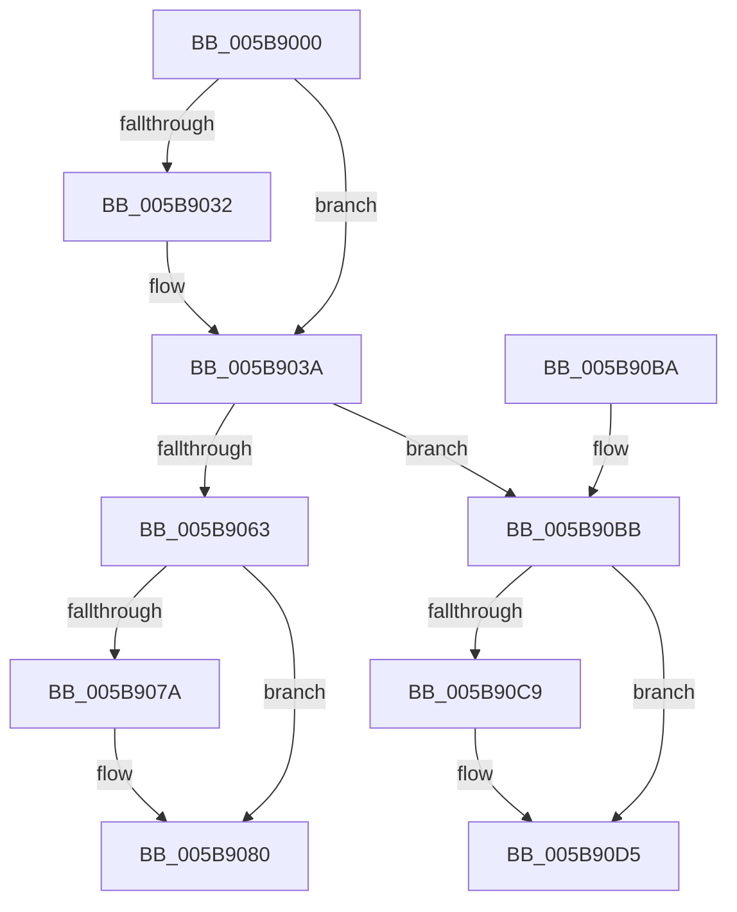

# KeSuspendThreadOld

- RVA: `0x005B9000`–`0x005B90E8` (길이 `232` bytes)
- VA: `0x00000001405B9000`
- 실행 섹션: `.text`
- PDB 이름 있음: `예`; PDB Function 태그: `아니요`
- unwind 정보 RVA: `0x000CA040`
- 디코드: `59`개 명령, `232/232` bytes 표시
- 미해석 바이트: `0` (있으면 어셈블리에 `.byte`로 보존)

> 이 문서는 커널 이미지의 기계어와 PDB 기호를 분석해 생성했습니다. 4번과 5번은 함수 원형과 자료형을 바이너리 사용 방식에서 추정한 C 해석이며 원본 소스 복구 결과는 아닙니다.

## 1. Dependencies

- 직접 호출 지점: **7**; 고유 호출 대상: **7**
- 직접 호출자로 확인된 함수: **2**
- RIP 상대 이미지 참조: **1**

### Outgoing calls
- `0x005B9035` → [KiRaiseIrqlProcessIrqlFlags](../4F/KiRaiseIrqlProcessIrqlFlags_function_004F56FC.md) (function, `0x004F56FC`)
- `0x005B904D` → [KiAcquireKobjectLockSafe](../25/KiAcquireKobjectLockSafe_function_00251C90.md) (function, `0x00251C90`)
- `0x005B9071` → [KiSuspendThread](../46/KiSuspendThread_function_0046B964.md) (function, `0x0046B964`)
- `0x005B9098` → [KiExitDispatcher](../25/KiExitDispatcher_function_00251CF0.md) (function, `0x00251CF0`)
- `0x005B90BB` → [KiReleaseSuspendEventLock](../48/KiReleaseSuspendEventLock_function_004858FC.md) (function, `0x004858FC`)
- `0x005B90D0` → [KiLowerIrqlProcessIrqlFlags](../4F/KiLowerIrqlProcessIrqlFlags_function_004F5698.md) (function, `0x004F5698`)
- `0x005B90E2` → [RtlRaiseStatus](../2F/RtlRaiseStatus_function_002F6A50.md) (function, `0x002F6A50`)

### Direct callers
- [PspInsertThread](../../page/9F/PspInsertThread_function_009F0314.md) at `0x009F089B`
- [PsSuspendThread](../../page/A1/PsSuspendThread_function_00A110D0.md) at `0x00A11151`

### Static image references
- `0x005B9029` → RVA `0x00FC6D20` (`ALMOSTRO`; read)

## 2. Other-region calls and transfers

- 다른 실행 섹션으로 향하는 call: **0**
- 별도 외부 분기/꼬리 이동을 확인하지 못했습니다.

## 3. Assembly (complete function range)

```asm
005B9000  48 8B C4                        mov rax, rsp
005B9003  48 89 58 08                     mov qword ptr [rax + 8], rbx
005B9007  48 89 68 10                     mov qword ptr [rax + 0x10], rbp
005B900B  48 89 70 18                     mov qword ptr [rax + 0x18], rsi
005B900F  48 89 78 20                     mov qword ptr [rax + 0x20], rdi
005B9013  41 56                           push r14
005B9015  48 83 EC 30                     sub rsp, 0x30
005B9019  48 8B D9                        mov rbx, rcx
005B901C  44 0F 20 C7                     mov rdi, cr8
005B9020  BA 02 00 00 00                  mov edx, 2
005B9025  44 0F 22 C2                     mov cr8, rdx
005B9029  83 3D F0 DC A0 00 00            cmp dword ptr [rip + 0xa0dcf0], 0
005B9030  74 08                           je 0x1405b903a
005B9032  40 8A CF                        mov cl, dil
005B9035  E8 C2 C6 F3 FF                  call 0x1404f56fc
005B903A  65 4C 8B 34 25 20 00 00 00      mov r14, qword ptr gs:[0x20]
005B9043  48 8D B3 E0 02 00 00            lea rsi, [rbx + 0x2e0]
005B904A  48 8B CE                        mov rcx, rsi
005B904D  E8 3E 8C C9 FF                  call 0x140251c90
005B9052  0F BE 83 84 02 00 00            movsx eax, byte ptr [rbx + 0x284]
005B9059  48 8B CB                        mov rcx, rbx
005B905C  8B E8                           mov ebp, eax
005B905E  83 F8 7F                        cmp eax, 0x7f
005B9061  74 58                           je 0x1405b90bb
005B9063  FE C0                           inc al
005B9065  45 33 C0                        xor r8d, r8d
005B9068  49 8B D6                        mov rdx, r14
005B906B  88 83 84 02 00 00               mov byte ptr [rbx + 0x284], al
005B9071  E8 EE 28 EB FF                  call 0x14046b964
005B9076  84 C0                           test al, al
005B9078  75 06                           jne 0x1405b9080
005B907A  FE 8B 84 02 00 00               dec byte ptr [rbx + 0x284]
005B9080  F0 81 26 7F FF FF FF            lock and dword ptr [rsi], 0xffffff7f
005B9087  45 33 C9                        xor r9d, r9d
005B908A  40 88 7C 24 20                  mov byte ptr [rsp + 0x20], dil
005B908F  33 D2                           xor edx, edx
005B9091  49 8B CE                        mov rcx, r14
005B9094  45 8D 41 01                     lea r8d, [r9 + 1]
005B9098  E8 53 8C C9 FF                  call 0x140251cf0
005B909D  48 8B 5C 24 40                  mov rbx, qword ptr [rsp + 0x40]
005B90A2  8B C5                           mov eax, ebp
005B90A4  48 8B 6C 24 48                  mov rbp, qword ptr [rsp + 0x48]
005B90A9  48 8B 74 24 50                  mov rsi, qword ptr [rsp + 0x50]
005B90AE  48 8B 7C 24 58                  mov rdi, qword ptr [rsp + 0x58]
005B90B3  48 83 C4 30                     add rsp, 0x30
005B90B7  41 5E                           pop r14
005B90B9  C3                              ret
005B90BA  CC                              int3
005B90BB  E8 3C C8 EC FF                  call 0x1404858fc
005B90C0  83 3D 59 DC A0 00 00            cmp dword ptr [rip + 0xa0dc59], 0
005B90C7  74 0C                           je 0x1405b90d5
005B90C9  44 0F 20 C1                     mov rcx, cr8
005B90CD  40 8A D7                        mov dl, dil
005B90D0  E8 C3 C5 F3 FF                  call 0x1404f5698
005B90D5  40 0F B6 C7                     movzx eax, dil
005B90D9  44 0F 22 C0                     mov cr8, rax
005B90DD  B9 4A 00 00 C0                  mov ecx, 0xc000004a
005B90E2  E8 69 D9 D3 FF                  call 0x1402f6a50
005B90E7  CC                              int3
```

## 4. C-style interpretation (structured pseudocode)

```c
__int64 __fastcall KeSuspendThreadOld(__int64 a1, __int64 a2, int a3, int a4)
{
    __int64 result;
    __int64 v_rsp;
    unsigned __int8 v_stack_m18;
    unsigned __int64 v_stack_p10;
    unsigned __int64 v_stack_p18;
    unsigned __int64 v_stack_p20;
    unsigned __int64 v_stack_p8;

    *(unsigned __int64 *)(v_rsp + 8) = v_rbx;
    *(unsigned __int64 *)(v_rsp + 16) = v_rbp;
    *(unsigned __int64 *)(v_rsp + 24) = v_rsi;
    *(unsigned __int64 *)(v_rsp + 32) = v_rdi;
    v_rsp = (v_rsp) - (48);
    result = v_rsp;
    if ((*(unsigned int *)(v_rip + 10542320)) != 0) {
        a1 = (unsigned __int8)(v_cr8);
        result = KiRaiseIrqlProcessIrqlFlags(a1, 2, a3, a4);
    }
    result = KiAcquireKobjectLockSafe(a1 + 736, 2, a3, a4);
    if (((unsigned int)((__int8)(*(unsigned __int8 *)(a1 + 644)))) == 127) goto loc_005B90BB;
    result = (unsigned __int8)(((__int8)(*(unsigned __int8 *)(a1 + 644))) + 1);
    a3 = 0;
    *(unsigned __int8 *)(a1 + 644) = (unsigned __int8)(result);
    result = KiSuspendThread(a1, *(unsigned __int64 *)(gs_base + (0 + 32)), a3, a4);
    if ((unsigned __int8)(result) == 0) {
    }
    a4 = 0;
    v_stack_m18 = (unsigned __int8)(v_cr8);
    a2 = 0;
    result = KiExitDispatcher(*(unsigned __int64 *)(gs_base + (0 + 32)), a2, a4 + 1, a4);
    v_rsp = (v_rsp) + (48);
    return (unsigned int)((unsigned int)((unsigned int)((unsigned int)((__int8)(*(unsigned __int8 *)(a1 + 644))))));
loc_005B90BB:
    result = KiReleaseSuspendEventLock(*(unsigned __int64 *)(gs_base + (0 + 32)), a2, a4 + 1, a4);
    if ((*(unsigned int *)(v_rip + 10542169)) != 0) {
        a1 = 2;
        a2 = (unsigned __int8)(v_stack_p20);
        result = KiLowerIrqlProcessIrqlFlags(a1, a2, a4 + 1, a4);
    }
    result = RtlRaiseStatus((unsigned int)(0xC000004AULL), a2, a4 + 1, a4);
    return result;
}
```

## 5. (Beta) C Style

```c
int64_t KeSuspendThreadOld(void *Arg1, int64_t Arg2, int32_t Arg3, int32_t Arg4)
{
    uint8_t *arg1 = (uint8_t *)Arg1;

    int64_t result;
    int64_t local_rsp;
    uint8_t v_stack_m18;
    uint64_t v_stack_p10;
    uint64_t v_stack_p18;
    uint64_t v_stack_p20;
    uint64_t v_stack_p8;

    *(uint64_t *)(local_rsp + 0x8) = local_rbx;
    *(uint64_t *)(local_rsp + 0x10) = local_rbp;
    *(uint64_t *)(local_rsp + 0x18) = local_rsi;
    *(uint64_t *)(local_rsp + 0x20) = local_rdi;
    local_rsp = (local_rsp) - (48);
    result = local_rsp;
    if ((*(uint32_t *)(v_rip + 0xA0DCF0)) != 0) {
        Arg1 = (uint8_t)(v_cr8);
        result = KiRaiseIrqlProcessIrqlFlags(Arg1, 2, Arg3, Arg4);
    }
    result = KiAcquireKobjectLockSafe(Arg1 + 736, 2, Arg3, Arg4);
    if (((uint32_t)((int8_t)(*(uint8_t *)(arg1 + 0x284)))) == 127) goto loc_005B90BB;
    result = (uint8_t)(((int8_t)(*(uint8_t *)(arg1 + 0x284))) + 1);
    Arg3 = 0;
    *(uint8_t *)(arg1 + 0x284) = (uint8_t)(result);
    result = KiSuspendThread(Arg1, *(uint64_t *)(gs_base + (0 + 0x20)), Arg3, Arg4);
    if ((uint8_t)(result) == 0) {
    }
    Arg4 = 0;
    v_stack_m18 = (uint8_t)(v_cr8);
    Arg2 = 0;
    result = KiExitDispatcher(*(uint64_t *)(gs_base + (0 + 0x20)), Arg2, Arg4 + 1, Arg4);
    local_rsp = (local_rsp) + (48);
    return (uint32_t)((uint32_t)((uint32_t)((uint32_t)((int8_t)(*(uint8_t *)(arg1 + 0x284))))));
loc_005B90BB:
    result = KiReleaseSuspendEventLock(*(uint64_t *)(gs_base + (0 + 0x20)), Arg2, Arg4 + 1, Arg4);
    if ((*(uint32_t *)(v_rip + 0xA0DC59)) != 0) {
        Arg1 = 2;
        Arg2 = (uint8_t)(v_stack_p20);
        result = KiLowerIrqlProcessIrqlFlags(Arg1, Arg2, Arg4 + 1, Arg4);
    }
    result = RtlRaiseStatus((uint32_t)(0xC000004AULL), Arg2, Arg4 + 1, Arg4);
    return result;
}
```

### 관측된 메모리 오프셋

구조체 형식이 확인되지 않은 접근은 인자 기준의 오프셋으로만 기록했습니다.

| 기준 인자 | 오프셋 표현 | 폭 (bit) | 접근 |
|---|---:|---:|---|
| `Arg1` | `+ 0x0` | `32` | `R/W` |
| `Arg1` | `+ 0x284` | `8` | `R` |
| `Arg1` | `+ 0x284` | `8` | `R/W` |
| `Arg1` | `+ 0x284` | `8` | `W` |
| `Arg1` | `+ 0x2E0` | `64` | `R` |

## 6. Execution-region graph

[열기: 2D/3D 그래프와 함수 탐색 컨트롤 패널](../../../control-panel.html?section=text&rva=0x005B9000&view=graph)

- 2D 그래프는 위에서 아래로 흐르고, 3D 그래프는 빈 공간을 드래그해 회전합니다. Shift+드래그는 이동, 휠은 확대·축소, 함수 노드 선택은 대상 보고서 이동입니다.

### Static fallback


