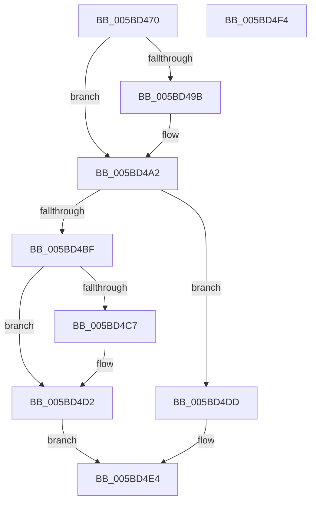

# KeTryToAcquireQueuedSpinLock

- RVA: `0x005BD470`–`0x005BD4F5` (길이 `133` bytes)
- VA: `0x00000001405BD470`
- 실행 섹션: `.text`
- PDB 이름 있음: `예`; PDB Function 태그: `아니요`
- unwind 정보 RVA: `0x00060BC4`
- 디코드: `37`개 명령, `133/133` bytes 표시
- 미해석 바이트: `0` (있으면 어셈블리에 `.byte`로 보존)

> 이 문서는 커널 이미지의 기계어와 PDB 기호를 분석해 생성했습니다. 4번과 5번은 함수 원형과 자료형을 바이너리 사용 방식에서 추정한 C 해석이며 원본 소스 복구 결과는 아닙니다.

## 1. Dependencies

- 직접 호출 지점: **3**; 고유 호출 대상: **3**
- 직접 호출자로 확인된 함수: **1**
- RIP 상대 이미지 참조: **1**

### Outgoing calls
- `0x005BD49D` → [KiRaiseIrqlProcessIrqlFlags](../4F/KiRaiseIrqlProcessIrqlFlags_function_004F56FC.md) (function, `0x004F56FC`)
- `0x005BD4B6` → [KxTryToAcquireQueuedSpinLock](../27/KxTryToAcquireQueuedSpinLock_function_00277388.md) (function, `0x00277388`)
- `0x005BD4CD` → [KiLowerIrqlProcessIrqlFlags](../4F/KiLowerIrqlProcessIrqlFlags_function_004F5698.md) (function, `0x004F5698`)

### Direct callers
- [DifKeTryToAcquireQueuedSpinLockWrapper](../63/DifKeTryToAcquireQueuedSpinLockWrapper_function_00633220.md) at `0x006332F4`

### Static image references
- `0x005BD492` → RVA `0x00FC6D20` (`ALMOSTRO`; read)

## 2. Other-region calls and transfers

- 다른 실행 섹션으로 향하는 call: **0**
- 별도 외부 분기/꼬리 이동을 확인하지 못했습니다.

## 3. Assembly (complete function range)

```asm
005BD470  48 89 5C 24 08                  mov qword ptr [rsp + 8], rbx
005BD475  48 89 74 24 10                  mov qword ptr [rsp + 0x10], rsi
005BD47A  57                              push rdi
005BD47B  48 83 EC 20                     sub rsp, 0x20
005BD47F  48 8B FA                        mov rdi, rdx
005BD482  48 8B F1                        mov rsi, rcx
005BD485  44 0F 20 C3                     mov rbx, cr8
005BD489  BA 02 00 00 00                  mov edx, 2
005BD48E  44 0F 22 C2                     mov cr8, rdx
005BD492  83 3D 87 98 A0 00 00            cmp dword ptr [rip + 0xa09887], 0
005BD499  74 07                           je 0x1405bd4a2
005BD49B  8A CB                           mov cl, bl
005BD49D  E8 5A 82 F3 FF                  call 0x1404f56fc
005BD4A2  65 48 8B 0C 25 28 00 00 00      mov rcx, qword ptr gs:[0x28]
005BD4AB  48 C1 E6 04                     shl rsi, 4
005BD4AF  48 03 CE                        add rcx, rsi
005BD4B2  48 8B 51 08                     mov rdx, qword ptr [rcx + 8]
005BD4B6  E8 CD 9E CB FF                  call 0x140277388
005BD4BB  85 C0                           test eax, eax
005BD4BD  75 1E                           jne 0x1405bd4dd
005BD4BF  39 05 5B 98 A0 00               cmp dword ptr [rip + 0xa0985b], eax
005BD4C5  74 0B                           je 0x1405bd4d2
005BD4C7  44 0F 20 C1                     mov rcx, cr8
005BD4CB  8A D3                           mov dl, bl
005BD4CD  E8 C6 81 F3 FF                  call 0x1404f5698
005BD4D2  0F B6 C3                        movzx eax, bl
005BD4D5  44 0F 22 C0                     mov cr8, rax
005BD4D9  33 C0                           xor eax, eax
005BD4DB  EB 07                           jmp 0x1405bd4e4
005BD4DD  88 1F                           mov byte ptr [rdi], bl
005BD4DF  B8 01 00 00 00                  mov eax, 1
005BD4E4  48 8B 5C 24 30                  mov rbx, qword ptr [rsp + 0x30]
005BD4E9  48 8B 74 24 38                  mov rsi, qword ptr [rsp + 0x38]
005BD4EE  48 83 C4 20                     add rsp, 0x20
005BD4F2  5F                              pop rdi
005BD4F3  C3                              ret
005BD4F4  CC                              int3
```

## 4. C-style interpretation (structured pseudocode)

```c
__int64 __fastcall KeTryToAcquireQueuedSpinLock(__int64 a1, __int64 a2)
{
    __int64 result;
    __int64 v_rsi;
    __int64 v_rsp;
    unsigned __int64 v_stack_p10;
    unsigned __int64 v_stack_p8;

    v_stack_p8 = v_rbx;
    v_stack_p10 = v_rsi;
    v_rsp = (v_rsp) - (32);
    if ((*(unsigned int *)(v_rip + 10524807)) != 0) {
        a1 = (unsigned __int8)(v_cr8);
        result = KiRaiseIrqlProcessIrqlFlags(a1, 2, a3, a4);
    }
    v_rsi = (a1) << (4);
    a1 = (*(unsigned __int64 *)(gs_base + (0 + 40))) + (v_rsi);
    result = KxTryToAcquireQueuedSpinLock(a1, *(unsigned __int64 *)(a1 + 8), a3, a4);
    if ((unsigned int)(result) != 0) goto loc_005BD4DD;
    if ((*(unsigned int *)(v_rip + 10524763)) != ((unsigned int)(result))) {
        a1 = 2;
        a2 = (unsigned __int8)(v_cr8);
        result = KiLowerIrqlProcessIrqlFlags(a1, a2, a3, a4);
    }
    result = 0;
    goto loc_005BD4E4;
loc_005BD4DD:
    *(unsigned __int8 *)(a2) = (unsigned __int8)(v_cr8);
loc_005BD4E4:
    v_rsp = (v_rsp) + (32);
    return 1;
}
```

## 5. (Beta) C Style

```c
int64_t KeTryToAcquireQueuedSpinLock(int64_t Arg1, void *Arg2)
{
    uint8_t *arg2 = (uint8_t *)Arg2;

    int64_t result;
    int64_t local_rsi;
    int64_t local_rsp;
    uint64_t v_stack_p10;
    uint64_t v_stack_p8;

    v_stack_p8 = local_rbx;
    v_stack_p10 = local_rsi;
    local_rsp = (local_rsp) - (32);
    if ((*(uint32_t *)(v_rip + 0xA09887)) != 0) {
        Arg1 = (uint8_t)(v_cr8);
        result = KiRaiseIrqlProcessIrqlFlags(Arg1, 2, a3, a4);
    }
    local_rsi = (Arg1) << (4);
    Arg1 = (*(uint64_t *)(gs_base + (0 + 0x28))) + (local_rsi);
    result = KxTryToAcquireQueuedSpinLock(Arg1, *(uint64_t *)(Arg1 + 0x8), a3, a4);
    if ((uint32_t)(result) != 0) goto loc_005BD4DD;
    if ((*(uint32_t *)(v_rip + 0xA0985B)) != ((uint32_t)(result))) {
        Arg1 = 2;
        Arg2 = (uint8_t)(v_cr8);
        result = KiLowerIrqlProcessIrqlFlags(Arg1, Arg2, a3, a4);
    }
    result = 0;
    goto loc_005BD4E4;
loc_005BD4DD:
    *(uint8_t *)(arg2) = (uint8_t)(v_cr8);
loc_005BD4E4:
    local_rsp = (local_rsp) + (32);
    return 1;
}
```

### 관측된 메모리 오프셋

구조체 형식이 확인되지 않은 접근은 인자 기준의 오프셋으로만 기록했습니다.

| 기준 인자 | 오프셋 표현 | 폭 (bit) | 접근 |
|---|---:|---:|---|
| `Arg2` | `+ 0x0` | `8` | `W` |

## 6. Execution-region graph

[열기: 2D/3D 그래프와 함수 탐색 컨트롤 패널](../../../control-panel.html?section=text&rva=0x005BD470&view=graph)

- 2D 그래프는 위에서 아래로 흐르고, 3D 그래프는 빈 공간을 드래그해 회전합니다. Shift+드래그는 이동, 휠은 확대·축소, 함수 노드 선택은 대상 보고서 이동입니다.

### Static fallback


