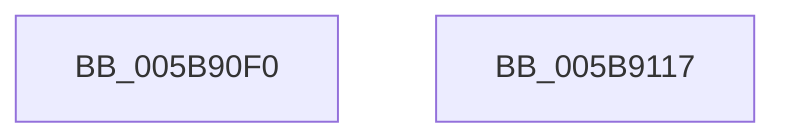

# KeUnsecureThread

- RVA: `0x005B90F0`–`0x005B9118` (길이 `40` bytes)
- VA: `0x00000001405B90F0`
- 실행 섹션: `.text`
- PDB 이름 있음: `예`; PDB Function 태그: `아니요`
- unwind 정보 RVA: `0x0005C788`
- 디코드: `9`개 명령, `40/40` bytes 표시
- 미해석 바이트: `0` (있으면 어셈블리에 `.byte`로 보존)

> 이 문서는 커널 이미지의 기계어와 PDB 기호를 분석해 생성했습니다. 4번과 5번은 함수 원형과 자료형을 바이너리 사용 방식에서 추정한 C 해석이며 원본 소스 복구 결과는 아닙니다.

## 1. Dependencies

- 직접 호출 지점: **1**; 고유 호출 대상: **1**
- 직접 호출자로 확인된 함수: **1**
- RIP 상대 이미지 참조: **0**

### Outgoing calls
- `0x005B910D` → [VslTerminateSecureThread](../../page/71/VslTerminateSecureThread_function_00719974.md) (function, `0x00719974`)

### Direct callers
- [PspExitThread](../../page/90/PspExitThread_function_00905F60.md) at `0x00906733`

### Static image references
- 디코드된 RIP-relative 메모리 참조가 없습니다.

## 2. Other-region calls and transfers

- 다른 실행 섹션으로 향하는 call: **1**
  - `0x005B910D` → [VslTerminateSecureThread](../../page/71/VslTerminateSecureThread_function_00719974.md) (`.text` → `PAGE`)
- 별도 외부 분기/꼬리 이동을 확인하지 못했습니다.

## 3. Assembly (complete function range)

```asm
005B90F0  48 83 EC 28                     sub rsp, 0x28
005B90F4  65 48 8B 04 25 88 01 00 00      mov rax, qword ptr gs:[0x188]
005B90FD  48 8B D1                        mov rdx, rcx
005B9100  8B 88 1C 03 00 00               mov ecx, dword ptr [rax + 0x31c]
005B9106  83 A0 1C 03 00 00 00            and dword ptr [rax + 0x31c], 0
005B910D  E8 62 08 16 00                  call 0x140719974
005B9112  48 83 C4 28                     add rsp, 0x28
005B9116  C3                              ret
005B9117  CC                              int3
```

## 4. C-style interpretation (structured pseudocode)

```c
__int64 __fastcall KeUnsecureThread(__int64 a1)
{
    __int64 result;
    __int64 v_rsp;

    v_rsp = (v_rsp) - (40);
    result = VslTerminateSecureThread((unsigned int)(*(unsigned int *)(*(unsigned __int64 *)(gs_base + (0 + 392)) + 796)), a1, a3, a4);
    v_rsp = (v_rsp) + (40);
    return result;
}
```

## 5. (Beta) C Style

```c
int64_t KeUnsecureThread(int64_t Arg1)
{
    int64_t result;
    int64_t local_rsp;

    local_rsp = (local_rsp) - (40);
    result = VslTerminateSecureThread((uint32_t)(*(uint32_t *)(*(uint64_t *)(gs_base + (0 + 0x188)) + 0x31C)), Arg1, a3, a4);
    local_rsp = (local_rsp) + (40);
    return result;
}
```

## 6. Execution-region graph

[열기: 2D/3D 그래프와 함수 탐색 컨트롤 패널](../../../control-panel.html?section=text&rva=0x005B90F0&view=graph)

- 2D 그래프는 위에서 아래로 흐르고, 3D 그래프는 빈 공간을 드래그해 회전합니다. Shift+드래그는 이동, 휠은 확대·축소, 함수 노드 선택은 대상 보고서 이동입니다.

### Static fallback


