# KeUpdateDpcWatchdogConfiguration

- RVA: `0x005B5A34`–`0x005B5C41` (길이 `525` bytes)
- VA: `0x00000001405B5A34`
- 실행 섹션: `.text`
- PDB 이름 있음: `예`; PDB Function 태그: `아니요`
- unwind 정보 RVA: `0x000C9D80`
- 디코드: `141`개 명령, `525/525` bytes 표시
- 미해석 바이트: `0` (있으면 어셈블리에 `.byte`로 보존)

> 이 문서는 커널 이미지의 기계어와 PDB 기호를 분석해 생성했습니다. 4번과 5번은 함수 원형과 자료형을 바이너리 사용 방식에서 추정한 C 해석이며 원본 소스 복구 결과는 아닙니다.

## 1. Dependencies

- 직접 호출 지점: **12**; 고유 호출 대상: **12**
- 직접 호출자로 확인된 함수: **1**
- RIP 상대 이미지 참조: **17**

### Outgoing calls
- `0x005B5A9E` → [KeAbPreAcquire](../21/KeAbPreAcquire_function_00210230.md) (function, `0x00210230`)
- `0x005B5AB8` → [ExfAcquirePushLockExclusiveEx](../20/ExfAcquirePushLockExclusiveEx_function_0020FC90.md) (function, `0x0020FC90`)
- `0x005B5AD3` → [KiValidateDpcWatchdogConfiguration](KiValidateDpcWatchdogConfiguration_function_005B5E38.md) (function, `0x005B5E38`)
- `0x005B5AFF` → [KiRaiseIrqlProcessIrqlFlags](../4F/KiRaiseIrqlProcessIrqlFlags_function_004F56FC.md) (function, `0x004F56FC`)
- `0x005B5B9E` → [KiApplyDpcVerificationScaleSettings](KiApplyDpcVerificationScaleSettings_function_005B7014.md) (function, `0x005B7014`)
- `0x005B5BB3` → [KiLowerIrqlProcessIrqlFlags](../4F/KiLowerIrqlProcessIrqlFlags_function_004F5698.md) (function, `0x004F5698`)
- `0x005B5BC9` → [KiCreateDpcLimitsProcessorConfiguration](KiCreateDpcLimitsProcessorConfiguration_function_005B5C48.md) (function, `0x005B5C48`)
- `0x005B5BE3` → [KeGenericProcessorCallback](../39/KeGenericProcessorCallback_function_00398C2C.md) (function, `0x00398C2C`)
- `0x005B5BFE` → [ExfTryToWakePushLock](../26/ExfTryToWakePushLock_function_00265DD0.md) (function, `0x00265DD0`)
- `0x005B5C06` → [KeAbPostRelease](../2E/KeAbPostRelease_function_002E1600.md) (function, `0x002E1600`)
- `0x005B5C14` → [KiLeaveCriticalRegionUnsafe](../25/KiLeaveCriticalRegionUnsafe_function_0025F010.md) (function, `0x0025F010`)
- `0x005B5C22` → [_security_check_cookie](../6A/_security_check_cookie_function_006AC640.md) (function, `0x006AC640`)

### Direct callers
- [NtSetSystemInformation](../../page/AF/NtSetSystemInformation_function_00AF4A60.md) at `0x00AF672B`

### Static image references
- `0x005B5A4D` → RVA `0x00E0A740` (`.data`; read)
- `0x005B5A5E` → RVA `0x00F234F8` (`.data`; read)
- `0x005B5AF0` → RVA `0x00FC6D20` (`ALMOSTRO`; read)
- `0x005B5B10` → RVA `0x00FC5034` (`ALMOSTRO`; write)
- `0x005B5B1F` → RVA `0x00FC502C` (`ALMOSTRO`; write)
- `0x005B5B2E` → RVA `0x00FC5040` (`ALMOSTRO`; write)
- `0x005B5B3D` → RVA `0x00FC503C` (`ALMOSTRO`; write)
- `0x005B5B4C` → RVA `0x00FC5028` (`ALMOSTRO`; write)
- `0x005B5B5B` → RVA `0x00FC5024` (`ALMOSTRO`; write)
- `0x005B5B61` → RVA `0x00FC5048` (`ALMOSTRO`; read)
- `0x005B5B78` → RVA `0x00FC5028` (`ALMOSTRO`; read)
- `0x005B5B80` → RVA `0x00FC5024` (`ALMOSTRO`; read)
- `0x005B5B8F` → RVA `0x00FC5048` (`ALMOSTRO`; write)
- `0x005B5B98` → RVA `0x00FC53D4` (`ALMOSTRO`; write)
- `0x005B5BD5` → RVA `0x005B5E20` (`KiUpdateProcessorDpcWatchdogConfiguration`; read)
- `0x005B5BDC` → RVA `0x00FC7120` (`ALMOSTRO`; read)
- `0x005B5BEA` → RVA `0x00F234F8` (`.data`; read/write)

## 2. Other-region calls and transfers

- 다른 실행 섹션으로 향하는 call: **0**
- 별도 외부 분기/꼬리 이동을 확인하지 못했습니다.

## 3. Assembly (complete function range)

```asm
005B5A34  48 89 5C 24 18                  mov qword ptr [rsp + 0x18], rbx
005B5A39  48 89 74 24 20                  mov qword ptr [rsp + 0x20], rsi
005B5A3E  55                              push rbp
005B5A3F  57                              push rdi
005B5A40  41 55                           push r13
005B5A42  41 56                           push r14
005B5A44  41 57                           push r15
005B5A46  48 8B EC                        mov rbp, rsp
005B5A49  48 83 EC 70                     sub rsp, 0x70
005B5A4D  48 8B 05 EC 4C 85 00            mov rax, qword ptr [rip + 0x854cec]
005B5A54  48 33 C4                        xor rax, rsp
005B5A57  48 89 45 F0                     mov qword ptr [rbp - 0x10], rax
005B5A5B  0F 57 C0                        xorps xmm0, xmm0
005B5A5E  4C 8D 2D 93 DA 96 00            lea r13, [rip + 0x96da93]
005B5A65  0F 11 45 D0                     movups xmmword ptr [rbp - 0x30], xmm0
005B5A69  41 8B F0                        mov esi, r8d
005B5A6C  44 8B FA                        mov r15d, edx
005B5A6F  0F 11 45 E0                     movups xmmword ptr [rbp - 0x20], xmm0
005B5A73  65 48 8B 04 25 88 01 00 00      mov rax, qword ptr gs:[0x188]
005B5A7C  4C 8B F1                        mov r14, rcx
005B5A7F  0F 57 C9                        xorps xmm1, xmm1
005B5A82  48 83 CB FF                     or rbx, 0xffffffffffffffff
005B5A86  45 33 C0                        xor r8d, r8d
005B5A89  33 D2                           xor edx, edx
005B5A8B  49 8B CD                        mov rcx, r13
005B5A8E  66 01 98 E4 01 00 00            add word ptr [rax + 0x1e4], bx
005B5A95  90                              nop
005B5A96  0F 11 4D B0                     movups xmmword ptr [rbp - 0x50], xmm1
005B5A9A  0F 11 4D C0                     movups xmmword ptr [rbp - 0x40], xmm1
005B5A9E  E8 8D A7 C5 FF                  call 0x140210230
005B5AA3  F0 49 0F BA 6D 00 00            lock bts qword ptr [r13], 0
005B5AAA  48 8B F8                        mov rdi, rax
005B5AAD  73 0E                           jae 0x1405b5abd
005B5AAF  4D 8B C5                        mov r8, r13
005B5AB2  48 8B D0                        mov rdx, rax
005B5AB5  49 8B CD                        mov rcx, r13
005B5AB8  E8 D3 A1 C5 FF                  call 0x14020fc90
005B5ABD  48 85 FF                        test rdi, rdi
005B5AC0  74 04                           je 0x1405b5ac6
005B5AC2  C6 47 0A 01                     mov byte ptr [rdi + 0xa], 1
005B5AC6  4C 8D 4D B0                     lea r9, [rbp - 0x50]
005B5ACA  44 8B C6                        mov r8d, esi
005B5ACD  41 8B D7                        mov edx, r15d
005B5AD0  49 8B CE                        mov rcx, r14
005B5AD3  E8 60 03 00 00                  call 0x1405b5e38
005B5AD8  8B F8                           mov edi, eax
005B5ADA  41 BF 02 00 00 00               mov r15d, 2
005B5AE0  85 C0                           test eax, eax
005B5AE2  0F 88 02 01 00 00               js 0x1405b5bea
005B5AE8  45 0F 20 C6                     mov r14, cr8
005B5AEC  45 0F 22 C7                     mov cr8, r15
005B5AF0  83 3D 29 12 A1 00 00            cmp dword ptr [rip + 0xa11229], 0
005B5AF7  74 0B                           je 0x1405b5b04
005B5AF9  41 8A D7                        mov dl, r15b
005B5AFC  41 8A CE                        mov cl, r14b
005B5AFF  E8 F8 FB F3 FF                  call 0x1404f56fc
005B5B04  8B 4D B0                        mov ecx, dword ptr [rbp - 0x50]
005B5B07  0F BA E1 08                     bt ecx, 8
005B5B0B  73 09                           jae 0x1405b5b16
005B5B0D  8B 45 B4                        mov eax, dword ptr [rbp - 0x4c]
005B5B10  89 05 1E F5 A0 00               mov dword ptr [rip + 0xa0f51e], eax
005B5B16  0F BA E1 09                     bt ecx, 9
005B5B1A  73 09                           jae 0x1405b5b25
005B5B1C  8B 45 B8                        mov eax, dword ptr [rbp - 0x48]
005B5B1F  89 05 07 F5 A0 00               mov dword ptr [rip + 0xa0f507], eax
005B5B25  0F BA E1 0A                     bt ecx, 0xa
005B5B29  73 09                           jae 0x1405b5b34
005B5B2B  8B 45 BC                        mov eax, dword ptr [rbp - 0x44]
005B5B2E  89 05 0C F5 A0 00               mov dword ptr [rip + 0xa0f50c], eax
005B5B34  0F BA E1 0B                     bt ecx, 0xb
005B5B38  73 09                           jae 0x1405b5b43
005B5B3A  8B 45 C0                        mov eax, dword ptr [rbp - 0x40]
005B5B3D  89 05 F9 F4 A0 00               mov dword ptr [rip + 0xa0f4f9], eax
005B5B43  0F BA E1 0C                     bt ecx, 0xc
005B5B47  73 09                           jae 0x1405b5b52
005B5B49  8B 45 C4                        mov eax, dword ptr [rbp - 0x3c]
005B5B4C  89 05 D6 F4 A0 00               mov dword ptr [rip + 0xa0f4d6], eax
005B5B52  0F BA E1 0D                     bt ecx, 0xd
005B5B56  73 09                           jae 0x1405b5b61
005B5B58  8B 45 C8                        mov eax, dword ptr [rbp - 0x38]
005B5B5B  89 05 C3 F4 A0 00               mov dword ptr [rip + 0xa0f4c3], eax
005B5B61  8B 35 E1 F4 A0 00               mov esi, dword ptr [rip + 0xa0f4e1]
005B5B67  8B FE                           mov edi, esi
005B5B69  0F BA E1 0E                     bt ecx, 0xe
005B5B6D  73 05                           jae 0x1405b5b74
005B5B6F  8B 7D CC                        mov edi, dword ptr [rbp - 0x34]
005B5B72  EB 19                           jmp 0x1405b5b8d
005B5B74  85 F6                           test esi, esi
005B5B76  75 15                           jne 0x1405b5b8d
005B5B78  39 35 AA F4 A0 00               cmp dword ptr [rip + 0xa0f4aa], esi
005B5B7E  75 08                           jne 0x1405b5b88
005B5B80  39 35 9E F4 A0 00               cmp dword ptr [rip + 0xa0f49e], esi
005B5B86  74 05                           je 0x1405b5b8d
005B5B88  BF 00 10 04 00                  mov edi, 0x41000
005B5B8D  8B C7                           mov eax, edi
005B5B8F  89 3D B3 F4 A0 00               mov dword ptr [rip + 0xa0f4b3], edi
005B5B95  C1 E8 03                        shr eax, 3
005B5B98  89 05 36 F8 A0 00               mov dword ptr [rip + 0xa0f836], eax
005B5B9E  E8 71 14 00 00                  call 0x1405b7014
005B5BA3  83 3D 76 11 A1 00 00            cmp dword ptr [rip + 0xa11176], 0
005B5BAA  74 0C                           je 0x1405b5bb8
005B5BAC  44 0F 20 C1                     mov rcx, cr8
005B5BB0  41 8A D6                        mov dl, r14b
005B5BB3  E8 E0 FA F3 FF                  call 0x1404f5698
005B5BB8  41 0F B6 C6                     movzx eax, r14b
005B5BBC  44 0F 22 C0                     mov cr8, rax
005B5BC0  44 8B C7                        mov r8d, edi
005B5BC3  48 8D 4D D0                     lea rcx, [rbp - 0x30]
005B5BC7  8B D6                           mov edx, esi
005B5BC9  E8 7A 00 00 00                  call 0x1405b5c48
005B5BCE  45 8B CF                        mov r9d, r15d
005B5BD1  4C 8D 45 D0                     lea r8, [rbp - 0x30]
005B5BD5  48 8D 15 44 02 00 00            lea rdx, [rip + 0x244]
005B5BDC  48 8D 0D 3D 15 A1 00            lea rcx, [rip + 0xa1153d]
005B5BE3  E8 44 30 DE FF                  call 0x140398c2c
005B5BE8  33 FF                           xor edi, edi
005B5BEA  F0 48 0F C1 1D 05 D9 96 00      lock xadd qword ptr [rip + 0x96d905], rbx
005B5BF3  80 E3 06                        and bl, 6
005B5BF6  41 3A DF                        cmp bl, r15b
005B5BF9  75 08                           jne 0x1405b5c03
005B5BFB  49 8B CD                        mov rcx, r13
005B5BFE  E8 CD 01 CB FF                  call 0x140265dd0
005B5C03  49 8B CD                        mov rcx, r13
005B5C06  E8 F5 B9 D2 FF                  call 0x1402e1600
005B5C0B  65 48 8B 0C 25 88 01 00 00      mov rcx, qword ptr gs:[0x188]
005B5C14  E8 F7 93 CA FF                  call 0x14025f010
005B5C19  8B C7                           mov eax, edi
005B5C1B  48 8B 4D F0                     mov rcx, qword ptr [rbp - 0x10]
005B5C1F  48 33 CC                        xor rcx, rsp
005B5C22  E8 19 6A 0F 00                  call 0x1406ac640
005B5C27  4C 8D 5C 24 70                  lea r11, [rsp + 0x70]
005B5C2C  49 8B 5B 40                     mov rbx, qword ptr [r11 + 0x40]
005B5C30  49 8B 73 48                     mov rsi, qword ptr [r11 + 0x48]
005B5C34  49 8B E3                        mov rsp, r11
005B5C37  41 5F                           pop r15
005B5C39  41 5E                           pop r14
005B5C3B  41 5D                           pop r13
005B5C3D  5F                              pop rdi
005B5C3E  5D                              pop rbp
005B5C3F  C3                              ret
005B5C40  CC                              int3
```

## 4. C-style interpretation (structured pseudocode)

```c
__int64 __fastcall KeUpdateDpcWatchdogConfiguration(__int64 a1, int a2, int a3)
{
    __int64 result;
    __int64 v_rbx;
    __int64 v_rdi;
    __int64 v_rsp;
    unsigned __int64 v_stack_m28;
    unsigned __int64 v_stack_m38;
    unsigned __int64 v_stack_m48;
    unsigned __int64 v_stack_m58;
    unsigned int v_stack_m5C;
    unsigned int v_stack_m60;
    unsigned int v_stack_m64;
    unsigned __int64 v_stack_m68;
    unsigned int v_stack_m6C;
    unsigned int v_stack_m70;
    unsigned int v_stack_m74;
    unsigned __int64 v_stack_m78;
    unsigned __int64 v_stack_p18;
    unsigned __int64 v_stack_p20;

    v_stack_p18 = v_rbx;
    v_stack_p20 = v_rsi;
    v_rsp = (v_rsp) - (112);
    result = (*(unsigned __int64 *)(v_rip + 8735980)) ^ (v_rsp);
    v_stack_m38 = result;
    v_stack_m58 = v_xmm0;
    v_stack_m48 = v_xmm0;
    v_rbx = (v_rbx) | (-1);
    a3 = 0;
    a2 = 0;
    v_stack_m78 = v_xmm1;
    v_stack_m68 = v_xmm1;
    result = KeAbPreAcquire(v_rip + 9886355, a2, a3, a4);
    if (!(condition_is_above_or_equal)) {
        a3 = v_rip + 9886355;
        a2 = result;
        a1 = v_rip + 9886355;
        result = ExfAcquirePushLockExclusiveEx(a1, a2, a3, a4);
    }
    if (result != 0) {
        *(unsigned __int8 *)(result + 10) = 1;
    }
    result = KiValidateDpcWatchdogConfiguration(a1, (unsigned int)((unsigned int)((unsigned int)(a2))), (unsigned int)((unsigned int)((unsigned int)(a3))), v_stack_m78);
    if (sign_flag) goto loc_005B5BEA;
    if ((*(unsigned int *)(v_rip + 10555945)) != 0) {
        a2 = 2;
        a1 = (unsigned __int8)(v_cr8);
        result = KiRaiseIrqlProcessIrqlFlags(a1, a2, (unsigned int)((unsigned int)((unsigned int)(a3))), v_stack_m78);
    }
    if ((*(unsigned int *)(v_rip + 10555945)) < 0) {
        result = v_stack_m74;
        *(unsigned int *)(v_rip + 10548510) = (unsigned int)(result);
    }
    if ((*(unsigned int *)(v_rip + 10555945)) < 0) {
        result = v_stack_m70;
        *(unsigned int *)(v_rip + 10548487) = (unsigned int)(result);
    }
    if ((*(unsigned int *)(v_rip + 10555945)) < 0) {
        result = v_stack_m6C;
        *(unsigned int *)(v_rip + 10548492) = (unsigned int)(result);
    }
    if ((*(unsigned int *)(v_rip + 10555945)) < 0) {
        result = v_stack_m68;
        *(unsigned int *)(v_rip + 10548473) = (unsigned int)(result);
    }
    if ((*(unsigned int *)(v_rip + 10555945)) < 0) {
        result = v_stack_m64;
        *(unsigned int *)(v_rip + 10548438) = (unsigned int)(result);
    }
    if ((*(unsigned int *)(v_rip + 10555945)) < 0) {
        result = v_stack_m60;
        *(unsigned int *)(v_rip + 10548419) = (unsigned int)(result);
    }
    if ((*(unsigned int *)(v_rip + 10555945)) >= 0) goto loc_005B5B74;
    goto loc_005B5B8D;
loc_005B5B74:
    if ((unsigned int)((unsigned int)(*(unsigned int *)(v_rip + 10548449))) != 0) goto loc_005B5B8D;
    if ((*(unsigned int *)(v_rip + 10548394)) != ((unsigned int)((unsigned int)(*(unsigned int *)(v_rip + 10548449))))) goto loc_005B5B88;
    v_rdi = (unsigned int)(v_stack_m5C);
    if ((*(unsigned int *)(v_rip + 10548382)) != ((unsigned int)((unsigned int)(*(unsigned int *)(v_rip + 10548449))))) {
        v_rdi = 0x41000ULL;
    }
    *(unsigned int *)(v_rip + 10548403) = (unsigned int)(v_rdi);
    result = (unsigned int)(((unsigned int)((unsigned int)(v_rdi))) >> (3));
    *(unsigned int *)(v_rip + 10549302) = (unsigned int)(result);
    result = KiApplyDpcVerificationScaleSettings((unsigned int)(v_stack_m78), a2, (unsigned int)((unsigned int)((unsigned int)(a3))), v_stack_m78);
    if ((*(unsigned int *)(v_rip + 10555766)) != 0) {
        a1 = 2;
        a2 = (unsigned __int8)(v_cr8);
        result = KiLowerIrqlProcessIrqlFlags(a1, a2, (unsigned int)((unsigned int)((unsigned int)(a3))), v_stack_m78);
    }
    result = KiCreateDpcLimitsProcessorConfiguration(v_stack_m58, (unsigned int)((unsigned int)((unsigned int)(*(unsigned int *)(v_rip + 10548449)))), (unsigned int)((unsigned int)(v_rdi)), v_stack_m78);
    result = KeGenericProcessorCallback(v_rip + 10556733, v_rip + 580, v_stack_m58, 2);
    v_rdi = 0;
loc_005B5BEA:
    v_rbx = (unsigned __int8)((v_rbx) & (6));
    if (((unsigned __int8)(v_rbx)) == 2) {
        a1 = v_rip + 9886355;
        result = ExfTryToWakePushLock(a1, v_rip + 580, v_stack_m58, 2);
    }
    result = KeAbPostRelease(v_rip + 9886355, v_rip + 580, v_stack_m58, 2);
    result = KiLeaveCriticalRegionUnsafe(*(unsigned __int64 *)(gs_base + (0 + 392)), v_rip + 580, v_stack_m58, 2);
    a1 = (v_stack_m38) ^ (v_rsp);
    result = _security_check_cookie(a1, v_rip + 580, v_stack_m58, 2);
    return result;
}
```

## 5. (Beta) C Style

```c
int64_t KeUpdateDpcWatchdogConfiguration(int64_t Arg1, int32_t Arg2, int32_t Arg3)
{
    int64_t result;
    int64_t local_rbx;
    int64_t local_rdi;
    int64_t local_rsp;
    uint64_t v_stack_m28;
    uint64_t v_stack_m38;
    uint64_t v_stack_m48;
    uint64_t v_stack_m58;
    uint32_t v_stack_m5C;
    uint32_t v_stack_m60;
    uint32_t v_stack_m64;
    uint64_t v_stack_m68;
    uint32_t v_stack_m6C;
    uint32_t v_stack_m70;
    uint32_t v_stack_m74;
    uint64_t v_stack_m78;
    uint64_t v_stack_p18;
    uint64_t v_stack_p20;

    v_stack_p18 = local_rbx;
    v_stack_p20 = local_rsi;
    local_rsp = (local_rsp) - (112);
    result = (*(uint64_t *)(v_rip + 0x854CEC)) ^ (local_rsp);
    v_stack_m38 = result;
    v_stack_m58 = v_xmm0;
    v_stack_m48 = v_xmm0;
    local_rbx = (local_rbx) | (-1);
    Arg3 = 0;
    Arg2 = 0;
    v_stack_m78 = v_xmm1;
    v_stack_m68 = v_xmm1;
    result = KeAbPreAcquire(v_rip + 9886355, Arg2, Arg3, a4);
    if (!(condition_is_above_or_equal)) {
        Arg3 = v_rip + 9886355;
        Arg2 = result;
        Arg1 = v_rip + 9886355;
        result = ExfAcquirePushLockExclusiveEx(Arg1, Arg2, Arg3, a4);
    }
    if (result != 0) {
        *(uint8_t *)(result + 0xA) = 1;
    }
    result = KiValidateDpcWatchdogConfiguration(Arg1, (uint32_t)((uint32_t)((uint32_t)(Arg2))), (uint32_t)((uint32_t)((uint32_t)(Arg3))), v_stack_m78);
    if (sign_flag) goto loc_005B5BEA;
    if ((*(uint32_t *)(v_rip + 0xA11229)) != 0) {
        Arg2 = 2;
        Arg1 = (uint8_t)(v_cr8);
        result = KiRaiseIrqlProcessIrqlFlags(Arg1, Arg2, (uint32_t)((uint32_t)((uint32_t)(Arg3))), v_stack_m78);
    }
    if ((*(uint32_t *)(v_rip + 0xA11229)) < 0) {
        result = v_stack_m74;
        *(uint32_t *)(v_rip + 0xA0F51E) = (uint32_t)(result);
    }
    if ((*(uint32_t *)(v_rip + 0xA11229)) < 0) {
        result = v_stack_m70;
        *(uint32_t *)(v_rip + 0xA0F507) = (uint32_t)(result);
    }
    if ((*(uint32_t *)(v_rip + 0xA11229)) < 0) {
        result = v_stack_m6C;
        *(uint32_t *)(v_rip + 0xA0F50C) = (uint32_t)(result);
    }
    if ((*(uint32_t *)(v_rip + 0xA11229)) < 0) {
        result = v_stack_m68;
        *(uint32_t *)(v_rip + 0xA0F4F9) = (uint32_t)(result);
    }
    if ((*(uint32_t *)(v_rip + 0xA11229)) < 0) {
        result = v_stack_m64;
        *(uint32_t *)(v_rip + 0xA0F4D6) = (uint32_t)(result);
    }
    if ((*(uint32_t *)(v_rip + 0xA11229)) < 0) {
        result = v_stack_m60;
        *(uint32_t *)(v_rip + 0xA0F4C3) = (uint32_t)(result);
    }
    if ((*(uint32_t *)(v_rip + 0xA11229)) >= 0) goto loc_005B5B74;
    goto loc_005B5B8D;
loc_005B5B74:
    if ((uint32_t)((uint32_t)(*(uint32_t *)(v_rip + 0xA0F4E1))) != 0) goto loc_005B5B8D;
    if ((*(uint32_t *)(v_rip + 0xA0F4AA)) != ((uint32_t)((uint32_t)(*(uint32_t *)(v_rip + 0xA0F4E1))))) goto loc_005B5B88;
    local_rdi = (uint32_t)(v_stack_m5C);
    if ((*(uint32_t *)(v_rip + 0xA0F49E)) != ((uint32_t)((uint32_t)(*(uint32_t *)(v_rip + 0xA0F4E1))))) {
        local_rdi = 0x41000ULL;
    }
    *(uint32_t *)(v_rip + 0xA0F4B3) = (uint32_t)(local_rdi);
    result = (uint32_t)(((uint32_t)((uint32_t)(local_rdi))) >> (3));
    *(uint32_t *)(v_rip + 0xA0F836) = (uint32_t)(result);
    result = KiApplyDpcVerificationScaleSettings((uint32_t)(v_stack_m78), Arg2, (uint32_t)((uint32_t)((uint32_t)(Arg3))), v_stack_m78);
    if ((*(uint32_t *)(v_rip + 0xA11176)) != 0) {
        Arg1 = 2;
        Arg2 = (uint8_t)(v_cr8);
        result = KiLowerIrqlProcessIrqlFlags(Arg1, Arg2, (uint32_t)((uint32_t)((uint32_t)(Arg3))), v_stack_m78);
    }
    result = KiCreateDpcLimitsProcessorConfiguration(v_stack_m58, (uint32_t)((uint32_t)((uint32_t)(*(uint32_t *)(v_rip + 0xA0F4E1)))), (uint32_t)((uint32_t)(local_rdi)), v_stack_m78);
    result = KeGenericProcessorCallback(v_rip + 10556733, v_rip + 580, v_stack_m58, 2);
    local_rdi = 0;
loc_005B5BEA:
    local_rbx = (uint8_t)((local_rbx) & (6));
    if (((uint8_t)(local_rbx)) == 2) {
        Arg1 = v_rip + 9886355;
        result = ExfTryToWakePushLock(Arg1, v_rip + 580, v_stack_m58, 2);
    }
    result = KeAbPostRelease(v_rip + 9886355, v_rip + 580, v_stack_m58, 2);
    result = KiLeaveCriticalRegionUnsafe(*(uint64_t *)(gs_base + (0 + 0x188)), v_rip + 580, v_stack_m58, 2);
    Arg1 = (v_stack_m38) ^ (local_rsp);
    result = _security_check_cookie(Arg1, v_rip + 580, v_stack_m58, 2);
    return result;
}
```

## 6. Execution-region graph

[열기: 2D/3D 그래프와 함수 탐색 컨트롤 패널](../../../control-panel.html?section=text&rva=0x005B5A34&view=graph)

- 2D 그래프는 위에서 아래로 흐르고, 3D 그래프는 빈 공간을 드래그해 회전합니다. Shift+드래그는 이동, 휠은 확대·축소, 함수 노드 선택은 대상 보고서 이동입니다.

### Static fallback

```mermaid
flowchart TD
  bb_005B5A34[BB_005B5A34]
  bb_005B5AAF[BB_005B5AAF]
  bb_005B5ABD[BB_005B5ABD]
  bb_005B5AC2[BB_005B5AC2]
  bb_005B5AC6[BB_005B5AC6]
  bb_005B5AE8[BB_005B5AE8]
  bb_005B5AF9[BB_005B5AF9]
  bb_005B5B04[BB_005B5B04]
  bb_005B5B0D[BB_005B5B0D]
  bb_005B5B16[BB_005B5B16]
  bb_005B5B1C[BB_005B5B1C]
  bb_005B5B25[BB_005B5B25]
  bb_005B5B2B[BB_005B5B2B]
  bb_005B5B34[BB_005B5B34]
  bb_005B5B3A[BB_005B5B3A]
  bb_005B5B43[BB_005B5B43]
  bb_005B5B49[BB_005B5B49]
  bb_005B5B52[BB_005B5B52]
  bb_005B5B58[BB_005B5B58]
  bb_005B5B61[BB_005B5B61]
  bb_005B5B6F[BB_005B5B6F]
  bb_005B5B74[BB_005B5B74]
  bb_005B5B78[BB_005B5B78]
  bb_005B5B80[BB_005B5B80]
  bb_005B5B88[BB_005B5B88]
  bb_005B5B8D[BB_005B5B8D]
  bb_005B5BAC[BB_005B5BAC]
  bb_005B5BB8[BB_005B5BB8]
  bb_005B5BEA[BB_005B5BEA]
  bb_005B5BFB[BB_005B5BFB]
  bb_005B5C03[BB_005B5C03]
  bb_005B5C40[BB_005B5C40]
  bb_005B5A34 -->|branch| bb_005B5ABD
  bb_005B5A34 -->|fallthrough| bb_005B5AAF
  bb_005B5AAF -->|flow| bb_005B5ABD
  bb_005B5ABD -->|branch| bb_005B5AC6
  bb_005B5ABD -->|fallthrough| bb_005B5AC2
  bb_005B5AC2 -->|flow| bb_005B5AC6
  bb_005B5AC6 -->|branch| bb_005B5BEA
  bb_005B5AC6 -->|fallthrough| bb_005B5AE8
  bb_005B5AE8 -->|branch| bb_005B5B04
  bb_005B5AE8 -->|fallthrough| bb_005B5AF9
  bb_005B5AF9 -->|flow| bb_005B5B04
  bb_005B5B04 -->|branch| bb_005B5B16
  bb_005B5B04 -->|fallthrough| bb_005B5B0D
  bb_005B5B0D -->|flow| bb_005B5B16
  bb_005B5B16 -->|branch| bb_005B5B25
  bb_005B5B16 -->|fallthrough| bb_005B5B1C
  bb_005B5B1C -->|flow| bb_005B5B25
  bb_005B5B25 -->|branch| bb_005B5B34
  bb_005B5B25 -->|fallthrough| bb_005B5B2B
  bb_005B5B2B -->|flow| bb_005B5B34
  bb_005B5B34 -->|branch| bb_005B5B43
  bb_005B5B34 -->|fallthrough| bb_005B5B3A
  bb_005B5B3A -->|flow| bb_005B5B43
  bb_005B5B43 -->|branch| bb_005B5B52
  bb_005B5B43 -->|fallthrough| bb_005B5B49
  bb_005B5B49 -->|flow| bb_005B5B52
  bb_005B5B52 -->|branch| bb_005B5B61
  bb_005B5B52 -->|fallthrough| bb_005B5B58
  bb_005B5B58 -->|flow| bb_005B5B61
  bb_005B5B61 -->|branch| bb_005B5B74
  bb_005B5B61 -->|fallthrough| bb_005B5B6F
  bb_005B5B6F -->|branch| bb_005B5B8D
  bb_005B5B74 -->|branch| bb_005B5B8D
  bb_005B5B74 -->|fallthrough| bb_005B5B78
  bb_005B5B78 -->|branch| bb_005B5B88
  bb_005B5B78 -->|fallthrough| bb_005B5B80
  bb_005B5B80 -->|branch| bb_005B5B8D
  bb_005B5B80 -->|fallthrough| bb_005B5B88
  bb_005B5B88 -->|flow| bb_005B5B8D
  bb_005B5B8D -->|branch| bb_005B5BB8
  bb_005B5B8D -->|fallthrough| bb_005B5BAC
  bb_005B5BAC -->|flow| bb_005B5BB8
  bb_005B5BB8 -->|flow| bb_005B5BEA
  bb_005B5BEA -->|branch| bb_005B5C03
  bb_005B5BEA -->|fallthrough| bb_005B5BFB
  bb_005B5BFB -->|flow| bb_005B5C03
```


