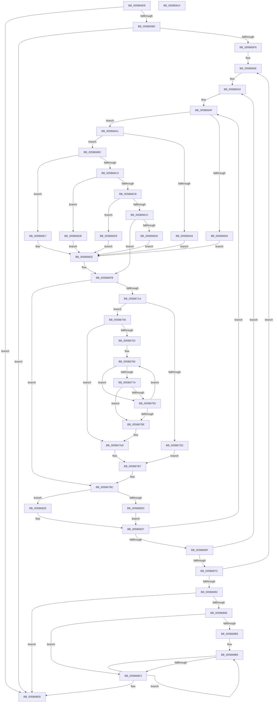

# KeUpdateProcessorRestrictionsEx

- RVA: `0x005B64E8`–`0x005B6915` (길이 `1,069` bytes)
- VA: `0x00000001405B64E8`
- 실행 섹션: `.text`
- PDB 이름 있음: `예`; PDB Function 태그: `아니요`
- unwind 정보 RVA: `0x000C9F28`
- 디코드: `250`개 명령, `1,069/1,069` bytes 표시
- 미해석 바이트: `0` (있으면 어셈블리에 `.byte`로 보존)

> 이 문서는 커널 이미지의 기계어와 PDB 기호를 분석해 생성했습니다. 4번과 5번은 함수 원형과 자료형을 바이너리 사용 방식에서 추정한 C 해석이며 원본 소스 복구 결과는 아닙니다.

## 1. Dependencies

- 직접 호출 지점: **23**; 고유 호출 대상: **13**
- 직접 호출자로 확인된 함수: **1**
- RIP 상대 이미지 참조: **7**

### Outgoing calls
- `0x005B6537` → [memset](../6C/memset_function_006C6C40.md) (function, `0x006C6C40`)
- `0x005B654F` → [memset](../6C/memset_function_006C6C40.md) (function, `0x006C6C40`)
- `0x005B6560` → [memset](../6C/memset_function_006C6C40.md) (function, `0x006C6C40`)
- `0x005B659E` → [memset](../6C/memset_function_006C6C40.md) (function, `0x006C6C40`)
- `0x005B65BA` → [memset](../6C/memset_function_006C6C40.md) (function, `0x006C6C40`)
- `0x005B65D6` → [memset](../6C/memset_function_006C6C40.md) (function, `0x006C6C40`)
- `0x005B6664` → [memset](../6C/memset_function_006C6C40.md) (function, `0x006C6C40`)
- `0x005B6684` → [memset](../6C/memset_function_006C6C40.md) (function, `0x006C6C40`)
- `0x005B66F6` → [KiCopyAffinityEx](../2C/KiCopyAffinityEx_function_002CE860.md) (function, `0x002CE860`)
- `0x005B6708` → [KeAndAffinityEx2](../3C/KeAndAffinityEx2_function_003C0740.md) (function, `0x003C0740`)
- `0x005B6724` → [KeCountSetBitsAffinityEx](../2C/KeCountSetBitsAffinityEx_function_002CE6E0.md) (function, `0x002CE6E0`)
- `0x005B673F` → [KiCopyAffinityEx](../2C/KiCopyAffinityEx_function_002CE860.md) (function, `0x002CE860`)
- `0x005B6771` → [KeCheckProcessorAffinityEx](../30/KeCheckProcessorAffinityEx_function_00305150.md) (function, `0x00305150`)
- `0x005B6785` → [KeAddProcessorAffinityEx](../25/KeAddProcessorAffinityEx_function_0025B6F0.md) (function, `0x0025B6F0`)
- `0x005B67D3` → [KiSubtractAffinityEx](../2D/KiSubtractAffinityEx_function_002D61E8.md) (function, `0x002D61E8`)
- `0x005B67F5` → [KiOrAffinityEx](../39/KiOrAffinityEx_function_0039A84C.md) (function, `0x0039A84C`)
- `0x005B6804` → [KeIsEqualAffinityEx](../30/KeIsEqualAffinityEx_function_00305230.md) (function, `0x00305230`)
- `0x005B681C` → [KiCopyAffinityEx](../2C/KiCopyAffinityEx_function_002CE860.md) (function, `0x002CE860`)
- `0x005B689E` → [KeInitializeSchedulerSubNodeEnumerationContext](../41/KeInitializeSchedulerSubNodeEnumerationContext_function_0041E4B0.md) (function, `0x0041E4B0`)
- `0x005B68AC` → [KeEnumerateNextSchedulerSubNodeInNode](../25/KeEnumerateNextSchedulerSubNodeInNode_function_002566D8.md) (function, `0x002566D8`)
- `0x005B68CC` → [KiInstallSubNodeHeteroSets](../4B/KiInstallSubNodeHeteroSets_function_004B71D4.md) (function, `0x004B71D4`)
- `0x005B68DA` → [KeEnumerateNextSchedulerSubNodeInNode](../25/KeEnumerateNextSchedulerSubNodeInNode_function_002566D8.md) (function, `0x002566D8`)
- `0x005B68F4` → [_security_check_cookie](../6A/_security_check_cookie_function_006AC640.md) (function, `0x006AC640`)

### Direct callers
- [PpmParkEvaluateRestriction](../4A/PpmParkEvaluateRestriction_function_004ADE0C.md) at `0x004ADEAA`

### Static image references
- `0x005B6507` → RVA `0x00E0A740` (`.data`; read)
- `0x005B6565` → RVA `0x00F234D8` (`.data`; read)
- `0x005B656E` → RVA `0x00FC53E0` (`ALMOSTRO`; read)
- `0x005B65DF` → RVA `0x00FCF6C0` (`CACHEALI`; read)
- `0x005B660D` → RVA `0x00FC5460` (`ALMOSTRO`; read)
- `0x005B6689` → RVA `0x00FC6B78` (`ALMOSTRO`; read)
- `0x005B66A1` → RVA `0x00FC6C34` (`ALMOSTRO`; read)

## 2. Other-region calls and transfers

- 다른 실행 섹션으로 향하는 call: **0**
- 별도 외부 분기/꼬리 이동을 확인하지 못했습니다.

## 3. Assembly (complete function range)

```asm
005B64E8  48 89 5C 24 18                  mov qword ptr [rsp + 0x18], rbx
005B64ED  55                              push rbp
005B64EE  56                              push rsi
005B64EF  57                              push rdi
005B64F0  41 54                           push r12
005B64F2  41 55                           push r13
005B64F4  41 56                           push r14
005B64F6  41 57                           push r15
005B64F8  48 8D AC 24 00 FD FF FF         lea rbp, [rsp - 0x300]
005B6500  48 81 EC 00 04 00 00            sub rsp, 0x400
005B6507  48 8B 05 32 42 85 00            mov rax, qword ptr [rip + 0x854232]
005B650E  48 33 C4                        xor rax, rsp
005B6511  48 89 85 F0 02 00 00            mov qword ptr [rbp + 0x2f0], rax
005B6518  44 89 44 24 28                  mov dword ptr [rsp + 0x28], r8d
005B651D  41 BD 00 01 00 00               mov r13d, 0x100
005B6523  48 89 54 24 38                  mov qword ptr [rsp + 0x38], rdx
005B6528  45 8B C5                        mov r8d, r13d
005B652B  8B F9                           mov edi, ecx
005B652D  33 D2                           xor edx, edx
005B652F  48 8D 4D C8                     lea rcx, [rbp - 0x38]
005B6533  4C 89 4D 88                     mov qword ptr [rbp - 0x78], r9
005B6537  E8 04 07 11 00                  call 0x1406c6c40
005B653C  33 DB                           xor ebx, ebx
005B653E  48 8D 8D E8 01 00 00            lea rcx, [rbp + 0x1e8]
005B6545  45 8B C5                        mov r8d, r13d
005B6548  48 89 5C 24 50                  mov qword ptr [rsp + 0x50], rbx
005B654D  33 D2                           xor edx, edx
005B654F  E8 EC 06 11 00                  call 0x1406c6c40
005B6554  45 8B C5                        mov r8d, r13d
005B6557  48 8D 8D D8 00 00 00            lea rcx, [rbp + 0xd8]
005B655E  33 D2                           xor edx, edx
005B6560  E8 DB 06 11 00                  call 0x1406c6c40
005B6565  4C 8B 35 6C CF 96 00            mov r14, qword ptr [rip + 0x96cf6c]
005B656C  33 C0                           xor eax, eax
005B656E  8B 35 6C EE A0 00               mov esi, dword ptr [rip + 0xa0ee6c]
005B6574  0F 57 C0                        xorps xmm0, xmm0
005B6577  0F 11 45 A0                     movups xmmword ptr [rbp - 0x60], xmm0
005B657B  48 89 45 B0                     mov qword ptr [rbp - 0x50], rax
005B657F  4C 89 75 98                     mov qword ptr [rbp - 0x68], r14
005B6583  41 3B 76 1C                     cmp esi, dword ptr [r14 + 0x1c]
005B6587  0F 87 5B 03 00 00               ja 0x1405b68e8
005B658D  45 8B C5                        mov r8d, r13d
005B6590  48 C7 45 C0 01 00 20 00         mov qword ptr [rbp - 0x40], 0x200001
005B6598  33 D2                           xor edx, edx
005B659A  48 8D 4D C8                     lea rcx, [rbp - 0x38]
005B659E  E8 9D 06 11 00                  call 0x1406c6c40
005B65A3  45 8B C5                        mov r8d, r13d
005B65A6  48 C7 85 E0 01 00 00 01 00 20 00  mov qword ptr [rbp + 0x1e0], 0x200001
005B65B1  33 D2                           xor edx, edx
005B65B3  48 8D 8D E8 01 00 00            lea rcx, [rbp + 0x1e8]
005B65BA  E8 81 06 11 00                  call 0x1406c6c40
005B65BF  45 8B C5                        mov r8d, r13d
005B65C2  48 C7 85 D0 00 00 00 01 00 20 00  mov qword ptr [rbp + 0xd0], 0x200001
005B65CD  33 D2                           xor edx, edx
005B65CF  48 8D 8D D8 00 00 00            lea rcx, [rbp + 0xd8]
005B65D6  E8 65 06 11 00                  call 0x1406c6c40
005B65DB  88 5C 24 20                     mov byte ptr [rsp + 0x20], bl
005B65DF  48 8D 0D DA 90 A1 00            lea rcx, [rip + 0xa190da]
005B65E6  48 8B 04 F9                     mov rax, qword ptr [rcx + rdi*8]
005B65EA  48 89 45 90                     mov qword ptr [rbp - 0x70], rax
005B65EE  85 F6                           test esi, esi
005B65F0  0F 84 F2 02 00 00               je 0x1405b68e8
005B65F6  49 8D BE 30 02 00 00            lea rdi, [r14 + 0x230]
005B65FD  48 89 75 80                     mov qword ptr [rbp - 0x80], rsi
005B6601  48 89 7C 24 78                  mov qword ptr [rsp + 0x78], rdi
005B6606  4C 8B B5 60 03 00 00            mov r14, qword ptr [rbp + 0x360]
005B660D  4C 8D 2D 4C EE A0 00            lea r13, [rip + 0xa0ee4c]
005B6614  41 BC 06 00 00 00               mov r12d, 6
005B661A  4C 89 74 24 48                  mov qword ptr [rsp + 0x48], r14
005B661F  4C 89 64 24 40                  mov qword ptr [rsp + 0x40], r12
005B6624  4C 8D BF 70 2F 00 00            lea r15, [rdi + 0x2f70]
005B662B  48 C7 44 24 70 07 00 00 00      mov qword ptr [rsp + 0x70], 7
005B6634  48 8B F3                        mov rsi, rbx
005B6637  48 89 5C 24 30                  mov qword ptr [rsp + 0x30], rbx
005B663C  4C 89 7C 24 60                  mov qword ptr [rsp + 0x60], r15
005B6641  4C 89 6C 24 58                  mov qword ptr [rsp + 0x58], r13
005B6646  48 C7 44 24 68 02 00 00 00      mov qword ptr [rsp + 0x68], 2
005B664F  44 0F B7 85 D0 00 00 00         movzx r8d, word ptr [rbp + 0xd0]
005B6657  48 8D 8D D8 00 00 00            lea rcx, [rbp + 0xd8]
005B665E  49 C1 E0 03                     shl r8, 3
005B6662  33 D2                           xor edx, edx
005B6664  E8 D7 05 11 00                  call 0x1406c6c40
005B6669  44 0F B7 45 C0                  movzx r8d, word ptr [rbp - 0x40]
005B666E  48 8D 4D C8                     lea rcx, [rbp - 0x38]
005B6672  B8 01 00 00 00                  mov eax, 1
005B6677  49 C1 E0 03                     shl r8, 3
005B667B  33 D2                           xor edx, edx
005B667D  66 89 85 D0 00 00 00            mov word ptr [rbp + 0xd0], ax
005B6684  E8 B7 05 11 00                  call 0x1406c6c40
005B6689  39 1D E9 04 A1 00               cmp dword ptr [rip + 0xa104e9], ebx
005B668F  B8 01 00 00 00                  mov eax, 1
005B6694  66 89 45 C0                     mov word ptr [rbp - 0x40], ax
005B6698  75 07                           jne 0x1405b66a1
005B669A  4C 8B 44 24 38                  mov r8, qword ptr [rsp + 0x38]
005B669F  EB 4D                           jmp 0x1405b66ee
005B66A1  39 1D 8D 05 A1 00               cmp dword ptr [rip + 0xa1058d], ebx
005B66A7  74 13                           je 0x1405b66bc
005B66A9  48 8D 46 FE                     lea rax, [rsi - 2]
005B66AD  49 03 C4                        add rax, r12
005B66B0  4C 69 C0 08 01 00 00            imul r8, rax, 0x108
005B66B7  4C 03 C7                        add r8, rdi
005B66BA  EB 32                           jmp 0x1405b66ee
005B66BC  41 8B 4D 00                     mov ecx, dword ptr [r13]
005B66C0  2B C8                           sub ecx, eax
005B66C2  74 23                           je 0x1405b66e7
005B66C4  2B C8                           sub ecx, eax
005B66C6  74 16                           je 0x1405b66de
005B66C8  2B C8                           sub ecx, eax
005B66CA  74 0D                           je 0x1405b66d9
005B66CC  3B C8                           cmp ecx, eax
005B66CE  75 2B                           jne 0x1405b66fb
005B66D0  4C 8D 87 10 02 00 00            lea r8, [rdi + 0x210]
005B66D7  EB 15                           jmp 0x1405b66ee
005B66D9  4C 8B C7                        mov r8, rdi
005B66DC  EB 10                           jmp 0x1405b66ee
005B66DE  4C 8D 87 18 03 00 00            lea r8, [rdi + 0x318]
005B66E5  EB 07                           jmp 0x1405b66ee
005B66E7  4C 8D 87 F0 FD FF FF            lea r8, [rdi - 0x210]
005B66EE  0F B7 55 C2                     movzx edx, word ptr [rbp - 0x3e]
005B66F2  48 8D 4D C0                     lea rcx, [rbp - 0x40]
005B66F6  E8 65 81 D1 FF                  call 0x1402ce860
005B66FB  48 8B 54 24 38                  mov rdx, qword ptr [rsp + 0x38]
005B6700  4C 8D 45 C0                     lea r8, [rbp - 0x40]
005B6704  48 8D 4D C0                     lea rcx, [rbp - 0x40]
005B6708  E8 33 A0 E0 FF                  call 0x1403c0740
005B670D  41 0F B7 06                     movzx eax, word ptr [r14]
005B6711  66 85 C0                        test ax, ax
005B6714  0F 84 A2 00 00 00               je 0x1405b67bc
005B671A  48 8D 4D C0                     lea rcx, [rbp - 0x40]
005B671E  89 44 24 24                     mov dword ptr [rsp + 0x24], eax
005B6722  8B F0                           mov esi, eax
005B6724  E8 B7 7F D1 FF                  call 0x1402ce6e0
005B6729  3B F0                           cmp esi, eax
005B672B  72 19                           jb 0x1405b6746
005B672D  0F B7 95 D2 00 00 00            movzx edx, word ptr [rbp + 0xd2]
005B6734  4C 8D 45 C0                     lea r8, [rbp - 0x40]
005B6738  48 8D 8D D0 00 00 00            lea rcx, [rbp + 0xd0]
005B673F  E8 1C 81 D1 FF                  call 0x1402ce860
005B6744  EB 71                           jmp 0x1405b67b7
005B6746  44 8B E3                        mov r12d, ebx
005B6749  44 8B F3                        mov r14d, ebx
005B674C  39 5C 24 28                     cmp dword ptr [rsp + 0x28], ebx
005B6750  76 5B                           jbe 0x1405b67ad
005B6752  48 8B 75 88                     mov rsi, qword ptr [rbp - 0x78]
005B6756  41 BD 01 00 00 00               mov r13d, 1
005B675C  8B 7C 24 24                     mov edi, dword ptr [rsp + 0x24]
005B6760  44 8B 7C 24 28                  mov r15d, dword ptr [rsp + 0x28]
005B6765  8B 06                           mov eax, dword ptr [rsi]
005B6767  48 8D 4D C0                     lea rcx, [rbp - 0x40]
005B676B  8B D0                           mov edx, eax
005B676D  89 44 24 24                     mov dword ptr [rsp + 0x24], eax
005B6771  E8 DA E9 D4 FF                  call 0x140305150
005B6776  85 C0                           test eax, eax
005B6778  74 18                           je 0x1405b6792
005B677A  8B 54 24 24                     mov edx, dword ptr [rsp + 0x24]
005B677E  48 8D 8D D0 00 00 00            lea rcx, [rbp + 0xd0]
005B6785  E8 66 4F CA FF                  call 0x14025b6f0
005B678A  45 03 E5                        add r12d, r13d
005B678D  44 3B E7                        cmp r12d, edi
005B6790  74 0C                           je 0x1405b679e
005B6792  45 03 F5                        add r14d, r13d
005B6795  48 83 C6 04                     add rsi, 4
005B6799  45 3B F7                        cmp r14d, r15d
005B679C  72 C7                           jb 0x1405b6765
005B679E  48 8B 7C 24 78                  mov rdi, qword ptr [rsp + 0x78]
005B67A3  4C 8B 7C 24 60                  mov r15, qword ptr [rsp + 0x60]
005B67A8  4C 8B 6C 24 58                  mov r13, qword ptr [rsp + 0x58]
005B67AD  4C 8B 64 24 40                  mov r12, qword ptr [rsp + 0x40]
005B67B2  4C 8B 74 24 48                  mov r14, qword ptr [rsp + 0x48]
005B67B7  48 8B 74 24 30                  mov rsi, qword ptr [rsp + 0x30]
005B67BC  44 0F B7 8D E2 01 00 00         movzx r9d, word ptr [rbp + 0x1e2]
005B67C4  4C 8D 85 E0 01 00 00            lea r8, [rbp + 0x1e0]
005B67CB  48 8B 54 24 38                  mov rdx, qword ptr [rsp + 0x38]
005B67D0  49 8B CF                        mov rcx, r15
005B67D3  E8 10 FA D1 FF                  call 0x1402d61e8
005B67D8  44 0F B7 8D E2 01 00 00         movzx r9d, word ptr [rbp + 0x1e2]
005B67E0  48 8D 95 D0 00 00 00            lea rdx, [rbp + 0xd0]
005B67E7  48 8D 8D E0 01 00 00            lea rcx, [rbp + 0x1e0]
005B67EE  4C 8D 85 E0 01 00 00            lea r8, [rbp + 0x1e0]
005B67F5  E8 52 40 DE FF                  call 0x14039a84c
005B67FA  48 8D 95 E0 01 00 00            lea rdx, [rbp + 0x1e0]
005B6801  49 8B CF                        mov rcx, r15
005B6804  E8 27 EA D4 FF                  call 0x140305230
005B6809  85 C0                           test eax, eax
005B680B  75 21                           jne 0x1405b682e
005B680D  41 0F B7 57 02                  movzx edx, word ptr [r15 + 2]
005B6812  4C 8D 85 E0 01 00 00            lea r8, [rbp + 0x1e0]
005B6819  49 8B CF                        mov rcx, r15
005B681C  E8 3F 80 D1 FF                  call 0x1402ce860
005B6821  B8 01 00 00 00                  mov eax, 1
005B6826  8A C8                           mov cl, al
005B6828  88 44 24 20                     mov byte ptr [rsp + 0x20], al
005B682C  EB 09                           jmp 0x1405b6837
005B682E  8A 4C 24 20                     mov cl, byte ptr [rsp + 0x20]
005B6832  B8 01 00 00 00                  mov eax, 1
005B6837  48 03 F0                        add rsi, rax
005B683A  49 83 C5 04                     add r13, 4
005B683E  49 81 C7 08 01 00 00            add r15, 0x108
005B6845  48 89 74 24 30                  mov qword ptr [rsp + 0x30], rsi
005B684A  48 29 44 24 68                  sub qword ptr [rsp + 0x68], rax
005B684F  4C 89 6C 24 58                  mov qword ptr [rsp + 0x58], r13
005B6854  4C 89 7C 24 60                  mov qword ptr [rsp + 0x60], r15
005B6859  0F 85 F0 FD FF FF               jne 0x1405b664f
005B685F  49 83 C4 02                     add r12, 2
005B6863  49 83 C6 02                     add r14, 2
005B6867  48 29 44 24 70                  sub qword ptr [rsp + 0x70], rax
005B686C  4C 89 64 24 40                  mov qword ptr [rsp + 0x40], r12
005B6871  4C 89 74 24 48                  mov qword ptr [rsp + 0x48], r14
005B6876  0F 85 B8 FD FF FF               jne 0x1405b6634
005B687C  48 81 C7 F0 3F 00 00            add rdi, 0x3ff0
005B6883  48 29 45 80                     sub qword ptr [rbp - 0x80], rax
005B6887  48 89 7C 24 78                  mov qword ptr [rsp + 0x78], rdi
005B688C  0F 85 74 FD FF FF               jne 0x1405b6606
005B6892  84 C9                           test cl, cl
005B6894  74 52                           je 0x1405b68e8
005B6896  48 8B 55 90                     mov rdx, qword ptr [rbp - 0x70]
005B689A  48 8D 4D A0                     lea rcx, [rbp - 0x60]
005B689E  E8 0D 7C E6 FF                  call 0x14041e4b0
005B68A3  48 8D 54 24 50                  lea rdx, [rsp + 0x50]
005B68A8  48 8D 4D A0                     lea rcx, [rbp - 0x60]
005B68AC  E8 27 FE C9 FF                  call 0x1402566d8
005B68B1  85 C0                           test eax, eax
005B68B3  75 2E                           jne 0x1405b68e3
005B68B5  48 8B 75 98                     mov rsi, qword ptr [rbp - 0x68]
005B68B9  44 8B 4E 1C                     mov r9d, dword ptr [rsi + 0x1c]
005B68BD  4C 8D 46 20                     lea r8, [rsi + 0x20]
005B68C1  8B 15 B1 02 A1 00               mov edx, dword ptr [rip + 0xa102b1]
005B68C7  48 8B 4C 24 50                  mov rcx, qword ptr [rsp + 0x50]
005B68CC  E8 03 09 F0 FF                  call 0x1404b71d4
005B68D1  48 8D 54 24 50                  lea rdx, [rsp + 0x50]
005B68D6  48 8D 4D A0                     lea rcx, [rbp - 0x60]
005B68DA  E8 F9 FD C9 FF                  call 0x1402566d8
005B68DF  85 C0                           test eax, eax
005B68E1  74 D6                           je 0x1405b68b9
005B68E3  BB 01 00 00 00                  mov ebx, 1
005B68E8  8A C3                           mov al, bl
005B68EA  48 8B 8D F0 02 00 00            mov rcx, qword ptr [rbp + 0x2f0]
005B68F1  48 33 CC                        xor rcx, rsp
005B68F4  E8 47 5D 0F 00                  call 0x1406ac640
005B68F9  48 8B 9C 24 50 04 00 00         mov rbx, qword ptr [rsp + 0x450]
005B6901  48 81 C4 00 04 00 00            add rsp, 0x400
005B6908  41 5F                           pop r15
005B690A  41 5E                           pop r14
005B690C  41 5D                           pop r13
005B690E  41 5C                           pop r12
005B6910  5F                              pop rdi
005B6911  5E                              pop rsi
005B6912  5D                              pop rbp
005B6913  C3                              ret
005B6914  CC                              int3
```

## 4. C-style interpretation (structured pseudocode)

```c
__int64 __fastcall KeUpdateProcessorRestrictionsEx(int a1, __int64 a2, int a3, __int64 a4, __int64 a5)
{
    __int64 result;
    __int64 v_r12;
    __int64 v_r13;
    __int64 v_r14;
    __int64 v_r15;
    __int64 v_rbx;
    __int64 v_rdi;
    __int64 v_rsi;
    __int64 v_rsp;
    unsigned __int64 v_stack_m150;
    unsigned __int16 v_stack_m156;
    unsigned __int64 v_stack_m158;
    unsigned __int64 v_stack_m260;
    unsigned __int16 v_stack_m266;
    unsigned __int64 v_stack_m268;
    unsigned __int64 v_stack_m338;
    unsigned __int64 v_stack_m370;
    unsigned __int16 v_stack_m376;
    unsigned __int64 v_stack_m378;
    unsigned __int64 v_stack_m388;
    unsigned __int64 v_stack_m398;
    unsigned __int64 v_stack_m3A0;
    unsigned __int64 v_stack_m3A8;
    unsigned __int64 v_stack_m3B0;
    unsigned __int64 v_stack_m3B8;
    unsigned __int64 v_stack_m3C0;
    unsigned __int64 v_stack_m3C8;
    unsigned __int64 v_stack_m3D0;
    unsigned __int64 v_stack_m3D8;
    unsigned __int64 v_stack_m3E0;
    unsigned __int64 v_stack_m3E8;
    unsigned __int64 v_stack_m3F0;
    unsigned __int64 v_stack_m3F8;
    unsigned __int64 v_stack_m400;
    unsigned __int64 v_stack_m408;
    unsigned int v_stack_m410;
    unsigned int v_stack_m414;
    unsigned __int8 v_stack_m418;
    unsigned __int64 v_stack_m48;
    unsigned __int64 v_stack_p18;

    v_stack_p18 = v_rbx;
    v_rsp = (v_rsp) - (0x400ULL);
    result = (*(unsigned __int64 *)(v_rip + 8733234)) ^ (v_rsp);
    v_stack_m48 = result;
    v_stack_m410 = a3;
    v_stack_m400 = a2;
    a2 = 0;
    v_stack_m3B0 = a4;
    result = memset(v_stack_m370, a2, 256, a4);
    v_rbx = 0;
    v_stack_m3E8 = 0;
    a2 = 0;
    result = memset(v_stack_m150, a2, 256, a4);
    a2 = 0;
    result = memset(v_stack_m260, a2, 256, a4);
    result = 0;
    v_stack_m398 = v_xmm0;
    v_stack_m388 = 0;
    v_stack_m3A0 = *(unsigned __int64 *)(v_rip + 9883500);
    if (((unsigned int)((unsigned int)(*(unsigned int *)(v_rip + 10546796)))) > (*(unsigned int *)(*(unsigned __int64 *)(v_rip + 9883500) + 28))) goto loc_005B68E8;
    v_stack_m378 = 0x200001ULL;
    a2 = 0;
    result = memset(v_stack_m370, a2, 256, a4);
    v_stack_m158 = 0x200001ULL;
    a2 = 0;
    result = memset(v_stack_m150, a2, 256, a4);
    v_stack_m268 = 0x200001ULL;
    a2 = 0;
    result = memset(v_stack_m260, a2, 256, a4);
    v_stack_m418 = 0;
    v_stack_m3A8 = *(unsigned __int64 *)(v_rip + 10588378 + (unsigned int)(a1) * 8);
    if ((unsigned int)((unsigned int)(*(unsigned int *)(v_rip + 10546796))) == 0) goto loc_005B68E8;
    v_stack_m3B8 = (unsigned int)(*(unsigned int *)(v_rip + 10546796));
    v_stack_m3C0 = *(unsigned __int64 *)(v_rip + 9883500) + 560;
loc_005B6606:
    v_stack_m3F0 = a5;
    v_stack_m3F8 = 6;
    v_stack_m3C8 = 7;
loc_005B6634:
    v_stack_m408 = 0;
    v_stack_m3D8 = *(unsigned __int64 *)(v_rip + 9883500) + 560 + 12144;
    v_stack_m3E0 = v_rip + 10546764;
    v_stack_m3D0 = 2;
loc_005B664F:
    a3 = (v_stack_m268) << (3);
    a2 = 0;
    result = memset(v_stack_m260, a2, a3, a4);
    a3 = (v_stack_m378) << (3);
    a2 = 0;
    v_stack_m268 = 1;
    result = memset(v_stack_m370, a2, a3, a4);
    v_stack_m378 = 1;
    if ((*(unsigned int *)(v_rip + 10552553)) != 0) goto loc_005B66A1;
    goto loc_005B66EE;
loc_005B66A1:
    if ((*(unsigned int *)(v_rip + 10552717)) == 0) goto loc_005B66BC;
    result = (0 - 2) + (6);
    a3 = (v_stack_m400) * (result);
    a3 = (a3) + (*(unsigned __int64 *)(v_rip + 9883500) + 560);
    goto loc_005B66EE;
loc_005B66BC:
    a1 = (unsigned int)(((unsigned int)(*(unsigned int *)(v_rip + 10546764))) - ((unsigned int)(result)));
    if (condition_is_equal) goto loc_005B66E7;
    a1 = (unsigned int)((a1) - ((unsigned int)(result)));
    if (condition_is_equal) goto loc_005B66DE;
    a1 = (unsigned int)((a1) - ((unsigned int)(result)));
    if (condition_is_equal) goto loc_005B66D9;
    if (a1 != ((unsigned int)(result))) goto loc_005B66FB;
    goto loc_005B66EE;
loc_005B66D9:
    goto loc_005B66EE;
loc_005B66DE:
    goto loc_005B66EE;
loc_005B66E7:
loc_005B66EE:
    result = KiCopyAffinityEx(v_stack_m378, v_stack_m376, *(unsigned __int64 *)(v_rip + 9883500) + 560 - 528, a4);
loc_005B66FB:
    result = KeAndAffinityEx2(v_stack_m378, v_stack_m400, v_stack_m378, a4);
    if ((unsigned __int16)(*(unsigned __int16 *)(a5)) == 0) goto loc_005B67BC;
    v_stack_m414 = (unsigned int)(*(unsigned __int16 *)(a5));
    result = KeCountSetBitsAffinityEx(v_stack_m378, v_stack_m400, v_stack_m378, a4);
    if (((unsigned int)((unsigned int)((unsigned int)(*(unsigned __int16 *)(a5))))) < ((unsigned int)(result))) goto loc_005B6746;
    result = KiCopyAffinityEx(v_stack_m268, v_stack_m266, v_stack_m378, a4);
    goto loc_005B67B7;
loc_005B6746:
    if (v_stack_m410 <= 0) goto loc_005B67AD;
loc_005B6765:
    v_stack_m414 = (unsigned int)((unsigned int)(*(unsigned int *)(v_stack_m3B0)));
    result = KeCheckProcessorAffinityEx(v_stack_m378, (unsigned int)((unsigned int)((unsigned int)(*(unsigned int *)(v_stack_m3B0)))), v_stack_m378, a4);
    if ((unsigned int)(result) == 0) goto loc_005B6792;
    result = KeAddProcessorAffinityEx(v_stack_m268, (unsigned int)(v_stack_m414), v_stack_m378, a4);
    v_r12 = (unsigned int)((0) + (1));
    if (((unsigned int)(v_r12)) == ((unsigned int)((unsigned int)(v_stack_m414)))) goto loc_005B679E;
loc_005B6792:
    v_r14 = (unsigned int)((0) + (1));
    v_rsi = (v_stack_m3B0) + (4);
    if (((unsigned int)(v_r14)) < ((unsigned int)((unsigned int)(v_stack_m410)))) goto loc_005B6765;
loc_005B679E:
loc_005B67AD:
loc_005B67B7:
loc_005B67BC:
    result = KiSubtractAffinityEx(v_stack_m3D8, v_stack_m400, v_stack_m158, v_stack_m156);
    result = KiOrAffinityEx(v_stack_m158, v_stack_m268, v_stack_m158, v_stack_m156);
    result = KeIsEqualAffinityEx(v_stack_m3D8, v_stack_m158, v_stack_m158, v_stack_m156);
    if ((unsigned int)(result) != 0) goto loc_005B682E;
    result = KiCopyAffinityEx(v_stack_m3D8, *(unsigned __int16 *)(v_stack_m3D8 + 2), v_stack_m158, v_stack_m156);
    v_stack_m418 = 1;
    goto loc_005B6837;
loc_005B682E:
loc_005B6837:
    v_rsi = (v_stack_m408) + (1);
    v_r13 = (v_stack_m3E0) + (4);
    v_r15 = (v_stack_m3D8) + (264);
    v_stack_m408 = v_rsi;
    v_stack_m3E0 = v_r13;
    v_stack_m3D8 = v_r15;
    if (condition_is_not_equal) goto loc_005B664F;
    v_r12 = (v_stack_m3F8) + (2);
    v_r14 = (v_stack_m3F0) + (2);
    v_stack_m3F8 = v_r12;
    v_stack_m3F0 = v_r14;
    if (condition_is_not_equal) goto loc_005B6634;
    v_rdi = (v_stack_m3C0) + (0x3FF0ULL);
    v_stack_m3C0 = v_rdi;
    if (condition_is_not_equal) goto loc_005B6606;
    if ((unsigned __int8)(v_stack_m418) == 0) goto loc_005B68E8;
    result = KeInitializeSchedulerSubNodeEnumerationContext(v_stack_m398, v_stack_m3A8, v_stack_m158, v_stack_m156);
    result = KeEnumerateNextSchedulerSubNodeInNode(v_stack_m398, v_stack_m3E8, v_stack_m158, v_stack_m156);
    if ((unsigned int)(result) != 0) goto loc_005B68E3;
loc_005B68B9:
    result = KiInstallSubNodeHeteroSets(v_stack_m3E8, (unsigned int)(*(unsigned int *)(v_rip + 10551985)), v_stack_m3A0 + 32, (unsigned int)(*(unsigned int *)(v_stack_m3A0 + 28)));
    result = KeEnumerateNextSchedulerSubNodeInNode(v_stack_m398, v_stack_m3E8, v_stack_m3A0 + 32, (unsigned int)(*(unsigned int *)(v_stack_m3A0 + 28)));
    if ((unsigned int)(result) == 0) goto loc_005B68B9;
loc_005B68E3:
loc_005B68E8:
    a1 = (v_stack_m48) ^ (v_rsp);
    result = _security_check_cookie(a1, v_stack_m3E8, v_stack_m3A0 + 32, (unsigned int)(*(unsigned int *)(v_stack_m3A0 + 28)));
    v_rsp = (v_rsp) + (0x400ULL);
    return result;
}
```

## 5. (Beta) C Style

```c
int64_t KeUpdateProcessorRestrictionsEx(int32_t Arg1, int64_t Arg2, int32_t Arg3, int64_t Arg4, int64_t Arg5)
{
    int64_t result;
    int64_t local_r12;
    int64_t local_r13;
    int64_t local_r14;
    int64_t local_r15;
    int64_t local_rbx;
    int64_t local_rdi;
    int64_t local_rsi;
    int64_t local_rsp;
    uint64_t v_stack_m150;
    uint16_t v_stack_m156;
    uint64_t v_stack_m158;
    uint64_t v_stack_m260;
    uint16_t v_stack_m266;
    uint64_t v_stack_m268;
    uint64_t v_stack_m338;
    uint64_t v_stack_m370;
    uint16_t v_stack_m376;
    uint64_t v_stack_m378;
    uint64_t v_stack_m388;
    uint64_t v_stack_m398;
    uint64_t v_stack_m3A0;
    uint64_t v_stack_m3A8;
    uint64_t v_stack_m3B0;
    uint64_t v_stack_m3B8;
    uint64_t v_stack_m3C0;
    uint64_t v_stack_m3C8;
    uint64_t v_stack_m3D0;
    uint64_t v_stack_m3D8;
    uint64_t v_stack_m3E0;
    uint64_t v_stack_m3E8;
    uint64_t v_stack_m3F0;
    uint64_t v_stack_m3F8;
    uint64_t v_stack_m400;
    uint64_t v_stack_m408;
    uint32_t v_stack_m410;
    uint32_t v_stack_m414;
    uint8_t v_stack_m418;
    uint64_t v_stack_m48;
    uint64_t v_stack_p18;

    v_stack_p18 = local_rbx;
    local_rsp = (local_rsp) - (0x400ULL);
    result = (*(uint64_t *)(v_rip + 0x854232)) ^ (local_rsp);
    v_stack_m48 = result;
    v_stack_m410 = Arg3;
    v_stack_m400 = Arg2;
    Arg2 = 0;
    v_stack_m3B0 = Arg4;
    result = memset(v_stack_m370, Arg2, 256, Arg4);
    local_rbx = 0;
    v_stack_m3E8 = 0;
    Arg2 = 0;
    result = memset(v_stack_m150, Arg2, 256, Arg4);
    Arg2 = 0;
    result = memset(v_stack_m260, Arg2, 256, Arg4);
    result = 0;
    v_stack_m398 = v_xmm0;
    v_stack_m388 = 0;
    v_stack_m3A0 = *(uint64_t *)(v_rip + 0x96CF6C);
    if (((uint32_t)((uint32_t)(*(uint32_t *)(v_rip + 0xA0EE6C)))) > (*(uint32_t *)(*(uint64_t *)(v_rip + 0x96CF6C) + 0x1C))) goto loc_005B68E8;
    v_stack_m378 = 0x200001ULL;
    Arg2 = 0;
    result = memset(v_stack_m370, Arg2, 256, Arg4);
    v_stack_m158 = 0x200001ULL;
    Arg2 = 0;
    result = memset(v_stack_m150, Arg2, 256, Arg4);
    v_stack_m268 = 0x200001ULL;
    Arg2 = 0;
    result = memset(v_stack_m260, Arg2, 256, Arg4);
    v_stack_m418 = 0;
    v_stack_m3A8 = *(uint64_t *)(v_rip + 0xA190DA + (uint32_t)(Arg1) * 8);
    if ((uint32_t)((uint32_t)(*(uint32_t *)(v_rip + 0xA0EE6C))) == 0) goto loc_005B68E8;
    v_stack_m3B8 = (uint32_t)(*(uint32_t *)(v_rip + 0xA0EE6C));
    v_stack_m3C0 = *(uint64_t *)(v_rip + 0x96CF6C) + 560;
loc_005B6606:
    v_stack_m3F0 = Arg5;
    v_stack_m3F8 = 6;
    v_stack_m3C8 = 7;
loc_005B6634:
    v_stack_m408 = 0;
    v_stack_m3D8 = *(uint64_t *)(v_rip + 0x96CF6C) + 560 + 12144;
    v_stack_m3E0 = v_rip + 10546764;
    v_stack_m3D0 = 2;
loc_005B664F:
    Arg3 = (v_stack_m268) << (3);
    Arg2 = 0;
    result = memset(v_stack_m260, Arg2, Arg3, Arg4);
    Arg3 = (v_stack_m378) << (3);
    Arg2 = 0;
    v_stack_m268 = 1;
    result = memset(v_stack_m370, Arg2, Arg3, Arg4);
    v_stack_m378 = 1;
    if ((*(uint32_t *)(v_rip + 0xA104E9)) != 0) goto loc_005B66A1;
    goto loc_005B66EE;
loc_005B66A1:
    if ((*(uint32_t *)(v_rip + 0xA1058D)) == 0) goto loc_005B66BC;
    result = (0 - 2) + (6);
    Arg3 = (v_stack_m400) * (result);
    Arg3 = (Arg3) + (*(uint64_t *)(v_rip + 0x96CF6C) + 560);
    goto loc_005B66EE;
loc_005B66BC:
    Arg1 = (uint32_t)(((uint32_t)(*(uint32_t *)(v_rip + 0xA0EE4C))) - ((uint32_t)(result)));
    if (condition_is_equal) goto loc_005B66E7;
    Arg1 = (uint32_t)((Arg1) - ((uint32_t)(result)));
    if (condition_is_equal) goto loc_005B66DE;
    Arg1 = (uint32_t)((Arg1) - ((uint32_t)(result)));
    if (condition_is_equal) goto loc_005B66D9;
    if (Arg1 != ((uint32_t)(result))) goto loc_005B66FB;
    goto loc_005B66EE;
loc_005B66D9:
    goto loc_005B66EE;
loc_005B66DE:
    goto loc_005B66EE;
loc_005B66E7:
loc_005B66EE:
    result = KiCopyAffinityEx(v_stack_m378, v_stack_m376, *(uint64_t *)(v_rip + 0x96CF6C) + 560 - 528, Arg4);
loc_005B66FB:
    result = KeAndAffinityEx2(v_stack_m378, v_stack_m400, v_stack_m378, Arg4);
    if ((uint16_t)(*(uint16_t *)(Arg5)) == 0) goto loc_005B67BC;
    v_stack_m414 = (uint32_t)(*(uint16_t *)(Arg5));
    result = KeCountSetBitsAffinityEx(v_stack_m378, v_stack_m400, v_stack_m378, Arg4);
    if (((uint32_t)((uint32_t)((uint32_t)(*(uint16_t *)(Arg5))))) < ((uint32_t)(result))) goto loc_005B6746;
    result = KiCopyAffinityEx(v_stack_m268, v_stack_m266, v_stack_m378, Arg4);
    goto loc_005B67B7;
loc_005B6746:
    if (v_stack_m410 <= 0) goto loc_005B67AD;
loc_005B6765:
    v_stack_m414 = (uint32_t)((uint32_t)(*(uint32_t *)(v_stack_m3B0)));
    result = KeCheckProcessorAffinityEx(v_stack_m378, (uint32_t)((uint32_t)((uint32_t)(*(uint32_t *)(v_stack_m3B0)))), v_stack_m378, Arg4);
    if ((uint32_t)(result) == 0) goto loc_005B6792;
    result = KeAddProcessorAffinityEx(v_stack_m268, (uint32_t)(v_stack_m414), v_stack_m378, Arg4);
    local_r12 = (uint32_t)((0) + (1));
    if (((uint32_t)(local_r12)) == ((uint32_t)((uint32_t)(v_stack_m414)))) goto loc_005B679E;
loc_005B6792:
    local_r14 = (uint32_t)((0) + (1));
    local_rsi = (v_stack_m3B0) + (4);
    if (((uint32_t)(local_r14)) < ((uint32_t)((uint32_t)(v_stack_m410)))) goto loc_005B6765;
loc_005B679E:
loc_005B67AD:
loc_005B67B7:
loc_005B67BC:
    result = KiSubtractAffinityEx(v_stack_m3D8, v_stack_m400, v_stack_m158, v_stack_m156);
    result = KiOrAffinityEx(v_stack_m158, v_stack_m268, v_stack_m158, v_stack_m156);
    result = KeIsEqualAffinityEx(v_stack_m3D8, v_stack_m158, v_stack_m158, v_stack_m156);
    if ((uint32_t)(result) != 0) goto loc_005B682E;
    result = KiCopyAffinityEx(v_stack_m3D8, *(uint16_t *)(v_stack_m3D8 + 0x2), v_stack_m158, v_stack_m156);
    v_stack_m418 = 1;
    goto loc_005B6837;
loc_005B682E:
loc_005B6837:
    local_rsi = (v_stack_m408) + (1);
    local_r13 = (v_stack_m3E0) + (4);
    local_r15 = (v_stack_m3D8) + (264);
    v_stack_m408 = local_rsi;
    v_stack_m3E0 = local_r13;
    v_stack_m3D8 = local_r15;
    if (condition_is_not_equal) goto loc_005B664F;
    local_r12 = (v_stack_m3F8) + (2);
    local_r14 = (v_stack_m3F0) + (2);
    v_stack_m3F8 = local_r12;
    v_stack_m3F0 = local_r14;
    if (condition_is_not_equal) goto loc_005B6634;
    local_rdi = (v_stack_m3C0) + (0x3FF0ULL);
    v_stack_m3C0 = local_rdi;
    if (condition_is_not_equal) goto loc_005B6606;
    if ((uint8_t)(v_stack_m418) == 0) goto loc_005B68E8;
    result = KeInitializeSchedulerSubNodeEnumerationContext(v_stack_m398, v_stack_m3A8, v_stack_m158, v_stack_m156);
    result = KeEnumerateNextSchedulerSubNodeInNode(v_stack_m398, v_stack_m3E8, v_stack_m158, v_stack_m156);
    if ((uint32_t)(result) != 0) goto loc_005B68E3;
loc_005B68B9:
    result = KiInstallSubNodeHeteroSets(v_stack_m3E8, (uint32_t)(*(uint32_t *)(v_rip + 0xA102B1)), v_stack_m3A0 + 32, (uint32_t)(*(uint32_t *)(v_stack_m3A0 + 0x1C)));
    result = KeEnumerateNextSchedulerSubNodeInNode(v_stack_m398, v_stack_m3E8, v_stack_m3A0 + 32, (uint32_t)(*(uint32_t *)(v_stack_m3A0 + 0x1C)));
    if ((uint32_t)(result) == 0) goto loc_005B68B9;
loc_005B68E3:
loc_005B68E8:
    Arg1 = (v_stack_m48) ^ (local_rsp);
    result = _security_check_cookie(Arg1, v_stack_m3E8, v_stack_m3A0 + 32, (uint32_t)(*(uint32_t *)(v_stack_m3A0 + 0x1C)));
    local_rsp = (local_rsp) + (0x400ULL);
    return result;
}
```

## 6. Execution-region graph

[열기: 2D/3D 그래프와 함수 탐색 컨트롤 패널](../../../control-panel.html?section=text&rva=0x005B64E8&view=graph)

- 2D 그래프는 위에서 아래로 흐르고, 3D 그래프는 빈 공간을 드래그해 회전합니다. Shift+드래그는 이동, 휠은 확대·축소, 함수 노드 선택은 대상 보고서 이동입니다.

### Static fallback


