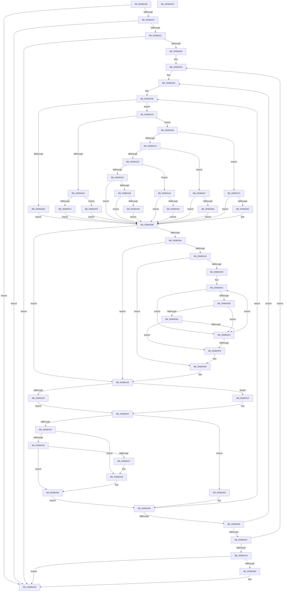

# KeUpdateProcessorRestrictions

- RVA: `0x005B6208`–`0x005B64E0` (길이 `728` bytes)
- VA: `0x00000001405B6208`
- 실행 섹션: `.text`
- PDB 이름 있음: `예`; PDB Function 태그: `아니요`
- unwind 정보 RVA: `0x000C9F50`
- 디코드: `183`개 명령, `728/728` bytes 표시
- 미해석 바이트: `0` (있으면 어셈블리에 `.byte`로 보존)

> 이 문서는 커널 이미지의 기계어와 PDB 기호를 분석해 생성했습니다. 4번과 5번은 함수 원형과 자료형을 바이너리 사용 방식에서 추정한 C 해석이며 원본 소스 복구 결과는 아닙니다.

## 1. Dependencies

- 직접 호출 지점: **2**; 고유 호출 대상: **2**
- 직접 호출자로 확인된 함수: **1**
- RIP 상대 이미지 참조: **8**

### Outgoing calls
- `0x005B622F` → [KiGetNumberOfActiveSubNodes](../42/KiGetNumberOfActiveSubNodes_function_00427920.md) (function, `0x00427920`)
- `0x005B64C3` → [KiInstallSubNodeHeteroSets](../4B/KiInstallSubNodeHeteroSets_function_004B71D4.md) (function, `0x004B71D4`)

### Direct callers
- [sub_006FAB12](../6F/Unknown_function_006FAB12.md) at `0x006FAB36`

### Static image references
- `0x005B6234` → RVA `0x00F234D8` (`.data`; read)
- `0x005B623E` → RVA `0x00F21AC8` (`.data`; read)
- `0x005B6245` → RVA `0x00FC53E0` (`ALMOSTRO`; read)
- `0x005B6264` → RVA `0x00F21AD0` (`.data`; read)
- `0x005B62AE` → RVA `0x00FC6B78` (`ALMOSTRO`; read)
- `0x005B62C9` → RVA `0x00FC6C34` (`ALMOSTRO`; read)
- `0x005B630A` → RVA `0x00FC5460` (`ALMOSTRO`; read)
- `0x005B63C7` → RVA `0x00F231B0` (`.data`; read)

## 2. Other-region calls and transfers

- 다른 실행 섹션으로 향하는 call: **0**
- 별도 외부 분기/꼬리 이동을 확인하지 못했습니다.

## 3. Assembly (complete function range)

```asm
005B6208  4C 89 4C 24 20                  mov qword ptr [rsp + 0x20], r9
005B620D  4C 89 44 24 18                  mov qword ptr [rsp + 0x18], r8
005B6212  89 54 24 10                     mov dword ptr [rsp + 0x10], edx
005B6216  53                              push rbx
005B6217  55                              push rbp
005B6218  56                              push rsi
005B6219  57                              push rdi
005B621A  41 54                           push r12
005B621C  41 55                           push r13
005B621E  41 56                           push r14
005B6220  41 57                           push r15
005B6222  48 83 EC 48                     sub rsp, 0x48
005B6226  49 8B F1                        mov rsi, r9
005B6229  0F B7 D9                        movzx ebx, cx
005B622C  44 8B FA                        mov r15d, edx
005B622F  E8 EC 16 E7 FF                  call 0x140427920
005B6234  4C 8B 2D 9D D2 96 00            mov r13, qword ptr [rip + 0x96d29d]
005B623B  45 33 D2                        xor r10d, r10d
005B623E  66 3B 1D 83 B8 96 00            cmp bx, word ptr [rip + 0x96b883]
005B6245  44 8B 1D 94 F1 A0 00            mov r11d, dword ptr [rip + 0xa0f194]
005B624C  4C 89 6C 24 38                  mov qword ptr [rsp + 0x38], r13
005B6251  0F 83 74 02 00 00               jae 0x1405b64cb
005B6257  45 3B 5D 1C                     cmp r11d, dword ptr [r13 + 0x1c]
005B625B  0F 87 6A 02 00 00               ja 0x1405b64cb
005B6261  0F AE E8                        lfence
005B6264  48 8B 05 65 B8 96 00            mov rax, qword ptr [rip + 0x96b865]
005B626B  44 88 94 24 90 00 00 00         mov byte ptr [rsp + 0x90], r10b
005B6273  48 8B 1C D8                     mov rbx, qword ptr [rax + rbx*8]
005B6277  45 85 DB                        test r11d, r11d
005B627A  0F 84 4B 02 00 00               je 0x1405b64cb
005B6280  41 8B C3                        mov eax, r11d
005B6283  4D 8D 8D 30 02 00 00            lea r9, [r13 + 0x230]
005B628A  48 89 44 24 30                  mov qword ptr [rsp + 0x30], rax
005B628F  41 8D 6A 01                     lea ebp, [r10 + 1]
005B6293  4D 8B E2                        mov r12, r10
005B6296  4D 8D 99 70 2F 00 00            lea r11, [r9 + 0x2f70]
005B629D  41 8A 34 34                     mov sil, byte ptr [r12 + rsi]
005B62A1  49 8B FA                        mov rdi, r10
005B62A4  40 88 74 24 20                  mov byte ptr [rsp + 0x20], sil
005B62A9  4C 89 54 24 28                  mov qword ptr [rsp + 0x28], r10
005B62AE  44 39 15 C3 08 A1 00            cmp dword ptr [rip + 0xa108c3], r10d
005B62B5  4D 8B EA                        mov r13, r10
005B62B8  4D 8B C2                        mov r8, r10
005B62BB  75 0C                           jne 0x1405b62c9
005B62BD  4C 8B 83 80 00 00 00            mov r8, qword ptr [rbx + 0x80]
005B62C4  E9 C2 00 00 00                  jmp 0x1405b638b
005B62C9  44 39 15 64 09 A1 00            cmp dword ptr [rip + 0xa10964], r10d
005B62D0  74 34                           je 0x1405b6306
005B62D2  0F B7 8B 88 00 00 00            movzx ecx, word ptr [rbx + 0x88]
005B62D9  49 8D 44 24 02                  lea rax, [r12 + 2]
005B62DE  48 8D 04 47                     lea rax, [rdi + rax*2]
005B62E2  4C 69 C0 08 01 00 00            imul r8, rax, 0x108
005B62E9  4D 03 C1                        add r8, r9
005B62EC  66 41 3B 08                     cmp cx, word ptr [r8]
005B62F0  73 0C                           jae 0x1405b62fe
005B62F2  4D 8B 44 C8 08                  mov r8, qword ptr [r8 + rcx*8 + 8]
005B62F7  8B C1                           mov eax, ecx
005B62F9  E9 8D 00 00 00                  jmp 0x1405b638b
005B62FE  4D 8B C2                        mov r8, r10
005B6301  E9 85 00 00 00                  jmp 0x1405b638b
005B6306  4A 8D 0C 67                     lea rcx, [rdi + r12*2]
005B630A  48 8D 15 4F F1 A0 00            lea rdx, [rip + 0xa0f14f]
005B6311  8B 14 8A                        mov edx, dword ptr [rdx + rcx*4]
005B6314  83 EA 01                        sub edx, 1
005B6317  74 59                           je 0x1405b6372
005B6319  83 EA 01                        sub edx, 1
005B631C  74 39                           je 0x1405b6357
005B631E  83 EA 01                        sub edx, 1
005B6321  74 20                           je 0x1405b6343
005B6323  83 FA 01                        cmp edx, 1
005B6326  75 63                           jne 0x1405b638b
005B6328  0F B7 83 88 00 00 00            movzx eax, word ptr [rbx + 0x88]
005B632F  66 41 3B 81 10 02 00 00         cmp ax, word ptr [r9 + 0x210]
005B6337  73 52                           jae 0x1405b638b
005B6339  4D 8B 84 C1 18 02 00 00         mov r8, qword ptr [r9 + rax*8 + 0x218]
005B6341  EB 48                           jmp 0x1405b638b
005B6343  0F B7 83 88 00 00 00            movzx eax, word ptr [rbx + 0x88]
005B634A  66 41 3B 01                     cmp ax, word ptr [r9]
005B634E  73 3B                           jae 0x1405b638b
005B6350  4D 8B 44 C1 08                  mov r8, qword ptr [r9 + rax*8 + 8]
005B6355  EB 34                           jmp 0x1405b638b
005B6357  0F B7 83 88 00 00 00            movzx eax, word ptr [rbx + 0x88]
005B635E  66 41 3B 81 18 03 00 00         cmp ax, word ptr [r9 + 0x318]
005B6366  73 23                           jae 0x1405b638b
005B6368  4D 8B 84 C1 20 03 00 00         mov r8, qword ptr [r9 + rax*8 + 0x320]
005B6370  EB 19                           jmp 0x1405b638b
005B6372  0F B7 83 88 00 00 00            movzx eax, word ptr [rbx + 0x88]
005B6379  66 41 3B 81 F0 FD FF FF         cmp ax, word ptr [r9 - 0x210]
005B6381  73 08                           jae 0x1405b638b
005B6383  4D 8B 84 C1 F8 FD FF FF         mov r8, qword ptr [r9 + rax*8 - 0x208]
005B638B  40 84 F6                        test sil, sil
005B638E  0F 84 84 00 00 00               je 0x1405b6418
005B6394  44 0F B6 F6                     movzx r14d, sil
005B6398  F3 49 0F B8 C0                  popcnt rax, r8
005B639D  44 3B F0                        cmp r14d, eax
005B63A0  73 76                           jae 0x1405b6418
005B63A2  41 8B EA                        mov ebp, r10d
005B63A5  41 8B FA                        mov edi, r10d
005B63A8  45 85 FF                        test r15d, r15d
005B63AB  74 61                           je 0x1405b640e
005B63AD  44 0F B7 BB 88 00 00 00         movzx r15d, word ptr [rbx + 0x88]
005B63B5  48 8B B4 24 A0 00 00 00         mov rsi, qword ptr [rsp + 0xa0]
005B63BD  44 8B 94 24 98 00 00 00         mov r10d, dword ptr [rsp + 0x98]
005B63C5  8B 0E                           mov ecx, dword ptr [rsi]
005B63C7  48 8B 05 E2 CD 96 00            mov rax, qword ptr [rip + 0x96cde2]
005B63CE  8B 14 88                        mov edx, dword ptr [rax + rcx*4]
005B63D1  8B CA                           mov ecx, edx
005B63D3  83 E1 3F                        and ecx, 0x3f
005B63D6  C1 EA 06                        shr edx, 6
005B63D9  44 3B FA                        cmp r15d, edx
005B63DC  75 15                           jne 0x1405b63f3
005B63DE  8B C1                           mov eax, ecx
005B63E0  49 0F A3 C0                     bt r8, rax
005B63E4  73 0D                           jae 0x1405b63f3
005B63E6  8B C1                           mov eax, ecx
005B63E8  FF C5                           inc ebp
005B63EA  49 0F AB C5                     bts r13, rax
005B63EE  41 3B EE                        cmp ebp, r14d
005B63F1  74 0B                           je 0x1405b63fe
005B63F3  FF C7                           inc edi
005B63F5  48 83 C6 04                     add rsi, 4
005B63F9  41 3B FA                        cmp edi, r10d
005B63FC  72 C7                           jb 0x1405b63c5
005B63FE  40 8A 74 24 20                  mov sil, byte ptr [rsp + 0x20]
005B6403  45 33 D2                        xor r10d, r10d
005B6406  44 8B BC 24 98 00 00 00         mov r15d, dword ptr [rsp + 0x98]
005B640E  48 8B 7C 24 28                  mov rdi, qword ptr [rsp + 0x28]
005B6413  BD 01 00 00 00                  mov ebp, 1
005B6418  0F B7 8B 88 00 00 00            movzx ecx, word ptr [rbx + 0x88]
005B641F  45 0F B7 03                     movzx r8d, word ptr [r11]
005B6423  66 41 3B C8                     cmp cx, r8w
005B6427  73 09                           jae 0x1405b6432
005B6429  49 8B 54 CB 08                  mov rdx, qword ptr [r11 + rcx*8 + 8]
005B642E  8B C1                           mov eax, ecx
005B6430  EB 03                           jmp 0x1405b6435
005B6432  49 8B D2                        mov rdx, r10
005B6435  49 3B D5                        cmp rdx, r13
005B6438  74 28                           je 0x1405b6462
005B643A  66 44 3B C1                     cmp r8w, cx
005B643E  77 0E                           ja 0x1405b644e
005B6440  66 41 39 4B 02                  cmp word ptr [r11 + 2], cx
005B6445  76 0F                           jbe 0x1405b6456
005B6447  8D 04 29                        lea eax, [rcx + rbp]
005B644A  66 41 89 03                     mov word ptr [r11], ax
005B644E  48 8B C1                        mov rax, rcx
005B6451  4D 89 6C CB 08                  mov qword ptr [r11 + rcx*8 + 8], r13
005B6456  40 8A C5                        mov al, bpl
005B6459  88 84 24 90 00 00 00            mov byte ptr [rsp + 0x90], al
005B6460  EB 07                           jmp 0x1405b6469
005B6462  8A 84 24 90 00 00 00            mov al, byte ptr [rsp + 0x90]
005B6469  48 03 FD                        add rdi, rbp
005B646C  49 81 C3 08 01 00 00            add r11, 0x108
005B6473  48 89 7C 24 28                  mov qword ptr [rsp + 0x28], rdi
005B6478  48 83 FF 02                     cmp rdi, 2
005B647C  0F 8C 2C FE FF FF               jl 0x1405b62ae
005B6482  48 8B B4 24 A8 00 00 00         mov rsi, qword ptr [rsp + 0xa8]
005B648A  4C 03 E5                        add r12, rbp
005B648D  49 83 FC 07                     cmp r12, 7
005B6491  0F 8C 06 FE FF FF               jl 0x1405b629d
005B6497  49 81 C1 F0 3F 00 00            add r9, 0x3ff0
005B649E  48 29 6C 24 30                  sub qword ptr [rsp + 0x30], rbp
005B64A3  0F 85 EA FD FF FF               jne 0x1405b6293
005B64A9  4C 8B 6C 24 38                  mov r13, qword ptr [rsp + 0x38]
005B64AE  84 C0                           test al, al
005B64B0  74 19                           je 0x1405b64cb
005B64B2  45 8B 4D 1C                     mov r9d, dword ptr [r13 + 0x1c]
005B64B6  4D 8D 45 20                     lea r8, [r13 + 0x20]
005B64BA  8B 15 B8 06 A1 00               mov edx, dword ptr [rip + 0xa106b8]
005B64C0  48 8B CB                        mov rcx, rbx
005B64C3  E8 0C 0D F0 FF                  call 0x1404b71d4
005B64C8  44 8A D5                        mov r10b, bpl
005B64CB  41 8A C2                        mov al, r10b
005B64CE  48 83 C4 48                     add rsp, 0x48
005B64D2  41 5F                           pop r15
005B64D4  41 5E                           pop r14
005B64D6  41 5D                           pop r13
005B64D8  41 5C                           pop r12
005B64DA  5F                              pop rdi
005B64DB  5E                              pop rsi
005B64DC  5D                              pop rbp
005B64DD  5B                              pop rbx
005B64DE  C3                              ret
005B64DF  CC                              int3
```

## 4. C-style interpretation (structured pseudocode)

```c
__int64 __fastcall KeUpdateProcessorRestrictions(unsigned __int16 a1, int a2, __int64 a3, __int64 a4)
{
    __int64 result;
    __int64 v_r10;
    __int64 v_r11;
    __int64 v_r12;
    __int64 v_rbp;
    __int64 v_rdi;
    __int64 v_rsi;
    __int64 v_rsp;
    unsigned __int64 v_stack_m50;
    unsigned __int64 v_stack_m58;
    unsigned __int64 v_stack_m60;
    unsigned __int8 v_stack_m68;
    unsigned int v_stack_p10;
    unsigned __int64 v_stack_p18;
    unsigned __int64 v_stack_p20;
    unsigned __int8 v_stack_p8;

    v_stack_p20 = a4;
    v_stack_p18 = a3;
    v_stack_p10 = a2;
    v_rsp = (v_rsp) - (72);
    result = KiGetNumberOfActiveSubNodes(a1, a2, a3, a4);
    v_r10 = 0;
    v_stack_m50 = *(unsigned __int64 *)(v_rip + 9884317);
    if (a1 >= (*(unsigned __int16 *)(v_rip + 9877635))) goto loc_005B64CB;
    if (((unsigned int)((unsigned int)(*(unsigned int *)(v_rip + 10547604)))) > (*(unsigned int *)(*(unsigned __int64 *)(v_rip + 9884317) + 28))) goto loc_005B64CB;
    v_stack_p8 = 0;
    if ((unsigned int)((unsigned int)(*(unsigned int *)(v_rip + 10547604))) == 0) goto loc_005B64CB;
    v_stack_m58 = (unsigned int)((unsigned int)((unsigned int)(*(unsigned int *)(v_rip + 10547604))));
loc_005B6293:
loc_005B629D:
    v_stack_m68 = (unsigned __int8)(*(unsigned __int8 *)(0 + a4 * 1));
    v_stack_m60 = 0;
loc_005B62AE:
    if ((*(unsigned int *)(v_rip + 10553539)) != 0) goto loc_005B62C9;
    goto loc_005B638B;
loc_005B62C9:
    if ((*(unsigned int *)(v_rip + 10553700)) == 0) goto loc_005B6306;
    a3 = (*(unsigned __int64 *)(*(unsigned __int64 *)(*(unsigned __int64 *)(v_rip + 9877605) + a1 * 8) + 128)) * (0 + 0 + 2 * 2);
    a3 = (a3) + (*(unsigned __int64 *)(v_rip + 9884317) + 560);
    if (((unsigned __int16)(*(unsigned __int16 *)(*(unsigned __int64 *)(*(unsigned __int64 *)(v_rip + 9877605) + a1 * 8) + 136))) >= (*(unsigned __int16 *)(a3))) goto loc_005B62FE;
    goto loc_005B638B;
loc_005B62FE:
    goto loc_005B638B;
loc_005B6306:
    a2 = (unsigned int)(((unsigned int)(*(unsigned int *)(v_rip + 10547535 + 0 + 0 * 2 * 4))) - (1));
    if (condition_is_equal) goto loc_005B6372;
    a2 = (unsigned int)((a2) - (1));
    if (condition_is_equal) goto loc_005B6357;
    a2 = (unsigned int)((a2) - (1));
    if (condition_is_equal) goto loc_005B6343;
    if (a2 != 1) goto loc_005B638B;
    if (((unsigned __int16)(*(unsigned __int16 *)(*(unsigned __int64 *)(*(unsigned __int64 *)(v_rip + 9877605) + a1 * 8) + 136))) >= (*(unsigned __int16 *)(*(unsigned __int64 *)(v_rip + 9884317) + 560 + 528))) goto loc_005B638B;
    goto loc_005B638B;
loc_005B6343:
    if (((unsigned __int16)(*(unsigned __int16 *)(*(unsigned __int64 *)(*(unsigned __int64 *)(v_rip + 9877605) + a1 * 8) + 136))) >= (*(unsigned __int16 *)(*(unsigned __int64 *)(v_rip + 9884317) + 560))) goto loc_005B638B;
    goto loc_005B638B;
loc_005B6357:
    if (((unsigned __int16)(*(unsigned __int16 *)(*(unsigned __int64 *)(*(unsigned __int64 *)(v_rip + 9877605) + a1 * 8) + 136))) >= (*(unsigned __int16 *)(*(unsigned __int64 *)(v_rip + 9884317) + 560 + 792))) goto loc_005B638B;
    goto loc_005B638B;
loc_005B6372:
    if (((unsigned __int16)(*(unsigned __int16 *)(*(unsigned __int64 *)(*(unsigned __int64 *)(v_rip + 9877605) + a1 * 8) + 136))) < (*(unsigned __int16 *)(*(unsigned __int64 *)(v_rip + 9884317) + 560 - 528))) {
        a3 = *(unsigned __int64 *)(*(unsigned __int64 *)(v_rip + 9884317) + 560 + *(unsigned __int16 *)(*(unsigned __int64 *)(*(unsigned __int64 *)(v_rip + 9877605) + a1 * 8) + 136) * 8 - 520);
    }
    if ((unsigned __int8)(*(unsigned __int8 *)(0 + a4 * 1)) == 0) goto loc_005B6418;
    if (((unsigned int)((unsigned __int8)(*(unsigned __int8 *)(0 + a4 * 1)))) >= ((unsigned int)(*(unsigned __int16 *)(*(unsigned __int64 *)(*(unsigned __int64 *)(v_rip + 9877605) + a1 * 8) + 136)))) goto loc_005B6418;
    if ((unsigned int)((unsigned int)(a2)) == 0) goto loc_005B640E;
loc_005B63C5:
    a1 = (unsigned int)(((unsigned int)((unsigned int)((unsigned int)(*(unsigned int *)(*(unsigned __int64 *)(v_rip + 9883106) + (unsigned int)(*(unsigned int *)(v_stack_p18)) * 4))))) & (63));
    a2 = (unsigned int)(((unsigned int)(*(unsigned int *)(*(unsigned __int64 *)(v_rip + 9883106) + (unsigned int)(*(unsigned int *)(v_stack_p18)) * 4))) >> (6));
    if (((unsigned int)(*(unsigned __int16 *)(*(unsigned __int64 *)(*(unsigned __int64 *)(v_rip + 9877605) + a1 * 8) + 136))) != a2) goto loc_005B63F3;
    if (((unsigned int)(*(unsigned __int16 *)(*(unsigned __int64 *)(*(unsigned __int64 *)(v_rip + 9877605) + a1 * 8) + 136))) >= a2) goto loc_005B63F3;
    v_rbp = (unsigned int)((0) + 1);
    if (((unsigned int)(v_rbp)) == ((unsigned int)((unsigned __int8)(*(unsigned __int8 *)(0 + a4 * 1))))) goto loc_005B63FE;
loc_005B63F3:
    v_rdi = (unsigned int)((0) + 1);
    v_rsi = (v_stack_p18) + (4);
    if (((unsigned int)(v_rdi)) < ((unsigned int)((unsigned int)(v_stack_p10)))) goto loc_005B63C5;
loc_005B63FE:
    v_r10 = 0;
loc_005B640E:
loc_005B6418:
    if (((unsigned __int16)(*(unsigned __int16 *)(*(unsigned __int64 *)(*(unsigned __int64 *)(v_rip + 9877605) + a1 * 8) + 136))) >= ((unsigned __int16)(*(unsigned __int16 *)(*(unsigned __int64 *)(v_rip + 9884317) + 560 + 12144)))) goto loc_005B6432;
    goto loc_005B6435;
loc_005B6432:
loc_005B6435:
    if (0 == 0) goto loc_005B6462;
    if (((unsigned __int16)(*(unsigned __int16 *)(*(unsigned __int64 *)(v_rip + 9884317) + 560 + 12144))) > ((unsigned __int16)(*(unsigned __int16 *)(*(unsigned __int64 *)(*(unsigned __int64 *)(v_rip + 9877605) + a1 * 8) + 136)))) goto loc_005B644E;
    if ((*(unsigned __int16 *)(*(unsigned __int64 *)(v_rip + 9884317) + 560 + 12144 + 2)) <= ((unsigned __int16)(*(unsigned __int16 *)(*(unsigned __int64 *)(*(unsigned __int64 *)(v_rip + 9877605) + a1 * 8) + 136)))) goto loc_005B6456;
    *(unsigned __int16 *)(*(unsigned __int64 *)(v_rip + 9884317) + 560 + 12144) = (unsigned __int16)(*(unsigned __int16 *)(*(unsigned __int64 *)(*(unsigned __int64 *)(v_rip + 9877605) + a1 * 8) + 136) + 1 * 1);
loc_005B644E:
    *(unsigned __int64 *)(*(unsigned __int64 *)(v_rip + 9884317) + 560 + 12144 + *(unsigned __int16 *)(*(unsigned __int64 *)(*(unsigned __int64 *)(v_rip + 9877605) + a1 * 8) + 136) * 8 + 8) = 0;
loc_005B6456:
    v_stack_p8 = 1;
    goto loc_005B6469;
loc_005B6462:
loc_005B6469:
    v_rdi = (v_stack_m60) + (1);
    v_r11 = (*(unsigned __int64 *)(v_rip + 9884317) + 560 + 12144) + (264);
    v_stack_m60 = v_rdi;
    if (v_rdi < 2) goto loc_005B62AE;
    v_r12 = (0) + (1);
    if (v_r12 < 7) goto loc_005B629D;
    a4 = (*(unsigned __int64 *)(v_rip + 9884317) + 560) + (0x3FF0ULL);
    if (condition_is_not_equal) goto loc_005B6293;
    result = v_stack_p8;
    if ((unsigned __int8)(v_stack_p8) != 0) {
        a4 = *(unsigned int *)(v_stack_m50 + 28);
        a3 = v_stack_m50 + 32;
        a2 = *(unsigned int *)(v_rip + 10553016);
        a1 = *(unsigned __int64 *)(*(unsigned __int64 *)(v_rip + 9877605) + a1 * 8);
        result = KiInstallSubNodeHeteroSets(a1, a2, a3, a4);
        v_r10 = 1;
    }
    v_rsp = (v_rsp) + (72);
    return (unsigned __int8)(v_r10);
}
```

## 5. (Beta) C Style

```c
int64_t KeUpdateProcessorRestrictions(uint16_t Arg1, int32_t Arg2, int64_t Arg3, int64_t Arg4)
{
    int64_t result;
    int64_t local_r10;
    int64_t local_r11;
    int64_t local_r12;
    int64_t local_rbp;
    int64_t local_rdi;
    int64_t local_rsi;
    int64_t local_rsp;
    uint64_t v_stack_m50;
    uint64_t v_stack_m58;
    uint64_t v_stack_m60;
    uint8_t v_stack_m68;
    uint32_t v_stack_p10;
    uint64_t v_stack_p18;
    uint64_t v_stack_p20;
    uint8_t v_stack_p8;

    v_stack_p20 = Arg4;
    v_stack_p18 = Arg3;
    v_stack_p10 = Arg2;
    local_rsp = (local_rsp) - (72);
    result = KiGetNumberOfActiveSubNodes(Arg1, Arg2, Arg3, Arg4);
    local_r10 = 0;
    v_stack_m50 = *(uint64_t *)(v_rip + 0x96D29D);
    if (Arg1 >= (*(uint16_t *)(v_rip + 0x96B883))) goto loc_005B64CB;
    if (((uint32_t)((uint32_t)(*(uint32_t *)(v_rip + 0xA0F194)))) > (*(uint32_t *)(*(uint64_t *)(v_rip + 0x96D29D) + 0x1C))) goto loc_005B64CB;
    v_stack_p8 = 0;
    if ((uint32_t)((uint32_t)(*(uint32_t *)(v_rip + 0xA0F194))) == 0) goto loc_005B64CB;
    v_stack_m58 = (uint32_t)((uint32_t)((uint32_t)(*(uint32_t *)(v_rip + 0xA0F194))));
loc_005B6293:
loc_005B629D:
    v_stack_m68 = (uint8_t)(*(uint8_t *)(0 + Arg4 * 1));
    v_stack_m60 = 0;
loc_005B62AE:
    if ((*(uint32_t *)(v_rip + 0xA108C3)) != 0) goto loc_005B62C9;
    goto loc_005B638B;
loc_005B62C9:
    if ((*(uint32_t *)(v_rip + 0xA10964)) == 0) goto loc_005B6306;
    Arg3 = (*(uint64_t *)(*(uint64_t *)(*(uint64_t *)(v_rip + 0x96B865) + Arg1 * 8) + 0x80)) * (0 + 0 + 2 * 2);
    Arg3 = (Arg3) + (*(uint64_t *)(v_rip + 0x96D29D) + 560);
    if (((uint16_t)(*(uint16_t *)(*(uint64_t *)(*(uint64_t *)(v_rip + 0x96B865) + Arg1 * 8) + 0x88))) >= (*(uint16_t *)(Arg3))) goto loc_005B62FE;
    goto loc_005B638B;
loc_005B62FE:
    goto loc_005B638B;
loc_005B6306:
    Arg2 = (uint32_t)(((uint32_t)(*(uint32_t *)(v_rip + 0xA0F14F + 0x0 + 0x0 * 2 * 4))) - (1));
    if (condition_is_equal) goto loc_005B6372;
    Arg2 = (uint32_t)((Arg2) - (1));
    if (condition_is_equal) goto loc_005B6357;
    Arg2 = (uint32_t)((Arg2) - (1));
    if (condition_is_equal) goto loc_005B6343;
    if (Arg2 != 1) goto loc_005B638B;
    if (((uint16_t)(*(uint16_t *)(*(uint64_t *)(*(uint64_t *)(v_rip + 0x96B865) + Arg1 * 8) + 0x88))) >= (*(uint16_t *)(*(uint64_t *)(v_rip + 0x96D29D) + 0x230 + 0x210))) goto loc_005B638B;
    goto loc_005B638B;
loc_005B6343:
    if (((uint16_t)(*(uint16_t *)(*(uint64_t *)(*(uint64_t *)(v_rip + 0x96B865) + Arg1 * 8) + 0x88))) >= (*(uint16_t *)(*(uint64_t *)(v_rip + 0x96D29D) + 0x230))) goto loc_005B638B;
    goto loc_005B638B;
loc_005B6357:
    if (((uint16_t)(*(uint16_t *)(*(uint64_t *)(*(uint64_t *)(v_rip + 0x96B865) + Arg1 * 8) + 0x88))) >= (*(uint16_t *)(*(uint64_t *)(v_rip + 0x96D29D) + 0x230 + 0x318))) goto loc_005B638B;
    goto loc_005B638B;
loc_005B6372:
    if (((uint16_t)(*(uint16_t *)(*(uint64_t *)(*(uint64_t *)(v_rip + 0x96B865) + Arg1 * 8) + 0x88))) < (*(uint16_t *)(*(uint64_t *)(v_rip + 0x96D29D) + 0x230 - 0x210))) {
        Arg3 = *(uint64_t *)(*(uint64_t *)(v_rip + 0x96D29D) + 0x230 + *(uint16_t *)(*(uint64_t *)(*(uint64_t *)(v_rip + 0x96B865) + Arg1 * 8) + 0x88) * 8 - 0x208);
    }
    if ((uint8_t)(*(uint8_t *)(0 + Arg4 * 1)) == 0) goto loc_005B6418;
    if (((uint32_t)((uint8_t)(*(uint8_t *)(0 + Arg4 * 1)))) >= ((uint32_t)(*(uint16_t *)(*(uint64_t *)(*(uint64_t *)(v_rip + 0x96B865) + Arg1 * 8) + 0x88)))) goto loc_005B6418;
    if ((uint32_t)((uint32_t)(Arg2)) == 0) goto loc_005B640E;
loc_005B63C5:
    Arg1 = (uint32_t)(((uint32_t)((uint32_t)((uint32_t)(*(uint32_t *)(*(uint64_t *)(v_rip + 0x96CDE2) + (uint32_t)(*(uint32_t *)(v_stack_p18)) * 4))))) & (63));
    Arg2 = (uint32_t)(((uint32_t)(*(uint32_t *)(*(uint64_t *)(v_rip + 0x96CDE2) + (uint32_t)(*(uint32_t *)(v_stack_p18)) * 4))) >> (6));
    if (((uint32_t)(*(uint16_t *)(*(uint64_t *)(*(uint64_t *)(v_rip + 0x96B865) + Arg1 * 8) + 0x88))) != Arg2) goto loc_005B63F3;
    if (((uint32_t)(*(uint16_t *)(*(uint64_t *)(*(uint64_t *)(v_rip + 0x96B865) + Arg1 * 8) + 0x88))) >= Arg2) goto loc_005B63F3;
    local_rbp = (uint32_t)((0) + 1);
    if (((uint32_t)(local_rbp)) == ((uint32_t)((uint8_t)(*(uint8_t *)(0 + Arg4 * 1))))) goto loc_005B63FE;
loc_005B63F3:
    local_rdi = (uint32_t)((0) + 1);
    local_rsi = (v_stack_p18) + (4);
    if (((uint32_t)(local_rdi)) < ((uint32_t)((uint32_t)(v_stack_p10)))) goto loc_005B63C5;
loc_005B63FE:
    local_r10 = 0;
loc_005B640E:
loc_005B6418:
    if (((uint16_t)(*(uint16_t *)(*(uint64_t *)(*(uint64_t *)(v_rip + 0x96B865) + Arg1 * 8) + 0x88))) >= ((uint16_t)(*(uint16_t *)(*(uint64_t *)(v_rip + 0x96D29D) + 0x230 + 0x2F70)))) goto loc_005B6432;
    goto loc_005B6435;
loc_005B6432:
loc_005B6435:
    if (0 == 0) goto loc_005B6462;
    if (((uint16_t)(*(uint16_t *)(*(uint64_t *)(v_rip + 0x96D29D) + 0x230 + 0x2F70))) > ((uint16_t)(*(uint16_t *)(*(uint64_t *)(*(uint64_t *)(v_rip + 0x96B865) + Arg1 * 8) + 0x88)))) goto loc_005B644E;
    if ((*(uint16_t *)(*(uint64_t *)(v_rip + 0x96D29D) + 0x230 + 0x2F70 + 0x2)) <= ((uint16_t)(*(uint16_t *)(*(uint64_t *)(*(uint64_t *)(v_rip + 0x96B865) + Arg1 * 8) + 0x88)))) goto loc_005B6456;
    *(uint16_t *)(*(uint64_t *)(v_rip + 0x96D29D) + 0x230 + 0x2F70) = (uint16_t)(*(uint16_t *)(*(uint64_t *)(*(uint64_t *)(v_rip + 0x96B865) + Arg1 * 8) + 0x88) + 1 * 1);
loc_005B644E:
    *(uint64_t *)(*(uint64_t *)(v_rip + 0x96D29D) + 0x230 + 0x2F70 + *(uint16_t *)(*(uint64_t *)(*(uint64_t *)(v_rip + 0x96B865) + Arg1 * 8) + 0x88) * 8 + 0x8) = 0;
loc_005B6456:
    v_stack_p8 = 1;
    goto loc_005B6469;
loc_005B6462:
loc_005B6469:
    local_rdi = (v_stack_m60) + (1);
    local_r11 = (*(uint64_t *)(v_rip + 0x96D29D) + 560 + 12144) + (264);
    v_stack_m60 = local_rdi;
    if (local_rdi < 2) goto loc_005B62AE;
    local_r12 = (0) + (1);
    if (local_r12 < 7) goto loc_005B629D;
    Arg4 = (*(uint64_t *)(v_rip + 0x96D29D) + 560) + (0x3FF0ULL);
    if (condition_is_not_equal) goto loc_005B6293;
    result = v_stack_p8;
    if ((uint8_t)(v_stack_p8) != 0) {
        Arg4 = *(uint32_t *)(v_stack_m50 + 0x1C);
        Arg3 = v_stack_m50 + 32;
        Arg2 = *(uint32_t *)(v_rip + 0xA106B8);
        Arg1 = *(uint64_t *)(*(uint64_t *)(v_rip + 0x96B865) + Arg1 * 8);
        result = KiInstallSubNodeHeteroSets(Arg1, Arg2, Arg3, Arg4);
        local_r10 = 1;
    }
    local_rsp = (local_rsp) + (72);
    return (uint8_t)(local_r10);
}
```

## 6. Execution-region graph

[열기: 2D/3D 그래프와 함수 탐색 컨트롤 패널](../../../control-panel.html?section=text&rva=0x005B6208&view=graph)

- 2D 그래프는 위에서 아래로 흐르고, 3D 그래프는 빈 공간을 드래그해 회전합니다. Shift+드래그는 이동, 휠은 확대·축소, 함수 노드 선택은 대상 보고서 이동입니다.

### Static fallback


