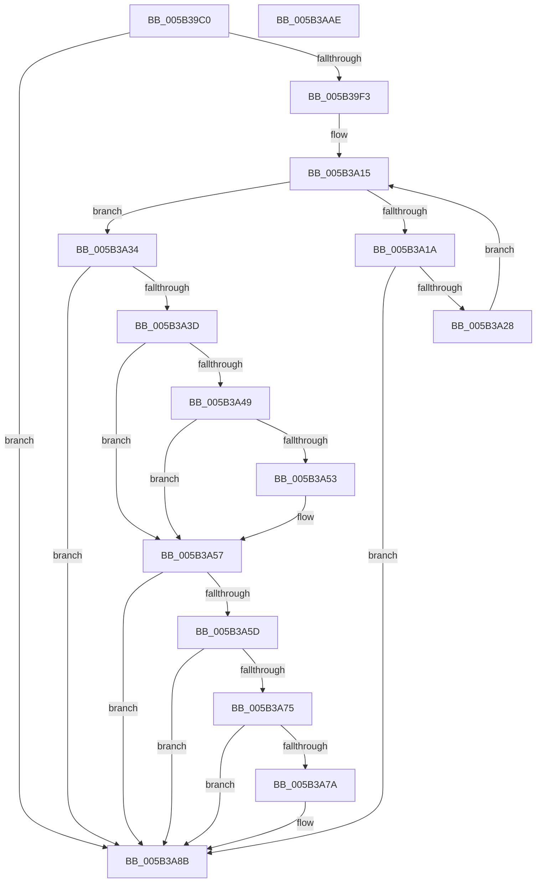

# KeValidateBugCheckCallbackRecord

- RVA: `0x005B39C0`–`0x005B3AAF` (길이 `239` bytes)
- VA: `0x00000001405B39C0`
- 실행 섹션: `.text`
- PDB 이름 있음: `예`; PDB Function 태그: `아니요`
- unwind 정보 RVA: `0x00075C18`
- 디코드: `74`개 명령, `239/239` bytes 표시
- 미해석 바이트: `0` (있으면 어셈블리에 `.byte`로 보존)

> 이 문서는 커널 이미지의 기계어와 PDB 기호를 분석해 생성했습니다. 4번과 5번은 함수 원형과 자료형을 바이너리 사용 방식에서 추정한 C 해석이며 원본 소스 복구 결과는 아닙니다.

## 1. Dependencies

- 직접 호출 지점: **3**; 고유 호출 대상: **2**
- 직접 호출자로 확인된 함수: **6**
- RIP 상대 이미지 참조: **0**

### Outgoing calls
- `0x005B3A1F` → [MmIsAddressValidEx](../27/MmIsAddressValidEx_function_0027FDD0.md) (function, `0x0027FDD0`)
- `0x005B3A40` → [IoIsPartialDumpRetry](../59/IoIsPartialDumpRetry_function_00592AA0.md) (function, `0x00592AA0`)
- `0x005B3A7C` → [MmIsAddressValidEx](../27/MmIsAddressValidEx_function_0027FDD0.md) (function, `0x0027FDD0`)

### Direct callers
- [IopDumpCallAddPagesCallbacks](../59/IopDumpCallAddPagesCallbacks_function_005949FC.md) at `0x00594A5C`
- [IopDumpCallRemovePagesCallbacks](../59/IopDumpCallRemovePagesCallbacks_function_00594B44.md) at `0x00594BA4`
- [IopLiveDumpAddTriageDumpData](../59/IopLiveDumpAddTriageDumpData_function_00599190.md) at `0x005991FA`
- [IopLiveDumpCallRemovePagesCallbacks](../59/IopLiveDumpCallRemovePagesCallbacks_function_0059AC28.md) at `0x0059ACF6`
- [KiInvokeBugCheckAddTriageDumpDataCallbacks](KiInvokeBugCheckAddTriageDumpDataCallbacks_function_005B4F88.md) at `0x005B5013`
- [KiInvokeBugCheckEntryCallbacks](KiInvokeBugCheckEntryCallbacks_function_005B51A0.md) at `0x005B51FE`

### Static image references
- 디코드된 RIP-relative 메모리 참조가 없습니다.

## 2. Other-region calls and transfers

- 다른 실행 섹션으로 향하는 call: **0**
- 별도 외부 분기/꼬리 이동을 확인하지 못했습니다.

## 3. Assembly (complete function range)

```asm
005B39C0  48 89 5C 24 08                  mov qword ptr [rsp + 8], rbx
005B39C5  48 89 6C 24 10                  mov qword ptr [rsp + 0x10], rbp
005B39CA  48 89 74 24 18                  mov qword ptr [rsp + 0x18], rsi
005B39CF  57                              push rdi
005B39D0  41 54                           push r12
005B39D2  41 55                           push r13
005B39D4  41 56                           push r14
005B39D6  41 57                           push r15
005B39D8  48 83 EC 20                     sub rsp, 0x20
005B39DC  33 F6                           xor esi, esi
005B39DE  4D 8B F0                        mov r14, r8
005B39E1  44 8B E2                        mov r12d, edx
005B39E4  48 8B D9                        mov rbx, rcx
005B39E7  44 8B FE                        mov r15d, esi
005B39EA  F6 C1 07                        test cl, 7
005B39ED  0F 85 98 00 00 00               jne 0x1405b3a8b
005B39F3  48 8B F9                        mov rdi, rcx
005B39F6  44 8D 6E 01                     lea r13d, [rsi + 1]
005B39FA  81 E7 FF 0F 00 00               and edi, 0xfff
005B3A00  48 8B E9                        mov rbp, rcx
005B3A03  48 81 C7 2F 10 00 00            add rdi, 0x102f
005B3A0A  48 81 E5 00 F0 FF FF            and rbp, 0xfffffffffffff000
005B3A11  48 C1 EF 0C                     shr rdi, 0xc
005B3A15  48 85 FF                        test rdi, rdi
005B3A18  74 1A                           je 0x1405b3a34
005B3A1A  33 D2                           xor edx, edx
005B3A1C  48 8B CD                        mov rcx, rbp
005B3A1F  E8 AC C3 CC FF                  call 0x14027fdd0
005B3A24  84 C0                           test al, al
005B3A26  74 63                           je 0x1405b3a8b
005B3A28  48 81 C5 00 10 00 00            add rbp, 0x1000
005B3A2F  49 2B FD                        sub rdi, r13
005B3A32  EB E1                           jmp 0x1405b3a15
005B3A34  49 8B 06                        mov rax, qword ptr [r14]
005B3A37  48 39 43 08                     cmp qword ptr [rbx + 8], rax
005B3A3B  75 4E                           jne 0x1405b3a8b
005B3A3D  4C 8B FB                        mov r15, rbx
005B3A40  E8 5B F0 FD FF                  call 0x140592aa0
005B3A45  84 C0                           test al, al
005B3A47  74 0E                           je 0x1405b3a57
005B3A49  8A 43 2C                        mov al, byte ptr [rbx + 0x2c]
005B3A4C  2C 03                           sub al, 3
005B3A4E  41 3A C5                        cmp al, r13b
005B3A51  77 04                           ja 0x1405b3a57
005B3A53  44 88 6B 2C                     mov byte ptr [rbx + 0x2c], r13b
005B3A57  44 38 6B 2C                     cmp byte ptr [rbx + 0x2c], r13b
005B3A5B  75 2E                           jne 0x1405b3a8b
005B3A5D  4C 63 43 28                     movsxd r8, dword ptr [rbx + 0x28]
005B3A61  48 8B 53 18                     mov rdx, qword ptr [rbx + 0x18]
005B3A65  48 8B 4B 10                     mov rcx, qword ptr [rbx + 0x10]
005B3A69  49 03 D0                        add rdx, r8
005B3A6C  48 03 D1                        add rdx, rcx
005B3A6F  48 39 53 20                     cmp qword ptr [rbx + 0x20], rdx
005B3A73  75 16                           jne 0x1405b3a8b
005B3A75  45 3B C4                        cmp r8d, r12d
005B3A78  75 11                           jne 0x1405b3a8b
005B3A7A  33 D2                           xor edx, edx
005B3A7C  E8 4F C3 CC FF                  call 0x14027fdd0
005B3A81  84 C0                           test al, al
005B3A83  40 0F B6 F6                     movzx esi, sil
005B3A87  41 0F 45 F5                     cmovne esi, r13d
005B3A8B  48 8B 5C 24 50                  mov rbx, qword ptr [rsp + 0x50]
005B3A90  40 8A C6                        mov al, sil
005B3A93  48 8B 74 24 60                  mov rsi, qword ptr [rsp + 0x60]
005B3A98  48 8B 6C 24 58                  mov rbp, qword ptr [rsp + 0x58]
005B3A9D  4D 89 3E                        mov qword ptr [r14], r15
005B3AA0  48 83 C4 20                     add rsp, 0x20
005B3AA4  41 5F                           pop r15
005B3AA6  41 5E                           pop r14
005B3AA8  41 5D                           pop r13
005B3AAA  41 5C                           pop r12
005B3AAC  5F                              pop rdi
005B3AAD  C3                              ret
005B3AAE  CC                              int3
```

## 4. C-style interpretation (structured pseudocode)

```c
__int64 __fastcall KeValidateBugCheckCallbackRecord(__int64 a1, int a2, __int64 a3)
{
    __int64 result;
    __int64 v_rbp;
    __int64 v_rdi;
    __int64 v_rsi;
    __int64 v_rsp;
    unsigned __int64 v_stack_p10;
    unsigned __int64 v_stack_p18;
    unsigned __int64 v_stack_p8;

    v_stack_p8 = v_rbx;
    v_stack_p10 = v_rbp;
    v_stack_p18 = v_rsi;
    v_rsp = (v_rsp) - (32);
    v_rsi = 0;
    if ((((unsigned __int8)(a1)) & (7)) != 0) goto loc_005B3A8B;
    v_rdi = (unsigned int)((a1) & (0xFFFULL));
    v_rdi = (v_rdi) + (0x102FULL);
    v_rbp = (a1) & (0xFFFFFFFFFFFFF000ULL);
    v_rdi = (v_rdi) >> (12);
loc_005B3A15:
    if (v_rdi == 0) goto loc_005B3A34;
    a2 = 0;
    result = MmIsAddressValidEx(v_rbp, a2, a3, a4);
    if ((unsigned __int8)(result) == 0) goto loc_005B3A8B;
    v_rbp = (v_rbp) + (0x1000ULL);
    v_rdi = (v_rdi) - (v_rsi + 1);
    goto loc_005B3A15;
loc_005B3A34:
    if ((*(unsigned __int64 *)(a1 + 8)) != (*(unsigned __int64 *)(a3))) goto loc_005B3A8B;
    result = IoIsPartialDumpRetry(v_rbp, a2, a3, a4);
    if ((unsigned __int8)(result) == 0) goto loc_005B3A57;
    result = (unsigned __int8)((*(unsigned __int8 *)(a1 + 44)) - (3));
    if (((unsigned __int8)(result)) <= ((unsigned __int8)(v_rsi + 1))) {
        *(unsigned __int8 *)(a1 + 44) = (unsigned __int8)(v_rsi + 1);
    }
    if ((*(unsigned __int8 *)(a1 + 44)) != ((unsigned __int8)(v_rsi + 1))) goto loc_005B3A8B;
    a2 = (*(unsigned __int64 *)(a1 + 24)) + ((int)(*(unsigned int *)(a1 + 40)));
    a2 = (a2) + (*(unsigned __int64 *)(a1 + 16));
    if ((*(unsigned __int64 *)(a1 + 32)) != a2) goto loc_005B3A8B;
    if (((unsigned int)((int)(*(unsigned int *)(a1 + 40)))) == ((unsigned int)((unsigned int)(a2)))) {
        a2 = 0;
        result = MmIsAddressValidEx(*(unsigned __int64 *)(a1 + 16), a2, (int)(*(unsigned int *)(a1 + 40)), a4);
        v_rsi = 0;
        if ((unsigned __int8)(result) != 0) { v_rsi = (unsigned int)(v_rsi + 1); }
    }
    *(unsigned __int64 *)(a3) = a1;
    v_rsp = (v_rsp) + (32);
    return (unsigned __int8)(v_rsi);
}
```

## 5. (Beta) C Style

```c
int64_t KeValidateBugCheckCallbackRecord(void *Arg1, int32_t Arg2, void *Arg3)
{
    uint8_t *arg1 = (uint8_t *)Arg1;
    uint8_t *arg3 = (uint8_t *)Arg3;

    int64_t result;
    int64_t local_rbp;
    int64_t local_rdi;
    int64_t local_rsi;
    int64_t local_rsp;
    uint64_t v_stack_p10;
    uint64_t v_stack_p18;
    uint64_t v_stack_p8;

    v_stack_p8 = local_rbx;
    v_stack_p10 = local_rbp;
    v_stack_p18 = local_rsi;
    local_rsp = (local_rsp) - (32);
    local_rsi = 0;
    if ((((uint8_t)(Arg1)) & (7)) != 0) goto loc_005B3A8B;
    local_rdi = (uint32_t)((Arg1) & (0xFFFULL));
    local_rdi = (local_rdi) + (0x102FULL);
    local_rbp = (Arg1) & (0xFFFFFFFFFFFFF000ULL);
    local_rdi = (local_rdi) >> (12);
loc_005B3A15:
    if (local_rdi == 0) goto loc_005B3A34;
    Arg2 = 0;
    result = MmIsAddressValidEx(local_rbp, Arg2, Arg3, a4);
    if ((uint8_t)(result) == 0) goto loc_005B3A8B;
    local_rbp = (local_rbp) + (0x1000ULL);
    local_rdi = (local_rdi) - (local_rsi + 1);
    goto loc_005B3A15;
loc_005B3A34:
    if ((*(uint64_t *)(arg1 + 0x8)) != (*(uint64_t *)(arg3))) goto loc_005B3A8B;
    result = IoIsPartialDumpRetry(local_rbp, Arg2, Arg3, a4);
    if ((uint8_t)(result) == 0) goto loc_005B3A57;
    result = (uint8_t)((*(uint8_t *)(arg1 + 0x2C)) - (3));
    if (((uint8_t)(result)) <= ((uint8_t)(local_rsi + 1))) {
        *(uint8_t *)(arg1 + 0x2C) = (uint8_t)(local_rsi + 1);
    }
    if ((*(uint8_t *)(arg1 + 0x2C)) != ((uint8_t)(local_rsi + 1))) goto loc_005B3A8B;
    Arg2 = (*(uint64_t *)(arg1 + 0x18)) + ((int32_t)(*(uint32_t *)(arg1 + 0x28)));
    Arg2 = (Arg2) + (*(uint64_t *)(arg1 + 0x10));
    if ((*(uint64_t *)(arg1 + 0x20)) != Arg2) goto loc_005B3A8B;
    if (((uint32_t)((int32_t)(*(uint32_t *)(arg1 + 0x28)))) == ((uint32_t)((uint32_t)(Arg2)))) {
        Arg2 = 0;
        result = MmIsAddressValidEx(*(uint64_t *)(arg1 + 0x10), Arg2, (int32_t)(*(uint32_t *)(arg1 + 0x28)), a4);
        local_rsi = 0;
        if ((uint8_t)(result) != 0) { local_rsi = (uint32_t)(local_rsi + 1); }
    }
    *(void **)(arg3) = Arg1;
    local_rsp = (local_rsp) + (32);
    return (uint8_t)(local_rsi);
}
```

### 관측된 메모리 오프셋

구조체 형식이 확인되지 않은 접근은 인자 기준의 오프셋으로만 기록했습니다.

| 기준 인자 | 오프셋 표현 | 폭 (bit) | 접근 |
|---|---:|---:|---|
| `Arg1` | `+ 0x8` | `64` | `R` |
| `Arg1` | `+ 0x10` | `64` | `R` |
| `Arg1` | `+ 0x18` | `64` | `R` |
| `Arg1` | `+ 0x20` | `64` | `R` |
| `Arg1` | `+ 0x28` | `32` | `R` |
| `Arg1` | `+ 0x2C` | `8` | `R` |
| `Arg1` | `+ 0x2C` | `8` | `W` |
| `Arg3` | `+ 0x0` | `64` | `R` |
| `Arg3` | `+ 0x0` | `64` | `W` |

## 6. Execution-region graph

[열기: 2D/3D 그래프와 함수 탐색 컨트롤 패널](../../../control-panel.html?section=text&rva=0x005B39C0&view=graph)

- 2D 그래프는 위에서 아래로 흐르고, 3D 그래프는 빈 공간을 드래그해 회전합니다. Shift+드래그는 이동, 휠은 확대·축소, 함수 노드 선택은 대상 보고서 이동입니다.

### Static fallback


