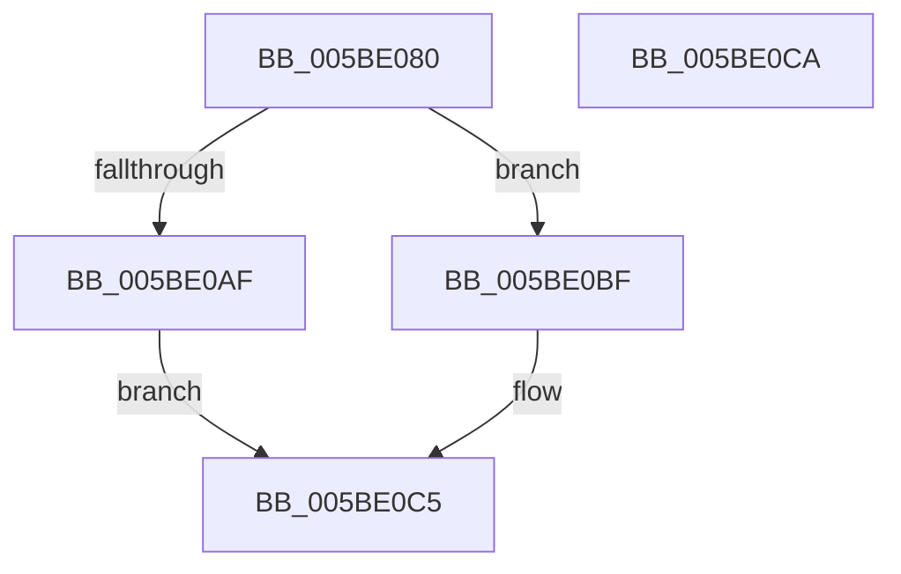

# KeWakeProcessor

- RVA: `0x005BE080`–`0x005BE0CB` (길이 `75` bytes)
- VA: `0x00000001405BE080`
- 실행 섹션: `.text`
- PDB 이름 있음: `예`; PDB Function 태그: `아니요`
- unwind 정보 RVA: `0x0005C788`
- 디코드: `19`개 명령, `75/75` bytes 표시
- 미해석 바이트: `0` (있으면 어셈블리에 `.byte`로 보존)

> 이 문서는 커널 이미지의 기계어와 PDB 기호를 분석해 생성했습니다. 4번과 5번은 함수 원형과 자료형을 바이너리 사용 방식에서 추정한 C 해석이며 원본 소스 복구 결과는 아닙니다.

## 1. Dependencies

- 직접 호출 지점: **1**; 고유 호출 대상: **1**
- 직접 호출자로 확인된 함수: **12**
- RIP 상대 이미지 참조: **1**

### Outgoing calls
- `0x005BE09E` → [KeInterlockedClearProcessorAffinityEx](../35/KeInterlockedClearProcessorAffinityEx_function_003524F0.md) (function, `0x003524F0`)

### Direct callers
- [PpmIdleExecuteTransition](../2D/PpmIdleExecuteTransition_function_002D0A1C.md) at `0x002D112C`
- [KxIsrLinkage](../6B/KxIsrLinkage_function_006B5680.md) at `0x006B59A2`
- [KiHvInterrupt](../6B/KiHvInterrupt_function_006B6620.md) at `0x006B6944`
- [KiVmbusInterrupt0](../6B/KiVmbusInterrupt0_function_006B6990.md) at `0x006B6CB4`
- [KiVmbusInterrupt1](../6B/KiVmbusInterrupt1_function_006B6D00.md) at `0x006B7024`
- [KiVmbusInterrupt2](../6B/KiVmbusInterrupt2_function_006B7070.md) at `0x006B7394`
- [KiVmbusInterrupt3](../6B/KiVmbusInterrupt3_function_006B73E0.md) at `0x006B7704`
- [KiSwInterrupt](../6B/KiSwInterrupt_function_006B8070.md) at `0x006B8396`
- [KiIpiInterrupt](../6B/KiIpiInterrupt_function_006B8F20.md) at `0x006B9246`
- [KiNmiInterrupt](../6B/KiNmiInterrupt_function_006BD3C0.md) at `0x006BD558`
- [KiMcheckAbort](../6C/KiMcheckAbort_function_006C16C0.md) at `0x006C1858`
- [sub_006DCEEE](../6D/Unknown_function_006DCEEE.md) at `0x006DD2E1`

### Static image references
- `0x005BE08D` → RVA `0x00F10F20` (`.data`; read)

## 2. Other-region calls and transfers

- 다른 실행 섹션으로 향하는 call: **0**
- 별도 외부 분기/꼬리 이동을 확인하지 못했습니다.

## 3. Assembly (complete function range)

```asm
005BE080  48 83 EC 28                     sub rsp, 0x28
005BE084  65 48 8B 14 25 20 00 00 00      mov rdx, qword ptr gs:[0x20]
005BE08D  48 8D 0D 8C 2E 95 00            lea rcx, [rip + 0x952e8c]
005BE094  C6 82 5A 86 00 00 00            mov byte ptr [rdx + 0x865a], 0
005BE09B  8B 52 24                        mov edx, dword ptr [rdx + 0x24]
005BE09E  E8 4D 44 D9 FF                  call 0x1403524f0
005BE0A3  0F 20 E1                        mov rcx, cr4
005BE0A6  48 F7 C1 80 00 02 00            test rcx, 0x20080
005BE0AD  74 10                           je 0x1405be0bf
005BE0AF  48 8B C1                        mov rax, rcx
005BE0B2  48 0F BA F8 07                  btc rax, 7
005BE0B7  0F 22 E0                        mov cr4, rax
005BE0BA  0F 22 E1                        mov cr4, rcx
005BE0BD  EB 06                           jmp 0x1405be0c5
005BE0BF  0F 20 D8                        mov rax, cr3
005BE0C2  0F 22 D8                        mov cr3, rax
005BE0C5  48 83 C4 28                     add rsp, 0x28
005BE0C9  C3                              ret
005BE0CA  CC                              int3
```

## 4. C-style interpretation (structured pseudocode)

```c
__int64 __fastcall KeWakeProcessor(void)
{
    __int64 result;
    __int64 v_rsp;

    v_rsp = (v_rsp) - (40);
    *(unsigned __int8 *)(*(unsigned __int64 *)(gs_base + (0 + 32)) + 34394) = 0;
    result = KeInterlockedClearProcessorAffinityEx(v_rip + 9776780, (unsigned int)(*(unsigned int *)(*(unsigned __int64 *)(gs_base + (0 + 32)) + 36)), a3, a4);
    if (((v_cr4) & (0x20080ULL)) == 0) goto loc_005BE0BF;
    goto loc_005BE0C5;
loc_005BE0BF:
loc_005BE0C5:
    v_rsp = (v_rsp) + (40);
    return v_cr3;
}
```

## 5. (Beta) C Style

```c
void KeWakeProcessor(void)
{
    int64_t result;
    int64_t local_rsp;

    local_rsp = (local_rsp) - (40);
    *(uint8_t *)(*(uint64_t *)(gs_base + (0 + 0x20)) + 0x865A) = 0;
    result = KeInterlockedClearProcessorAffinityEx(v_rip + 9776780, (uint32_t)(*(uint32_t *)(*(uint64_t *)(gs_base + (0 + 0x20)) + 0x24)), a3, a4);
    if (((v_cr4) & (0x20080ULL)) == 0) goto loc_005BE0BF;
    goto loc_005BE0C5;
loc_005BE0BF:
loc_005BE0C5:
    local_rsp = (local_rsp) + (40);
    return v_cr3;
}
```

## 6. Execution-region graph

[열기: 2D/3D 그래프와 함수 탐색 컨트롤 패널](../../../control-panel.html?section=text&rva=0x005BE080&view=graph)

- 2D 그래프는 위에서 아래로 흐르고, 3D 그래프는 빈 공간을 드래그해 회전합니다. Shift+드래그는 이동, 휠은 확대·축소, 함수 노드 선택은 대상 보고서 이동입니다.

### Static fallback


