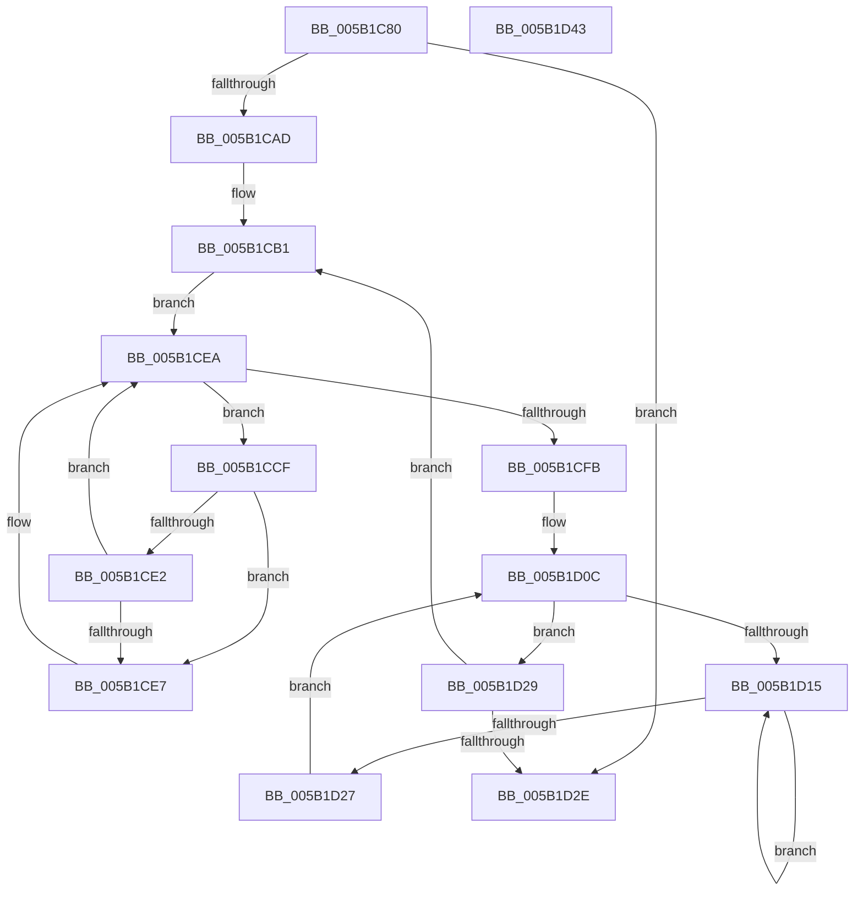

# KiAcquirePrcbLocksForGroupAffinity

- RVA: `0x005B1C80`–`0x005B1D44` (길이 `196` bytes)
- VA: `0x00000001405B1C80`
- 실행 섹션: `.text`
- PDB 이름 있음: `예`; PDB Function 태그: `아니요`
- unwind 정보 RVA: `0x000C9B9C`
- 디코드: `58`개 명령, `196/196` bytes 표시
- 미해석 바이트: `0` (있으면 어셈블리에 `.byte`로 보존)

> 이 문서는 커널 이미지의 기계어와 PDB 기호를 분석해 생성했습니다. 4번과 5번은 함수 원형과 자료형을 바이너리 사용 방식에서 추정한 C 해석이며 원본 소스 복구 결과는 아닙니다.

## 1. Dependencies

- 직접 호출 지점: **2**; 고유 호출 대상: **2**
- 직접 호출자로 확인된 함수: **1**
- RIP 상대 이미지 참조: **1**

### Outgoing calls
- `0x005B1CF2` → [KeEnumerateNextProcessor](../41/KeEnumerateNextProcessor_function_00415480.md) (function, `0x00415480`)
- `0x005B1D19` → [KeYieldProcessorEx](../3F/KeYieldProcessorEx_function_003FBD00.md) (function, `0x003FBD00`)

### Direct callers
- [KiCompleteKernelInit](../../pagelk/B6/KiCompleteKernelInit_function_00B66090.md) at `0x00B662AF`

### Static image references
- `0x005B1CD2` → RVA `0x00FC8C40` (`ALMOSTRO`; read)

## 2. Other-region calls and transfers

- 다른 실행 섹션으로 향하는 call: **0**
- 별도 외부 분기/꼬리 이동을 확인하지 못했습니다.

## 3. Assembly (complete function range)

```asm
005B1C80  48 89 5C 24 18                  mov qword ptr [rsp + 0x18], rbx
005B1C85  48 89 74 24 20                  mov qword ptr [rsp + 0x20], rsi
005B1C8A  55                              push rbp
005B1C8B  57                              push rdi
005B1C8C  41 56                           push r14
005B1C8E  48 8B EC                        mov rbp, rsp
005B1C91  48 83 EC 50                     sub rsp, 0x50
005B1C95  0F 10 01                        movups xmm0, xmmword ptr [rcx]
005B1C98  45 33 F6                        xor r14d, r14d
005B1C9B  66 48 0F 7E C7                  movq rdi, xmm0
005B1CA0  0F 11 45 D0                     movups xmmword ptr [rbp - 0x30], xmm0
005B1CA4  48 85 FF                        test rdi, rdi
005B1CA7  0F 84 81 00 00 00               je 0x1405b1d2e
005B1CAD  0F B7 75 D8                     movzx esi, word ptr [rbp - 0x28]
005B1CB1  44 89 75 F2                     mov dword ptr [rbp - 0xe], r14d
005B1CB5  49 8B DE                        mov rbx, r14
005B1CB8  66 44 89 75 F6                  mov word ptr [rbp - 0xa], r14w
005B1CBD  44 89 75 20                     mov dword ptr [rbp + 0x20], r14d
005B1CC1  66 89 75 F0                     mov word ptr [rbp - 0x10], si
005B1CC5  48 89 7D E8                     mov qword ptr [rbp - 0x18], rdi
005B1CC9  4C 89 75 E0                     mov qword ptr [rbp - 0x20], r14
005B1CCD  EB 1B                           jmp 0x1405b1cea
005B1CCF  8B 45 20                        mov eax, dword ptr [rbp + 0x20]
005B1CD2  48 8D 0D 67 6F A1 00            lea rcx, [rip + 0xa16f67]
005B1CD9  48 8B 0C C1                     mov rcx, qword ptr [rcx + rax*8]
005B1CDD  48 85 DB                        test rbx, rbx
005B1CE0  74 05                           je 0x1405b1ce7
005B1CE2  48 3B CB                        cmp rcx, rbx
005B1CE5  73 03                           jae 0x1405b1cea
005B1CE7  48 8B D9                        mov rbx, rcx
005B1CEA  48 8D 55 E0                     lea rdx, [rbp - 0x20]
005B1CEE  48 8D 4D 20                     lea rcx, [rbp + 0x20]
005B1CF2  E8 89 37 E6 FF                  call 0x140415480
005B1CF7  85 C0                           test eax, eax
005B1CF9  74 D4                           je 0x1405b1ccf
005B1CFB  48 8B 83 C8 00 00 00            mov rax, qword ptr [rbx + 0xc8]
005B1D02  48 F7 D0                        not rax
005B1D05  44 89 75 28                     mov dword ptr [rbp + 0x28], r14d
005B1D09  48 23 F8                        and rdi, rax
005B1D0C  F0 48 0F BA 6B 30 00            lock bts qword ptr [rbx + 0x30], 0
005B1D13  73 14                           jae 0x1405b1d29
005B1D15  48 8D 4D 28                     lea rcx, [rbp + 0x28]
005B1D19  E8 E2 9F E4 FF                  call 0x1403fbd00
005B1D1E  48 8B 43 30                     mov rax, qword ptr [rbx + 0x30]
005B1D22  48 85 C0                        test rax, rax
005B1D25  75 EE                           jne 0x1405b1d15
005B1D27  EB E3                           jmp 0x1405b1d0c
005B1D29  48 85 FF                        test rdi, rdi
005B1D2C  75 83                           jne 0x1405b1cb1
005B1D2E  4C 8D 5C 24 50                  lea r11, [rsp + 0x50]
005B1D33  49 8B 5B 30                     mov rbx, qword ptr [r11 + 0x30]
005B1D37  49 8B 73 38                     mov rsi, qword ptr [r11 + 0x38]
005B1D3B  49 8B E3                        mov rsp, r11
005B1D3E  41 5E                           pop r14
005B1D40  5F                              pop rdi
005B1D41  5D                              pop rbp
005B1D42  C3                              ret
005B1D43  CC                              int3
```

## 4. C-style interpretation (structured pseudocode)

```c
__int64 __fastcall KiAcquirePrcbLocksForGroupAffinity(__int64 a1)
{
    __int64 result;
    __int64 v_r14;
    __int64 v_rbx;
    __int64 v_rdi;
    __int64 v_rsp;
    unsigned __int64 v_stack_m18;
    unsigned __int16 v_stack_m22;
    unsigned int v_stack_m26;
    unsigned __int16 v_stack_m28;
    unsigned __int64 v_stack_m30;
    unsigned __int64 v_stack_m38;
    unsigned __int16 v_stack_m40;
    unsigned __int64 v_stack_m48;
    unsigned int v_stack_p10;
    unsigned __int64 v_stack_p18;
    unsigned __int64 v_stack_p20;
    unsigned int v_stack_p8;

    v_stack_p18 = v_rbx;
    v_stack_p20 = v_rsi;
    v_rsp = (v_rsp) - (80);
    v_r14 = 0;
    v_stack_m48 = v_xmm0;
    if (v_rdi == 0) goto loc_005B1D2E;
loc_005B1CB1:
    v_stack_m26 = 0;
    v_stack_m22 = 0;
    v_stack_p8 = 0;
    v_stack_m28 = (unsigned __int16)(v_stack_m40);
    v_stack_m30 = v_rdi;
    v_stack_m38 = 0;
    goto loc_005B1CEA;
loc_005B1CCF:
    if (0 == 0) goto loc_005B1CE7;
    v_rbx = 0;
    if ((*(unsigned __int64 *)(v_rip + 10579815 + (unsigned int)(v_stack_p8) * 8)) < 0) {
        v_rbx = *(unsigned __int64 *)(v_rip + 10579815 + (unsigned int)(v_stack_p8) * 8);
    }
    result = KeEnumerateNextProcessor(v_stack_p8, v_stack_m38, a3, a4);
    if ((unsigned int)(result) == 0) goto loc_005B1CCF;
    result = ~(*(unsigned __int64 *)(v_rbx + 200));
    v_stack_p10 = 0;
    v_rdi = (v_rdi) & (result);
loc_005B1D0C:
    if (condition_is_above_or_equal) goto loc_005B1D29;
loc_005B1D15:
    result = KeYieldProcessorEx(v_stack_p10, v_stack_m38, a3, a4);
    if (*(unsigned __int64 *)(v_rbx + 48) != 0) goto loc_005B1D15;
    goto loc_005B1D0C;
loc_005B1D29:
    if (v_rdi != 0) goto loc_005B1CB1;
loc_005B1D2E:
    return *(unsigned __int64 *)(v_rbx + 48);
}
```

## 5. (Beta) C Style

```c
int64_t KiAcquirePrcbLocksForGroupAffinity(void *Arg1)
{
    uint8_t *arg1 = (uint8_t *)Arg1;

    int64_t result;
    int64_t local_r14;
    int64_t local_rbx;
    int64_t local_rdi;
    int64_t local_rsp;
    uint64_t v_stack_m18;
    uint16_t v_stack_m22;
    uint32_t v_stack_m26;
    uint16_t v_stack_m28;
    uint64_t v_stack_m30;
    uint64_t v_stack_m38;
    uint16_t v_stack_m40;
    uint64_t v_stack_m48;
    uint32_t v_stack_p10;
    uint64_t v_stack_p18;
    uint64_t v_stack_p20;
    uint32_t v_stack_p8;

    v_stack_p18 = local_rbx;
    v_stack_p20 = local_rsi;
    local_rsp = (local_rsp) - (80);
    local_r14 = 0;
    v_stack_m48 = v_xmm0;
    if (local_rdi == 0) goto loc_005B1D2E;
loc_005B1CB1:
    v_stack_m26 = 0;
    v_stack_m22 = 0;
    v_stack_p8 = 0;
    v_stack_m28 = (uint16_t)(v_stack_m40);
    v_stack_m30 = local_rdi;
    v_stack_m38 = 0;
    goto loc_005B1CEA;
loc_005B1CCF:
    if (0 == 0) goto loc_005B1CE7;
    local_rbx = 0;
    if ((*(uint64_t *)(v_rip + 0xA16F67 + (uint32_t)(v_stack_p8) * 8)) < 0) {
        local_rbx = *(uint64_t *)(v_rip + 0xA16F67 + (uint32_t)(v_stack_p8) * 8);
    }
    result = KeEnumerateNextProcessor(v_stack_p8, v_stack_m38, a3, a4);
    if ((uint32_t)(result) == 0) goto loc_005B1CCF;
    result = ~(*(uint64_t *)(local_rbx + 0xC8));
    v_stack_p10 = 0;
    local_rdi = (local_rdi) & (result);
loc_005B1D0C:
    if (condition_is_above_or_equal) goto loc_005B1D29;
loc_005B1D15:
    result = KeYieldProcessorEx(v_stack_p10, v_stack_m38, a3, a4);
    if (*(uint64_t *)(local_rbx + 0x30) != 0) goto loc_005B1D15;
    goto loc_005B1D0C;
loc_005B1D29:
    if (local_rdi != 0) goto loc_005B1CB1;
loc_005B1D2E:
    return *(uint64_t *)(local_rbx + 0x30);
}
```

### 관측된 메모리 오프셋

구조체 형식이 확인되지 않은 접근은 인자 기준의 오프셋으로만 기록했습니다.

| 기준 인자 | 오프셋 표현 | 폭 (bit) | 접근 |
|---|---:|---:|---|
| `Arg1` | `+ 0x0` | `128` | `R` |

## 6. Execution-region graph

[열기: 2D/3D 그래프와 함수 탐색 컨트롤 패널](../../../control-panel.html?section=text&rva=0x005B1C80&view=graph)

- 2D 그래프는 위에서 아래로 흐르고, 3D 그래프는 빈 공간을 드래그해 회전합니다. Shift+드래그는 이동, 휠은 확대·축소, 함수 노드 선택은 대상 보고서 이동입니다.

### Static fallback


