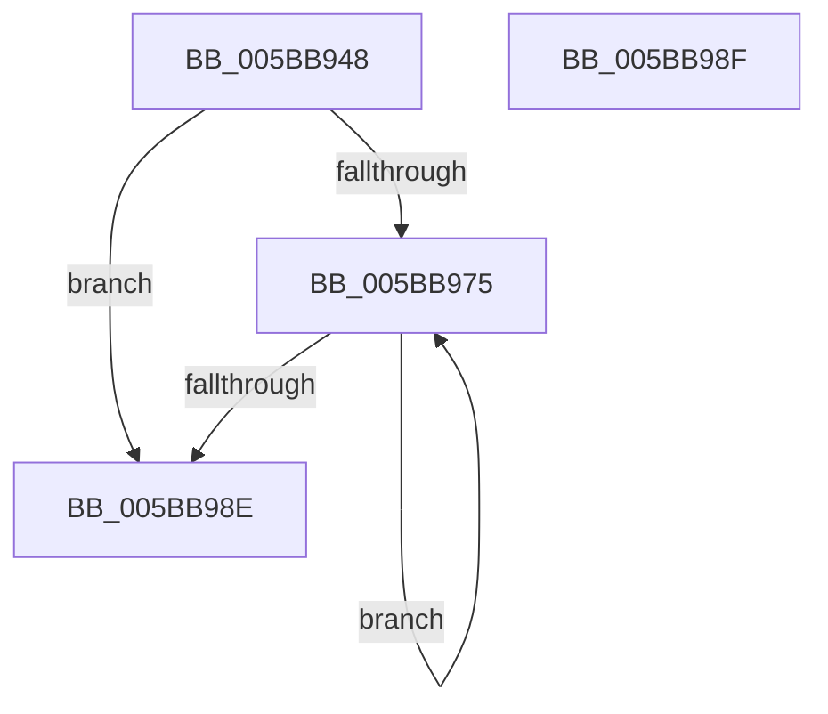

# KiAddHaltBlockToWaitList

- RVA: `0x005BB948`–`0x005BB990` (길이 `72` bytes)
- VA: `0x00000001405BB948`
- 실행 섹션: `.text`
- PDB 이름 있음: `예`; PDB Function 태그: `아니요`
- unwind 정보 RVA: `0x000DB714`
- 디코드: `21`개 명령, `72/72` bytes 표시
- 미해석 바이트: `0` (있으면 어셈블리에 `.byte`로 보존)

> 이 문서는 커널 이미지의 기계어와 PDB 기호를 분석해 생성했습니다. 4번과 5번은 함수 원형과 자료형을 바이너리 사용 방식에서 추정한 C 해석이며 원본 소스 복구 결과는 아닙니다.

## 1. Dependencies

- 직접 호출 지점: **0**; 고유 호출 대상: **0**
- 직접 호출자로 확인된 함수: **3**
- RIP 상대 이미지 참조: **0**

### Outgoing calls
- 직접 디코드된 call 명령이 없습니다.

### Direct callers
- [KxWaitForLockOwnerShip](../25/KxWaitForLockOwnerShip_function_00257EB0.md) at `0x00257FE8`
- [KxWaitForLockOwnerShipWithIrql](../41/KxWaitForLockOwnerShipWithIrql_function_00414E30.md) at `0x00414F74`
- [KiHaltOnAddress](../4F/KiHaltOnAddress_function_004FBA3C.md) at `0x004FBA9B`

### Static image references
- 디코드된 RIP-relative 메모리 참조가 없습니다.

## 2. Other-region calls and transfers

- 다른 실행 섹션으로 향하는 call: **0**
- 별도 외부 분기/꼬리 이동을 확인하지 못했습니다.

## 3. Assembly (complete function range)

```asm
005BB948  44 8B 0A                        mov r9d, dword ptr [rdx]
005BB94B  4C 8B DA                        mov r11, rdx
005BB94E  49 C1 E9 05                     shr r9, 5
005BB952  4C 8B D1                        mov r10, rcx
005BB955  41 83 E1 7F                     and r9d, 0x7f
005BB959  42 0F 0D 0C C9                  prefetchw byte ptr [rcx + r9*8]
005BB95E  4A 8B 04 C9                     mov rax, qword ptr [rcx + r9*8]
005BB962  4C 8B C0                        mov r8, rax
005BB965  49 83 E0 FC                     and r8, 0xfffffffffffffffc
005BB969  4C 89 42 10                     mov qword ptr [rdx + 0x10], r8
005BB96D  F0 4E 0F B1 1C C9               lock cmpxchg qword ptr [rcx + r9*8], r11
005BB973  74 19                           je 0x1405bb98e
005BB975  48 8B D0                        mov rdx, rax
005BB978  48 8B C8                        mov rcx, rax
005BB97B  48 83 E2 FC                     and rdx, 0xfffffffffffffffc
005BB97F  49 89 53 10                     mov qword ptr [r11 + 0x10], rdx
005BB983  F0 4F 0F B1 1C CA               lock cmpxchg qword ptr [r10 + r9*8], r11
005BB989  48 3B C1                        cmp rax, rcx
005BB98C  75 E7                           jne 0x1405bb975
005BB98E  C3                              ret
005BB98F  CC                              int3
```

## 4. C-style interpretation (structured pseudocode)

```c
__int64 __fastcall KiAddHaltBlockToWaitList(__int64 a1, __int64 a2)
{
    a4 = ((unsigned int)(*(unsigned int *)(a2))) >> (5);
    a4 = (unsigned int)((a4) & (127));
    a3 = (*(unsigned __int64 *)(a1 + a4 * 8)) & (-4);
    *(unsigned __int64 *)(a2 + 16) = a3;
    if (condition_is_equal) goto loc_005BB98E;
loc_005BB975:
    a2 = (*(unsigned __int64 *)(a1 + a4 * 8)) & (-4);
    *(unsigned __int64 *)(a2 + 16) = a2;
    if ((*(unsigned __int64 *)(a1 + a4 * 8)) != (*(unsigned __int64 *)(a1 + a4 * 8))) goto loc_005BB975;
loc_005BB98E:
    return *(unsigned __int64 *)(a1 + a4 * 8);
}
```

## 5. (Beta) C Style

```c
int64_t KiAddHaltBlockToWaitList(void *Arg1, void *Arg2)
{
    uint8_t *arg1 = (uint8_t *)Arg1;
    uint8_t *arg2 = (uint8_t *)Arg2;

    a4 = ((uint32_t)(*(uint32_t *)(arg2))) >> (5);
    a4 = (uint32_t)((a4) & (127));
    a3 = (*(uint64_t *)(arg1 + a4 * 8)) & (-4);
    *(uint64_t *)(arg2 + 0x10) = a3;
    if (condition_is_equal) goto loc_005BB98E;
loc_005BB975:
    Arg2 = (*(uint64_t *)(arg1 + a4 * 8)) & (-4);
    *(void **)(arg2 + 0x10) = Arg2;
    if ((*(uint64_t *)(arg1 + a4 * 8)) != (*(uint64_t *)(arg1 + a4 * 8))) goto loc_005BB975;
loc_005BB98E:
    return *(uint64_t *)(arg1 + a4 * 8);
}
```

### 관측된 메모리 오프셋

구조체 형식이 확인되지 않은 접근은 인자 기준의 오프셋으로만 기록했습니다.

| 기준 인자 | 오프셋 표현 | 폭 (bit) | 접근 |
|---|---:|---:|---|
| `Arg1` | `+ 0x0 + r9*8` | `8` | `R` |
| `Arg1` | `+ 0x0 + r9*8` | `64` | `R` |
| `Arg2` | `+ 0x0` | `32` | `R` |
| `Arg2` | `+ 0x10` | `64` | `W` |

## 6. Execution-region graph

[열기: 2D/3D 그래프와 함수 탐색 컨트롤 패널](../../../control-panel.html?section=text&rva=0x005BB948&view=graph)

- 2D 그래프는 위에서 아래로 흐르고, 3D 그래프는 빈 공간을 드래그해 회전합니다. Shift+드래그는 이동, 휠은 확대·축소, 함수 노드 선택은 대상 보고서 이동입니다.

### Static fallback


