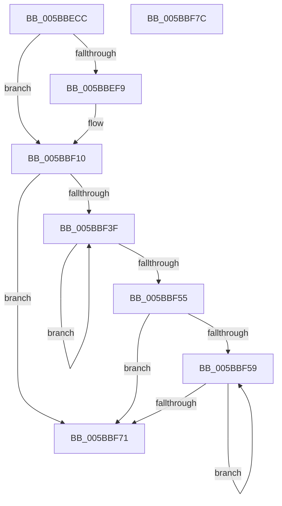

# KiAddProcessorToCoreControlBlock

- RVA: `0x005BBECC`–`0x005BBF7D` (길이 `177` bytes)
- VA: `0x00000001405BBECC`
- 실행 섹션: `.text`
- PDB 이름 있음: `예`; PDB Function 태그: `아니요`
- unwind 정보 RVA: `0x0006E5F8`
- 디코드: `50`개 명령, `177/177` bytes 표시
- 미해석 바이트: `0` (있으면 어셈블리에 `.byte`로 보존)

> 이 문서는 커널 이미지의 기계어와 PDB 기호를 분석해 생성했습니다. 4번과 5번은 함수 원형과 자료형을 바이너리 사용 방식에서 추정한 C 해석이며 원본 소스 복구 결과는 아닙니다.

## 1. Dependencies

- 직접 호출 지점: **2**; 고유 호출 대상: **2**
- 직접 호출자로 확인된 함수: **2**
- RIP 상대 이미지 참조: **1**

### Outgoing calls
- `0x005BBF0A` → [KeBugCheckEx](../4F/KeBugCheckEx_function_004FD660.md) (function, `0x004FD660`)
- `0x005BBF2B` → [qsort](../50/qsort_function_005009F0.md) (function, `0x005009F0`)

### Direct callers
- [KiFinalizeCoreControlBlockAssignment](KiFinalizeCoreControlBlockAssignment_function_005B7D0C.md) at `0x005B7DEC`
- [KiInitializeKernel](../../pagelk/B6/KiInitializeKernel_function_00B68D20.md) at `0x00B68FCC`

### Static image references
- `0x005BBF15` → RVA `0x00558EA0` (`HalpNodeCostSort`; read)

## 2. Other-region calls and transfers

- 다른 실행 섹션으로 향하는 call: **0**
- 별도 외부 분기/꼬리 이동을 확인하지 못했습니다.

## 3. Assembly (complete function range)

```asm
005BBECC  48 89 5C 24 08                  mov qword ptr [rsp + 8], rbx
005BBED1  57                              push rdi
005BBED2  48 83 EC 30                     sub rsp, 0x30
005BBED6  48 89 8A 58 8E 00 00            mov qword ptr [rdx + 0x8e58], rcx
005BBEDD  41 B9 04 00 00 00               mov r9d, 4
005BBEE3  48 8B 79 28                     mov rdi, qword ptr [rcx + 0x28]
005BBEE7  48 8B D9                        mov rbx, rcx
005BBEEA  48 89 BA B8 AE 00 00            mov qword ptr [rdx + 0xaeb8], rdi
005BBEF1  0F B6 01                        movzx eax, byte ptr [rcx]
005BBEF4  41 3A C1                        cmp al, r9b
005BBEF7  72 17                           jb 0x1405bbf10
005BBEF9  4C 8D 40 01                     lea r8, [rax + 1]
005BBEFD  48 C7 44 24 20 01 00 00 00      mov qword ptr [rsp + 0x20], 1
005BBF06  41 8D 49 3A                     lea ecx, [r9 + 0x3a]
005BBF0A  E8 51 17 F4 FF                  call 0x1404fd660
005BBF0F  CC                              int3
005BBF10  48 89 54 C1 08                  mov qword ptr [rcx + rax*8 + 8], rdx
005BBF15  4C 8D 0D 84 CF F9 FF            lea r9, [rip - 0x6307c]
005BBF1C  FE 01                           inc byte ptr [rcx]
005BBF1E  41 B8 08 00 00 00               mov r8d, 8
005BBF24  0F B6 11                        movzx edx, byte ptr [rcx]
005BBF27  48 83 C1 08                     add rcx, 8
005BBF2B  E8 C0 4A F4 FF                  call 0x1405009f0
005BBF30  FE 47 18                        inc byte ptr [rdi + 0x18]
005BBF33  45 33 C0                        xor r8d, r8d
005BBF36  8A 03                           mov al, byte ptr [rbx]
005BBF38  41 8B D0                        mov edx, r8d
005BBF3B  84 C0                           test al, al
005BBF3D  74 32                           je 0x1405bbf71
005BBF3F  8B C2                           mov eax, edx
005BBF41  48 8B 4C C3 08                  mov rcx, qword ptr [rbx + rax*8 + 8]
005BBF46  89 91 B4 AE 00 00               mov dword ptr [rcx + 0xaeb4], edx
005BBF4C  FF C2                           inc edx
005BBF4E  0F B6 03                        movzx eax, byte ptr [rbx]
005BBF51  3B D0                           cmp edx, eax
005BBF53  72 EA                           jb 0x1405bbf3f
005BBF55  84 C0                           test al, al
005BBF57  74 18                           je 0x1405bbf71
005BBF59  4A 8B 44 C3 08                  mov rax, qword ptr [rbx + r8*8 + 8]
005BBF5E  8B 48 24                        mov ecx, dword ptr [rax + 0x24]
005BBF61  4A 89 4C C7 20                  mov qword ptr [rdi + r8*8 + 0x20], rcx
005BBF66  41 FF C0                        inc r8d
005BBF69  0F B6 03                        movzx eax, byte ptr [rbx]
005BBF6C  44 3B C0                        cmp r8d, eax
005BBF6F  72 E8                           jb 0x1405bbf59
005BBF71  48 8B 5C 24 40                  mov rbx, qword ptr [rsp + 0x40]
005BBF76  48 83 C4 30                     add rsp, 0x30
005BBF7A  5F                              pop rdi
005BBF7B  C3                              ret
005BBF7C  CC                              int3
```

## 4. C-style interpretation (structured pseudocode)

```c
__int64 __fastcall KiAddProcessorToCoreControlBlock(__int64 a1, __int64 a2)
{
    __int64 result;
    __int64 v_rsp;
    unsigned __int64 v_stack_m18;
    unsigned __int64 v_stack_p8;

    v_stack_p8 = v_rbx;
    v_rsp = (v_rsp) - (48);
    *(unsigned __int64 *)(a2 + 36440) = a1;
    *(unsigned __int64 *)(a2 + 44728) = *(unsigned __int64 *)(a1 + 40);
    result = *(unsigned __int8 *)(a1);
    if (((unsigned __int8)(*(unsigned __int8 *)(a1))) >= 4) {
        a3 = *(unsigned __int8 *)(a1) + 1;
        v_stack_m18 = 1;
        a1 = 4 + 58;
        result = KeBugCheckEx(a1, a2, a3, 4);
    }
    *(unsigned __int64 *)(a1 + result * 8 + 8) = a2;
    a1 = (a1) + (8);
    result = qsort(a1, *(unsigned __int8 *)(a1), 8, v_rip - 405628);
    a3 = 0;
    if ((unsigned __int8)(*(unsigned __int8 *)(a1)) == 0) goto loc_005BBF71;
loc_005BBF3F:
    *(unsigned int *)(*(unsigned __int64 *)(a1 + 0 * 8 + 8) + 44724) = 0;
    a2 = (unsigned int)((0) + 1);
    if (((unsigned int)(a2)) < ((unsigned int)(*(unsigned __int8 *)(a1)))) goto loc_005BBF3F;
    if ((unsigned __int8)(*(unsigned __int8 *)(a1)) == 0) goto loc_005BBF71;
loc_005BBF59:
    *(unsigned __int64 *)(*(unsigned __int64 *)(a1 + 40) + a3 * 8 + 32) = (unsigned int)(*(unsigned int *)(*(unsigned __int64 *)(a1 + a3 * 8 + 8) + 36));
    a3 = (unsigned int)((a3) + 1);
    if (((unsigned int)(a3)) < ((unsigned int)(*(unsigned __int8 *)(a1)))) goto loc_005BBF59;
loc_005BBF71:
    v_rsp = (v_rsp) + (48);
    return *(unsigned __int8 *)(a1);
}
```

## 5. (Beta) C Style

```c
int64_t KiAddProcessorToCoreControlBlock(void *Arg1, void *Arg2)
{
    uint8_t *arg1 = (uint8_t *)Arg1;
    uint8_t *arg2 = (uint8_t *)Arg2;

    int64_t result;
    int64_t local_rsp;
    uint64_t v_stack_m18;
    uint64_t v_stack_p8;

    v_stack_p8 = local_rbx;
    local_rsp = (local_rsp) - (48);
    *(void **)(arg2 + 0x8E58) = Arg1;
    *(uint64_t *)(arg2 + 0xAEB8) = *(uint64_t *)(arg1 + 0x28);
    result = *(uint8_t *)(arg1);
    if (((uint8_t)(*(uint8_t *)(arg1))) >= 4) {
        a3 = *(uint8_t *)(arg1) + 1;
        v_stack_m18 = 1;
        Arg1 = 4 + 58;
        result = KeBugCheckEx(Arg1, Arg2, a3, 4);
    }
    *(void **)(arg1 + result * 8 + 0x8) = Arg2;
    Arg1 = (Arg1) + (8);
    result = qsort(Arg1, *(uint8_t *)(arg1), 8, v_rip - 405628);
    a3 = 0;
    if ((uint8_t)(*(uint8_t *)(arg1)) == 0) goto loc_005BBF71;
loc_005BBF3F:
    *(uint32_t *)(*(uint64_t *)(arg1 + 0x0 * 8 + 0x8) + 0xAEB4) = 0;
    Arg2 = (uint32_t)((0) + 1);
    if (((uint32_t)(Arg2)) < ((uint32_t)(*(uint8_t *)(arg1)))) goto loc_005BBF3F;
    if ((uint8_t)(*(uint8_t *)(arg1)) == 0) goto loc_005BBF71;
loc_005BBF59:
    *(uint64_t *)(*(uint64_t *)(arg1 + 0x28) + a3 * 8 + 0x20) = (uint32_t)(*(uint32_t *)(*(uint64_t *)(arg1 + a3 * 8 + 0x8) + 0x24));
    a3 = (uint32_t)((a3) + 1);
    if (((uint32_t)(a3)) < ((uint32_t)(*(uint8_t *)(arg1)))) goto loc_005BBF59;
loc_005BBF71:
    local_rsp = (local_rsp) + (48);
    return *(uint8_t *)(arg1);
}
```

### 관측된 메모리 오프셋

구조체 형식이 확인되지 않은 접근은 인자 기준의 오프셋으로만 기록했습니다.

| 기준 인자 | 오프셋 표현 | 폭 (bit) | 접근 |
|---|---:|---:|---|
| `Arg1` | `+ 0x0` | `8` | `R` |
| `Arg1` | `+ 0x8 + r8*8` | `64` | `R` |
| `Arg1` | `+ 0x8 + rax*8` | `64` | `R` |
| `Arg1` | `+ 0x28` | `64` | `R` |
| `Arg2` | `+ 0x8E58` | `64` | `W` |
| `Arg2` | `+ 0xAEB8` | `64` | `W` |

## 6. Execution-region graph

[열기: 2D/3D 그래프와 함수 탐색 컨트롤 패널](../../../control-panel.html?section=text&rva=0x005BBECC&view=graph)

- 2D 그래프는 위에서 아래로 흐르고, 3D 그래프는 빈 공간을 드래그해 회전합니다. Shift+드래그는 이동, 휠은 확대·축소, 함수 노드 선택은 대상 보고서 이동입니다.

### Static fallback


