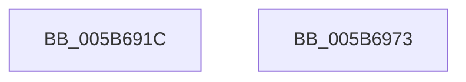

# KiAddSubNodeToIdleSearchContextTargets

- RVA: `0x005B691C`–`0x005B6974` (길이 `88` bytes)
- VA: `0x00000001405B691C`
- 실행 섹션: `.text`
- PDB 이름 있음: `예`; PDB Function 태그: `아니요`
- unwind 정보 RVA: `0x000DB714`
- 디코드: `16`개 명령, `88/88` bytes 표시
- 미해석 바이트: `0` (있으면 어셈블리에 `.byte`로 보존)

> 이 문서는 커널 이미지의 기계어와 PDB 기호를 분석해 생성했습니다. 4번과 5번은 함수 원형과 자료형을 바이너리 사용 방식에서 추정한 C 해석이며 원본 소스 복구 결과는 아닙니다.

## 1. Dependencies

- 직접 호출 지점: **0**; 고유 호출 대상: **0**
- 직접 호출자로 확인된 함수: **1**
- RIP 상대 이미지 참조: **0**

### Outgoing calls
- 직접 디코드된 call 명령이 없습니다.

### Direct callers
- [KiConfigureCooperativeIdleSearchContextTargets](KiConfigureCooperativeIdleSearchContextTargets_function_005B78D8.md) at `0x005B7966`
- [KiConfigureCooperativeIdleSearchContextTargets](KiConfigureCooperativeIdleSearchContextTargets_function_005B78D8.md) at `0x005B7991`

### Static image references
- 디코드된 RIP-relative 메모리 참조가 없습니다.

## 2. Other-region calls and transfers

- 다른 실행 섹션으로 향하는 call: **0**
- 별도 외부 분기/꼬리 이동을 확인하지 못했습니다.

## 3. Assembly (complete function range)

```asm
005B691C  44 0F B7 89 22 04 00 00         movzx r9d, word ptr [rcx + 0x422]
005B6924  44 0F B7 91 20 04 00 00         movzx r10d, word ptr [rcx + 0x420]
005B692C  0F B7 82 8C 00 00 00            movzx eax, word ptr [rdx + 0x8c]
005B6933  45 8B C2                        mov r8d, r10d
005B6936  49 C1 E0 04                     shl r8, 4
005B693A  4D 03 C1                        add r8, r9
005B693D  66 42 89 84 41 28 04 00 00      mov word ptr [rcx + r8*2 + 0x428], ax
005B6946  4F 8D 04 11                     lea r8, [r9 + r10]
005B694A  48 8B 82 80 00 00 00            mov rax, qword ptr [rdx + 0x80]
005B6951  4D 03 C0                        add r8, r8
005B6954  4A 89 84 C1 28 04 00 00         mov qword ptr [rcx + r8*8 + 0x428], rax
005B695C  48 8B 82 98 00 00 00            mov rax, qword ptr [rdx + 0x98]
005B6963  4A 89 84 C1 30 04 00 00         mov qword ptr [rcx + r8*8 + 0x430], rax
005B696B  66 FF 81 22 04 00 00            inc word ptr [rcx + 0x422]
005B6972  C3                              ret
005B6973  CC                              int3
```

## 4. C-style interpretation (structured pseudocode)

```c
__int64 __fastcall KiAddSubNodeToIdleSearchContextTargets(__int64 a1, __int64 a2)
{
    a3 = ((unsigned int)((unsigned int)(*(unsigned __int16 *)(a1 + 1056)))) << (4);
    a3 = (a3) + (*(unsigned __int16 *)(a1 + 1058));
    *(unsigned __int16 *)(a1 + a3 * 2 + 1064) = (unsigned __int16)(*(unsigned __int16 *)(a2 + 140));
    a3 = (*(unsigned __int16 *)(a1 + 1058) + *(unsigned __int16 *)(a1 + 1056) * 1) + (*(unsigned __int16 *)(a1 + 1058) + *(unsigned __int16 *)(a1 + 1056) * 1);
    *(unsigned __int64 *)(a1 + a3 * 8 + 1064) = *(unsigned __int64 *)(a2 + 128);
    *(unsigned __int64 *)(a1 + a3 * 8 + 1072) = *(unsigned __int64 *)(a2 + 152);
    return *(unsigned __int64 *)(a2 + 152);
}
```

## 5. (Beta) C Style

```c
int64_t KiAddSubNodeToIdleSearchContextTargets(void *Arg1, void *Arg2)
{
    uint8_t *arg1 = (uint8_t *)Arg1;
    uint8_t *arg2 = (uint8_t *)Arg2;

    a3 = ((uint32_t)((uint32_t)(*(uint16_t *)(arg1 + 0x420)))) << (4);
    a3 = (a3) + (*(uint16_t *)(arg1 + 0x422));
    *(uint16_t *)(arg1 + a3 * 2 + 0x428) = (uint16_t)(*(uint16_t *)(arg2 + 0x8C));
    a3 = (*(uint16_t *)(arg1 + 0x422) + *(uint16_t *)(arg1 + 0x420) * 1) + (*(uint16_t *)(arg1 + 0x422) + *(uint16_t *)(arg1 + 0x420) * 1);
    *(uint64_t *)(arg1 + a3 * 8 + 0x428) = *(uint64_t *)(arg2 + 0x80);
    *(uint64_t *)(arg1 + a3 * 8 + 0x430) = *(uint64_t *)(arg2 + 0x98);
    return *(uint64_t *)(arg2 + 0x98);
}
```

### 관측된 메모리 오프셋

구조체 형식이 확인되지 않은 접근은 인자 기준의 오프셋으로만 기록했습니다.

| 기준 인자 | 오프셋 표현 | 폭 (bit) | 접근 |
|---|---:|---:|---|
| `Arg1` | `+ 0x420` | `16` | `R` |
| `Arg1` | `+ 0x422` | `16` | `R` |
| `Arg1` | `+ 0x422` | `16` | `R/W` |
| `Arg1` | `+ 0x428 + r8*2` | `16` | `W` |
| `Arg1` | `+ 0x428 + r8*8` | `64` | `W` |
| `Arg1` | `+ 0x430 + r8*8` | `64` | `W` |
| `Arg2` | `+ 0x80` | `64` | `R` |
| `Arg2` | `+ 0x8C` | `16` | `R` |
| `Arg2` | `+ 0x98` | `64` | `R` |

## 6. Execution-region graph

[열기: 2D/3D 그래프와 함수 탐색 컨트롤 패널](../../../control-panel.html?section=text&rva=0x005B691C&view=graph)

- 2D 그래프는 위에서 아래로 흐르고, 3D 그래프는 빈 공간을 드래그해 회전합니다. Shift+드래그는 이동, 휠은 확대·축소, 함수 노드 선택은 대상 보고서 이동입니다.

### Static fallback


