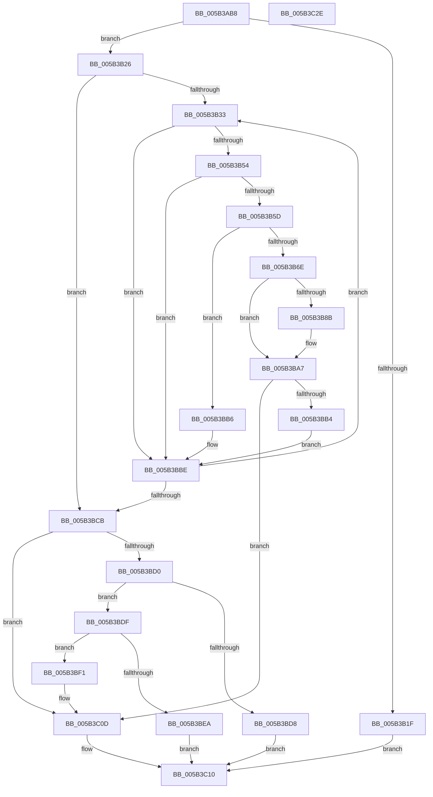

# KiAddTriageDumpDataBlock

- RVA: `0x005B3AB8`–`0x005B3C2F` (길이 `375` bytes)
- VA: `0x00000001405B3AB8`
- 실행 섹션: `.text`
- PDB 이름 있음: `예`; PDB Function 태그: `아니요`
- unwind 정보 RVA: `0x000BE68C`
- 디코드: `113`개 명령, `375/375` bytes 표시
- 미해석 바이트: `0` (있으면 어셈블리에 `.byte`로 보존)

> 이 문서는 커널 이미지의 기계어와 PDB 기호를 분석해 생성했습니다. 4번과 5번은 함수 원형과 자료형을 바이너리 사용 방식에서 추정한 C 해석이며 원본 소스 복구 결과는 아닙니다.

## 1. Dependencies

- 직접 호출 지점: **4**; 고유 호출 대상: **3**
- 직접 호출자로 확인된 함수: **2**
- RIP 상대 이미지 참조: **2**

### Outgoing calls
- `0x005B3B15` → [DbgPrintEx](../35/DbgPrintEx_function_00359290.md) (function, `0x00359290`)
- `0x005B3B65` → [KiCheckRangeOverlap](KiCheckRangeOverlap_function_005B42F8.md) (function, `0x005B42F8`)
- `0x005B3B7F` → [KiAddTriageDumpDataBlock](KiAddTriageDumpDataBlock_function_005B3AB8.md) (function, `0x005B3AB8`)
- `0x005B3BA2` → [DbgPrintEx](../35/DbgPrintEx_function_00359290.md) (function, `0x00359290`)

### Direct callers
- [KeAddTriageDumpDataBlock](KeAddTriageDumpDataBlock_function_005B26B0.md) at `0x005B27A7`
- [KiAddTriageDumpDataBlock](KiAddTriageDumpDataBlock_function_005B3AB8.md) at `0x005B3B7F`

### Static image references
- `0x005B3B03` → RVA `0x006CB780` (` ?? ::FNODOBFM::`string'`; read)
- `0x005B3B98` → RVA `0x006CB820` (` ?? ::FNODOBFM::`string'`; read)

## 2. Other-region calls and transfers

- 다른 실행 섹션으로 향하는 call: **0**
- 별도 외부 분기/꼬리 이동을 확인하지 못했습니다.

## 3. Assembly (complete function range)

```asm
005B3AB8  48 8B C4                        mov rax, rsp
005B3ABB  48 89 58 08                     mov qword ptr [rax + 8], rbx
005B3ABF  48 89 70 10                     mov qword ptr [rax + 0x10], rsi
005B3AC3  48 89 78 18                     mov qword ptr [rax + 0x18], rdi
005B3AC7  55                              push rbp
005B3AC8  41 54                           push r12
005B3ACA  41 55                           push r13
005B3ACC  41 56                           push r14
005B3ACE  41 57                           push r15
005B3AD0  48 8B EC                        mov rbp, rsp
005B3AD3  48 83 EC 60                     sub rsp, 0x60
005B3AD7  44 89 48 A8                     mov dword ptr [rax - 0x58], r9d
005B3ADB  48 8B F2                        mov rsi, rdx
005B3ADE  4C 89 40 A0                     mov qword ptr [rax - 0x60], r8
005B3AE2  45 8B E1                        mov r12d, r9d
005B3AE5  48 89 55 E0                     mov qword ptr [rbp - 0x20], rdx
005B3AE9  4D 8B E8                        mov r13, r8
005B3AEC  48 89 50 98                     mov qword ptr [rax - 0x68], rdx
005B3AF0  48 8B D9                        mov rbx, rcx
005B3AF3  0F 57 C0                        xorps xmm0, xmm0
005B3AF6  4C 89 45 E8                     mov qword ptr [rbp - 0x18], r8
005B3AFA  49 8B F8                        mov rdi, r8
005B3AFD  4C 8B C9                        mov r9, rcx
005B3B00  45 33 FF                        xor r15d, r15d
005B3B03  4C 8D 05 76 7C 11 00            lea r8, [rip + 0x117c76]
005B3B0A  0F 11 45 F0                     movups xmmword ptr [rbp - 0x10], xmm0
005B3B0E  41 8D 57 02                     lea edx, [r15 + 2]
005B3B12  8D 4A 03                        lea ecx, [rdx + 3]
005B3B15  E8 76 57 DA FF                  call 0x140359290
005B3B1A  48 85 FF                        test rdi, rdi
005B3B1D  75 07                           jne 0x1405b3b26
005B3B1F  33 C0                           xor eax, eax
005B3B21  E9 EA 00 00 00                  jmp 0x1405b3c10
005B3B26  45 33 F6                        xor r14d, r14d
005B3B29  44 39 73 10                     cmp dword ptr [rbx + 0x10], r14d
005B3B2D  0F 86 98 00 00 00               jbe 0x1405b3bcb
005B3B33  49 8D 56 03                     lea rdx, [r14 + 3]
005B3B37  41 8B CE                        mov ecx, r14d
005B3B3A  48 03 C9                        add rcx, rcx
005B3B3D  48 C1 E2 04                     shl rdx, 4
005B3B41  48 03 D3                        add rdx, rbx
005B3B44  48 8B 4C CB 38                  mov rcx, qword ptr [rbx + rcx*8 + 0x38]
005B3B49  4C 8B 02                        mov r8, qword ptr [rdx]
005B3B4C  49 03 C8                        add rcx, r8
005B3B4F  48 3B F1                        cmp rsi, rcx
005B3B52  73 6A                           jae 0x1405b3bbe
005B3B54  4A 8D 04 2E                     lea rax, [rsi + r13]
005B3B58  49 3B C0                        cmp rax, r8
005B3B5B  76 61                           jbe 0x1405b3bbe
005B3B5D  4C 8D 45 F0                     lea r8, [rbp - 0x10]
005B3B61  48 8D 4D E0                     lea rcx, [rbp - 0x20]
005B3B65  E8 8E 07 00 00                  call 0x1405b42f8
005B3B6A  84 C0                           test al, al
005B3B6C  74 48                           je 0x1405b3bb6
005B3B6E  4C 8B 45 F8                     mov r8, qword ptr [rbp - 8]
005B3B72  41 FF C4                        inc r12d
005B3B75  48 8B 55 F0                     mov rdx, qword ptr [rbp - 0x10]
005B3B79  45 8B CC                        mov r9d, r12d
005B3B7C  48 8B CB                        mov rcx, rbx
005B3B7F  E8 34 FF FF FF                  call 0x1405b3ab8
005B3B84  44 8B F8                        mov r15d, eax
005B3B87  85 C0                           test eax, eax
005B3B89  79 1C                           jns 0x1405b3ba7
005B3B8B  BA 01 00 00 00                  mov edx, 1
005B3B90  44 89 64 24 20                  mov dword ptr [rsp + 0x20], r12d
005B3B95  44 8B C8                        mov r9d, eax
005B3B98  4C 8D 05 81 7C 11 00            lea r8, [rip + 0x117c81]
005B3B9F  8D 4A 04                        lea ecx, [rdx + 4]
005B3BA2  E8 E9 56 DA FF                  call 0x140359290
005B3BA7  48 8B 7D E8                     mov rdi, qword ptr [rbp - 0x18]
005B3BAB  48 8B 75 E0                     mov rsi, qword ptr [rbp - 0x20]
005B3BAF  48 85 FF                        test rdi, rdi
005B3BB2  74 59                           je 0x1405b3c0d
005B3BB4  EB 08                           jmp 0x1405b3bbe
005B3BB6  48 8B 7D E8                     mov rdi, qword ptr [rbp - 0x18]
005B3BBA  48 8B 75 E0                     mov rsi, qword ptr [rbp - 0x20]
005B3BBE  41 FF C6                        inc r14d
005B3BC1  44 3B 73 10                     cmp r14d, dword ptr [rbx + 0x10]
005B3BC5  0F 82 68 FF FF FF               jb 0x1405b3b33
005B3BCB  48 85 FF                        test rdi, rdi
005B3BCE  74 3D                           je 0x1405b3c0d
005B3BD0  8B 43 14                        mov eax, dword ptr [rbx + 0x14]
005B3BD3  39 43 10                        cmp dword ptr [rbx + 0x10], eax
005B3BD6  75 07                           jne 0x1405b3bdf
005B3BD8  B8 23 00 00 C0                  mov eax, 0xc0000023
005B3BDD  EB 31                           jmp 0x1405b3c10
005B3BDF  8B 43 1C                        mov eax, dword ptr [rbx + 0x1c]
005B3BE2  2B 43 18                        sub eax, dword ptr [rbx + 0x18]
005B3BE5  4C 3B E8                        cmp r13, rax
005B3BE8  76 07                           jbe 0x1405b3bf1
005B3BEA  B8 9A 00 00 C0                  mov eax, 0xc000009a
005B3BEF  EB 1F                           jmp 0x1405b3c10
005B3BF1  41 8B CE                        mov ecx, r14d
005B3BF4  49 8D 46 03                     lea rax, [r14 + 3]
005B3BF8  48 03 C0                        add rax, rax
005B3BFB  48 03 C9                        add rcx, rcx
005B3BFE  48 89 34 C3                     mov qword ptr [rbx + rax*8], rsi
005B3C02  48 89 7C CB 38                  mov qword ptr [rbx + rcx*8 + 0x38], rdi
005B3C07  FF 43 10                        inc dword ptr [rbx + 0x10]
005B3C0A  01 7B 18                        add dword ptr [rbx + 0x18], edi
005B3C0D  41 8B C7                        mov eax, r15d
005B3C10  4C 8D 5C 24 60                  lea r11, [rsp + 0x60]
005B3C15  49 8B 5B 30                     mov rbx, qword ptr [r11 + 0x30]
005B3C19  49 8B 73 38                     mov rsi, qword ptr [r11 + 0x38]
005B3C1D  49 8B 7B 40                     mov rdi, qword ptr [r11 + 0x40]
005B3C21  49 8B E3                        mov rsp, r11
005B3C24  41 5F                           pop r15
005B3C26  41 5E                           pop r14
005B3C28  41 5D                           pop r13
005B3C2A  41 5C                           pop r12
005B3C2C  5D                              pop rbp
005B3C2D  C3                              ret
005B3C2E  CC                              int3
```

## 4. C-style interpretation (structured pseudocode)

```c
__int64 __fastcall KiAddTriageDumpDataBlock(__int64 a1, __int64 a2, __int64 a3, int a4)
{
    __int64 result;
    __int64 v_r12;
    __int64 v_r14;
    __int64 v_r15;
    __int64 v_rsp;
    unsigned __int64 v_stack_m28;
    unsigned __int64 v_stack_m30;
    unsigned __int64 v_stack_m38;
    unsigned __int64 v_stack_m40;
    unsigned __int64 v_stack_m48;
    unsigned int v_stack_m68;

    *(unsigned __int64 *)(v_rsp + 8) = v_rbx;
    *(unsigned __int64 *)(v_rsp + 16) = v_rsi;
    *(unsigned __int64 *)(v_rsp + 24) = v_rdi;
    v_rsp = (v_rsp) - (96);
    *(unsigned int *)(v_rsp - 88) = a4;
    *(unsigned __int64 *)(v_rsp - 96) = a3;
    v_stack_m48 = a2;
    *(unsigned __int64 *)(v_rsp - 104) = a2;
    v_stack_m40 = a3;
    v_r15 = 0;
    v_stack_m38 = v_xmm0;
    result = DbgPrintEx(v_r15 + 2 + 3, v_r15 + 2, v_rip + 1145974, a1);
    if (a3 != 0) goto loc_005B3B26;
    result = 0;
    goto loc_005B3C10;
loc_005B3B26:
    v_r14 = 0;
    if ((*(unsigned int *)(a1 + 16)) <= 0) goto loc_005B3BCB;
loc_005B3B33:
    a1 = (0) + (0);
    a2 = (v_r14 + 3) << (4);
    a2 = (a2) + (a1);
    a1 = (*(unsigned __int64 *)(a1 + a1 * 8 + 56)) + (*(unsigned __int64 *)(a2));
    if (a2 >= a1) goto loc_005B3BBE;
    if ((a2 + a3 * 1) <= (*(unsigned __int64 *)(a2))) goto loc_005B3BBE;
    result = KiCheckRangeOverlap(v_stack_m48, a2, v_stack_m38, a1);
    if ((unsigned __int8)(result) == 0) goto loc_005B3BB6;
    v_r12 = (unsigned int)(((unsigned int)(a4)) + 1);
    result = KiAddTriageDumpDataBlock(a1, v_stack_m38, v_stack_m30, (unsigned int)((unsigned int)(v_r12)));
    if (sign_flag) {
        a2 = 1;
        v_stack_m68 = (unsigned int)(v_r12);
        a4 = (unsigned int)(result);
        a3 = v_rip + 1145985;
        a1 = a2 + 4;
        result = DbgPrintEx(a1, a2, a3, a4);
    }
    if (v_stack_m40 == 0) goto loc_005B3C0D;
    goto loc_005B3BBE;
loc_005B3BB6:
loc_005B3BBE:
    v_r14 = (unsigned int)((v_r14) + 1);
    if (((unsigned int)(v_r14)) < (*(unsigned int *)(a1 + 16))) goto loc_005B3B33;
loc_005B3BCB:
    if (v_stack_m40 == 0) goto loc_005B3C0D;
    if ((*(unsigned int *)(a1 + 16)) != ((unsigned int)((unsigned int)(*(unsigned int *)(a1 + 20))))) goto loc_005B3BDF;
    goto loc_005B3C10;
loc_005B3BDF:
    result = (unsigned int)(((unsigned int)(*(unsigned int *)(a1 + 28))) - (*(unsigned int *)(a1 + 24)));
    if (a3 <= result) goto loc_005B3BF1;
    goto loc_005B3C10;
loc_005B3BF1:
    result = (v_r14 + 3) + (v_r14 + 3);
    a1 = ((unsigned int)((unsigned int)(v_r14))) + ((unsigned int)((unsigned int)(v_r14)));
    *(unsigned __int64 *)(a1 + result * 8) = v_stack_m48;
    *(unsigned __int64 *)(a1 + a1 * 8 + 56) = v_stack_m40;
loc_005B3C0D:
loc_005B3C10:
    return (unsigned int)((unsigned int)((unsigned int)((unsigned int)(result))));
}
```

## 5. (Beta) C Style

```c
int64_t KiAddTriageDumpDataBlock(void *Arg1, int64_t Arg2, int64_t Arg3, int32_t Arg4)
{
    uint8_t *arg1 = (uint8_t *)Arg1;

    int64_t result;
    int64_t local_r12;
    int64_t local_r14;
    int64_t local_r15;
    int64_t local_rsp;
    uint64_t v_stack_m28;
    uint64_t v_stack_m30;
    uint64_t v_stack_m38;
    uint64_t v_stack_m40;
    uint64_t v_stack_m48;
    uint32_t v_stack_m68;

    *(uint64_t *)(local_rsp + 0x8) = local_rbx;
    *(uint64_t *)(local_rsp + 0x10) = local_rsi;
    *(uint64_t *)(local_rsp + 0x18) = local_rdi;
    local_rsp = (local_rsp) - (96);
    *(uint32_t *)(local_rsp - 0x58) = Arg4;
    *(uint64_t *)(local_rsp - 0x60) = Arg3;
    v_stack_m48 = Arg2;
    *(uint64_t *)(local_rsp - 0x68) = Arg2;
    v_stack_m40 = Arg3;
    local_r15 = 0;
    v_stack_m38 = v_xmm0;
    result = DbgPrintEx(local_r15 + 2 + 3, local_r15 + 2, v_rip + 1145974, Arg1);
    if (Arg3 != 0) goto loc_005B3B26;
    result = 0;
    goto loc_005B3C10;
loc_005B3B26:
    local_r14 = 0;
    if ((*(uint32_t *)(arg1 + 0x10)) <= 0) goto loc_005B3BCB;
loc_005B3B33:
    Arg1 = (0) + (0);
    Arg2 = (local_r14 + 3) << (4);
    Arg2 = (Arg2) + (Arg1);
    Arg1 = (*(uint64_t *)(arg1 + arg1 * 8 + 0x38)) + (*(uint64_t *)(Arg2));
    if (Arg2 >= Arg1) goto loc_005B3BBE;
    if ((Arg2 + Arg3 * 1) <= (*(uint64_t *)(Arg2))) goto loc_005B3BBE;
    result = KiCheckRangeOverlap(v_stack_m48, Arg2, v_stack_m38, Arg1);
    if ((uint8_t)(result) == 0) goto loc_005B3BB6;
    local_r12 = (uint32_t)(((uint32_t)(Arg4)) + 1);
    result = KiAddTriageDumpDataBlock(Arg1, v_stack_m38, v_stack_m30, (uint32_t)((uint32_t)(local_r12)));
    if (sign_flag) {
        Arg2 = 1;
        v_stack_m68 = (uint32_t)(local_r12);
        Arg4 = (uint32_t)(result);
        Arg3 = v_rip + 1145985;
        Arg1 = Arg2 + 4;
        result = DbgPrintEx(Arg1, Arg2, Arg3, Arg4);
    }
    if (v_stack_m40 == 0) goto loc_005B3C0D;
    goto loc_005B3BBE;
loc_005B3BB6:
loc_005B3BBE:
    local_r14 = (uint32_t)((local_r14) + 1);
    if (((uint32_t)(local_r14)) < (*(uint32_t *)(arg1 + 0x10))) goto loc_005B3B33;
loc_005B3BCB:
    if (v_stack_m40 == 0) goto loc_005B3C0D;
    if ((*(uint32_t *)(arg1 + 0x10)) != ((uint32_t)((uint32_t)(*(uint32_t *)(arg1 + 0x14))))) goto loc_005B3BDF;
    goto loc_005B3C10;
loc_005B3BDF:
    result = (uint32_t)(((uint32_t)(*(uint32_t *)(arg1 + 0x1C))) - (*(uint32_t *)(arg1 + 0x18)));
    if (Arg3 <= result) goto loc_005B3BF1;
    goto loc_005B3C10;
loc_005B3BF1:
    result = (local_r14 + 3) + (local_r14 + 3);
    Arg1 = ((uint32_t)((uint32_t)(local_r14))) + ((uint32_t)((uint32_t)(local_r14)));
    *(uint64_t *)(arg1 + result * 8) = v_stack_m48;
    *(uint64_t *)(arg1 + arg1 * 8 + 0x38) = v_stack_m40;
loc_005B3C0D:
loc_005B3C10:
    return (uint32_t)((uint32_t)((uint32_t)((uint32_t)(result))));
}
```

### 관측된 메모리 오프셋

구조체 형식이 확인되지 않은 접근은 인자 기준의 오프셋으로만 기록했습니다.

| 기준 인자 | 오프셋 표현 | 폭 (bit) | 접근 |
|---|---:|---:|---|
| `Arg1` | `+ 0x0 + rax*8` | `64` | `W` |
| `Arg1` | `+ 0x10` | `32` | `R` |
| `Arg1` | `+ 0x10` | `32` | `R/W` |
| `Arg1` | `+ 0x14` | `32` | `R` |
| `Arg1` | `+ 0x18` | `32` | `R` |
| `Arg1` | `+ 0x18` | `32` | `R/W` |
| `Arg1` | `+ 0x1C` | `32` | `R` |
| `Arg1` | `+ 0x38 + rcx*8` | `64` | `R` |
| `Arg1` | `+ 0x38 + rcx*8` | `64` | `W` |

## 6. Execution-region graph

[열기: 2D/3D 그래프와 함수 탐색 컨트롤 패널](../../../control-panel.html?section=text&rva=0x005B3AB8&view=graph)

- 2D 그래프는 위에서 아래로 흐르고, 3D 그래프는 빈 공간을 드래그해 회전합니다. Shift+드래그는 이동, 휠은 확대·축소, 함수 노드 선택은 대상 보고서 이동입니다.

### Static fallback


