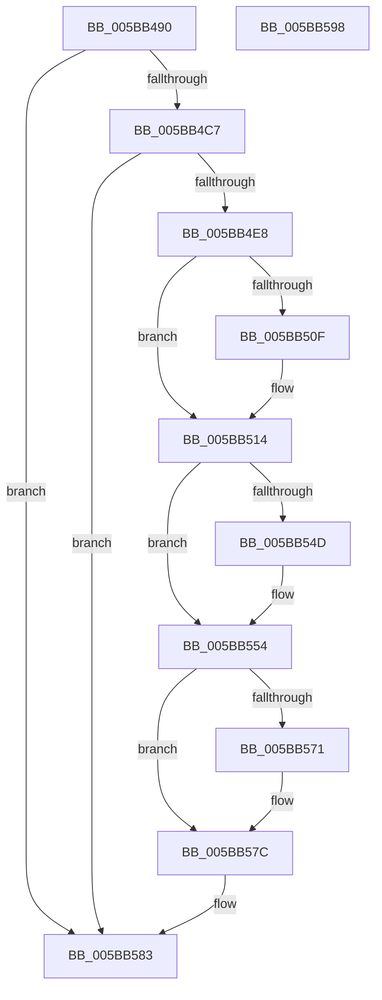

# KiAdjustTimersAfterDripsExit

- RVA: `0x005BB490`–`0x005BB599` (길이 `265` bytes)
- VA: `0x00000001405BB490`
- 실행 섹션: `.text`
- PDB 이름 있음: `예`; PDB Function 태그: `아니요`
- unwind 정보 RVA: `0x000BB674`
- 디코드: `64`개 명령, `265/265` bytes 표시
- 미해석 바이트: `0` (있으면 어셈블리에 `.byte`로 보존)

> 이 문서는 커널 이미지의 기계어와 PDB 기호를 분석해 생성했습니다. 4번과 5번은 함수 원형과 자료형을 바이너리 사용 방식에서 추정한 C 해석이며 원본 소스 복구 결과는 아닙니다.

## 1. Dependencies

- 직접 호출 지점: **4**; 고유 호출 대상: **4**
- 직접 호출자로 확인된 함수: **1**
- RIP 상대 이미지 참조: **6**

### Outgoing calls
- `0x005BB530` → [KiSelectActiveTimerTable](../44/KiSelectActiveTimerTable_function_00446680.md) (function, `0x00446680`)
- `0x005BB54F` → [KiRaiseIrqlProcessIrqlFlags](../4F/KiRaiseIrqlProcessIrqlFlags_function_004F56FC.md) (function, `0x004F56FC`)
- `0x005BB564` → [KiAdjustTimerDueTimes](../4E/KiAdjustTimerDueTimes_function_004E8CD4.md) (function, `0x004E8CD4`)
- `0x005BB577` → [KiLowerIrqlProcessIrqlFlags](../4F/KiLowerIrqlProcessIrqlFlags_function_004F5698.md) (function, `0x004F5698`)

### Direct callers
- [KeResumeClockTimerFromIdle](KeResumeClockTimerFromIdle_function_005BACC4.md) at `0x005BAF01`

### Static image references
- `0x005BB4AC` → RVA `0x00FC5030` (`ALMOSTRO`; read)
- `0x005BB4C7` → RVA `0x00F21FB8` (`.data`; read)
- `0x005BB4CE` → RVA `0x00FC536C` (`ALMOSTRO`; read)
- `0x005BB4E8` → RVA `0x00FC5008` (`ALMOSTRO`; read)
- `0x005BB4EF` → RVA `0x00F21F98` (`.data`; read/write)
- `0x005BB545` → RVA `0x00FC6D20` (`ALMOSTRO`; read)

## 2. Other-region calls and transfers

- 다른 실행 섹션으로 향하는 call: **0**
- 별도 외부 분기/꼬리 이동을 확인하지 못했습니다.

## 3. Assembly (complete function range)

```asm
005BB490  48 89 5C 24 08                  mov qword ptr [rsp + 8], rbx
005BB495  48 89 74 24 10                  mov qword ptr [rsp + 0x10], rsi
005BB49A  48 89 7C 24 18                  mov qword ptr [rsp + 0x18], rdi
005BB49F  55                              push rbp
005BB4A0  48 8B EC                        mov rbp, rsp
005BB4A3  48 83 EC 50                     sub rsp, 0x50
005BB4A7  33 F6                           xor esi, esi
005BB4A9  4C 8B C1                        mov r8, rcx
005BB4AC  39 35 7E 9B A0 00               cmp dword ptr [rip + 0xa09b7e], esi
005BB4B2  66 89 75 D1                     mov word ptr [rbp - 0x2f], si
005BB4B6  40 88 75 D3                     mov byte ptr [rbp - 0x2d], sil
005BB4BA  48 89 75 E8                     mov qword ptr [rbp - 0x18], rsi
005BB4BE  89 75 F1                        mov dword ptr [rbp - 0xf], esi
005BB4C1  0F 84 BC 00 00 00               je 0x1405bb583
005BB4C7  48 2B 15 EA 6A 96 00            sub rdx, qword ptr [rip + 0x966aea]
005BB4CE  8B 05 98 9E A0 00               mov eax, dword ptr [rip + 0xa09e98]
005BB4D4  48 69 C8 80 96 98 00            imul rcx, rax, 0x989680
005BB4DB  48 89 55 E8                     mov qword ptr [rbp - 0x18], rdx
005BB4DF  48 3B D1                        cmp rdx, rcx
005BB4E2  0F 8E 9B 00 00 00               jle 0x1405bb583
005BB4E8  48 8B 05 19 9B A0 00            mov rax, qword ptr [rip + 0xa09b19]
005BB4EF  48 01 15 A2 6A 96 00            add qword ptr [rip + 0x966aa2], rdx
005BB4F6  48 01 90 B0 03 00 00            add qword ptr [rax + 0x3b0], rdx
005BB4FD  48 B8 B0 03 00 00 80 F7 FF FF   movabs rax, 0xfffff780000003b0
005BB507  48 8B 00                        mov rax, qword ptr [rax]
005BB50A  48 85 C0                        test rax, rax
005BB50D  79 05                           jns 0x1405bb514
005BB50F  8D 4E 05                        lea ecx, [rsi + 5]
005BB512  CD 29                           int 0x29
005BB514  48 F7 5D E8                     neg qword ptr [rbp - 0x18]
005BB518  0F 57 C0                        xorps xmm0, xmm0
005BB51B  33 D2                           xor edx, edx
005BB51D  C6 45 D0 01                     mov byte ptr [rbp - 0x30], 1
005BB521  49 8B C8                        mov rcx, r8
005BB524  89 75 D4                        mov dword ptr [rbp - 0x2c], esi
005BB527  F3 0F 7F 45 D8                  movdqu xmmword ptr [rbp - 0x28], xmm0
005BB52C  C6 45 F0 01                     mov byte ptr [rbp - 0x10], 1
005BB530  E8 4B B1 E8 FF                  call 0x140446680
005BB535  48 8B F8                        mov rdi, rax
005BB538  44 0F 20 C3                     mov rbx, cr8
005BB53C  BA 02 00 00 00                  mov edx, 2
005BB541  44 0F 22 C2                     mov cr8, rdx
005BB545  39 35 D5 B7 A0 00               cmp dword ptr [rip + 0xa0b7d5], esi
005BB54B  74 07                           je 0x1405bb554
005BB54D  8A CB                           mov cl, bl
005BB54F  E8 A8 A1 F3 FF                  call 0x1404f56fc
005BB554  65 48 8B 0C 25 20 00 00 00      mov rcx, qword ptr gs:[0x20]
005BB55D  4C 8D 45 D0                     lea r8, [rbp - 0x30]
005BB561  48 8B D7                        mov rdx, rdi
005BB564  E8 6B D7 F2 FF                  call 0x1404e8cd4
005BB569  39 35 B1 B7 A0 00               cmp dword ptr [rip + 0xa0b7b1], esi
005BB56F  74 0B                           je 0x1405bb57c
005BB571  44 0F 20 C1                     mov rcx, cr8
005BB575  8A D3                           mov dl, bl
005BB577  E8 1C A1 F3 FF                  call 0x1404f5698
005BB57C  0F B6 C3                        movzx eax, bl
005BB57F  44 0F 22 C0                     mov cr8, rax
005BB583  48 8B 5C 24 60                  mov rbx, qword ptr [rsp + 0x60]
005BB588  48 8B 74 24 68                  mov rsi, qword ptr [rsp + 0x68]
005BB58D  48 8B 7C 24 70                  mov rdi, qword ptr [rsp + 0x70]
005BB592  48 83 C4 50                     add rsp, 0x50
005BB596  5D                              pop rbp
005BB597  C3                              ret
005BB598  CC                              int3
```

## 4. C-style interpretation (structured pseudocode)

```c
__int64 __fastcall KiAdjustTimersAfterDripsExit(__int64 a1, __int64 a2)
{
    __int64 result;
    __int64 v_rsi;
    __int64 v_rsp;
    unsigned int v_stack_m17;
    unsigned __int8 v_stack_m18;
    unsigned __int64 v_stack_m20;
    unsigned __int64 v_stack_m30;
    unsigned int v_stack_m34;
    unsigned __int8 v_stack_m35;
    unsigned __int16 v_stack_m37;
    unsigned __int8 v_stack_m38;
    unsigned __int64 v_stack_p10;
    unsigned __int64 v_stack_p18;
    unsigned __int64 v_stack_p8;

    v_stack_p8 = v_rbx;
    v_stack_p10 = v_rsi;
    v_stack_p18 = v_rdi;
    v_rsp = (v_rsp) - (80);
    v_rsi = 0;
    v_stack_m37 = 0;
    v_stack_m35 = 0;
    v_stack_m20 = 0;
    v_stack_m17 = 0;
    if ((*(unsigned int *)(v_rip + 10525566)) == 0) goto loc_005BB583;
    a2 = (a2) - (*(unsigned __int64 *)(v_rip + 9857770));
    a1 = (a1) * ((unsigned int)(*(unsigned int *)(v_rip + 10526360)));
    v_stack_m20 = a2;
    if (a2 <= a1) goto loc_005BB583;
    if (sign_flag) {
        a1 = v_rsi + 5;
    }
    a2 = 0;
    v_stack_m38 = 1;
    v_stack_m34 = 0;
    v_stack_m30 = v_xmm0;
    v_stack_m18 = 1;
    result = KiSelectActiveTimerTable(a1, a2, a1, a4);
    if ((*(unsigned int *)(v_rip + 10532821)) != 0) {
        a1 = (unsigned __int8)(v_cr8);
        result = KiRaiseIrqlProcessIrqlFlags(a1, 2, a1, a4);
    }
    result = KiAdjustTimerDueTimes(*(unsigned __int64 *)(gs_base + (0 + 32)), result, v_stack_m38, a4);
    if ((*(unsigned int *)(v_rip + 10532785)) != 0) {
        a1 = 2;
        a2 = (unsigned __int8)(v_cr8);
        result = KiLowerIrqlProcessIrqlFlags(a1, a2, v_stack_m38, a4);
    }
loc_005BB583:
    v_rsp = (v_rsp) + (80);
    return (unsigned __int8)(v_cr8);
}
```

## 5. (Beta) C Style

```c
int64_t KiAdjustTimersAfterDripsExit(int64_t Arg1, int64_t Arg2)
{
    int64_t result;
    int64_t local_rsi;
    int64_t local_rsp;
    uint32_t v_stack_m17;
    uint8_t v_stack_m18;
    uint64_t v_stack_m20;
    uint64_t v_stack_m30;
    uint32_t v_stack_m34;
    uint8_t v_stack_m35;
    uint16_t v_stack_m37;
    uint8_t v_stack_m38;
    uint64_t v_stack_p10;
    uint64_t v_stack_p18;
    uint64_t v_stack_p8;

    v_stack_p8 = local_rbx;
    v_stack_p10 = local_rsi;
    v_stack_p18 = local_rdi;
    local_rsp = (local_rsp) - (80);
    local_rsi = 0;
    v_stack_m37 = 0;
    v_stack_m35 = 0;
    v_stack_m20 = 0;
    v_stack_m17 = 0;
    if ((*(uint32_t *)(v_rip + 0xA09B7E)) == 0) goto loc_005BB583;
    Arg2 = (Arg2) - (*(uint64_t *)(v_rip + 0x966AEA));
    Arg1 = (Arg1) * ((uint32_t)(*(uint32_t *)(v_rip + 0xA09E98)));
    v_stack_m20 = Arg2;
    if (Arg2 <= Arg1) goto loc_005BB583;
    if (sign_flag) {
        Arg1 = local_rsi + 5;
    }
    Arg2 = 0;
    v_stack_m38 = 1;
    v_stack_m34 = 0;
    v_stack_m30 = v_xmm0;
    v_stack_m18 = 1;
    result = KiSelectActiveTimerTable(Arg1, Arg2, Arg1, a4);
    if ((*(uint32_t *)(v_rip + 0xA0B7D5)) != 0) {
        Arg1 = (uint8_t)(v_cr8);
        result = KiRaiseIrqlProcessIrqlFlags(Arg1, 2, Arg1, a4);
    }
    result = KiAdjustTimerDueTimes(*(uint64_t *)(gs_base + (0 + 0x20)), result, v_stack_m38, a4);
    if ((*(uint32_t *)(v_rip + 0xA0B7B1)) != 0) {
        Arg1 = 2;
        Arg2 = (uint8_t)(v_cr8);
        result = KiLowerIrqlProcessIrqlFlags(Arg1, Arg2, v_stack_m38, a4);
    }
loc_005BB583:
    local_rsp = (local_rsp) + (80);
    return (uint8_t)(v_cr8);
}
```

## 6. Execution-region graph

[열기: 2D/3D 그래프와 함수 탐색 컨트롤 패널](../../../control-panel.html?section=text&rva=0x005BB490&view=graph)

- 2D 그래프는 위에서 아래로 흐르고, 3D 그래프는 빈 공간을 드래그해 회전합니다. Shift+드래그는 이동, 휠은 확대·축소, 함수 노드 선택은 대상 보고서 이동입니다.

### Static fallback


