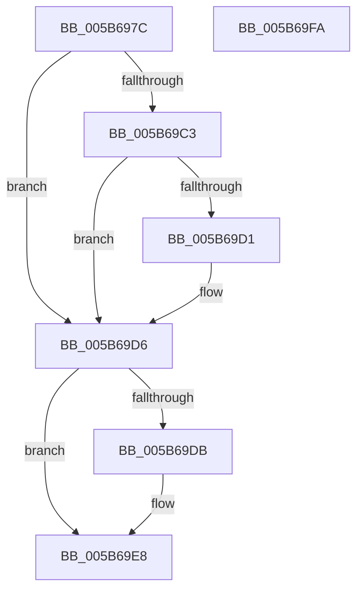

# KiAllocateDpcDelegateThread

- RVA: `0x005B697C`–`0x005B69FB` (길이 `127` bytes)
- VA: `0x00000001405B697C`
- 실행 섹션: `.text`
- PDB 이름 있음: `예`; PDB Function 태그: `아니요`
- unwind 정보 RVA: `0x000718AC`
- 디코드: `37`개 명령, `127/127` bytes 표시
- 미해석 바이트: `0` (있으면 어셈블리에 `.byte`로 보존)

> 이 문서는 커널 이미지의 기계어와 PDB 기호를 분석해 생성했습니다. 4번과 5번은 함수 원형과 자료형을 바이너리 사용 방식에서 추정한 C 해석이며 원본 소스 복구 결과는 아닙니다.

## 1. Dependencies

- 직접 호출 지점: **3**; 고유 호출 대상: **3**
- 직접 호출자로 확인된 함수: **2**
- RIP 상대 이미지 참조: **2**

### Outgoing calls
- `0x005B69B3` → [KiAllocatePrcbThread](KiAllocatePrcbThread_function_005B9130.md) (function, `0x005B9130`)
- `0x005B69C6` → [PsAssignThreadId](../47/PsAssignThreadId_function_004745F0.md) (function, `0x004745F0`)
- `0x005B69E3` → [ObfDereferenceObjectWithTag](../2F/ObfDereferenceObjectWithTag_function_002F78E0.md) (function, `0x002F78E0`)

### Direct callers
- [KiAllocatePrcbThreads](KiAllocatePrcbThreads_function_005B6C2C.md) at `0x005B6C55`
- [KiCompleteBootProcessorContextInitialization](KiCompleteBootProcessorContextInitialization_function_005B7634.md) at `0x005B7711`

### Static image references
- `0x005B6991` → RVA `0x00E07110` (`.data`; read)
- `0x005B69AC` → RVA `0x005C8620` (`KiExecuteDpcDelegate`; read)

## 2. Other-region calls and transfers

- 다른 실행 섹션으로 향하는 call: **0**
- 별도 외부 분기/꼬리 이동을 확인하지 못했습니다.

## 3. Assembly (complete function range)

```asm
005B697C  4C 8B DC                        mov r11, rsp
005B697F  49 89 5B 08                     mov qword ptr [r11 + 8], rbx
005B6983  49 89 73 10                     mov qword ptr [r11 + 0x10], rsi
005B6987  57                              push rdi
005B6988  48 83 EC 40                     sub rsp, 0x40
005B698C  83 64 24 30 00                  and dword ptr [rsp + 0x30], 0
005B6991  48 8D 05 78 07 85 00            lea rax, [rip + 0x850778]
005B6998  49 83 63 18 00                  and qword ptr [r11 + 0x18], 0
005B699D  48 8B F1                        mov rsi, rcx
005B69A0  49 89 43 E0                     mov qword ptr [r11 - 0x20], rax
005B69A4  49 8D 4B 18                     lea rcx, [r11 + 0x18]
005B69A8  89 54 24 20                     mov dword ptr [rsp + 0x20], edx
005B69AC  48 8D 15 6D 1C 01 00            lea rdx, [rip + 0x11c6d]
005B69B3  E8 78 27 00 00                  call 0x1405b9130
005B69B8  48 8B 5C 24 60                  mov rbx, qword ptr [rsp + 0x60]
005B69BD  8B F8                           mov edi, eax
005B69BF  85 C0                           test eax, eax
005B69C1  78 13                           js 0x1405b69d6
005B69C3  48 8B CB                        mov rcx, rbx
005B69C6  E8 25 DC EB FF                  call 0x1404745f0
005B69CB  8B F8                           mov edi, eax
005B69CD  85 C0                           test eax, eax
005B69CF  78 05                           js 0x1405b69d6
005B69D1  48 89 1E                        mov qword ptr [rsi], rbx
005B69D4  33 DB                           xor ebx, ebx
005B69D6  48 85 DB                        test rbx, rbx
005B69D9  74 0D                           je 0x1405b69e8
005B69DB  BA 44 66 6C 74                  mov edx, 0x746c6644
005B69E0  48 8B CB                        mov rcx, rbx
005B69E3  E8 F8 0E D4 FF                  call 0x1402f78e0
005B69E8  48 8B 5C 24 50                  mov rbx, qword ptr [rsp + 0x50]
005B69ED  8B C7                           mov eax, edi
005B69EF  48 8B 74 24 58                  mov rsi, qword ptr [rsp + 0x58]
005B69F4  48 83 C4 40                     add rsp, 0x40
005B69F8  5F                              pop rdi
005B69F9  C3                              ret
005B69FA  CC                              int3
```

## 4. C-style interpretation (structured pseudocode)

```c
__int64 __fastcall KiAllocateDpcDelegateThread(__int64 a1, int a2)
{
    __int64 result;
    __int64 v_rbx;
    __int64 v_rsp;
    unsigned int v_stack_m18;
    unsigned int v_stack_m28;
    unsigned __int64 v_stack_p10;
    unsigned __int64 v_stack_p18;
    unsigned __int64 v_stack_p8;

    *(unsigned __int64 *)(v_rsp + 8) = v_rbx;
    *(unsigned __int64 *)(v_rsp + 16) = v_rsi;
    v_rsp = (v_rsp) - (64);
    *(unsigned __int64 *)(v_rsp - 32) = v_rip + 8718200;
    v_stack_m28 = a2;
    result = KiAllocatePrcbThread(v_rsp + 24, v_rip + 72813, a3, a4);
    if (sign_flag) goto loc_005B69D6;
    result = PsAssignThreadId(v_stack_p18, v_rip + 72813, a3, a4);
    v_rbx = v_stack_p18;
    if (!(sign_flag)) {
        *(unsigned __int64 *)(a1) = v_stack_p18;
        v_rbx = 0;
    }
    if (0 != 0) {
        a2 = 0x746C6644ULL;
        a1 = 0;
        result = ObfDereferenceObjectWithTag(a1, a2, a3, a4);
    }
    v_rsp = (v_rsp) + (64);
    return (unsigned int)((unsigned int)((unsigned int)((unsigned int)(result))));
}
```

## 5. (Beta) C Style

```c
int64_t KiAllocateDpcDelegateThread(void *Arg1, int32_t Arg2)
{
    uint8_t *arg1 = (uint8_t *)Arg1;

    int64_t result;
    int64_t local_rbx;
    int64_t local_rsp;
    uint32_t v_stack_m18;
    uint32_t v_stack_m28;
    uint64_t v_stack_p10;
    uint64_t v_stack_p18;
    uint64_t v_stack_p8;

    *(uint64_t *)(local_rsp + 0x8) = local_rbx;
    *(uint64_t *)(local_rsp + 0x10) = local_rsi;
    local_rsp = (local_rsp) - (64);
    *(uint64_t *)(local_rsp - 0x20) = v_rip + 8718200;
    v_stack_m28 = Arg2;
    result = KiAllocatePrcbThread(local_rsp + 24, v_rip + 72813, a3, a4);
    if (sign_flag) goto loc_005B69D6;
    result = PsAssignThreadId(v_stack_p18, v_rip + 72813, a3, a4);
    local_rbx = v_stack_p18;
    if (!(sign_flag)) {
        *(uint64_t *)(arg1) = v_stack_p18;
        local_rbx = 0;
    }
    if (0 != 0) {
        Arg2 = 0x746C6644ULL;
        Arg1 = 0;
        result = ObfDereferenceObjectWithTag(Arg1, Arg2, a3, a4);
    }
    local_rsp = (local_rsp) + (64);
    return (uint32_t)((uint32_t)((uint32_t)((uint32_t)(result))));
}
```

### 관측된 메모리 오프셋

구조체 형식이 확인되지 않은 접근은 인자 기준의 오프셋으로만 기록했습니다.

| 기준 인자 | 오프셋 표현 | 폭 (bit) | 접근 |
|---|---:|---:|---|
| `Arg1` | `+ 0x0` | `64` | `W` |

## 6. Execution-region graph

[열기: 2D/3D 그래프와 함수 탐색 컨트롤 패널](../../../control-panel.html?section=text&rva=0x005B697C&view=graph)

- 2D 그래프는 위에서 아래로 흐르고, 3D 그래프는 빈 공간을 드래그해 회전합니다. Shift+드래그는 이동, 휠은 확대·축소, 함수 노드 선택은 대상 보고서 이동입니다.

### Static fallback


