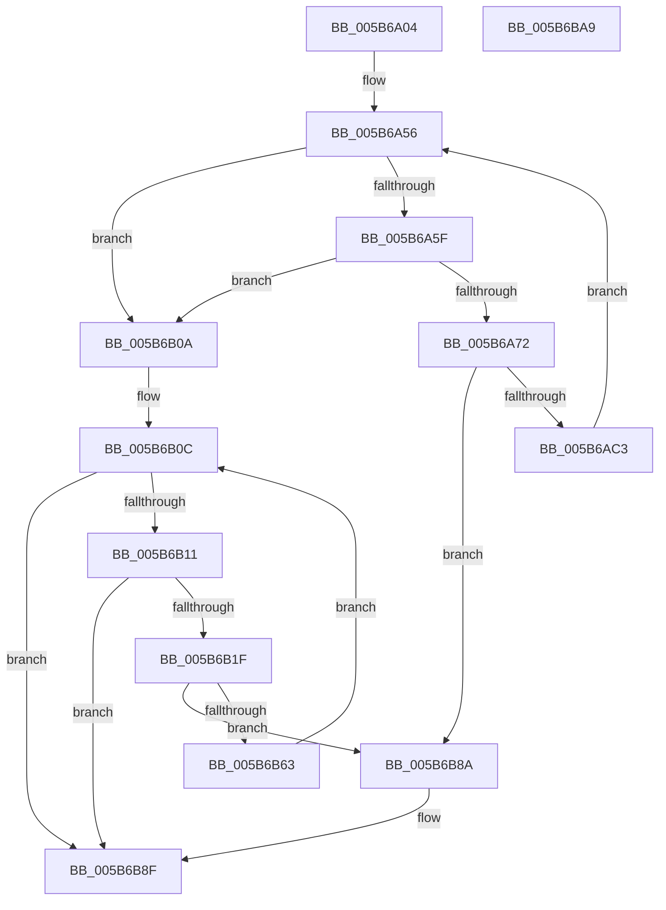

# KiAllocateIdleSearchStructures

- RVA: `0x005B6A04`–`0x005B6BAA` (길이 `422` bytes)
- VA: `0x00000001405B6A04`
- 실행 섹션: `.text`
- PDB 이름 있음: `예`; PDB Function 태그: `아니요`
- unwind 정보 RVA: `0x000C9F6C`
- 디코드: `110`개 명령, `422/422` bytes 표시
- 미해석 바이트: `0` (있으면 어셈블리에 `.byte`로 보존)

> 이 문서는 커널 이미지의 기계어와 PDB 기호를 분석해 생성했습니다. 4번과 5번은 함수 원형과 자료형을 바이너리 사용 방식에서 추정한 C 해석이며 원본 소스 복구 결과는 아닙니다.

## 1. Dependencies

- 직접 호출 지점: **4**; 고유 호출 대상: **2**
- 직접 호출자로 확인된 함수: **3**
- RIP 상대 이미지 참조: **1**

### Outgoing calls
- `0x005B6AB2` → [ExAllocatePool3](../../poolcode/B8/ExAllocatePool3_function_00B84270.md) (function, `0x00B84270`)
- `0x005B6ACC` → [memset](../6C/memset_function_006C6C40.md) (function, `0x006C6C40`)
- `0x005B6B56` → [ExAllocatePool3](../../poolcode/B8/ExAllocatePool3_function_00B84270.md) (function, `0x00B84270`)
- `0x005B6B6D` → [memset](../6C/memset_function_006C6C40.md) (function, `0x006C6C40`)

### Direct callers
- [KiCompleteBootProcessorContextInitialization](KiCompleteBootProcessorContextInitialization_function_005B7634.md) at `0x005B7735`
- [KiStartDynamicProcessor](../../page/74/KiStartDynamicProcessor_function_007456C8.md) at `0x007459B9`
- [KeStartAllProcessors](../../init/C3/KeStartAllProcessors_function_00C36F78.md) at `0x00C3730D`

### Static image references
- `0x005B6A1B` → RVA `0x00F21AC8` (`.data`; read)

## 2. Other-region calls and transfers

- 다른 실행 섹션으로 향하는 call: **2**
  - `0x005B6AB2` → [ExAllocatePool3](../../poolcode/B8/ExAllocatePool3_function_00B84270.md) (`.text` → `POOLCODE`)
  - `0x005B6B56` → [ExAllocatePool3](../../poolcode/B8/ExAllocatePool3_function_00B84270.md) (`.text` → `POOLCODE`)
- 별도 외부 분기/꼬리 이동을 확인하지 못했습니다.

## 3. Assembly (complete function range)

```asm
005B6A04  48 89 5C 24 20                  mov qword ptr [rsp + 0x20], rbx
005B6A09  55                              push rbp
005B6A0A  56                              push rsi
005B6A0B  57                              push rdi
005B6A0C  41 54                           push r12
005B6A0E  41 55                           push r13
005B6A10  41 56                           push r14
005B6A12  41 57                           push r15
005B6A14  48 8B EC                        mov rbp, rsp
005B6A17  48 83 EC 40                     sub rsp, 0x40
005B6A1B  0F B7 05 A6 B0 96 00            movzx eax, word ptr [rip + 0x96b0a6]
005B6A22  41 B8 01 00 00 00               mov r8d, 1
005B6A28  66 41 2B C0                     sub ax, r8w
005B6A2C  66 44 89 45 40                  mov word ptr [rbp + 0x40], r8w
005B6A31  66 89 45 42                     mov word ptr [rbp + 0x42], ax
005B6A35  33 DB                           xor ebx, ebx
005B6A37  48 8B 81 C0 00 00 00            mov rax, qword ptr [rcx + 0xc0]
005B6A3E  4C 8B E9                        mov r13, rcx
005B6A41  8B F3                           mov esi, ebx
005B6A43  0F B7 90 8A 00 00 00            movzx edx, word ptr [rax + 0x8a]
005B6A4A  8B C2                           mov eax, edx
005B6A4C  44 8B E2                        mov r12d, edx
005B6A4F  0F BA E8 1F                     bts eax, 0x1f
005B6A53  89 45 48                        mov dword ptr [rbp + 0x48], eax
005B6A56  83 FE 02                        cmp esi, 2
005B6A59  0F 83 AB 00 00 00               jae 0x1405b6b0a
005B6A5F  44 8B FE                        mov r15d, esi
005B6A62  46 0F B7 74 7D 40               movzx r14d, word ptr [rbp + r15*2 + 0x40]
005B6A68  66 45 85 F6                     test r14w, r14w
005B6A6C  0F 84 98 00 00 00               je 0x1405b6b0a
005B6A72  41 8B C4                        mov eax, r12d
005B6A75  44 89 44 24 20                  mov dword ptr [rsp + 0x20], r8d
005B6A7A  0F BA E8 1F                     bts eax, 0x1f
005B6A7E  4C 8D 4D F0                     lea r9, [rbp - 0x10]
005B6A82  0F 57 C0                        xorps xmm0, xmm0
005B6A85  41 B8 4B 69 53 47               mov r8d, 0x4753694b
005B6A8B  0F 11 45 F0                     movups xmmword ptr [rbp - 0x10], xmm0
005B6A8F  89 45 F8                        mov dword ptr [rbp - 8], eax
005B6A92  B9 48 00 00 00                  mov ecx, 0x48
005B6A97  C6 45 F0 03                     mov byte ptr [rbp - 0x10], 3
005B6A9B  48 0F BA 6D F0 08               bts qword ptr [rbp - 0x10], 8
005B6AA1  49 6B C6 22                     imul rax, r14, 0x22
005B6AA5  48 05 28 04 00 00               add rax, 0x428
005B6AAB  48 8B D0                        mov rdx, rax
005B6AAE  48 89 45 50                     mov qword ptr [rbp + 0x50], rax
005B6AB2  E8 B9 D7 5C 00                  call 0x140b84270
005B6AB7  48 8B F8                        mov rdi, rax
005B6ABA  48 85 C0                        test rax, rax
005B6ABD  0F 84 C7 00 00 00               je 0x1405b6b8a
005B6AC3  4C 8B 45 50                     mov r8, qword ptr [rbp + 0x50]
005B6AC7  33 D2                           xor edx, edx
005B6AC9  48 8B C8                        mov rcx, rax
005B6ACC  E8 6F 01 11 00                  call 0x1406c6c40
005B6AD1  8B 47 10                        mov eax, dword ptr [rdi + 0x10]
005B6AD4  41 B8 01 00 00 00               mov r8d, 1
005B6ADA  83 E0 7F                        and eax, 0x7f
005B6ADD  48 89 1F                        mov qword ptr [rdi], rbx
005B6AE0  48 0F BA E8 07                  bts rax, 7
005B6AE5  66 44 89 B7 20 04 00 00         mov word ptr [rdi + 0x420], r14w
005B6AED  48 89 47 10                     mov qword ptr [rdi + 0x10], rax
005B6AF1  41 03 F0                        add esi, r8d
005B6AF4  66 C7 87 24 04 00 00 40 00      mov word ptr [rdi + 0x424], 0x40
005B6AFD  4B 89 BC FD 08 94 00 00         mov qword ptr [r13 + r15*8 + 0x9408], rdi
005B6B05  E9 4C FF FF FF                  jmp 0x1405b6a56
005B6B0A  8B FB                           mov edi, ebx
005B6B0C  83 FF 02                        cmp edi, 2
005B6B0F  73 7E                           jae 0x1405b6b8f
005B6B11  44 8B FF                        mov r15d, edi
005B6B14  42 0F B7 74 7D 40               movzx esi, word ptr [rbp + r15*2 + 0x40]
005B6B1A  66 85 F6                        test si, si
005B6B1D  74 70                           je 0x1405b6b8f
005B6B1F  8B 45 48                        mov eax, dword ptr [rbp + 0x48]
005B6B22  4C 8D 4D F0                     lea r9, [rbp - 0x10]
005B6B26  0F 57 C0                        xorps xmm0, xmm0
005B6B29  44 89 44 24 20                  mov dword ptr [rsp + 0x20], r8d
005B6B2E  0F 11 45 F0                     movups xmmword ptr [rbp - 0x10], xmm0
005B6B32  C6 45 F0 03                     mov byte ptr [rbp - 0x10], 3
005B6B36  44 8B E6                        mov r12d, esi
005B6B39  48 0F BA 6D F0 08               bts qword ptr [rbp - 0x10], 8
005B6B3F  41 B8 4B 69 53 47               mov r8d, 0x4753694b
005B6B45  49 C1 E4 05                     shl r12, 5
005B6B49  B9 48 00 00 00                  mov ecx, 0x48
005B6B4E  89 45 F8                        mov dword ptr [rbp - 8], eax
005B6B51  49 8D 54 24 10                  lea rdx, [r12 + 0x10]
005B6B56  E8 15 D7 5C 00                  call 0x140b84270
005B6B5B  4C 8B F0                        mov r14, rax
005B6B5E  48 85 C0                        test rax, rax
005B6B61  74 27                           je 0x1405b6b8a
005B6B63  4D 8D 44 24 10                  lea r8, [r12 + 0x10]
005B6B68  33 D2                           xor edx, edx
005B6B6A  48 8B C8                        mov rcx, rax
005B6B6D  E8 CE 00 11 00                  call 0x1406c6c40
005B6B72  41 B8 01 00 00 00               mov r8d, 1
005B6B78  66 41 89 76 08                  mov word ptr [r14 + 8], si
005B6B7D  41 03 F8                        add edi, r8d
005B6B80  4F 89 B4 FD 28 94 00 00         mov qword ptr [r13 + r15*8 + 0x9428], r14
005B6B88  EB 82                           jmp 0x1405b6b0c
005B6B8A  BB 9A 00 00 C0                  mov ebx, 0xc000009a
005B6B8F  8B C3                           mov eax, ebx
005B6B91  48 8B 9C 24 98 00 00 00         mov rbx, qword ptr [rsp + 0x98]
005B6B99  48 83 C4 40                     add rsp, 0x40
005B6B9D  41 5F                           pop r15
005B6B9F  41 5E                           pop r14
005B6BA1  41 5D                           pop r13
005B6BA3  41 5C                           pop r12
005B6BA5  5F                              pop rdi
005B6BA6  5E                              pop rsi
005B6BA7  5D                              pop rbp
005B6BA8  C3                              ret
005B6BA9  CC                              int3
```

## 4. C-style interpretation (structured pseudocode)

```c
__int64 __fastcall KiAllocateIdleSearchStructures(__int64 a1)
{
    __int64 result;
    __int64 v_r12;
    __int64 v_rbx;
    __int64 v_rdi;
    __int64 v_rsi;
    __int64 v_rsp;
    unsigned int v_stack_m40;
    unsigned __int64 v_stack_m48;
    unsigned int v_stack_m58;
    unsigned int v_stack_p10;
    unsigned __int64 v_stack_p18;
    unsigned __int64 v_stack_p20;
    unsigned __int16 v_stack_p8;
    unsigned __int16 v_stack_pA;

    v_stack_p20 = v_rbx;
    v_rsp = (v_rsp) - (64);
    result = (unsigned __int16)((*(unsigned __int16 *)(v_rip + 9875622)) - (1));
    v_stack_p8 = 1;
    v_stack_pA = (unsigned __int16)(result);
    v_rbx = 0;
    v_stack_p10 = (unsigned int)((unsigned int)((unsigned int)(*(unsigned __int16 *)(*(unsigned __int64 *)(a1 + 192) + 138))));
loc_005B6A56:
    if (0 >= 2) goto loc_005B6B0A;
    if ((unsigned __int16)(*(unsigned __int16 *)(v_rsp + 0 * 2 + 64)) == 0) goto loc_005B6B0A;
    v_stack_m58 = 1;
    v_stack_m48 = v_xmm0;
    v_stack_m40 = (unsigned int)((unsigned int)((unsigned int)((unsigned int)((unsigned int)(*(unsigned __int16 *)(*(unsigned __int64 *)(a1 + 192) + 138))))));
    v_stack_m48 = 3;
    result = ((unsigned int)((unsigned int)((unsigned int)((unsigned int)(*(unsigned __int16 *)(*(unsigned __int64 *)(a1 + 192) + 138)))))) * (*(unsigned __int16 *)(v_rsp + 0 * 2 + 64));
    result = (result) + (0x428ULL);
    v_stack_p18 = result;
    result = ExAllocatePool3(72, result, (unsigned int)(0x4753694BULL), v_stack_m48);
    if (result == 0) goto loc_005B6B8A;
    a2 = 0;
    result = memset(result, a2, v_stack_p18, v_stack_m48);
    result = (unsigned int)(((unsigned int)(*(unsigned int *)(result + 16))) & (127));
    *(unsigned __int64 *)(result) = 0;
    *(unsigned __int16 *)(result + 1056) = (unsigned __int16)(*(unsigned __int16 *)(v_rsp + 0 * 2 + 64));
    *(unsigned __int64 *)(result + 16) = result;
    v_rsi = (unsigned int)((0) + (1));
    *(unsigned __int16 *)(result + 1060) = 64;
    *(unsigned __int64 *)(a1 + 0 * 8 + 37896) = result;
    goto loc_005B6A56;
loc_005B6B0A:
loc_005B6B0C:
    if (0 >= 2) goto loc_005B6B8F;
    if ((unsigned __int16)(*(unsigned __int16 *)(v_rsp + 0 * 2 + 64)) == 0) goto loc_005B6B8F;
    v_stack_m58 = 1;
    v_stack_m48 = v_xmm0;
    v_stack_m48 = 3;
    v_r12 = ((unsigned int)((unsigned int)(*(unsigned __int16 *)(v_rsp + 0 * 2 + 64)))) << (5);
    v_stack_m40 = (unsigned int)((unsigned int)(v_stack_p10));
    result = ExAllocatePool3(72, v_r12 + 16, (unsigned int)(0x4753694BULL), v_stack_m48);
    if (result == 0) goto loc_005B6B8A;
    a2 = 0;
    result = memset(result, a2, v_r12 + 16, v_stack_m48);
    *(unsigned __int16 *)(result + 8) = (unsigned __int16)(*(unsigned __int16 *)(v_rsp + 0 * 2 + 64));
    v_rdi = (unsigned int)((0) + (1));
    *(unsigned __int64 *)(a1 + 0 * 8 + 37928) = result;
    goto loc_005B6B0C;
loc_005B6B8A:
loc_005B6B8F:
    v_rsp = (v_rsp) + (64);
    return (unsigned int)((unsigned int)((unsigned int)(0xC000009AULL)));
}
```

## 5. (Beta) C Style

```c
int64_t KiAllocateIdleSearchStructures(void *Arg1)
{
    uint8_t *arg1 = (uint8_t *)Arg1;

    int64_t result;
    int64_t local_r12;
    int64_t local_rbx;
    int64_t local_rdi;
    int64_t local_rsi;
    int64_t local_rsp;
    uint32_t v_stack_m40;
    uint64_t v_stack_m48;
    uint32_t v_stack_m58;
    uint32_t v_stack_p10;
    uint64_t v_stack_p18;
    uint64_t v_stack_p20;
    uint16_t v_stack_p8;
    uint16_t v_stack_pA;

    v_stack_p20 = local_rbx;
    local_rsp = (local_rsp) - (64);
    result = (uint16_t)((*(uint16_t *)(v_rip + 0x96B0A6)) - (1));
    v_stack_p8 = 1;
    v_stack_pA = (uint16_t)(result);
    local_rbx = 0;
    v_stack_p10 = (uint32_t)((uint32_t)((uint32_t)(*(uint16_t *)(*(uint64_t *)(arg1 + 0xC0) + 0x8A))));
loc_005B6A56:
    if (0 >= 2) goto loc_005B6B0A;
    if ((uint16_t)(*(uint16_t *)(local_rsp + 0x0 * 2 + 0x40)) == 0) goto loc_005B6B0A;
    v_stack_m58 = 1;
    v_stack_m48 = v_xmm0;
    v_stack_m40 = (uint32_t)((uint32_t)((uint32_t)((uint32_t)((uint32_t)(*(uint16_t *)(*(uint64_t *)(arg1 + 0xC0) + 0x8A))))));
    v_stack_m48 = 3;
    result = ((uint32_t)((uint32_t)((uint32_t)((uint32_t)(*(uint16_t *)(*(uint64_t *)(arg1 + 0xC0) + 0x8A)))))) * (*(uint16_t *)(local_rsp + 0x0 * 2 + 0x40));
    result = (result) + (0x428ULL);
    v_stack_p18 = result;
    result = ExAllocatePool3(72, result, (uint32_t)(0x4753694BULL), v_stack_m48);
    if (result == 0) goto loc_005B6B8A;
    a2 = 0;
    result = memset(result, a2, v_stack_p18, v_stack_m48);
    result = (uint32_t)(((uint32_t)(*(uint32_t *)(result + 0x10))) & (127));
    *(uint64_t *)(result) = 0;
    *(uint16_t *)(result + 0x420) = (uint16_t)(*(uint16_t *)(local_rsp + 0x0 * 2 + 0x40));
    *(uint64_t *)(result + 0x10) = result;
    local_rsi = (uint32_t)((0) + (1));
    *(uint16_t *)(result + 0x424) = 64;
    *(uint64_t *)(arg1 + 0x0 * 8 + 0x9408) = result;
    goto loc_005B6A56;
loc_005B6B0A:
loc_005B6B0C:
    if (0 >= 2) goto loc_005B6B8F;
    if ((uint16_t)(*(uint16_t *)(local_rsp + 0x0 * 2 + 0x40)) == 0) goto loc_005B6B8F;
    v_stack_m58 = 1;
    v_stack_m48 = v_xmm0;
    v_stack_m48 = 3;
    local_r12 = ((uint32_t)((uint32_t)(*(uint16_t *)(local_rsp + 0x0 * 2 + 0x40)))) << (5);
    v_stack_m40 = (uint32_t)((uint32_t)(v_stack_p10));
    result = ExAllocatePool3(72, local_r12 + 16, (uint32_t)(0x4753694BULL), v_stack_m48);
    if (result == 0) goto loc_005B6B8A;
    a2 = 0;
    result = memset(result, a2, local_r12 + 16, v_stack_m48);
    *(uint16_t *)(result + 0x8) = (uint16_t)(*(uint16_t *)(local_rsp + 0x0 * 2 + 0x40));
    local_rdi = (uint32_t)((0) + (1));
    *(uint64_t *)(arg1 + 0x0 * 8 + 0x9428) = result;
    goto loc_005B6B0C;
loc_005B6B8A:
loc_005B6B8F:
    local_rsp = (local_rsp) + (64);
    return (uint32_t)((uint32_t)((uint32_t)(0xC000009AULL)));
}
```

### 관측된 메모리 오프셋

구조체 형식이 확인되지 않은 접근은 인자 기준의 오프셋으로만 기록했습니다.

| 기준 인자 | 오프셋 표현 | 폭 (bit) | 접근 |
|---|---:|---:|---|
| `Arg1` | `+ 0xC0` | `64` | `R` |
| `Arg1` | `+ 0x9408 + r15*8` | `64` | `W` |
| `Arg1` | `+ 0x9428 + r15*8` | `64` | `W` |

## 6. Execution-region graph

[열기: 2D/3D 그래프와 함수 탐색 컨트롤 패널](../../../control-panel.html?section=text&rva=0x005B6A04&view=graph)

- 2D 그래프는 위에서 아래로 흐르고, 3D 그래프는 빈 공간을 드래그해 회전합니다. Shift+드래그는 이동, 휠은 확대·축소, 함수 노드 선택은 대상 보고서 이동입니다.

### Static fallback


