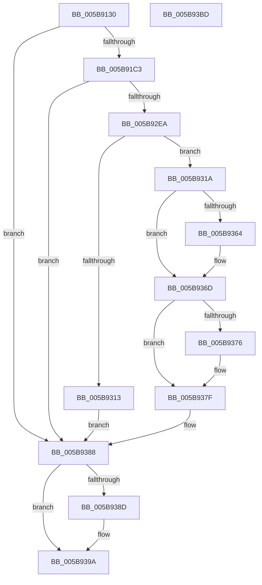

# KiAllocatePrcbThread

- RVA: `0x005B9130`–`0x005B93BE` (길이 `654` bytes)
- VA: `0x00000001405B9130`
- 실행 섹션: `.text`
- PDB 이름 있음: `예`; PDB Function 태그: `아니요`
- unwind 정보 RVA: `0x000CA05C`
- 디코드: `158`개 명령, `654/654` bytes 표시
- 미해석 바이트: `0` (있으면 어셈블리에 `.byte`로 보존)

> 이 문서는 커널 이미지의 기계어와 PDB 기호를 분석해 생성했습니다. 4번과 5번은 함수 원형과 자료형을 바이너리 사용 방식에서 추정한 C 해석이며 원본 소스 복구 결과는 아닙니다.

## 1. Dependencies

- 직접 호출 지점: **9**; 고유 호출 대상: **7**
- 직접 호출자로 확인된 함수: **3**
- RIP 상대 이미지 참조: **5**

### Outgoing calls
- `0x005B91B0` → [ObCreateObject](../../page/87/ObCreateObject_function_00872CB0.md) (function, `0x00872CB0`)
- `0x005B91CE` → [memset](../6C/memset_function_006C6C40.md) (function, `0x006C6C40`)
- `0x005B9215` → [memset](../6C/memset_function_006C6C40.md) (function, `0x006C6C40`)
- `0x005B923A` → [memset](../6C/memset_function_006C6C40.md) (function, `0x006C6C40`)
- `0x005B92DB` → [KeInitThread](../../pagelk/B7/KeInitThread_function_00B78450.md) (function, `0x00B78450`)
- `0x005B92FF` → [ExAllocatePool2](../../poolcode/B8/ExAllocatePool2_function_00B820F0.md) (function, `0x00B820F0`)
- `0x005B9339` → [RtlUnicodeStringCopy](../3D/RtlUnicodeStringCopy_function_003D4130.md) (function, `0x003D4130`)
- `0x005B934F` → [PsInitializeThreadRngState](../48/PsInitializeThreadRngState_function_0048975C.md) (function, `0x0048975C`)
- `0x005B9395` → [ObfDereferenceObjectWithTag](../2F/ObfDereferenceObjectWithTag_function_002F78E0.md) (function, `0x002F78E0`)

### Direct callers
- [KiAllocateDpcDelegateThread](KiAllocateDpcDelegateThread_function_005B697C.md) at `0x005B69B3`
- [KiAllocateSmtIsolationThread](../5C/KiAllocateSmtIsolationThread_function_005C3F88.md) at `0x005C3FBB`
- [KiAllocateIdleThread](../../pagelk/B6/KiAllocateIdleThread_function_00B6AB64.md) at `0x00B6ABA5`

### Static image references
- `0x005B9157` → RVA `0x00FC5014` (`ALMOSTRO`; read)
- `0x005B9170` → RVA `0x00FC6AC8` (`ALMOSTRO`; read)
- `0x005B92C3` → RVA `0x00FCFF00` (`CACHEALI`; read)
- `0x005B935B` → RVA `0x00FC6DC4` (`ALMOSTRO`; read)
- `0x005B936D` → RVA `0x00F0EFD0` (`.data`; read)

## 2. Other-region calls and transfers

- 다른 실행 섹션으로 향하는 call: **3**
  - `0x005B91B0` → [ObCreateObject](../../page/87/ObCreateObject_function_00872CB0.md) (`.text` → `PAGE`)
  - `0x005B92DB` → [KeInitThread](../../pagelk/B7/KeInitThread_function_00B78450.md) (`.text` → `PAGELK`)
  - `0x005B92FF` → [ExAllocatePool2](../../poolcode/B8/ExAllocatePool2_function_00B820F0.md) (`.text` → `POOLCODE`)
- 별도 외부 분기/꼬리 이동을 확인하지 못했습니다.

## 3. Assembly (complete function range)

```asm
005B9130  48 8B C4                        mov rax, rsp
005B9133  48 89 58 08                     mov qword ptr [rax + 8], rbx
005B9137  48 89 70 10                     mov qword ptr [rax + 0x10], rsi
005B913B  48 89 78 18                     mov qword ptr [rax + 0x18], rdi
005B913F  4C 89 48 20                     mov qword ptr [rax + 0x20], r9
005B9143  55                              push rbp
005B9144  41 54                           push r12
005B9146  41 55                           push r13
005B9148  41 56                           push r14
005B914A  41 57                           push r15
005B914C  48 8D 68 B9                     lea rbp, [rax - 0x47]
005B9150  48 81 EC A0 00 00 00            sub rsp, 0xa0
005B9157  44 0F B7 35 B5 BE A0 00         movzx r14d, word ptr [rip + 0xa0beb5]
005B915F  4C 8B F9                        mov r15, rcx
005B9162  48 8D 4D 67                     lea rcx, [rbp + 0x67]
005B9166  33 FF                           xor edi, edi
005B9168  48 89 4C 24 40                  mov qword ptr [rsp + 0x40], rcx
005B916D  48 8B F2                        mov rsi, rdx
005B9170  48 8B 15 51 D9 A0 00            mov rdx, qword ptr [rip + 0xa0d951]
005B9177  45 33 C9                        xor r9d, r9d
005B917A  C7 44 24 38 98 07 00 00         mov dword ptr [rsp + 0x38], 0x798
005B9182  46 8D 2C F5 00 00 00 00         lea r13d, [r14*8]
005B918A  89 7C 24 30                     mov dword ptr [rsp + 0x30], edi
005B918E  46 8D 24 6D A8 07 00 00         lea r12d, [r13*2 + 0x7a8]
005B9196  41 8D 84 24 20 02 00 00         lea eax, [r12 + 0x220]
005B919E  48 89 7D 67                     mov qword ptr [rbp + 0x67], rdi
005B91A2  89 44 24 28                     mov dword ptr [rsp + 0x28], eax
005B91A6  45 33 C0                        xor r8d, r8d
005B91A9  33 C9                           xor ecx, ecx
005B91AB  48 89 7C 24 20                  mov qword ptr [rsp + 0x20], rdi
005B91B0  E8 FB 9A 2B 00                  call 0x140872cb0
005B91B5  48 8B 7D 67                     mov rdi, qword ptr [rbp + 0x67]
005B91B9  8B D8                           mov ebx, eax
005B91BB  85 C0                           test eax, eax
005B91BD  0F 88 C5 01 00 00               js 0x1405b9388
005B91C3  33 D2                           xor edx, edx
005B91C5  41 B8 98 07 00 00               mov r8d, 0x798
005B91CB  48 8B CF                        mov rcx, rdi
005B91CE  E8 6D DA 10 00                  call 0x1406c6c40
005B91D3  48 8D 97 98 07 00 00            lea rdx, [rdi + 0x798]
005B91DA  41 8B DE                        mov ebx, r14d
005B91DD  48 89 97 40 02 00 00            mov qword ptr [rdi + 0x240], rdx
005B91E4  41 8D 8D A0 07 00 00            lea ecx, [r13 + 0x7a0]
005B91EB  48 03 CF                        add rcx, rdi
005B91EE  48 C1 E3 03                     shl rbx, 3
005B91F2  48 89 8F 28 02 00 00            mov qword ptr [rdi + 0x228], rcx
005B91F9  41 BD 01 00 00 00               mov r13d, 1
005B91FF  83 62 04 00                     and dword ptr [rdx + 4], 0
005B9203  48 8D 4A 08                     lea rcx, [rdx + 8]
005B9207  66 44 89 2A                     mov word ptr [rdx], r13w
005B920B  4C 8B C3                        mov r8, rbx
005B920E  66 44 89 72 02                  mov word ptr [rdx + 2], r14w
005B9213  33 D2                           xor edx, edx
005B9215  E8 26 DA 10 00                  call 0x1406c6c40
005B921A  48 8B 8F 28 02 00 00            mov rcx, qword ptr [rdi + 0x228]
005B9221  4C 8B C3                        mov r8, rbx
005B9224  33 D2                           xor edx, edx
005B9226  66 44 89 71 02                  mov word ptr [rcx + 2], r14w
005B922B  45 33 F6                        xor r14d, r14d
005B922E  44 89 71 04                     mov dword ptr [rcx + 4], r14d
005B9232  66 44 89 29                     mov word ptr [rcx], r13w
005B9236  48 83 C1 08                     add rcx, 8
005B923A  E8 01 DA 10 00                  call 0x1406c6c40
005B923F  0F 57 C0                        xorps xmm0, xmm0
005B9242  41 8B C4                        mov eax, r12d
005B9245  48 03 C7                        add rax, rdi
005B9248  4C 89 75 CF                     mov qword ptr [rbp - 0x31], r14
005B924C  48 8D 55 CF                     lea rdx, [rbp - 0x31]
005B9250  66 0F 7F 45 EF                  movdqa xmmword ptr [rbp - 0x11], xmm0
005B9255  48 8B CF                        mov rcx, rdi
005B9258  4C 89 75 0F                     mov qword ptr [rbp + 0xf], r14
005B925C  48 89 75 D7                     mov qword ptr [rbp - 0x29], rsi
005B9260  48 89 38                        mov qword ptr [rax], rdi
005B9263  C6 40 0C 06                     mov byte ptr [rax + 0xc], 6
005B9267  48 89 87 70 04 00 00            mov qword ptr [rdi + 0x470], rax
005B926E  48 8D 87 F0 05 00 00            lea rax, [rdi + 0x5f0]
005B9275  C7 87 04 04 00 00 20 00 00 00   mov dword ptr [rdi + 0x404], 0x20
005B927F  48 89 40 08                     mov qword ptr [rax + 8], rax
005B9283  48 89 00                        mov qword ptr [rax], rax
005B9286  48 8D 87 00 06 00 00            lea rax, [rdi + 0x600]
005B928D  48 89 40 08                     mov qword ptr [rax + 8], rax
005B9291  48 89 00                        mov qword ptr [rax], rax
005B9294  48 8D 87 B8 06 00 00            lea rax, [rdi + 0x6b8]
005B929B  4C 89 B7 10 06 00 00            mov qword ptr [rdi + 0x610], r14
005B92A2  48 89 40 08                     mov qword ptr [rax + 8], rax
005B92A6  48 89 00                        mov qword ptr [rax], rax
005B92A9  48 8D 87 D0 06 00 00            lea rax, [rdi + 0x6d0]
005B92B0  48 89 40 08                     mov qword ptr [rax + 8], rax
005B92B4  48 89 00                        mov qword ptr [rax], rax
005B92B7  8B 45 6F                        mov eax, dword ptr [rbp + 0x6f]
005B92BA  FF C0                           inc eax
005B92BC  4C 89 75 DF                     mov qword ptr [rbp - 0x21], r14
005B92C0  89 45 07                        mov dword ptr [rbp + 7], eax
005B92C3  48 8D 05 36 6C A1 00            lea rax, [rip + 0xa16c36]
005B92CA  48 89 45 FF                     mov qword ptr [rbp - 1], rax
005B92CE  8B 45 7F                        mov eax, dword ptr [rbp + 0x7f]
005B92D1  83 C8 02                        or eax, 2
005B92D4  4C 89 75 E7                     mov qword ptr [rbp - 0x19], r14
005B92D8  89 45 0B                        mov dword ptr [rbp + 0xb], eax
005B92DB  E8 70 F1 5B 00                  call 0x140b78450
005B92E0  8B D8                           mov ebx, eax
005B92E2  85 C0                           test eax, eax
005B92E4  0F 88 9E 00 00 00               js 0x1405b9388
005B92EA  48 8B 5D 77                     mov rbx, qword ptr [rbp + 0x77]
005B92EE  41 8D 4D 3F                     lea ecx, [r13 + 0x3f]
005B92F2  41 B8 54 68 4E 6D               mov r8d, 0x6d4e6854
005B92F8  0F B7 13                        movzx edx, word ptr [rbx]
005B92FB  48 83 C2 10                     add rdx, 0x10
005B92FF  E8 EC 8D 5C 00                  call 0x140b820f0
005B9304  48 89 87 A0 06 00 00            mov qword ptr [rdi + 0x6a0], rax
005B930B  48 8B C8                        mov rcx, rax
005B930E  48 85 C0                        test rax, rax
005B9311  75 07                           jne 0x1405b931a
005B9313  BB 17 00 00 C0                  mov ebx, 0xc0000017
005B9318  EB 6E                           jmp 0x1405b9388
005B931A  0F B7 03                        movzx eax, word ptr [rbx]
005B931D  0F 57 C0                        xorps xmm0, xmm0
005B9320  0F 11 01                        movups xmmword ptr [rcx], xmm0
005B9323  66 89 41 02                     mov word ptr [rcx + 2], ax
005B9327  48 8B D3                        mov rdx, rbx
005B932A  48 8D 41 10                     lea rax, [rcx + 0x10]
005B932E  48 89 41 08                     mov qword ptr [rcx + 8], rax
005B9332  48 8B 8F A0 06 00 00            mov rcx, qword ptr [rdi + 0x6a0]
005B9339  E8 F2 AD E1 FF                  call 0x1403d4130
005B933E  48 8B CF                        mov rcx, rdi
005B9341  48 89 B7 E0 04 00 00            mov qword ptr [rdi + 0x4e0], rsi
005B9348  48 89 B7 60 05 00 00            mov qword ptr [rdi + 0x560], rsi
005B934F  E8 08 04 ED FF                  call 0x14048975c
005B9354  C6 87 27 07 00 00 FF            mov byte ptr [rdi + 0x727], 0xff
005B935B  44 39 35 62 DA A0 00            cmp dword ptr [rip + 0xa0da62], r14d
005B9362  74 09                           je 0x1405b936d
005B9364  F0 0F BA 2F 16                  lock bts dword ptr [rdi], 0x16
005B9369  48 8B 7D 67                     mov rdi, qword ptr [rbp + 0x67]
005B936D  44 38 35 5C 5C 95 00            cmp byte ptr [rip + 0x955c5c], r14b
005B9374  74 09                           je 0x1405b937f
005B9376  F0 0F BA 2F 15                  lock bts dword ptr [rdi], 0x15
005B937B  48 8B 7D 67                     mov rdi, qword ptr [rbp + 0x67]
005B937F  49 89 3F                        mov qword ptr [r15], rdi
005B9382  41 8B DE                        mov ebx, r14d
005B9385  49 8B FE                        mov rdi, r14
005B9388  48 85 FF                        test rdi, rdi
005B938B  74 0D                           je 0x1405b939a
005B938D  BA 44 66 6C 74                  mov edx, 0x746c6644
005B9392  48 8B CF                        mov rcx, rdi
005B9395  E8 46 E5 D3 FF                  call 0x1402f78e0
005B939A  4C 8D 9C 24 A0 00 00 00         lea r11, [rsp + 0xa0]
005B93A2  8B C3                           mov eax, ebx
005B93A4  49 8B 5B 30                     mov rbx, qword ptr [r11 + 0x30]
005B93A8  49 8B 73 38                     mov rsi, qword ptr [r11 + 0x38]
005B93AC  49 8B 7B 40                     mov rdi, qword ptr [r11 + 0x40]
005B93B0  49 8B E3                        mov rsp, r11
005B93B3  41 5F                           pop r15
005B93B5  41 5E                           pop r14
005B93B7  41 5D                           pop r13
005B93B9  41 5C                           pop r12
005B93BB  5D                              pop rbp
005B93BC  C3                              ret
005B93BD  CC                              int3
```

## 4. C-style interpretation (structured pseudocode)

```c
__int64 __fastcall KiAllocatePrcbThread(__int64 a1, __int64 a2, int a3, __int64 a4)
{
    __int64 result;
    __int64 v_r14;
    __int64 v_rbx;
    __int64 v_rdi;
    __int64 v_rsp;
    unsigned __int64 v_stack_m28;
    unsigned __int64 v_stack_m88;
    unsigned int v_stack_m90;
    unsigned int v_stack_m98;
    unsigned int v_stack_mA0;
    unsigned __int64 v_stack_mA8;

    *(unsigned __int64 *)(v_rsp + 8) = v_rbx;
    *(unsigned __int64 *)(v_rsp + 16) = v_rsi;
    *(unsigned __int64 *)(v_rsp + 24) = v_rdi;
    *(unsigned __int64 *)(v_rsp + 32) = a4;
    v_rsp = (v_rsp) - (160);
    v_rdi = 0;
    v_stack_m88 = v_rsp - 71 + 103;
    a4 = 0;
    v_stack_m90 = 0x798ULL;
    v_stack_m98 = 0;
    *(unsigned __int64 *)(v_rsp - 71 + 103) = 0;
    v_stack_mA0 = (unsigned int)(*(unsigned __int16 *)(v_rip + 10534581) * 8 * 2 + 1960 + 544);
    a3 = 0;
    a1 = 0;
    v_stack_mA8 = 0;
    result = ObCreateObject(a1, *(unsigned __int64 *)(v_rip + 10541393), a3, a4);
    if (sign_flag) goto loc_005B9388;
    a2 = 0;
    result = memset(*(unsigned __int64 *)(v_rsp - 71 + 103), a2, (unsigned int)(0x798ULL), a4);
    *(unsigned __int64 *)(*(unsigned __int64 *)(v_rsp - 71 + 103) + 576) = *(unsigned __int64 *)(v_rsp - 71 + 103) + 1944;
    a1 = (*(unsigned __int16 *)(v_rip + 10534581) * 8 + 1952) + (*(unsigned __int64 *)(v_rsp - 71 + 103));
    v_rbx = ((unsigned int)((unsigned int)(*(unsigned __int16 *)(v_rip + 10534581)))) << (3);
    *(unsigned __int64 *)(*(unsigned __int64 *)(v_rsp - 71 + 103) + 552) = a1;
    *(unsigned __int16 *)(*(unsigned __int64 *)(v_rsp - 71 + 103) + 1944) = 1;
    *(unsigned __int16 *)(*(unsigned __int64 *)(v_rsp - 71 + 103) + 1944 + 2) = (unsigned __int16)(*(unsigned __int16 *)(v_rip + 10534581));
    a2 = 0;
    result = memset(*(unsigned __int64 *)(v_rsp - 71 + 103) + 1944 + 8, a2, v_rbx, a4);
    a2 = 0;
    *(unsigned __int16 *)(*(unsigned __int64 *)(*(unsigned __int64 *)(v_rsp - 71 + 103) + 552) + 2) = (unsigned __int16)(*(unsigned __int16 *)(v_rip + 10534581));
    v_r14 = 0;
    *(unsigned int *)(*(unsigned __int64 *)(*(unsigned __int64 *)(v_rsp - 71 + 103) + 552) + 4) = 0;
    *(unsigned __int16 *)(*(unsigned __int64 *)(*(unsigned __int64 *)(v_rsp - 71 + 103) + 552)) = 1;
    a1 = (*(unsigned __int64 *)(*(unsigned __int64 *)(v_rsp - 71 + 103) + 552)) + (8);
    result = memset(a1, a2, v_rbx, a4);
    result = ((unsigned int)((unsigned int)(*(unsigned __int16 *)(v_rip + 10534581) * 8 * 2 + 1960))) + (*(unsigned __int64 *)(v_rsp - 71 + 103));
    *(unsigned __int64 *)(v_rsp - 71 - 49) = 0;
    *(unsigned __int64 *)(v_rsp - 71 - 17) = v_xmm0;
    *(unsigned __int64 *)(v_rsp - 71 + 15) = 0;
    *(unsigned __int64 *)(v_rsp - 71 - 41) = 0;
    *(unsigned __int64 *)(result) = *(unsigned __int64 *)(v_rsp - 71 + 103);
    *(unsigned __int8 *)(result + 12) = 6;
    *(unsigned __int64 *)(*(unsigned __int64 *)(v_rsp - 71 + 103) + 1136) = result;
    *(unsigned int *)(*(unsigned __int64 *)(v_rsp - 71 + 103) + 1028) = 32;
    *(unsigned __int64 *)(*(unsigned __int64 *)(v_rsp - 71 + 103) + 1520 + 8) = *(unsigned __int64 *)(v_rsp - 71 + 103) + 1520;
    *(unsigned __int64 *)(*(unsigned __int64 *)(v_rsp - 71 + 103) + 1520) = *(unsigned __int64 *)(v_rsp - 71 + 103) + 1520;
    *(unsigned __int64 *)(*(unsigned __int64 *)(v_rsp - 71 + 103) + 1536 + 8) = *(unsigned __int64 *)(v_rsp - 71 + 103) + 1536;
    *(unsigned __int64 *)(*(unsigned __int64 *)(v_rsp - 71 + 103) + 1536) = *(unsigned __int64 *)(v_rsp - 71 + 103) + 1536;
    *(unsigned __int64 *)(*(unsigned __int64 *)(v_rsp - 71 + 103) + 1552) = 0;
    *(unsigned __int64 *)(*(unsigned __int64 *)(v_rsp - 71 + 103) + 1720 + 8) = *(unsigned __int64 *)(v_rsp - 71 + 103) + 1720;
    *(unsigned __int64 *)(*(unsigned __int64 *)(v_rsp - 71 + 103) + 1720) = *(unsigned __int64 *)(v_rsp - 71 + 103) + 1720;
    *(unsigned __int64 *)(*(unsigned __int64 *)(v_rsp - 71 + 103) + 1744 + 8) = *(unsigned __int64 *)(v_rsp - 71 + 103) + 1744;
    *(unsigned __int64 *)(*(unsigned __int64 *)(v_rsp - 71 + 103) + 1744) = *(unsigned __int64 *)(v_rsp - 71 + 103) + 1744;
    result = (unsigned int)(((unsigned int)(*(unsigned int *)(v_rsp - 71 + 111))) + 1);
    *(unsigned __int64 *)(v_rsp - 71 - 33) = 0;
    *(unsigned int *)(v_rsp - 71 + 7) = (unsigned int)(result);
    *(unsigned __int64 *)(v_rsp - 71 - 1) = v_rip + 10578998;
    result = (unsigned int)(((unsigned int)(*(unsigned int *)(v_rsp - 71 + 127))) | (2));
    *(unsigned __int64 *)(v_rsp - 71 - 25) = 0;
    *(unsigned int *)(v_rsp - 71 + 11) = (unsigned int)(result);
    result = KeInitThread(*(unsigned __int64 *)(v_rsp - 71 + 103), v_rsp - 71 - 49, v_rbx, a4);
    if (sign_flag) goto loc_005B9388;
    a2 = (*(unsigned __int16 *)(*(unsigned __int64 *)(v_rsp - 71 + 119))) + (16);
    result = ExAllocatePool2(1 + 63, a2, (unsigned int)(0x6D4E6854ULL), a4);
    *(unsigned __int64 *)(*(unsigned __int64 *)(v_rsp - 71 + 103) + 1696) = result;
    if (result != 0) goto loc_005B931A;
    goto loc_005B9388;
loc_005B931A:
    *(unsigned __int64 *)(result) = v_xmm0;
    *(unsigned __int16 *)(result + 2) = (unsigned __int16)(*(unsigned __int16 *)((unsigned int)(0xC0000017ULL)));
    *(unsigned __int64 *)(result + 8) = result + 16;
    result = RtlUnicodeStringCopy(*(unsigned __int64 *)(*(unsigned __int64 *)(v_rsp - 71 + 103) + 1696), (unsigned int)(0xC0000017ULL), (unsigned int)(0x6D4E6854ULL), a4);
    *(unsigned __int64 *)(*(unsigned __int64 *)(v_rsp - 71 + 103) + 1248) = a2;
    *(unsigned __int64 *)(*(unsigned __int64 *)(v_rsp - 71 + 103) + 1376) = a2;
    result = PsInitializeThreadRngState(*(unsigned __int64 *)(v_rsp - 71 + 103), (unsigned int)(0xC0000017ULL), (unsigned int)(0x6D4E6854ULL), a4);
    *(unsigned __int8 *)(*(unsigned __int64 *)(v_rsp - 71 + 103) + 1831) = 255;
    v_rdi = *(unsigned __int64 *)(v_rsp - 71 + 103);
    if ((*(unsigned int *)(v_rip + 10541666)) != 0) {
        v_rdi = *(unsigned __int64 *)(v_rsp - 71 + 103);
    }
    if ((*(unsigned __int8 *)(v_rip + 9788508)) != 0) {
        v_rdi = *(unsigned __int64 *)(v_rsp - 71 + 103);
    }
    *(unsigned __int64 *)(a1) = v_rdi;
loc_005B9388:
    if (0 != 0) {
        a2 = 0x746C6644ULL;
        a1 = 0;
        result = ObfDereferenceObjectWithTag(a1, a2, (unsigned int)(0x6D4E6854ULL), a4);
    }
    return 0;
}
```

## 5. (Beta) C Style

```c
int64_t KiAllocatePrcbThread(void *Arg1, int64_t Arg2, int32_t Arg3, int64_t Arg4)
{
    uint8_t *arg1 = (uint8_t *)Arg1;

    int64_t result;
    int64_t local_r14;
    int64_t local_rbx;
    int64_t local_rdi;
    int64_t local_rsp;
    uint64_t v_stack_m28;
    uint64_t v_stack_m88;
    uint32_t v_stack_m90;
    uint32_t v_stack_m98;
    uint32_t v_stack_mA0;
    uint64_t v_stack_mA8;

    *(uint64_t *)(local_rsp + 0x8) = local_rbx;
    *(uint64_t *)(local_rsp + 0x10) = local_rsi;
    *(uint64_t *)(local_rsp + 0x18) = local_rdi;
    *(uint64_t *)(local_rsp + 0x20) = Arg4;
    local_rsp = (local_rsp) - (160);
    local_rdi = 0;
    v_stack_m88 = local_rsp - 71 + 103;
    Arg4 = 0;
    v_stack_m90 = 0x798ULL;
    v_stack_m98 = 0;
    *(uint64_t *)(local_rsp - 0x47 + 0x67) = 0;
    v_stack_mA0 = (uint32_t)(*(uint16_t *)(v_rip + 0xA0BEB5) * 8 * 2 + 1960 + 544);
    Arg3 = 0;
    Arg1 = 0;
    v_stack_mA8 = 0;
    result = ObCreateObject(Arg1, *(uint64_t *)(v_rip + 0xA0D951), Arg3, Arg4);
    if (sign_flag) goto loc_005B9388;
    Arg2 = 0;
    result = memset(*(uint64_t *)(local_rsp - 0x47 + 0x67), Arg2, (uint32_t)(0x798ULL), Arg4);
    *(uint64_t *)(*(uint64_t *)(local_rsp - 0x47 + 0x67) + 0x240) = *(uint64_t *)(local_rsp - 0x47 + 0x67) + 1944;
    Arg1 = (*(uint16_t *)(v_rip + 0xA0BEB5) * 8 + 1952) + (*(uint64_t *)(local_rsp - 0x47 + 0x67));
    local_rbx = ((uint32_t)((uint32_t)(*(uint16_t *)(v_rip + 0xA0BEB5)))) << (3);
    *(void **)(*(uint64_t *)(local_rsp - 0x47 + 0x67) + 0x228) = Arg1;
    *(uint16_t *)(*(uint64_t *)(local_rsp - 0x47 + 0x67) + 0x798) = 1;
    *(uint16_t *)(*(uint64_t *)(local_rsp - 0x47 + 0x67) + 0x798 + 0x2) = (uint16_t)(*(uint16_t *)(v_rip + 0xA0BEB5));
    Arg2 = 0;
    result = memset(*(uint64_t *)(local_rsp - 0x47 + 0x67) + 1944 + 8, Arg2, local_rbx, Arg4);
    Arg2 = 0;
    *(uint16_t *)(*(uint64_t *)(*(uint64_t *)(local_rsp - 0x47 + 0x67) + 0x228) + 0x2) = (uint16_t)(*(uint16_t *)(v_rip + 0xA0BEB5));
    local_r14 = 0;
    *(uint32_t *)(*(uint64_t *)(*(uint64_t *)(local_rsp - 0x47 + 0x67) + 0x228) + 0x4) = 0;
    *(uint16_t *)(*(uint64_t *)(*(uint64_t *)(local_rsp - 0x47 + 0x67) + 0x228)) = 1;
    Arg1 = (*(uint64_t *)(*(uint64_t *)(local_rsp - 0x47 + 0x67) + 0x228)) + (8);
    result = memset(Arg1, Arg2, local_rbx, Arg4);
    result = ((uint32_t)((uint32_t)(*(uint16_t *)(v_rip + 0xA0BEB5) * 8 * 2 + 1960))) + (*(uint64_t *)(local_rsp - 0x47 + 0x67));
    *(uint64_t *)(local_rsp - 0x47 - 0x31) = 0;
    *(uint64_t *)(local_rsp - 0x47 - 0x11) = v_xmm0;
    *(uint64_t *)(local_rsp - 0x47 + 0xF) = 0;
    *(uint64_t *)(local_rsp - 0x47 - 0x29) = 0;
    *(uint64_t *)(result) = *(uint64_t *)(local_rsp - 0x47 + 0x67);
    *(uint8_t *)(result + 0xC) = 6;
    *(uint64_t *)(*(uint64_t *)(local_rsp - 0x47 + 0x67) + 0x470) = result;
    *(uint32_t *)(*(uint64_t *)(local_rsp - 0x47 + 0x67) + 0x404) = 32;
    *(uint64_t *)(*(uint64_t *)(local_rsp - 0x47 + 0x67) + 0x5F0 + 0x8) = *(uint64_t *)(local_rsp - 0x47 + 0x67) + 1520;
    *(uint64_t *)(*(uint64_t *)(local_rsp - 0x47 + 0x67) + 0x5F0) = *(uint64_t *)(local_rsp - 0x47 + 0x67) + 1520;
    *(uint64_t *)(*(uint64_t *)(local_rsp - 0x47 + 0x67) + 0x600 + 0x8) = *(uint64_t *)(local_rsp - 0x47 + 0x67) + 1536;
    *(uint64_t *)(*(uint64_t *)(local_rsp - 0x47 + 0x67) + 0x600) = *(uint64_t *)(local_rsp - 0x47 + 0x67) + 1536;
    *(uint64_t *)(*(uint64_t *)(local_rsp - 0x47 + 0x67) + 0x610) = 0;
    *(uint64_t *)(*(uint64_t *)(local_rsp - 0x47 + 0x67) + 0x6B8 + 0x8) = *(uint64_t *)(local_rsp - 0x47 + 0x67) + 1720;
    *(uint64_t *)(*(uint64_t *)(local_rsp - 0x47 + 0x67) + 0x6B8) = *(uint64_t *)(local_rsp - 0x47 + 0x67) + 1720;
    *(uint64_t *)(*(uint64_t *)(local_rsp - 0x47 + 0x67) + 0x6D0 + 0x8) = *(uint64_t *)(local_rsp - 0x47 + 0x67) + 1744;
    *(uint64_t *)(*(uint64_t *)(local_rsp - 0x47 + 0x67) + 0x6D0) = *(uint64_t *)(local_rsp - 0x47 + 0x67) + 1744;
    result = (uint32_t)(((uint32_t)(*(uint32_t *)(local_rsp - 0x47 + 0x6F))) + 1);
    *(uint64_t *)(local_rsp - 0x47 - 0x21) = 0;
    *(uint32_t *)(local_rsp - 0x47 + 0x7) = (uint32_t)(result);
    *(uint64_t *)(local_rsp - 0x47 - 0x1) = v_rip + 10578998;
    result = (uint32_t)(((uint32_t)(*(uint32_t *)(local_rsp - 0x47 + 0x7F))) | (2));
    *(uint64_t *)(local_rsp - 0x47 - 0x19) = 0;
    *(uint32_t *)(local_rsp - 0x47 + 0xB) = (uint32_t)(result);
    result = KeInitThread(*(uint64_t *)(local_rsp - 0x47 + 0x67), local_rsp - 71 - 49, local_rbx, Arg4);
    if (sign_flag) goto loc_005B9388;
    Arg2 = (*(uint16_t *)(*(uint64_t *)(local_rsp - 0x47 + 0x77))) + (16);
    result = ExAllocatePool2(1 + 63, Arg2, (uint32_t)(0x6D4E6854ULL), Arg4);
    *(uint64_t *)(*(uint64_t *)(local_rsp - 0x47 + 0x67) + 0x6A0) = result;
    if (result != 0) goto loc_005B931A;
    goto loc_005B9388;
loc_005B931A:
    *(uint64_t *)(result) = v_xmm0;
    *(uint16_t *)(result + 0x2) = (uint16_t)(*(uint16_t *)((uint32_t)(0xC0000017ULL)));
    *(uint64_t *)(result + 0x8) = result + 16;
    result = RtlUnicodeStringCopy(*(uint64_t *)(*(uint64_t *)(local_rsp - 0x47 + 0x67) + 0x6A0), (uint32_t)(0xC0000017ULL), (uint32_t)(0x6D4E6854ULL), Arg4);
    *(uint64_t *)(*(uint64_t *)(local_rsp - 0x47 + 0x67) + 0x4E0) = Arg2;
    *(uint64_t *)(*(uint64_t *)(local_rsp - 0x47 + 0x67) + 0x560) = Arg2;
    result = PsInitializeThreadRngState(*(uint64_t *)(local_rsp - 0x47 + 0x67), (uint32_t)(0xC0000017ULL), (uint32_t)(0x6D4E6854ULL), Arg4);
    *(uint8_t *)(*(uint64_t *)(local_rsp - 0x47 + 0x67) + 0x727) = 255;
    local_rdi = *(uint64_t *)(local_rsp - 0x47 + 0x67);
    if ((*(uint32_t *)(v_rip + 0xA0DA62)) != 0) {
        local_rdi = *(uint64_t *)(local_rsp - 0x47 + 0x67);
    }
    if ((*(uint8_t *)(v_rip + 0x955C5C)) != 0) {
        local_rdi = *(uint64_t *)(local_rsp - 0x47 + 0x67);
    }
    *(uint64_t *)(arg1) = local_rdi;
loc_005B9388:
    if (0 != 0) {
        Arg2 = 0x746C6644ULL;
        Arg1 = 0;
        result = ObfDereferenceObjectWithTag(Arg1, Arg2, (uint32_t)(0x6D4E6854ULL), Arg4);
    }
    return 0;
}
```

### 관측된 메모리 오프셋

구조체 형식이 확인되지 않은 접근은 인자 기준의 오프셋으로만 기록했습니다.

| 기준 인자 | 오프셋 표현 | 폭 (bit) | 접근 |
|---|---:|---:|---|
| `Arg1` | `+ 0x0` | `64` | `W` |

## 6. Execution-region graph

[열기: 2D/3D 그래프와 함수 탐색 컨트롤 패널](../../../control-panel.html?section=text&rva=0x005B9130&view=graph)

- 2D 그래프는 위에서 아래로 흐르고, 3D 그래프는 빈 공간을 드래그해 회전합니다. Shift+드래그는 이동, 휠은 확대·축소, 함수 노드 선택은 대상 보고서 이동입니다.

### Static fallback


