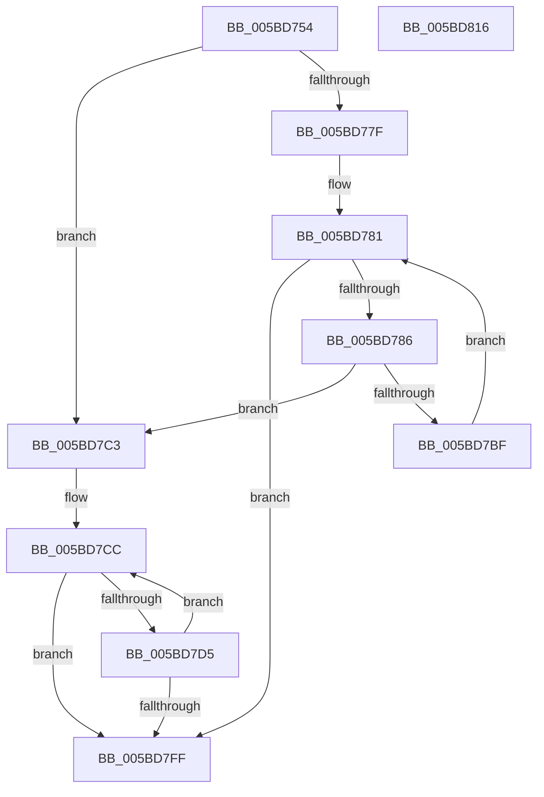

# KiAllocateProcessorHiberSwapShadowStacks

- RVA: `0x005BD754`–`0x005BD817` (길이 `195` bytes)
- VA: `0x00000001405BD754`
- 실행 섹션: `.text`
- PDB 이름 있음: `예`; PDB Function 태그: `아니요`
- unwind 정보 RVA: `0x00066400`
- 디코드: `56`개 명령, `195/195` bytes 표시
- 미해석 바이트: `0` (있으면 어셈블리에 `.byte`로 보존)

> 이 문서는 커널 이미지의 기계어와 PDB 기호를 분석해 생성했습니다. 4번과 5번은 함수 원형과 자료형을 바이너리 사용 방식에서 추정한 C 해석이며 원본 소스 복구 결과는 아닙니다.

## 1. Dependencies

- 직접 호출 지점: **2**; 고유 호출 대상: **2**
- 직접 호출자로 확인된 함수: **2**
- RIP 상대 이미지 참조: **0**

### Outgoing calls
- `0x005BD7B4` → [KiCreateKernelShadowStack](../../page/A1/KiCreateKernelShadowStack_function_00A1DD60.md) (function, `0x00A1DD60`)
- `0x005BD7E6` → [KiDeleteKernelShadowStack](../../page/A2/KiDeleteKernelShadowStack_function_00A25DC8.md) (function, `0x00A25DC8`)

### Direct callers
- [KeAllocateKernelHiberSwapShadowStacks](KeAllocateKernelHiberSwapShadowStacks_function_005BD658.md) at `0x005BD6DD`
- [KeAllocateKernelHiberSwapShadowStacks](KeAllocateKernelHiberSwapShadowStacks_function_005BD658.md) at `0x005BD71B`
- [KiStartDynamicProcessor](../../page/74/KiStartDynamicProcessor_function_007456C8.md) at `0x00745A33`
- [KiStartDynamicProcessor](../../page/74/KiStartDynamicProcessor_function_007456C8.md) at `0x00745C6E`

### Static image references
- 디코드된 RIP-relative 메모리 참조가 없습니다.

## 2. Other-region calls and transfers

- 다른 실행 섹션으로 향하는 call: **2**
  - `0x005BD7B4` → [KiCreateKernelShadowStack](../../page/A1/KiCreateKernelShadowStack_function_00A1DD60.md) (`.text` → `PAGE`)
  - `0x005BD7E6` → [KiDeleteKernelShadowStack](../../page/A2/KiDeleteKernelShadowStack_function_00A25DC8.md) (`.text` → `PAGE`)
- 별도 외부 분기/꼬리 이동을 확인하지 못했습니다.

## 3. Assembly (complete function range)

```asm
005BD754  48 89 5C 24 08                  mov qword ptr [rsp + 8], rbx
005BD759  48 89 6C 24 10                  mov qword ptr [rsp + 0x10], rbp
005BD75E  48 89 74 24 18                  mov qword ptr [rsp + 0x18], rsi
005BD763  57                              push rdi
005BD764  48 83 EC 30                     sub rsp, 0x30
005BD768  48 8B 81 C0 00 00 00            mov rax, qword ptr [rcx + 0xc0]
005BD76F  33 ED                           xor ebp, ebp
005BD771  48 8B F9                        mov rdi, rcx
005BD774  0F B7 B0 8A 00 00 00            movzx esi, word ptr [rax + 0x8a]
005BD77B  85 D2                           test edx, edx
005BD77D  74 44                           je 0x1405bd7c3
005BD77F  33 DB                           xor ebx, ebx
005BD781  83 FB 04                        cmp ebx, 4
005BD784  77 79                           ja 0x1405bd7ff
005BD786  45 33 C0                        xor r8d, r8d
005BD789  8B CB                           mov ecx, ebx
005BD78B  48 81 C1 7C 13 00 00            add rcx, 0x137c
005BD792  48 8D 87 B8 9B 00 00            lea rax, [rdi + 0x9bb8]
005BD799  48 8D 04 D8                     lea rax, [rax + rbx*8]
005BD79D  44 8B CE                        mov r9d, esi
005BD7A0  48 89 44 24 28                  mov qword ptr [rsp + 0x28], rax
005BD7A5  41 8D 50 02                     lea edx, [r8 + 2]
005BD7A9  48 8D 0C CF                     lea rcx, [rdi + rcx*8]
005BD7AD  48 89 4C 24 20                  mov qword ptr [rsp + 0x20], rcx
005BD7B2  33 C9                           xor ecx, ecx
005BD7B4  E8 A7 05 46 00                  call 0x140a1dd60
005BD7B9  8B E8                           mov ebp, eax
005BD7BB  85 C0                           test eax, eax
005BD7BD  78 04                           js 0x1405bd7c3
005BD7BF  FF C3                           inc ebx
005BD7C1  EB BE                           jmp 0x1405bd781
005BD7C3  33 F6                           xor esi, esi
005BD7C5  48 8D 9F B8 9B 00 00            lea rbx, [rdi + 0x9bb8]
005BD7CC  48 8B 53 28                     mov rdx, qword ptr [rbx + 0x28]
005BD7D0  48 85 D2                        test rdx, rdx
005BD7D3  74 2A                           je 0x1405bd7ff
005BD7D5  48 8B 03                        mov rax, qword ptr [rbx]
005BD7D8  45 33 C9                        xor r9d, r9d
005BD7DB  33 C9                           xor ecx, ecx
005BD7DD  48 89 44 24 20                  mov qword ptr [rsp + 0x20], rax
005BD7E2  45 8D 41 02                     lea r8d, [r9 + 2]
005BD7E6  E8 DD 85 46 00                  call 0x140a25dc8
005BD7EB  48 83 63 28 00                  and qword ptr [rbx + 0x28], 0
005BD7F0  FF C6                           inc esi
005BD7F2  48 83 23 00                     and qword ptr [rbx], 0
005BD7F6  48 83 C3 08                     add rbx, 8
005BD7FA  83 FE 04                        cmp esi, 4
005BD7FD  76 CD                           jbe 0x1405bd7cc
005BD7FF  48 8B 5C 24 40                  mov rbx, qword ptr [rsp + 0x40]
005BD804  8B C5                           mov eax, ebp
005BD806  48 8B 6C 24 48                  mov rbp, qword ptr [rsp + 0x48]
005BD80B  48 8B 74 24 50                  mov rsi, qword ptr [rsp + 0x50]
005BD810  48 83 C4 30                     add rsp, 0x30
005BD814  5F                              pop rdi
005BD815  C3                              ret
005BD816  CC                              int3
```

## 4. C-style interpretation (structured pseudocode)

```c
__int64 __fastcall KiAllocateProcessorHiberSwapShadowStacks(__int64 a1, int a2, int a3)
{
    __int64 result;
    __int64 v_rbp;
    __int64 v_rbx;
    __int64 v_rsi;
    __int64 v_rsp;
    unsigned __int64 v_stack_m10;
    unsigned __int64 v_stack_m18;
    unsigned __int64 v_stack_p10;
    unsigned __int64 v_stack_p18;
    unsigned __int64 v_stack_p8;

    v_stack_p8 = v_rbx;
    v_stack_p10 = v_rbp;
    v_stack_p18 = v_rsi;
    v_rsp = (v_rsp) - (48);
    v_rbp = 0;
    if (a2 == 0) goto loc_005BD7C3;
    v_rbx = 0;
loc_005BD781:
    if (0 > 4) goto loc_005BD7FF;
    a3 = 0;
    a1 = (0) + (0x137CULL);
    v_stack_m10 = a1 + 39864 + v_rbx * 8;
    v_stack_m18 = a1 + a1 * 8;
    a1 = 0;
    result = KiCreateKernelShadowStack(a1, a3 + 2, a3, (unsigned int)((unsigned int)(*(unsigned __int16 *)(*(unsigned __int64 *)(a1 + 192) + 138))));
    if (sign_flag) goto loc_005BD7C3;
    v_rbx = (unsigned int)((v_rbx) + 1);
    goto loc_005BD781;
loc_005BD7C3:
    v_rsi = 0;
loc_005BD7CC:
    if (*(unsigned __int64 *)(a1 + 39864 + 40) == 0) goto loc_005BD7FF;
    a4 = 0;
    a1 = 0;
    v_stack_m18 = *(unsigned __int64 *)(a1 + 39864);
    result = KiDeleteKernelShadowStack(a1, *(unsigned __int64 *)(a1 + 39864 + 40), a4 + 2, a4);
    v_rsi = (unsigned int)((v_rsi) + 1);
    v_rbx = (a1 + 39864) + (8);
    if (((unsigned int)(v_rsi)) <= 4) goto loc_005BD7CC;
loc_005BD7FF:
    v_rsp = (v_rsp) + (48);
    return (unsigned int)((unsigned int)((unsigned int)((unsigned int)(result))));
}
```

## 5. (Beta) C Style

```c
int64_t KiAllocateProcessorHiberSwapShadowStacks(void *Arg1, int32_t Arg2, int32_t Arg3)
{
    uint8_t *arg1 = (uint8_t *)Arg1;

    int64_t result;
    int64_t local_rbp;
    int64_t local_rbx;
    int64_t local_rsi;
    int64_t local_rsp;
    uint64_t v_stack_m10;
    uint64_t v_stack_m18;
    uint64_t v_stack_p10;
    uint64_t v_stack_p18;
    uint64_t v_stack_p8;

    v_stack_p8 = local_rbx;
    v_stack_p10 = local_rbp;
    v_stack_p18 = local_rsi;
    local_rsp = (local_rsp) - (48);
    local_rbp = 0;
    if (Arg2 == 0) goto loc_005BD7C3;
    local_rbx = 0;
loc_005BD781:
    if (0 > 4) goto loc_005BD7FF;
    Arg3 = 0;
    Arg1 = (0) + (0x137CULL);
    v_stack_m10 = Arg1 + 39864 + local_rbx * 8;
    v_stack_m18 = Arg1 + Arg1 * 8;
    Arg1 = 0;
    result = KiCreateKernelShadowStack(Arg1, Arg3 + 2, Arg3, (uint32_t)((uint32_t)(*(uint16_t *)(*(uint64_t *)(arg1 + 0xC0) + 0x8A))));
    if (sign_flag) goto loc_005BD7C3;
    local_rbx = (uint32_t)((local_rbx) + 1);
    goto loc_005BD781;
loc_005BD7C3:
    local_rsi = 0;
loc_005BD7CC:
    if (*(uint64_t *)(arg1 + 0x9BB8 + 0x28) == 0) goto loc_005BD7FF;
    a4 = 0;
    Arg1 = 0;
    v_stack_m18 = *(uint64_t *)(arg1 + 0x9BB8);
    result = KiDeleteKernelShadowStack(Arg1, *(uint64_t *)(arg1 + 0x9BB8 + 0x28), a4 + 2, a4);
    local_rsi = (uint32_t)((local_rsi) + 1);
    local_rbx = (Arg1 + 39864) + (8);
    if (((uint32_t)(local_rsi)) <= 4) goto loc_005BD7CC;
loc_005BD7FF:
    local_rsp = (local_rsp) + (48);
    return (uint32_t)((uint32_t)((uint32_t)((uint32_t)(result))));
}
```

### 관측된 메모리 오프셋

구조체 형식이 확인되지 않은 접근은 인자 기준의 오프셋으로만 기록했습니다.

| 기준 인자 | 오프셋 표현 | 폭 (bit) | 접근 |
|---|---:|---:|---|
| `Arg1` | `+ 0x0` | `64` | `R` |
| `Arg1` | `+ 0x0` | `64` | `R/W` |
| `Arg1` | `+ 0x0 + rbx*8` | `64` | `R` |
| `Arg1` | `+ 0x0 + rcx*8` | `64` | `R` |
| `Arg1` | `+ 0x28` | `64` | `R` |
| `Arg1` | `+ 0x28` | `64` | `R/W` |
| `Arg1` | `+ 0xC0` | `64` | `R` |
| `Arg1` | `+ 0x9BB8` | `64` | `R` |

## 6. Execution-region graph

[열기: 2D/3D 그래프와 함수 탐색 컨트롤 패널](../../../control-panel.html?section=text&rva=0x005BD754&view=graph)

- 2D 그래프는 위에서 아래로 흐르고, 3D 그래프는 빈 공간을 드래그해 회전합니다. Shift+드래그는 이동, 휠은 확대·축소, 함수 노드 선택은 대상 보고서 이동입니다.

### Static fallback


