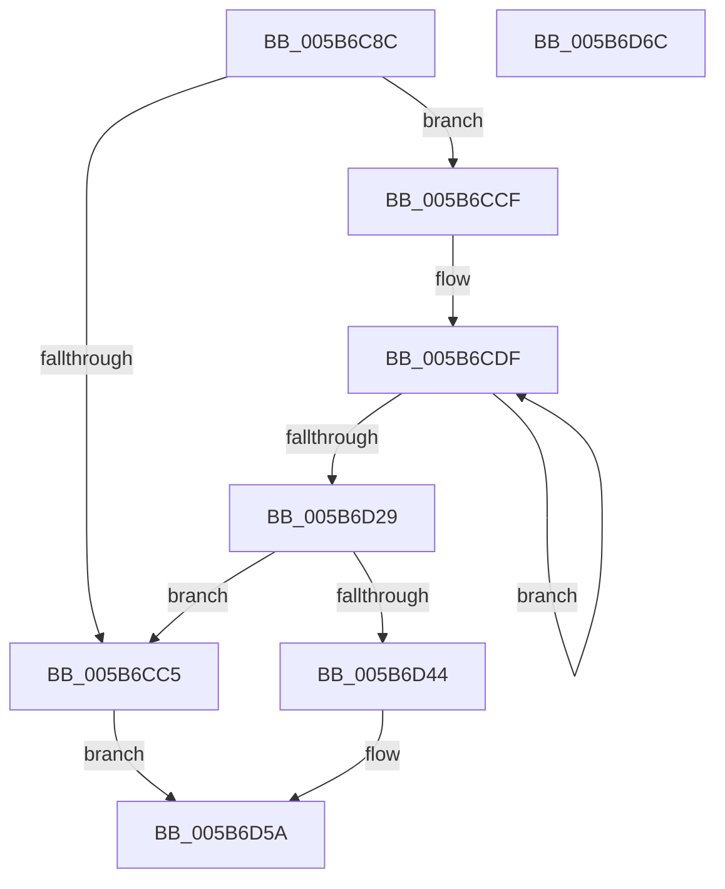

# KiAllocateProcessorLookupStructures

- RVA: `0x005B6C8C`–`0x005B6D6D` (길이 `225` bytes)
- VA: `0x00000001405B6C8C`
- 실행 섹션: `.text`
- PDB 이름 있음: `예`; PDB Function 태그: `아니요`
- unwind 정보 RVA: `0x00060BC4`
- 디코드: `58`개 명령, `225/225` bytes 표시
- 미해석 바이트: `0` (있으면 어셈블리에 `.byte`로 보존)

> 이 문서는 커널 이미지의 기계어와 PDB 기호를 분석해 생성했습니다. 4번과 5번은 함수 원형과 자료형을 바이너리 사용 방식에서 추정한 C 해석이며 원본 소스 복구 결과는 아닙니다.

## 1. Dependencies

- 직접 호출 지점: **2**; 고유 호출 대상: **1**
- 직접 호출자로 확인된 함수: **1**
- RIP 상대 이미지 참조: **5**

### Outgoing calls
- `0x005B6CB6` → [ExAllocatePool2](../../poolcode/B8/ExAllocatePool2_function_00B820F0.md) (function, `0x00B820F0`)
- `0x005B6D3A` → [ExAllocatePool2](../../poolcode/B8/ExAllocatePool2_function_00B820F0.md) (function, `0x00B820F0`)

### Direct callers
- [KeStartAllProcessors](../../init/C3/KeStartAllProcessors_function_00C36F78.md) at `0x00C3709A`

### Static image references
- `0x005B6C9B` → RVA `0x00FC5014` (`ALMOSTRO`; read)
- `0x005B6CD4` → RVA `0x00F22FE4` (`.data`; read)
- `0x005B6D44` → RVA `0x00F22FE0` (`.data`; read)
- `0x005B6D4C` → RVA `0x00F231B8` (`.data`; write)
- `0x005B6D53` → RVA `0x00F231B0` (`.data`; write)

## 2. Other-region calls and transfers

- 다른 실행 섹션으로 향하는 call: **2**
  - `0x005B6CB6` → [ExAllocatePool2](../../poolcode/B8/ExAllocatePool2_function_00B820F0.md) (`.text` → `POOLCODE`)
  - `0x005B6D3A` → [ExAllocatePool2](../../poolcode/B8/ExAllocatePool2_function_00B820F0.md) (`.text` → `POOLCODE`)
- 별도 외부 분기/꼬리 이동을 확인하지 못했습니다.

## 3. Assembly (complete function range)

```asm
005B6C8C  48 89 5C 24 08                  mov qword ptr [rsp + 8], rbx
005B6C91  48 89 74 24 10                  mov qword ptr [rsp + 0x10], rsi
005B6C96  57                              push rdi
005B6C97  48 83 EC 20                     sub rsp, 0x20
005B6C9B  0F B7 15 72 E3 A0 00            movzx edx, word ptr [rip + 0xa0e372]
005B6CA2  41 B8 4B 65 20 20               mov r8d, 0x2020654b
005B6CA8  C1 E2 06                        shl edx, 6
005B6CAB  8B F1                           mov esi, ecx
005B6CAD  B9 48 00 00 00                  mov ecx, 0x48
005B6CB2  48 C1 E2 02                     shl rdx, 2
005B6CB6  E8 35 B4 5C 00                  call 0x140b820f0
005B6CBB  33 DB                           xor ebx, ebx
005B6CBD  48 8B F8                        mov rdi, rax
005B6CC0  48 85 C0                        test rax, rax
005B6CC3  75 0A                           jne 0x1405b6ccf
005B6CC5  BB 9A 00 00 C0                  mov ebx, 0xc000009a
005B6CCA  E9 8B 00 00 00                  jmp 0x1405b6d5a
005B6CCF  B9 80 00 00 00                  mov ecx, 0x80
005B6CD4  48 8D 15 09 C3 96 00            lea rdx, [rip + 0x96c309]
005B6CDB  44 8D 49 82                     lea r9d, [rcx - 0x7e]
005B6CDF  0F 10 02                        movups xmm0, xmmword ptr [rdx]
005B6CE2  0F 11 00                        movups xmmword ptr [rax], xmm0
005B6CE5  0F 10 4A 10                     movups xmm1, xmmword ptr [rdx + 0x10]
005B6CE9  0F 11 48 10                     movups xmmword ptr [rax + 0x10], xmm1
005B6CED  0F 10 42 20                     movups xmm0, xmmword ptr [rdx + 0x20]
005B6CF1  0F 11 40 20                     movups xmmword ptr [rax + 0x20], xmm0
005B6CF5  0F 10 4A 30                     movups xmm1, xmmword ptr [rdx + 0x30]
005B6CF9  0F 11 48 30                     movups xmmword ptr [rax + 0x30], xmm1
005B6CFD  0F 10 42 40                     movups xmm0, xmmword ptr [rdx + 0x40]
005B6D01  0F 11 40 40                     movups xmmword ptr [rax + 0x40], xmm0
005B6D05  0F 10 4A 50                     movups xmm1, xmmword ptr [rdx + 0x50]
005B6D09  0F 11 48 50                     movups xmmword ptr [rax + 0x50], xmm1
005B6D0D  0F 10 42 60                     movups xmm0, xmmword ptr [rdx + 0x60]
005B6D11  0F 11 40 60                     movups xmmword ptr [rax + 0x60], xmm0
005B6D15  48 03 C1                        add rax, rcx
005B6D18  0F 10 4A 70                     movups xmm1, xmmword ptr [rdx + 0x70]
005B6D1C  48 03 D1                        add rdx, rcx
005B6D1F  0F 11 48 F0                     movups xmmword ptr [rax - 0x10], xmm1
005B6D23  49 83 E9 01                     sub r9, 1
005B6D27  75 B6                           jne 0x1405b6cdf
005B6D29  48 8B D6                        mov rdx, rsi
005B6D2C  41 8D 49 48                     lea ecx, [r9 + 0x48]
005B6D30  48 C1 E2 02                     shl rdx, 2
005B6D34  41 B8 4B 65 20 20               mov r8d, 0x2020654b
005B6D3A  E8 B1 B3 5C 00                  call 0x140b820f0
005B6D3F  48 85 C0                        test rax, rax
005B6D42  74 81                           je 0x1405b6cc5
005B6D44  8B 0D 96 C2 96 00               mov ecx, dword ptr [rip + 0x96c296]
005B6D4A  89 08                           mov dword ptr [rax], ecx
005B6D4C  48 89 3D 65 C4 96 00            mov qword ptr [rip + 0x96c465], rdi
005B6D53  48 89 05 56 C4 96 00            mov qword ptr [rip + 0x96c456], rax
005B6D5A  48 8B 74 24 38                  mov rsi, qword ptr [rsp + 0x38]
005B6D5F  8B C3                           mov eax, ebx
005B6D61  48 8B 5C 24 30                  mov rbx, qword ptr [rsp + 0x30]
005B6D66  48 83 C4 20                     add rsp, 0x20
005B6D6A  5F                              pop rdi
005B6D6B  C3                              ret
005B6D6C  CC                              int3
```

## 4. C-style interpretation (structured pseudocode)

```c
__int64 __fastcall KiAllocateProcessorLookupStructures(int a1)
{
    __int64 result;
    __int64 v_rbx;
    __int64 v_rsp;
    unsigned __int64 v_stack_p10;
    unsigned __int64 v_stack_p8;

    v_stack_p8 = v_rbx;
    v_stack_p10 = v_rsi;
    v_rsp = (v_rsp) - (32);
    a2 = (unsigned int)((*(unsigned __int16 *)(v_rip + 10543986)) << (6));
    a2 = (a2) << (2);
    result = ExAllocatePool2(72, a2, (unsigned int)(0x2020654BULL), a4);
    v_rbx = 0;
    if (result != 0) goto loc_005B6CCF;
loc_005B6CC5:
    goto loc_005B6D5A;
loc_005B6CCF:
loc_005B6CDF:
    *(unsigned __int64 *)(result) = v_xmm0;
    *(unsigned __int64 *)(result + 16) = v_xmm1;
    *(unsigned __int64 *)(result + 32) = v_xmm0;
    *(unsigned __int64 *)(result + 48) = v_xmm1;
    *(unsigned __int64 *)(result + 64) = v_xmm0;
    *(unsigned __int64 *)(result + 80) = v_xmm1;
    *(unsigned __int64 *)(result + 96) = v_xmm0;
    result = (result) + (128);
    a2 = (v_rip + 9880329) + (128);
    *(unsigned __int64 *)(result - 16) = v_xmm1;
    a4 = (128 - 126) - (1);
    if (condition_is_not_equal) goto loc_005B6CDF;
    a2 = ((unsigned int)(a1)) << (2);
    result = ExAllocatePool2(a4 + 72, a2, (unsigned int)(0x2020654BULL), a4);
    if (result == 0) goto loc_005B6CC5;
    *(unsigned int *)(result) = (unsigned int)((unsigned int)(*(unsigned int *)(v_rip + 9880214)));
    *(unsigned __int64 *)(v_rip + 9880677) = result;
    *(unsigned __int64 *)(v_rip + 9880662) = result;
loc_005B6D5A:
    v_rsp = (v_rsp) + (32);
    return (unsigned int)((unsigned int)((unsigned int)(0xC000009AULL)));
}
```

## 5. (Beta) C Style

```c
int64_t KiAllocateProcessorLookupStructures(int32_t Arg1)
{
    int64_t result;
    int64_t local_rbx;
    int64_t local_rsp;
    uint64_t v_stack_p10;
    uint64_t v_stack_p8;

    v_stack_p8 = local_rbx;
    v_stack_p10 = local_rsi;
    local_rsp = (local_rsp) - (32);
    a2 = (uint32_t)((*(uint16_t *)(v_rip + 0xA0E372)) << (6));
    a2 = (a2) << (2);
    result = ExAllocatePool2(72, a2, (uint32_t)(0x2020654BULL), a4);
    local_rbx = 0;
    if (result != 0) goto loc_005B6CCF;
loc_005B6CC5:
    goto loc_005B6D5A;
loc_005B6CCF:
loc_005B6CDF:
    *(uint64_t *)(result) = v_xmm0;
    *(uint64_t *)(result + 0x10) = v_xmm1;
    *(uint64_t *)(result + 0x20) = v_xmm0;
    *(uint64_t *)(result + 0x30) = v_xmm1;
    *(uint64_t *)(result + 0x40) = v_xmm0;
    *(uint64_t *)(result + 0x50) = v_xmm1;
    *(uint64_t *)(result + 0x60) = v_xmm0;
    result = (result) + (128);
    a2 = (v_rip + 9880329) + (128);
    *(uint64_t *)(result - 0x10) = v_xmm1;
    a4 = (128 - 126) - (1);
    if (condition_is_not_equal) goto loc_005B6CDF;
    a2 = ((uint32_t)(Arg1)) << (2);
    result = ExAllocatePool2(a4 + 72, a2, (uint32_t)(0x2020654BULL), a4);
    if (result == 0) goto loc_005B6CC5;
    *(uint32_t *)(result) = (uint32_t)((uint32_t)(*(uint32_t *)(v_rip + 0x96C296)));
    *(uint64_t *)(v_rip + 0x96C465) = result;
    *(uint64_t *)(v_rip + 0x96C456) = result;
loc_005B6D5A:
    local_rsp = (local_rsp) + (32);
    return (uint32_t)((uint32_t)((uint32_t)(0xC000009AULL)));
}
```

## 6. Execution-region graph

[열기: 2D/3D 그래프와 함수 탐색 컨트롤 패널](../../../control-panel.html?section=text&rva=0x005B6C8C&view=graph)

- 2D 그래프는 위에서 아래로 흐르고, 3D 그래프는 빈 공간을 드래그해 회전합니다. Shift+드래그는 이동, 휠은 확대·축소, 함수 노드 선택은 대상 보고서 이동입니다.

### Static fallback


