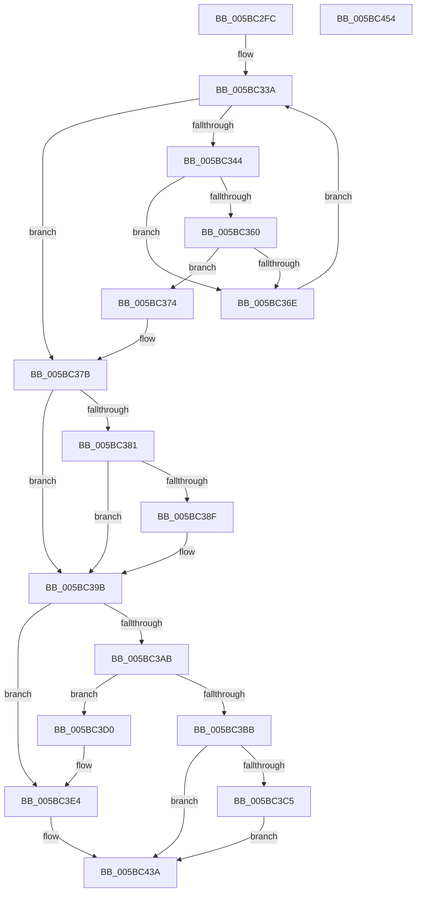

# KiAllocateProcessorNumber

- RVA: `0x005BC2FC`–`0x005BC455` (길이 `345` bytes)
- VA: `0x00000001405BC2FC`
- 실행 섹션: `.text`
- PDB 이름 있음: `예`; PDB Function 태그: `아니요`
- unwind 정보 RVA: `0x00083688`
- 디코드: `95`개 명령, `345/345` bytes 표시
- 미해석 바이트: `0` (있으면 어셈블리에 `.byte`로 보존)

> 이 문서는 커널 이미지의 기계어와 PDB 기호를 분석해 생성했습니다. 4번과 5번은 함수 원형과 자료형을 바이너리 사용 방식에서 추정한 C 해석이며 원본 소스 복구 결과는 아닙니다.

## 1. Dependencies

- 직접 호출 지점: **4**; 고유 호출 대상: **4**
- 직접 호출자로 확인된 함수: **2**
- RIP 상대 이미지 참조: **5**

### Outgoing calls
- `0x005BC384` → [KiAdjustGroupConfiguration](KiAdjustGroupConfiguration_function_005BBF84.md) (function, `0x005BBF84`)
- `0x005BC393` → [KiCommitGroupSubNodeAssignments](KiCommitGroupSubNodeAssignments_function_005BC674.md) (function, `0x005BC674`)
- `0x005BC3AE` → [KiAllocateSchedulerSubNode](KiAllocateSchedulerSubNode_function_005BC45C.md) (function, `0x005BC45C`)
- `0x005BC3C9` → [KiUncommitGroupSubNodeAssignments](KiUncommitGroupSubNodeAssignments_function_005BCF10.md) (function, `0x005BCF10`)

### Direct callers
- [KiAllocateProcessorStateInitializationParameters](KiAllocateProcessorStateInitializationParameters_function_005B6F24.md) at `0x005B6F5E`
- [KiConfigureInitialNodes](KiConfigureInitialNodes_function_005BC738.md) at `0x005BC846`

### Static image references
- `0x005BC318` → RVA `0x00FCF6C0` (`CACHEALI`; read)
- `0x005BC33A` → RVA `0x00F21AC8` (`.data`; read)
- `0x005BC34C` → RVA `0x00F21AF0` (`.data`; read)
- `0x005BC39B` → RVA `0x00F21AD0` (`.data`; read)
- `0x005BC3E9` → RVA `0x00FC8820` (`ALMOSTRO`; read)

## 2. Other-region calls and transfers

- 다른 실행 섹션으로 향하는 call: **0**
- 별도 외부 분기/꼬리 이동을 확인하지 못했습니다.

## 3. Assembly (complete function range)

```asm
005BC2FC  48 89 5C 24 10                  mov qword ptr [rsp + 0x10], rbx
005BC301  48 89 6C 24 18                  mov qword ptr [rsp + 0x18], rbp
005BC306  56                              push rsi
005BC307  57                              push rdi
005BC308  41 54                           push r12
005BC30A  41 56                           push r14
005BC30C  41 57                           push r15
005BC30E  48 83 EC 20                     sub rsp, 0x20
005BC312  45 33 FF                        xor r15d, r15d
005BC315  44 8B C9                        mov r9d, ecx
005BC318  48 8D 2D A1 33 A1 00            lea rbp, [rip + 0xa133a1]
005BC31F  4C 8B F2                        mov r14, rdx
005BC322  41 8B DF                        mov ebx, r15d
005BC325  BE FF FF 00 00                  mov esi, 0xffff
005BC32A  41 8B FF                        mov edi, r15d
005BC32D  45 0F B7 C7                     movzx r8d, r15w
005BC331  4A 8B 6C CD 00                  mov rbp, qword ptr [rbp + r9*8]
005BC336  45 8D 67 01                     lea r12d, [r15 + 1]
005BC33A  66 44 3B 05 86 57 96 00         cmp r8w, word ptr [rip + 0x965786]
005BC342  73 37                           jae 0x1405bc37b
005BC344  41 0F B7 C0                     movzx eax, r8w
005BC348  48 8D 0C 40                     lea rcx, [rax + rax*2]
005BC34C  48 8B 05 9D 57 96 00            mov rax, qword ptr [rip + 0x96579d]
005BC353  48 8D 14 C8                     lea rdx, [rax + rcx*8]
005BC357  0F B7 42 02                     movzx eax, word ptr [rdx + 2]
005BC35B  41 3B C1                        cmp eax, r9d
005BC35E  75 0E                           jne 0x1405bc36e
005BC360  F3 48 0F B8 4A 10               popcnt rcx, qword ptr [rdx + 0x10]
005BC366  0F B6 42 04                     movzx eax, byte ptr [rdx + 4]
005BC36A  3B C8                           cmp ecx, eax
005BC36C  72 06                           jb 0x1405bc374
005BC36E  66 45 03 C4                     add r8w, r12w
005BC372  EB C6                           jmp 0x1405bc33a
005BC374  48 8B FA                        mov rdi, rdx
005BC377  41 0F B7 F0                     movzx esi, r8w
005BC37B  F6 47 05 02                     test byte ptr [rdi + 5], 2
005BC37F  75 1A                           jne 0x1405bc39b
005BC381  48 8B CF                        mov rcx, rdi
005BC384  E8 FB FB FF FF                  call 0x1405bbf84
005BC389  F6 47 05 02                     test byte ptr [rdi + 5], 2
005BC38D  75 0C                           jne 0x1405bc39b
005BC38F  0F B7 4F 06                     movzx ecx, word ptr [rdi + 6]
005BC393  E8 DC 02 00 00                  call 0x1405bc674
005BC398  41 8B DC                        mov ebx, r12d
005BC39B  48 8B 05 2E 57 96 00            mov rax, qword ptr [rip + 0x96572e]
005BC3A2  0F B7 F6                        movzx esi, si
005BC3A5  4C 39 3C F0                     cmp qword ptr [rax + rsi*8], r15
005BC3A9  75 39                           jne 0x1405bc3e4
005BC3AB  48 8B CF                        mov rcx, rdi
005BC3AE  E8 A9 00 00 00                  call 0x1405bc45c
005BC3B3  48 8B C8                        mov rcx, rax
005BC3B6  48 85 C0                        test rax, rax
005BC3B9  75 15                           jne 0x1405bc3d0
005BC3BB  41 B9 9A 00 00 C0               mov r9d, 0xc000009a
005BC3C1  85 DB                           test ebx, ebx
005BC3C3  74 75                           je 0x1405bc43a
005BC3C5  0F B7 4F 06                     movzx ecx, word ptr [rdi + 6]
005BC3C9  E8 42 0B 00 00                  call 0x1405bcf10
005BC3CE  EB 6A                           jmp 0x1405bc43a
005BC3D0  48 8B 05 F9 56 96 00            mov rax, qword ptr [rip + 0x9656f9]
005BC3D7  48 89 0C F0                     mov qword ptr [rax + rsi*8], rcx
005BC3DB  0F B7 47 06                     movzx eax, word ptr [rdi + 6]
005BC3DF  48 89 4C C5 20                  mov qword ptr [rbp + rax*8 + 0x20], rcx
005BC3E4  44 0F B7 4F 06                  movzx r9d, word ptr [rdi + 6]
005BC3E9  48 8D 05 30 C4 A0 00            lea rax, [rip + 0xa0c430]
005BC3F0  45 8B C1                        mov r8d, r9d
005BC3F3  44 89 7C 24 50                  mov dword ptr [rsp + 0x50], r15d
005BC3F8  44 89 7C 24 50                  mov dword ptr [rsp + 0x50], r15d
005BC3FD  49 C1 E0 05                     shl r8, 5
005BC401  4C 03 C0                        add r8, rax
005BC404  66 44 89 4C 24 50               mov word ptr [rsp + 0x50], r9w
005BC40A  45 8B CF                        mov r9d, r15d
005BC40D  49 8B 10                        mov rdx, qword ptr [r8]
005BC410  48 8D 42 01                     lea rax, [rdx + 1]
005BC414  48 0F BD C8                     bsr rcx, rax
005BC418  48 0B D0                        or rdx, rax
005BC41B  49 89 10                        mov qword ptr [r8], rdx
005BC41E  88 4C 24 52                     mov byte ptr [rsp + 0x52], cl
005BC422  8B 44 24 50                     mov eax, dword ptr [rsp + 0x50]
005BC426  41 89 06                        mov dword ptr [r14], eax
005BC429  41 0F B6 46 02                  movzx eax, byte ptr [r14 + 2]
005BC42E  48 8B 4F 10                     mov rcx, qword ptr [rdi + 0x10]
005BC432  48 0F AB C1                     bts rcx, rax
005BC436  48 89 4F 10                     mov qword ptr [rdi + 0x10], rcx
005BC43A  48 8B 5C 24 58                  mov rbx, qword ptr [rsp + 0x58]
005BC43F  41 8B C1                        mov eax, r9d
005BC442  48 8B 6C 24 60                  mov rbp, qword ptr [rsp + 0x60]
005BC447  48 83 C4 20                     add rsp, 0x20
005BC44B  41 5F                           pop r15
005BC44D  41 5E                           pop r14
005BC44F  41 5C                           pop r12
005BC451  5F                              pop rdi
005BC452  5E                              pop rsi
005BC453  C3                              ret
005BC454  CC                              int3
```

## 4. C-style interpretation (structured pseudocode)

```c
__int64 __fastcall KiAllocateProcessorNumber(int a1, __int64 a2)
{
    __int64 result;
    __int64 v_r15;
    __int64 v_rbx;
    __int64 v_rsp;
    unsigned __int64 v_stack_p10;
    unsigned __int64 v_stack_p18;
    unsigned int v_stack_p8;
    unsigned __int8 v_stack_pA;

    v_stack_p10 = v_rbx;
    v_stack_p18 = v_rbp;
    v_rsp = (v_rsp) - (32);
    v_r15 = 0;
loc_005BC33A:
    if (0 >= (*(unsigned __int16 *)(v_rip + 9852806))) goto loc_005BC37B;
    if (((unsigned int)(*(unsigned __int16 *)(*(unsigned __int64 *)(v_rip + 9852829) + 0 + 0 * 2 * 8 + 2))) != ((unsigned int)((unsigned int)(a1)))) goto loc_005BC36E;
    if (((unsigned int)(0 + 0 * 2)) < ((unsigned int)(*(unsigned __int8 *)(*(unsigned __int64 *)(v_rip + 9852829) + 0 + 0 * 2 * 8 + 4)))) goto loc_005BC374;
loc_005BC36E:
    a3 = (unsigned __int16)((0) + ((unsigned __int16)(v_r15 + 1)));
    goto loc_005BC33A;
loc_005BC374:
loc_005BC37B:
    if (((*(unsigned __int8 *)(*(unsigned __int64 *)(v_rip + 9852829) + 0 + 0 * 2 * 8 + 5)) & (2)) != 0) goto loc_005BC39B;
    result = KiAdjustGroupConfiguration(*(unsigned __int64 *)(v_rip + 9852829) + 0 + 0 * 2 * 8, *(unsigned __int64 *)(v_rip + 9852829) + 0 + 0 * 2 * 8, a3, (unsigned int)(a1));
    v_rbx = 0;
    if (((*(unsigned __int8 *)(*(unsigned __int64 *)(v_rip + 9852829) + 0 + 0 * 2 * 8 + 5)) & (2)) == 0) {
        a1 = *(unsigned __int16 *)(*(unsigned __int64 *)(v_rip + 9852829) + 0 + 0 * 2 * 8 + 6);
        result = KiCommitGroupSubNodeAssignments(a1, *(unsigned __int64 *)(v_rip + 9852829) + 0 + 0 * 2 * 8, a3, (unsigned int)(a1));
        v_rbx = (unsigned int)(v_r15 + 1);
    }
    if ((*(unsigned __int64 *)(*(unsigned __int64 *)(v_rip + 9852718) + (unsigned __int16)((unsigned __int16)(a3)) * 8)) != 0) goto loc_005BC3E4;
    result = KiAllocateSchedulerSubNode(*(unsigned __int64 *)(v_rip + 9852829) + 0 + 0 * 2 * 8, *(unsigned __int64 *)(v_rip + 9852829) + 0 + 0 * 2 * 8, a3, (unsigned int)(a1));
    if (result != 0) goto loc_005BC3D0;
    if ((unsigned int)(v_rbx) == 0) goto loc_005BC43A;
    result = KiUncommitGroupSubNodeAssignments(*(unsigned __int16 *)(*(unsigned __int64 *)(v_rip + 9852829) + 0 + 0 * 2 * 8 + 6), *(unsigned __int64 *)(v_rip + 9852829) + 0 + 0 * 2 * 8, a3, (unsigned int)(0xC000009AULL));
    goto loc_005BC43A;
loc_005BC3D0:
    *(unsigned __int64 *)(*(unsigned __int64 *)(v_rip + 9852665) + (unsigned __int16)((unsigned __int16)(a3)) * 8) = *(unsigned __int16 *)(*(unsigned __int64 *)(v_rip + 9852829) + 0 + 0 * 2 * 8 + 6);
    *(unsigned __int64 *)(*(unsigned __int64 *)(v_rip + 10564513 + (unsigned int)(a1) * 8) + *(unsigned __int16 *)(*(unsigned __int64 *)(v_rip + 9852829) + 0 + 0 * 2 * 8 + 6) * 8 + 32) = *(unsigned __int16 *)(*(unsigned __int64 *)(v_rip + 9852829) + 0 + 0 * 2 * 8 + 6);
loc_005BC3E4:
    v_stack_p8 = 0;
    v_stack_p8 = 0;
    a3 = ((unsigned int)((unsigned int)(*(unsigned __int16 *)(*(unsigned __int64 *)(v_rip + 9852829) + 0 + 0 * 2 * 8 + 6)))) << (5);
    a3 = (a3) + (v_rip + 10535984);
    v_stack_p8 = (unsigned __int16)(*(unsigned __int16 *)(*(unsigned __int64 *)(v_rip + 9852829) + 0 + 0 * 2 * 8 + 6));
    a2 = (*(unsigned __int64 *)(a3)) | (*(unsigned __int64 *)(a3) + 1);
    *(unsigned __int64 *)(a3) = a2;
    v_stack_pA = (unsigned __int8)(*(unsigned __int16 *)(*(unsigned __int64 *)(v_rip + 9852829) + 0 + 0 * 2 * 8 + 6));
    *(unsigned int *)(a2) = (unsigned int)((unsigned int)(v_stack_p8));
    *(unsigned __int64 *)(*(unsigned __int64 *)(v_rip + 9852829) + 0 + 0 * 2 * 8 + 16) = *(unsigned __int64 *)(*(unsigned __int64 *)(v_rip + 9852829) + 0 + 0 * 2 * 8 + 16);
loc_005BC43A:
    v_rsp = (v_rsp) + (32);
    return 0;
}
```

## 5. (Beta) C Style

```c
int64_t KiAllocateProcessorNumber(int32_t Arg1, void *Arg2)
{
    uint8_t *arg2 = (uint8_t *)Arg2;

    int64_t result;
    int64_t local_r15;
    int64_t local_rbx;
    int64_t local_rsp;
    uint64_t v_stack_p10;
    uint64_t v_stack_p18;
    uint32_t v_stack_p8;
    uint8_t v_stack_pA;

    v_stack_p10 = local_rbx;
    v_stack_p18 = local_rbp;
    local_rsp = (local_rsp) - (32);
    local_r15 = 0;
loc_005BC33A:
    if (0 >= (*(uint16_t *)(v_rip + 0x965786))) goto loc_005BC37B;
    if (((uint32_t)(*(uint16_t *)(*(uint64_t *)(v_rip + 0x96579D) + 0x0 + 0x0 * 2 * 8 + 0x2))) != ((uint32_t)((uint32_t)(Arg1)))) goto loc_005BC36E;
    if (((uint32_t)(0 + 0 * 2)) < ((uint32_t)(*(uint8_t *)(*(uint64_t *)(v_rip + 0x96579D) + 0x0 + 0x0 * 2 * 8 + 0x4)))) goto loc_005BC374;
loc_005BC36E:
    a3 = (uint16_t)((0) + ((uint16_t)(local_r15 + 1)));
    goto loc_005BC33A;
loc_005BC374:
loc_005BC37B:
    if (((*(uint8_t *)(*(uint64_t *)(v_rip + 0x96579D) + 0x0 + 0x0 * 2 * 8 + 0x5)) & (2)) != 0) goto loc_005BC39B;
    result = KiAdjustGroupConfiguration(*(uint64_t *)(v_rip + 0x96579D) + 0 + 0 * 2 * 8, *(uint64_t *)(v_rip + 0x96579D) + 0 + 0 * 2 * 8, a3, (uint32_t)(Arg1));
    local_rbx = 0;
    if (((*(uint8_t *)(*(uint64_t *)(v_rip + 0x96579D) + 0x0 + 0x0 * 2 * 8 + 0x5)) & (2)) == 0) {
        Arg1 = *(uint16_t *)(*(uint64_t *)(v_rip + 0x96579D) + 0x0 + 0x0 * 2 * 8 + 0x6);
        result = KiCommitGroupSubNodeAssignments(Arg1, *(uint64_t *)(v_rip + 0x96579D) + 0 + 0 * 2 * 8, a3, (uint32_t)(Arg1));
        local_rbx = (uint32_t)(local_r15 + 1);
    }
    if ((*(uint64_t *)(*(uint64_t *)(v_rip + 0x96572E) + (uint16_t)((uint16_t)(a3)) * 8)) != 0) goto loc_005BC3E4;
    result = KiAllocateSchedulerSubNode(*(uint64_t *)(v_rip + 0x96579D) + 0 + 0 * 2 * 8, *(uint64_t *)(v_rip + 0x96579D) + 0 + 0 * 2 * 8, a3, (uint32_t)(Arg1));
    if (result != 0) goto loc_005BC3D0;
    if ((uint32_t)(local_rbx) == 0) goto loc_005BC43A;
    result = KiUncommitGroupSubNodeAssignments(*(uint16_t *)(*(uint64_t *)(v_rip + 0x96579D) + 0x0 + 0x0 * 2 * 8 + 0x6), *(uint64_t *)(v_rip + 0x96579D) + 0 + 0 * 2 * 8, a3, (uint32_t)(0xC000009AULL));
    goto loc_005BC43A;
loc_005BC3D0:
    *(uint64_t *)(*(uint64_t *)(v_rip + 0x9656F9) + (uint16_t)((uint16_t)(a3)) * 8) = *(uint16_t *)(*(uint64_t *)(v_rip + 0x96579D) + 0x0 + 0x0 * 2 * 8 + 0x6);
    *(uint64_t *)(*(uint64_t *)(v_rip + 0xA133A1 + (uint32_t)(Arg1) * 8) + *(uint16_t *)(*(uint64_t *)(v_rip + 0x96579D) + 0x0 + 0x0 * 2 * 8 + 0x6) * 8 + 0x20) = *(uint16_t *)(*(uint64_t *)(v_rip + 0x96579D) + 0x0 + 0x0 * 2 * 8 + 0x6);
loc_005BC3E4:
    v_stack_p8 = 0;
    v_stack_p8 = 0;
    a3 = ((uint32_t)((uint32_t)(*(uint16_t *)(*(uint64_t *)(v_rip + 0x96579D) + 0x0 + 0x0 * 2 * 8 + 0x6)))) << (5);
    a3 = (a3) + (v_rip + 10535984);
    v_stack_p8 = (uint16_t)(*(uint16_t *)(*(uint64_t *)(v_rip + 0x96579D) + 0x0 + 0x0 * 2 * 8 + 0x6));
    Arg2 = (*(uint64_t *)(a3)) | (*(uint64_t *)(a3) + 1);
    *(void **)(a3) = Arg2;
    v_stack_pA = (uint8_t)(*(uint16_t *)(*(uint64_t *)(v_rip + 0x96579D) + 0x0 + 0x0 * 2 * 8 + 0x6));
    *(uint32_t *)(arg2) = (uint32_t)((uint32_t)(v_stack_p8));
    *(uint64_t *)(*(uint64_t *)(v_rip + 0x96579D) + 0x0 + 0x0 * 2 * 8 + 0x10) = *(uint64_t *)(*(uint64_t *)(v_rip + 0x96579D) + 0x0 + 0x0 * 2 * 8 + 0x10);
loc_005BC43A:
    local_rsp = (local_rsp) + (32);
    return 0;
}
```

### 관측된 메모리 오프셋

구조체 형식이 확인되지 않은 접근은 인자 기준의 오프셋으로만 기록했습니다.

| 기준 인자 | 오프셋 표현 | 폭 (bit) | 접근 |
|---|---:|---:|---|
| `Arg2` | `+ 0x0` | `32` | `W` |
| `Arg2` | `+ 0x2` | `8` | `R` |

## 6. Execution-region graph

[열기: 2D/3D 그래프와 함수 탐색 컨트롤 패널](../../../control-panel.html?section=text&rva=0x005BC2FC&view=graph)

- 2D 그래프는 위에서 아래로 흐르고, 3D 그래프는 빈 공간을 드래그해 회전합니다. Shift+드래그는 이동, 휠은 확대·축소, 함수 노드 선택은 대상 보고서 이동입니다.

### Static fallback


