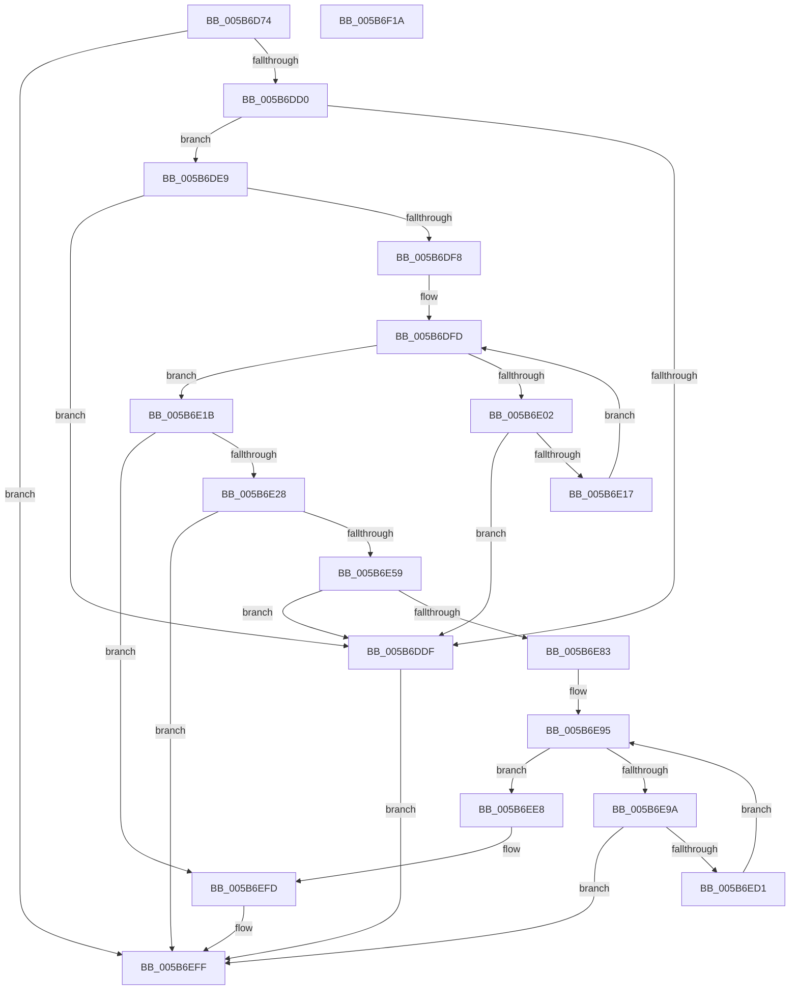

# KiAllocateProcessorStacks

- RVA: `0x005B6D74`–`0x005B6F1B` (길이 `423` bytes)
- VA: `0x00000001405B6D74`
- 실행 섹션: `.text`
- PDB 이름 있음: `예`; PDB Function 태그: `아니요`
- unwind 정보 RVA: `0x000C9E24`
- 디코드: `109`개 명령, `423/423` bytes 표시
- 미해석 바이트: `0` (있으면 어셈블리에 `.byte`로 보존)

> 이 문서는 커널 이미지의 기계어와 PDB 기호를 분석해 생성했습니다. 4번과 5번은 함수 원형과 자료형을 바이너리 사용 방식에서 추정한 C 해석이며 원본 소스 복구 결과는 아닙니다.

## 1. Dependencies

- 직접 호출 지점: **9**; 고유 호출 대상: **6**
- 직접 호출자로 확인된 함수: **1**
- RIP 상대 이미지 참조: **1**

### Outgoing calls
- `0x005B6DBA` → [MmCreateKernelStack](../33/MmCreateKernelStack_function_00337D20.md) (function, `0x00337D20`)
- `0x005B6DD6` → [MmAllocateIsrStack](../../page/80/MmAllocateIsrStack_function_00807ECC.md) (function, `0x00807ECC`)
- `0x005B6DEF` → [MmAllocateIsrStack](../../page/80/MmAllocateIsrStack_function_00807ECC.md) (function, `0x00807ECC`)
- `0x005B6E0E` → [MmAllocateIsrStack](../../page/80/MmAllocateIsrStack_function_00807ECC.md) (function, `0x00807ECC`)
- `0x005B6E4C` → [KiCreateKernelShadowStack](../../page/A1/KiCreateKernelShadowStack_function_00A1DD60.md) (function, `0x00A1DD60`)
- `0x005B6E6E` → [MmAllocateIndependentPagesEx](../../page/AA/MmAllocateIndependentPagesEx_function_00AA0CFC.md) (function, `0x00AA0CFC`)
- `0x005B6E8B` → [memset](../6C/memset_function_006C6C40.md) (function, `0x006C6C40`)
- `0x005B6EC8` → [KiCreateKernelShadowStack](../../page/A1/KiCreateKernelShadowStack_function_00A1DD60.md) (function, `0x00A1DD60`)
- `0x005B6EF8` → [MmSetPageProtection](../4E/MmSetPageProtection_function_004E1580.md) (function, `0x004E1580`)

### Direct callers
- [KiAllocateProcessorStateInitializationParameters](KiAllocateProcessorStateInitializationParameters_function_005B6F24.md) at `0x005B6F68`

### Static image references
- `0x005B6E1B` → RVA `0x01201841` (`CFGRO`; read)

## 2. Other-region calls and transfers

- 다른 실행 섹션으로 향하는 call: **6**
  - `0x005B6DD6` → [MmAllocateIsrStack](../../page/80/MmAllocateIsrStack_function_00807ECC.md) (`.text` → `PAGE`)
  - `0x005B6DEF` → [MmAllocateIsrStack](../../page/80/MmAllocateIsrStack_function_00807ECC.md) (`.text` → `PAGE`)
  - `0x005B6E0E` → [MmAllocateIsrStack](../../page/80/MmAllocateIsrStack_function_00807ECC.md) (`.text` → `PAGE`)
  - `0x005B6E4C` → [KiCreateKernelShadowStack](../../page/A1/KiCreateKernelShadowStack_function_00A1DD60.md) (`.text` → `PAGE`)
  - `0x005B6E6E` → [MmAllocateIndependentPagesEx](../../page/AA/MmAllocateIndependentPagesEx_function_00AA0CFC.md) (`.text` → `PAGE`)
  - `0x005B6EC8` → [KiCreateKernelShadowStack](../../page/A1/KiCreateKernelShadowStack_function_00A1DD60.md) (`.text` → `PAGE`)
- 별도 외부 분기/꼬리 이동을 확인하지 못했습니다.

## 3. Assembly (complete function range)

```asm
005B6D74  48 8B C4                        mov rax, rsp
005B6D77  48 89 58 08                     mov qword ptr [rax + 8], rbx
005B6D7B  48 89 68 10                     mov qword ptr [rax + 0x10], rbp
005B6D7F  48 89 70 18                     mov qword ptr [rax + 0x18], rsi
005B6D83  48 89 78 20                     mov qword ptr [rax + 0x20], rdi
005B6D87  41 54                           push r12
005B6D89  48 83 EC 60                     sub rsp, 0x60
005B6D8D  83 60 D4 00                     and dword ptr [rax - 0x2c], 0
005B6D91  48 8B D9                        mov rbx, rcx
005B6D94  48 83 60 F0 00                  and qword ptr [rax - 0x10], 0
005B6D99  48 8D 48 C8                     lea rcx, [rax - 0x38]
005B6D9D  83 60 C8 00                     and dword ptr [rax - 0x38], 0
005B6DA1  0F 57 C0                        xorps xmm0, xmm0
005B6DA4  48 83 60 D8 00                  and qword ptr [rax - 0x28], 0
005B6DA9  8B FA                           mov edi, edx
005B6DAB  F3 0F 7F 40 E0                  movdqu xmmword ptr [rax - 0x20], xmm0
005B6DB0  C7 40 CC 05 00 00 00            mov dword ptr [rax - 0x34], 5
005B6DB7  89 50 D0                        mov dword ptr [rax - 0x30], edx
005B6DBA  E8 61 0F D8 FF                  call 0x140337d20
005B6DBF  48 8B 4C 24 48                  mov rcx, qword ptr [rsp + 0x48]
005B6DC4  48 89 4B 40                     mov qword ptr [rbx + 0x40], rcx
005B6DC8  85 C0                           test eax, eax
005B6DCA  0F 88 2F 01 00 00               js 0x1405b6eff
005B6DD0  48 8D 4B 48                     lea rcx, [rbx + 0x48]
005B6DD4  8B D7                           mov edx, edi
005B6DD6  E8 F1 10 25 00                  call 0x140807ecc
005B6DDB  84 C0                           test al, al
005B6DDD  75 0A                           jne 0x1405b6de9
005B6DDF  B8 17 00 00 C0                  mov eax, 0xc0000017
005B6DE4  E9 16 01 00 00                  jmp 0x1405b6eff
005B6DE9  48 8D 4B 50                     lea rcx, [rbx + 0x50]
005B6DED  8B D7                           mov edx, edi
005B6DEF  E8 D8 10 25 00                  call 0x140807ecc
005B6DF4  84 C0                           test al, al
005B6DF6  74 E7                           je 0x1405b6ddf
005B6DF8  BE 01 00 00 00                  mov esi, 1
005B6DFD  83 FE 04                        cmp esi, 4
005B6E00  77 19                           ja 0x1405b6e1b
005B6E02  8B C6                           mov eax, esi
005B6E04  8B D7                           mov edx, edi
005B6E06  48 83 C0 0B                     add rax, 0xb
005B6E0A  48 8D 0C C3                     lea rcx, [rbx + rax*8]
005B6E0E  E8 B9 10 25 00                  call 0x140807ecc
005B6E13  84 C0                           test al, al
005B6E15  74 C8                           je 0x1405b6ddf
005B6E17  FF C6                           inc esi
005B6E19  EB E2                           jmp 0x1405b6dfd
005B6E1B  80 3D 1F AA C4 00 00            cmp byte ptr [rip + 0xc4aa1f], 0
005B6E22  0F 84 D5 00 00 00               je 0x1405b6efd
005B6E28  45 33 C0                        xor r8d, r8d
005B6E2B  48 8D 83 80 00 00 00            lea rax, [rbx + 0x80]
005B6E32  48 8D 8B 88 00 00 00            lea rcx, [rbx + 0x88]
005B6E39  48 89 44 24 28                  mov qword ptr [rsp + 0x28], rax
005B6E3E  48 89 4C 24 20                  mov qword ptr [rsp + 0x20], rcx
005B6E43  44 8B CF                        mov r9d, edi
005B6E46  33 C9                           xor ecx, ecx
005B6E48  41 8D 50 04                     lea edx, [r8 + 4]
005B6E4C  E8 0F 6F 46 00                  call 0x140a1dd60
005B6E51  85 C0                           test eax, eax
005B6E53  0F 88 A6 00 00 00               js 0x1405b6eff
005B6E59  41 BC 00 10 00 00               mov r12d, 0x1000
005B6E5F  41 B9 01 00 00 00               mov r9d, 1
005B6E65  41 8B CC                        mov ecx, r12d
005B6E68  49 83 C8 FF                     or r8, 0xffffffffffffffff
005B6E6C  8B D7                           mov edx, edi
005B6E6E  E8 89 9E 4E 00                  call 0x140aa0cfc
005B6E73  48 89 83 E0 00 00 00            mov qword ptr [rbx + 0xe0], rax
005B6E7A  48 85 C0                        test rax, rax
005B6E7D  0F 84 5C FF FF FF               je 0x1405b6ddf
005B6E83  45 8B C4                        mov r8d, r12d
005B6E86  33 D2                           xor edx, edx
005B6E88  48 8B C8                        mov rcx, rax
005B6E8B  E8 B0 FD 10 00                  call 0x1406c6c40
005B6E90  BE 01 00 00 00                  mov esi, 1
005B6E95  83 FE 04                        cmp esi, 4
005B6E98  77 4E                           ja 0x1405b6ee8
005B6E9A  8B EE                           mov ebp, esi
005B6E9C  48 8D 83 90 00 00 00            lea rax, [rbx + 0x90]
005B6EA3  45 33 C0                        xor r8d, r8d
005B6EA6  48 8D 8B B8 00 00 00            lea rcx, [rbx + 0xb8]
005B6EAD  44 8B CF                        mov r9d, edi
005B6EB0  48 8D 0C E9                     lea rcx, [rcx + rbp*8]
005B6EB4  48 8D 04 E8                     lea rax, [rax + rbp*8]
005B6EB8  48 89 44 24 28                  mov qword ptr [rsp + 0x28], rax
005B6EBD  41 8D 50 03                     lea edx, [r8 + 3]
005B6EC1  48 89 4C 24 20                  mov qword ptr [rsp + 0x20], rcx
005B6EC6  33 C9                           xor ecx, ecx
005B6EC8  E8 93 6E 46 00                  call 0x140a1dd60
005B6ECD  85 C0                           test eax, eax
005B6ECF  78 2E                           js 0x1405b6eff
005B6ED1  48 8B 8B E0 00 00 00            mov rcx, qword ptr [rbx + 0xe0]
005B6ED8  FF C6                           inc esi
005B6EDA  48 8B 84 EB 90 00 00 00         mov rax, qword ptr [rbx + rbp*8 + 0x90]
005B6EE2  48 89 04 E9                     mov qword ptr [rcx + rbp*8], rax
005B6EE6  EB AD                           jmp 0x1405b6e95
005B6EE8  48 8B 8B E0 00 00 00            mov rcx, qword ptr [rbx + 0xe0]
005B6EEF  41 B8 02 00 00 00               mov r8d, 2
005B6EF5  49 8B D4                        mov rdx, r12
005B6EF8  E8 83 A6 F2 FF                  call 0x1404e1580
005B6EFD  33 C0                           xor eax, eax
005B6EFF  4C 8D 5C 24 60                  lea r11, [rsp + 0x60]
005B6F04  49 8B 5B 10                     mov rbx, qword ptr [r11 + 0x10]
005B6F08  49 8B 6B 18                     mov rbp, qword ptr [r11 + 0x18]
005B6F0C  49 8B 73 20                     mov rsi, qword ptr [r11 + 0x20]
005B6F10  49 8B 7B 28                     mov rdi, qword ptr [r11 + 0x28]
005B6F14  49 8B E3                        mov rsp, r11
005B6F17  41 5C                           pop r12
005B6F19  C3                              ret
005B6F1A  CC                              int3
```

## 4. C-style interpretation (structured pseudocode)

```c
__int64 __fastcall KiAllocateProcessorStacks(__int64 a1, int a2, int a3)
{
    __int64 result;
    __int64 v_rsi;
    __int64 v_rsp;
    unsigned __int64 v_stack_m20;
    unsigned __int64 v_stack_m40;
    unsigned __int64 v_stack_m48;
    unsigned __int64 v_stack_m8;

    *(unsigned __int64 *)(v_rsp + 8) = v_rbx;
    *(unsigned __int64 *)(v_rsp + 16) = v_rbp;
    *(unsigned __int64 *)(v_rsp + 24) = v_rsi;
    *(unsigned __int64 *)(v_rsp + 32) = v_rdi;
    v_rsp = (v_rsp) - (96);
    *(unsigned __int64 *)(v_rsp - 32) = v_xmm0;
    *(unsigned int *)(v_rsp - 52) = 5;
    *(unsigned int *)(v_rsp - 48) = a2;
    result = MmCreateKernelStack(v_rsp - 56, a2, a3, a4);
    *(unsigned __int64 *)(a1 + 64) = v_stack_m20;
    if (sign_flag) goto loc_005B6EFF;
    result = MmAllocateIsrStack(a1 + 72, (unsigned int)((unsigned int)((unsigned int)(a2))), a3, a4);
    if ((unsigned __int8)(result) != 0) goto loc_005B6DE9;
loc_005B6DDF:
    goto loc_005B6EFF;
loc_005B6DE9:
    result = MmAllocateIsrStack(a1 + 80, (unsigned int)((unsigned int)((unsigned int)(a2))), a3, a4);
    if ((unsigned __int8)(result) == 0) goto loc_005B6DDF;
loc_005B6DFD:
    if (1 > 4) goto loc_005B6E1B;
    result = (1) + (11);
    result = MmAllocateIsrStack(a1 + result * 8, (unsigned int)((unsigned int)((unsigned int)(a2))), a3, a4);
    if ((unsigned __int8)(result) == 0) goto loc_005B6DDF;
    v_rsi = (unsigned int)((1) + 1);
    goto loc_005B6DFD;
loc_005B6E1B:
    if ((*(unsigned __int8 *)(v_rip + 12888607)) == 0) goto loc_005B6EFD;
    a3 = 0;
    v_stack_m40 = a1 + 128;
    v_stack_m48 = a1 + 136;
    a1 = 0;
    result = KiCreateKernelShadowStack(a1, a3 + 4, a3, (unsigned int)((unsigned int)((unsigned int)(a2))));
    if (sign_flag) goto loc_005B6EFF;
    a3 = (a3) | (-1);
    result = MmAllocateIndependentPagesEx((unsigned int)((unsigned int)((unsigned int)(0x1000ULL))), (unsigned int)((unsigned int)((unsigned int)(a2))), a3, 1);
    *(unsigned __int64 *)(a1 + 224) = result;
    if (result == 0) goto loc_005B6DDF;
    a2 = 0;
    result = memset(result, a2, (unsigned int)((unsigned int)((unsigned int)(0x1000ULL))), 1);
loc_005B6E95:
    if (1 > 4) goto loc_005B6EE8;
    a3 = 0;
    v_stack_m40 = a1 + 144 + 1 * 8;
    v_stack_m48 = a1 + 184 + 1 * 8;
    a1 = 0;
    result = KiCreateKernelShadowStack(a1, a3 + 3, a3, (unsigned int)((unsigned int)((unsigned int)(a2))));
    if (sign_flag) goto loc_005B6EFF;
    v_rsi = (unsigned int)((1) + 1);
    *(unsigned __int64 *)(*(unsigned __int64 *)(a1 + 224) + 1 * 8) = *(unsigned __int64 *)(a1 + 1 * 8 + 144);
    goto loc_005B6E95;
loc_005B6EE8:
    result = MmSetPageProtection(*(unsigned __int64 *)(a1 + 224), (unsigned int)(0x1000ULL), 2, (unsigned int)((unsigned int)((unsigned int)(a2))));
loc_005B6EFD:
    result = 0;
loc_005B6EFF:
    return result;
}
```

## 5. (Beta) C Style

```c
int64_t KiAllocateProcessorStacks(void *Arg1, int32_t Arg2, int32_t Arg3)
{
    uint8_t *arg1 = (uint8_t *)Arg1;

    int64_t result;
    int64_t local_rsi;
    int64_t local_rsp;
    uint64_t v_stack_m20;
    uint64_t v_stack_m40;
    uint64_t v_stack_m48;
    uint64_t v_stack_m8;

    *(uint64_t *)(local_rsp + 0x8) = local_rbx;
    *(uint64_t *)(local_rsp + 0x10) = local_rbp;
    *(uint64_t *)(local_rsp + 0x18) = local_rsi;
    *(uint64_t *)(local_rsp + 0x20) = local_rdi;
    local_rsp = (local_rsp) - (96);
    *(uint64_t *)(local_rsp - 0x20) = v_xmm0;
    *(uint32_t *)(local_rsp - 0x34) = 5;
    *(uint32_t *)(local_rsp - 0x30) = Arg2;
    result = MmCreateKernelStack(local_rsp - 56, Arg2, Arg3, a4);
    *(uint64_t *)(arg1 + 0x40) = v_stack_m20;
    if (sign_flag) goto loc_005B6EFF;
    result = MmAllocateIsrStack(Arg1 + 72, (uint32_t)((uint32_t)((uint32_t)(Arg2))), Arg3, a4);
    if ((uint8_t)(result) != 0) goto loc_005B6DE9;
loc_005B6DDF:
    goto loc_005B6EFF;
loc_005B6DE9:
    result = MmAllocateIsrStack(Arg1 + 80, (uint32_t)((uint32_t)((uint32_t)(Arg2))), Arg3, a4);
    if ((uint8_t)(result) == 0) goto loc_005B6DDF;
loc_005B6DFD:
    if (1 > 4) goto loc_005B6E1B;
    result = (1) + (11);
    result = MmAllocateIsrStack(Arg1 + result * 8, (uint32_t)((uint32_t)((uint32_t)(Arg2))), Arg3, a4);
    if ((uint8_t)(result) == 0) goto loc_005B6DDF;
    local_rsi = (uint32_t)((1) + 1);
    goto loc_005B6DFD;
loc_005B6E1B:
    if ((*(uint8_t *)(v_rip + 0xC4AA1F)) == 0) goto loc_005B6EFD;
    Arg3 = 0;
    v_stack_m40 = Arg1 + 128;
    v_stack_m48 = Arg1 + 136;
    Arg1 = 0;
    result = KiCreateKernelShadowStack(Arg1, Arg3 + 4, Arg3, (uint32_t)((uint32_t)((uint32_t)(Arg2))));
    if (sign_flag) goto loc_005B6EFF;
    Arg3 = (Arg3) | (-1);
    result = MmAllocateIndependentPagesEx((uint32_t)((uint32_t)((uint32_t)(0x1000ULL))), (uint32_t)((uint32_t)((uint32_t)(Arg2))), Arg3, 1);
    *(uint64_t *)(arg1 + 0xE0) = result;
    if (result == 0) goto loc_005B6DDF;
    Arg2 = 0;
    result = memset(result, Arg2, (uint32_t)((uint32_t)((uint32_t)(0x1000ULL))), 1);
loc_005B6E95:
    if (1 > 4) goto loc_005B6EE8;
    Arg3 = 0;
    v_stack_m40 = Arg1 + 144 + 1 * 8;
    v_stack_m48 = Arg1 + 184 + 1 * 8;
    Arg1 = 0;
    result = KiCreateKernelShadowStack(Arg1, Arg3 + 3, Arg3, (uint32_t)((uint32_t)((uint32_t)(Arg2))));
    if (sign_flag) goto loc_005B6EFF;
    local_rsi = (uint32_t)((1) + 1);
    *(uint64_t *)(*(uint64_t *)(arg1 + 0xE0) + 0x1 * 8) = *(uint64_t *)(arg1 + 0x1 * 8 + 0x90);
    goto loc_005B6E95;
loc_005B6EE8:
    result = MmSetPageProtection(*(uint64_t *)(arg1 + 0xE0), (uint32_t)(0x1000ULL), 2, (uint32_t)((uint32_t)((uint32_t)(Arg2))));
loc_005B6EFD:
    result = 0;
loc_005B6EFF:
    return result;
}
```

### 관측된 메모리 오프셋

구조체 형식이 확인되지 않은 접근은 인자 기준의 오프셋으로만 기록했습니다.

| 기준 인자 | 오프셋 표현 | 폭 (bit) | 접근 |
|---|---:|---:|---|
| `Arg1` | `+ 0x0 + rax*8` | `64` | `R` |
| `Arg1` | `+ 0x0 + rbp*8` | `64` | `R` |
| `Arg1` | `+ 0x40` | `64` | `W` |
| `Arg1` | `+ 0x48` | `64` | `R` |
| `Arg1` | `+ 0x50` | `64` | `R` |
| `Arg1` | `+ 0x80` | `64` | `R` |
| `Arg1` | `+ 0x88` | `64` | `R` |
| `Arg1` | `+ 0x90` | `64` | `R` |
| `Arg1` | `+ 0x90 + rbp*8` | `64` | `R` |
| `Arg1` | `+ 0xB8` | `64` | `R` |
| `Arg1` | `+ 0xE0` | `64` | `R` |
| `Arg1` | `+ 0xE0` | `64` | `W` |

## 6. Execution-region graph

[열기: 2D/3D 그래프와 함수 탐색 컨트롤 패널](../../../control-panel.html?section=text&rva=0x005B6D74&view=graph)

- 2D 그래프는 위에서 아래로 흐르고, 3D 그래프는 빈 공간을 드래그해 회전합니다. Shift+드래그는 이동, 휠은 확대·축소, 함수 노드 선택은 대상 보고서 이동입니다.

### Static fallback


