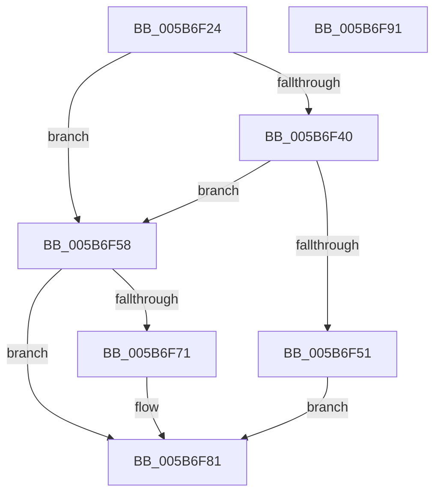

# KiAllocateProcessorStateInitializationParameters

- RVA: `0x005B6F24`–`0x005B6F92` (길이 `110` bytes)
- VA: `0x00000001405B6F24`
- 실행 섹션: `.text`
- PDB 이름 있음: `예`; PDB Function 태그: `아니요`
- unwind 정보 RVA: `0x00060BC4`
- 디코드: `35`개 명령, `110/110` bytes 표시
- 미해석 바이트: `0` (있으면 어셈블리에 `.byte`로 보존)

> 이 문서는 커널 이미지의 기계어와 PDB 기호를 분석해 생성했습니다. 4번과 5번은 함수 원형과 자료형을 바이너리 사용 방식에서 추정한 C 해석이며 원본 소스 복구 결과는 아닙니다.

## 1. Dependencies

- 직접 호출 지점: **4**; 고유 호출 대상: **4**
- 직접 호출자로 확인된 함수: **2**
- RIP 상대 이미지 참조: **0**

### Outgoing calls
- `0x005B6F43` → [MmAllocateIndependentPages](../../page/AA/MmAllocateIndependentPages_function_00AA0CE0.md) (function, `0x00AA0CE0`)
- `0x005B6F5E` → [KiAllocateProcessorNumber](KiAllocateProcessorNumber_function_005BC2FC.md) (function, `0x005BC2FC`)
- `0x005B6F68` → [KiAllocateProcessorStacks](KiAllocateProcessorStacks_function_005B6D74.md) (function, `0x005B6D74`)
- `0x005B6F77` → [KiAllocateIdleThread](../../pagelk/B6/KiAllocateIdleThread_function_00B6AB64.md) (function, `0x00B6AB64`)

### Direct callers
- [KiStartDynamicProcessor](../../page/74/KiStartDynamicProcessor_function_007456C8.md) at `0x00745820`
- [KeStartAllProcessors](../../init/C3/KeStartAllProcessors_function_00C36F78.md) at `0x00C3721F`

### Static image references
- 디코드된 RIP-relative 메모리 참조가 없습니다.

## 2. Other-region calls and transfers

- 다른 실행 섹션으로 향하는 call: **2**
  - `0x005B6F43` → [MmAllocateIndependentPages](../../page/AA/MmAllocateIndependentPages_function_00AA0CE0.md) (`.text` → `PAGE`)
  - `0x005B6F77` → [KiAllocateIdleThread](../../pagelk/B6/KiAllocateIdleThread_function_00B6AB64.md) (`.text` → `PAGELK`)
- 별도 외부 분기/꼬리 이동을 확인하지 못했습니다.

## 3. Assembly (complete function range)

```asm
005B6F24  48 89 5C 24 08                  mov qword ptr [rsp + 8], rbx
005B6F29  48 89 74 24 10                  mov qword ptr [rsp + 0x10], rsi
005B6F2E  57                              push rdi
005B6F2F  48 83 EC 20                     sub rsp, 0x20
005B6F33  33 F6                           xor esi, esi
005B6F35  8B FA                           mov edi, edx
005B6F37  48 8B D9                        mov rbx, rcx
005B6F3A  48 39 71 08                     cmp qword ptr [rcx + 8], rsi
005B6F3E  75 18                           jne 0x1405b6f58
005B6F40  8B 49 10                        mov ecx, dword ptr [rcx + 0x10]
005B6F43  E8 98 9D 4E 00                  call 0x140aa0ce0
005B6F48  48 89 43 08                     mov qword ptr [rbx + 8], rax
005B6F4C  48 85 C0                        test rax, rax
005B6F4F  75 07                           jne 0x1405b6f58
005B6F51  B8 17 00 00 C0                  mov eax, 0xc0000017
005B6F56  EB 29                           jmp 0x1405b6f81
005B6F58  48 8D 53 20                     lea rdx, [rbx + 0x20]
005B6F5C  8B CF                           mov ecx, edi
005B6F5E  E8 99 53 00 00                  call 0x1405bc2fc
005B6F63  8B D7                           mov edx, edi
005B6F65  48 8B CB                        mov rcx, rbx
005B6F68  E8 07 FE FF FF                  call 0x1405b6d74
005B6F6D  85 C0                           test eax, eax
005B6F6F  78 10                           js 0x1405b6f81
005B6F71  48 8D 4B 30                     lea rcx, [rbx + 0x30]
005B6F75  8B D7                           mov edx, edi
005B6F77  E8 E8 3B 5B 00                  call 0x140b6ab64
005B6F7C  85 C0                           test eax, eax
005B6F7E  0F 49 C6                        cmovns eax, esi
005B6F81  48 8B 5C 24 30                  mov rbx, qword ptr [rsp + 0x30]
005B6F86  48 8B 74 24 38                  mov rsi, qword ptr [rsp + 0x38]
005B6F8B  48 83 C4 20                     add rsp, 0x20
005B6F8F  5F                              pop rdi
005B6F90  C3                              ret
005B6F91  CC                              int3
```

## 4. C-style interpretation (structured pseudocode)

```c
__int64 __fastcall KiAllocateProcessorStateInitializationParameters(__int64 a1, int a2)
{
    __int64 result;
    __int64 v_rsi;
    __int64 v_rsp;
    unsigned __int64 v_stack_p10;
    unsigned __int64 v_stack_p8;

    v_stack_p8 = v_rbx;
    v_stack_p10 = v_rsi;
    v_rsp = (v_rsp) - (32);
    v_rsi = 0;
    if ((*(unsigned __int64 *)(a1 + 8)) != 0) goto loc_005B6F58;
    result = MmAllocateIndependentPages((unsigned int)(*(unsigned int *)(a1 + 16)), a2, a3, a4);
    *(unsigned __int64 *)(a1 + 8) = result;
    if (result != 0) goto loc_005B6F58;
    goto loc_005B6F81;
loc_005B6F58:
    result = KiAllocateProcessorNumber((unsigned int)((unsigned int)((unsigned int)(a2))), a1 + 32, a3, a4);
    result = KiAllocateProcessorStacks(a1, (unsigned int)((unsigned int)((unsigned int)(a2))), a3, a4);
    if (!(sign_flag)) {
        a1 = a1 + 48;
        a2 = (unsigned int)((unsigned int)(a2));
        result = KiAllocateIdleThread(a1, a2, a3, a4);
        if (!sign_flag) { result = 0; }
    }
    v_rsp = (v_rsp) + (32);
    return result;
}
```

## 5. (Beta) C Style

```c
int64_t KiAllocateProcessorStateInitializationParameters(void *Arg1, int32_t Arg2)
{
    uint8_t *arg1 = (uint8_t *)Arg1;

    int64_t result;
    int64_t local_rsi;
    int64_t local_rsp;
    uint64_t v_stack_p10;
    uint64_t v_stack_p8;

    v_stack_p8 = local_rbx;
    v_stack_p10 = local_rsi;
    local_rsp = (local_rsp) - (32);
    local_rsi = 0;
    if ((*(uint64_t *)(arg1 + 0x8)) != 0) goto loc_005B6F58;
    result = MmAllocateIndependentPages((uint32_t)(*(uint32_t *)(arg1 + 0x10)), Arg2, a3, a4);
    *(uint64_t *)(arg1 + 0x8) = result;
    if (result != 0) goto loc_005B6F58;
    goto loc_005B6F81;
loc_005B6F58:
    result = KiAllocateProcessorNumber((uint32_t)((uint32_t)((uint32_t)(Arg2))), Arg1 + 32, a3, a4);
    result = KiAllocateProcessorStacks(Arg1, (uint32_t)((uint32_t)((uint32_t)(Arg2))), a3, a4);
    if (!(sign_flag)) {
        Arg1 = Arg1 + 48;
        Arg2 = (uint32_t)((uint32_t)(Arg2));
        result = KiAllocateIdleThread(Arg1, Arg2, a3, a4);
        if (!sign_flag) { result = 0; }
    }
    local_rsp = (local_rsp) + (32);
    return result;
}
```

### 관측된 메모리 오프셋

구조체 형식이 확인되지 않은 접근은 인자 기준의 오프셋으로만 기록했습니다.

| 기준 인자 | 오프셋 표현 | 폭 (bit) | 접근 |
|---|---:|---:|---|
| `Arg1` | `+ 0x8` | `64` | `R` |
| `Arg1` | `+ 0x8` | `64` | `W` |
| `Arg1` | `+ 0x10` | `32` | `R` |
| `Arg1` | `+ 0x20` | `64` | `R` |
| `Arg1` | `+ 0x30` | `64` | `R` |

## 6. Execution-region graph

[열기: 2D/3D 그래프와 함수 탐색 컨트롤 패널](../../../control-panel.html?section=text&rva=0x005B6F24&view=graph)

- 2D 그래프는 위에서 아래로 흐르고, 3D 그래프는 빈 공간을 드래그해 회전합니다. Shift+드래그는 이동, 휠은 확대·축소, 함수 노드 선택은 대상 보고서 이동입니다.

### Static fallback


