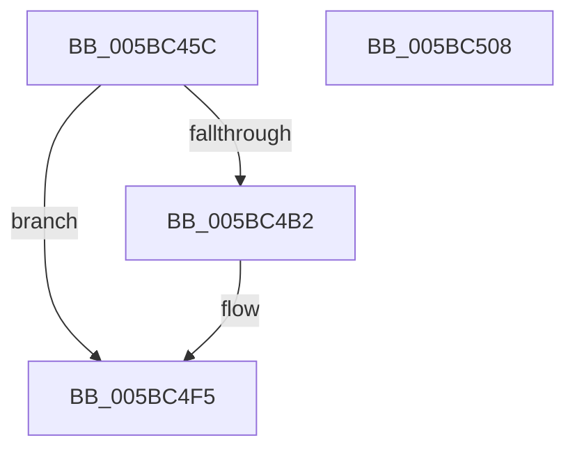

# KiAllocateSchedulerSubNode

- RVA: `0x005BC45C`–`0x005BC509` (길이 `173` bytes)
- VA: `0x00000001405BC45C`
- 실행 섹션: `.text`
- PDB 이름 있음: `예`; PDB Function 태그: `아니요`
- unwind 정보 RVA: `0x000718AC`
- 디코드: `41`개 명령, `173/173` bytes 표시
- 미해석 바이트: `0` (있으면 어셈블리에 `.byte`로 보존)

> 이 문서는 커널 이미지의 기계어와 PDB 기호를 분석해 생성했습니다. 4번과 5번은 함수 원형과 자료형을 바이너리 사용 방식에서 추정한 C 해석이며 원본 소스 복구 결과는 아닙니다.

## 1. Dependencies

- 직접 호출 지점: **2**; 고유 호출 대상: **2**
- 직접 호출자로 확인된 함수: **1**
- RIP 상대 이미지 참조: **0**

### Outgoing calls
- `0x005BC4A5` → [ExAllocatePool3](../../poolcode/B8/ExAllocatePool3_function_00B84270.md) (function, `0x00B84270`)
- `0x005BC4C2` → [KiInitializeSchedulerSubNode](KiInitializeSchedulerSubNode_function_005BCB74.md) (function, `0x005BCB74`)

### Direct callers
- [KiAllocateProcessorNumber](KiAllocateProcessorNumber_function_005BC2FC.md) at `0x005BC3AE`

### Static image references
- 디코드된 RIP-relative 메모리 참조가 없습니다.

## 2. Other-region calls and transfers

- 다른 실행 섹션으로 향하는 call: **1**
  - `0x005BC4A5` → [ExAllocatePool3](../../poolcode/B8/ExAllocatePool3_function_00B84270.md) (`.text` → `POOLCODE`)
- 별도 외부 분기/꼬리 이동을 확인하지 못했습니다.

## 3. Assembly (complete function range)

```asm
005BC45C  48 8B C4                        mov rax, rsp
005BC45F  48 89 58 08                     mov qword ptr [rax + 8], rbx
005BC463  48 89 70 10                     mov qword ptr [rax + 0x10], rsi
005BC467  57                              push rdi
005BC468  48 83 EC 40                     sub rsp, 0x40
005BC46C  0F 57 C0                        xorps xmm0, xmm0
005BC46F  C7 44 24 20 01 00 00 00         mov dword ptr [rsp + 0x20], 1
005BC477  0F 11 40 E8                     movups xmmword ptr [rax - 0x18], xmm0
005BC47B  C6 40 E8 03                     mov byte ptr [rax - 0x18], 3
005BC47F  4C 8D 4C 24 30                  lea r9, [rsp + 0x30]
005BC484  48 0F BA 68 E8 08               bts qword ptr [rax - 0x18], 8
005BC48A  48 8B F1                        mov rsi, rcx
005BC48D  0F B7 41 02                     movzx eax, word ptr [rcx + 2]
005BC491  33 DB                           xor ebx, ebx
005BC493  BA 80 11 00 00                  mov edx, 0x1180
005BC498  89 44 24 38                     mov dword ptr [rsp + 0x38], eax
005BC49C  41 B8 4B 69 53 6E               mov r8d, 0x6e53694b
005BC4A2  8D 4B 48                        lea ecx, [rbx + 0x48]
005BC4A5  E8 C6 7D 5C 00                  call 0x140b84270
005BC4AA  48 8B F8                        mov rdi, rax
005BC4AD  48 85 C0                        test rax, rax
005BC4B0  74 43                           je 0x1405bc4f5
005BC4B2  48 8B D6                        mov rdx, rsi
005BC4B5  48 8B C8                        mov rcx, rax
005BC4B8  48 8B D8                        mov rbx, rax
005BC4BB  48 81 C7 00 03 00 00            add rdi, 0x300
005BC4C2  E8 AD 06 00 00                  call 0x1405bcb74
005BC4C7  48 8D 8F 87 0A 00 00            lea rcx, [rdi + 0xa87]
005BC4CE  48 89 BB C0 00 00 00            mov qword ptr [rbx + 0xc0], rdi
005BC4D5  48 83 E1 F8                     and rcx, 0xfffffffffffffff8
005BC4D9  C6 83 B9 00 00 00 08            mov byte ptr [rbx + 0xb9], 8
005BC4E0  48 89 8B C8 00 00 00            mov qword ptr [rbx + 0xc8], rcx
005BC4E7  48 81 C1 00 02 00 00            add rcx, 0x200
005BC4EE  48 89 8B D0 00 00 00            mov qword ptr [rbx + 0xd0], rcx
005BC4F5  48 8B 74 24 58                  mov rsi, qword ptr [rsp + 0x58]
005BC4FA  48 8B C3                        mov rax, rbx
005BC4FD  48 8B 5C 24 50                  mov rbx, qword ptr [rsp + 0x50]
005BC502  48 83 C4 40                     add rsp, 0x40
005BC506  5F                              pop rdi
005BC507  C3                              ret
005BC508  CC                              int3
```

## 4. C-style interpretation (structured pseudocode)

```c
__int64 __fastcall KiAllocateSchedulerSubNode(__int64 a1)
{
    __int64 result;
    __int64 v_rbx;
    __int64 v_rdi;
    __int64 v_rsp;
    unsigned int v_stack_m10;
    unsigned __int64 v_stack_m18;
    unsigned int v_stack_m28;
    unsigned __int64 v_stack_p10;
    unsigned __int64 v_stack_p8;

    *(unsigned __int64 *)(v_rsp + 8) = v_rbx;
    *(unsigned __int64 *)(v_rsp + 16) = v_rsi;
    v_rsp = (v_rsp) - (64);
    v_stack_m28 = 1;
    *(unsigned __int64 *)(v_rsp - 24) = v_xmm0;
    *(unsigned __int8 *)(v_rsp - 24) = 3;
    v_rbx = 0;
    v_stack_m10 = (unsigned int)(*(unsigned __int16 *)(a1 + 2));
    result = ExAllocatePool3(v_rbx + 72, (unsigned int)(0x1180ULL), (unsigned int)(0x6E53694BULL), v_stack_m18);
    v_rdi = result;
    if (result != 0) {
        a2 = a1;
        a1 = result;
        v_rbx = result;
        v_rdi = (result) + (768);
        result = KiInitializeSchedulerSubNode(a1, a2, (unsigned int)(0x6E53694BULL), v_stack_m18);
        a1 = v_rdi + 2695;
        *(unsigned __int64 *)(v_rbx + 192) = v_rdi;
        a1 = (a1) & (-8);
        *(unsigned __int8 *)(v_rbx + 185) = 8;
        *(unsigned __int64 *)(v_rbx + 200) = a1;
        a1 = (a1) + (512);
        *(unsigned __int64 *)(v_rbx + 208) = a1;
    }
    v_rsp = (v_rsp) + (64);
    return v_rbx;
}
```

## 5. (Beta) C Style

```c
int64_t KiAllocateSchedulerSubNode(void *Arg1)
{
    uint8_t *arg1 = (uint8_t *)Arg1;

    int64_t result;
    int64_t local_rbx;
    int64_t local_rdi;
    int64_t local_rsp;
    uint32_t v_stack_m10;
    uint64_t v_stack_m18;
    uint32_t v_stack_m28;
    uint64_t v_stack_p10;
    uint64_t v_stack_p8;

    *(uint64_t *)(local_rsp + 0x8) = local_rbx;
    *(uint64_t *)(local_rsp + 0x10) = local_rsi;
    local_rsp = (local_rsp) - (64);
    v_stack_m28 = 1;
    *(uint64_t *)(local_rsp - 0x18) = v_xmm0;
    *(uint8_t *)(local_rsp - 0x18) = 3;
    local_rbx = 0;
    v_stack_m10 = (uint32_t)(*(uint16_t *)(arg1 + 0x2));
    result = ExAllocatePool3(local_rbx + 72, (uint32_t)(0x1180ULL), (uint32_t)(0x6E53694BULL), v_stack_m18);
    local_rdi = result;
    if (result != 0) {
        a2 = Arg1;
        Arg1 = result;
        local_rbx = result;
        local_rdi = (result) + (768);
        result = KiInitializeSchedulerSubNode(Arg1, a2, (uint32_t)(0x6E53694BULL), v_stack_m18);
        Arg1 = local_rdi + 2695;
        *(uint64_t *)(local_rbx + 0xC0) = local_rdi;
        Arg1 = (Arg1) & (-8);
        *(uint8_t *)(local_rbx + 0xB9) = 8;
        *(void **)(local_rbx + 0xC8) = Arg1;
        Arg1 = (Arg1) + (512);
        *(void **)(local_rbx + 0xD0) = Arg1;
    }
    local_rsp = (local_rsp) + (64);
    return local_rbx;
}
```

### 관측된 메모리 오프셋

구조체 형식이 확인되지 않은 접근은 인자 기준의 오프셋으로만 기록했습니다.

| 기준 인자 | 오프셋 표현 | 폭 (bit) | 접근 |
|---|---:|---:|---|
| `Arg1` | `+ 0x2` | `16` | `R` |

## 6. Execution-region graph

[열기: 2D/3D 그래프와 함수 탐색 컨트롤 패널](../../../control-panel.html?section=text&rva=0x005BC45C&view=graph)

- 2D 그래프는 위에서 아래로 흐르고, 3D 그래프는 빈 공간을 드래그해 회전합니다. Shift+드래그는 이동, 휠은 확대·축소, 함수 노드 선택은 대상 보고서 이동입니다.

### Static fallback


