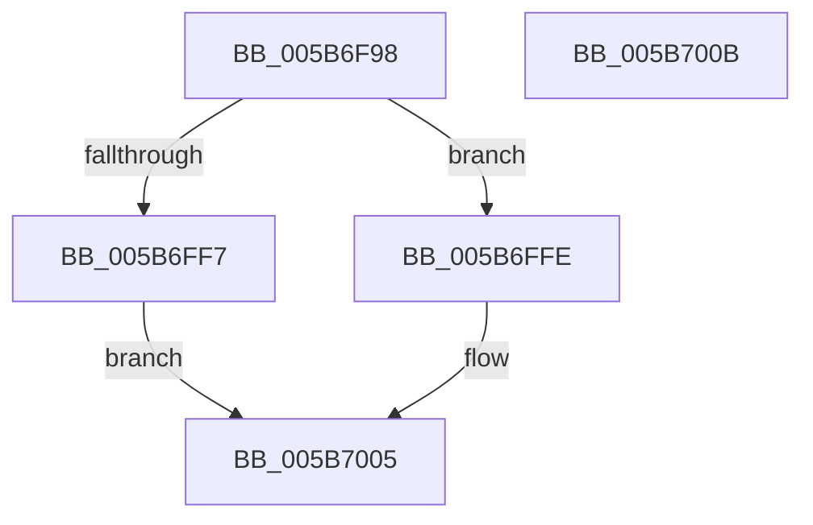

# KiAllocateStaticRescheduleContext

- RVA: `0x005B6F98`–`0x005B700C` (길이 `116` bytes)
- VA: `0x00000001405B6F98`
- 실행 섹션: `.text`
- PDB 이름 있음: `예`; PDB Function 태그: `아니요`
- unwind 정보 RVA: `0x000697A4`
- 디코드: `28`개 명령, `116/116` bytes 표시
- 미해석 바이트: `0` (있으면 어셈블리에 `.byte`로 보존)

> 이 문서는 커널 이미지의 기계어와 PDB 기호를 분석해 생성했습니다. 4번과 5번은 함수 원형과 자료형을 바이너리 사용 방식에서 추정한 C 해석이며 원본 소스 복구 결과는 아닙니다.

## 1. Dependencies

- 직접 호출 지점: **1**; 고유 호출 대상: **1**
- 직접 호출자로 확인된 함수: **2**
- RIP 상대 이미지 참조: **0**

### Outgoing calls
- `0x005B6FE8` → [ExAllocatePool3](../../poolcode/B8/ExAllocatePool3_function_00B84270.md) (function, `0x00B84270`)

### Direct callers
- [KiStartDynamicProcessor](../../page/74/KiStartDynamicProcessor_function_007456C8.md) at `0x007459A7`
- [KeStartAllProcessors](../../init/C3/KeStartAllProcessors_function_00C36F78.md) at `0x00C372FD`

### Static image references
- 디코드된 RIP-relative 메모리 참조가 없습니다.

## 2. Other-region calls and transfers

- 다른 실행 섹션으로 향하는 call: **1**
  - `0x005B6FE8` → [ExAllocatePool3](../../poolcode/B8/ExAllocatePool3_function_00B84270.md) (`.text` → `POOLCODE`)
- 별도 외부 분기/꼬리 이동을 확인하지 못했습니다.

## 3. Assembly (complete function range)

```asm
005B6F98  40 53                           push rbx
005B6F9A  48 83 EC 40                     sub rsp, 0x40
005B6F9E  48 8B 81 C0 00 00 00            mov rax, qword ptr [rcx + 0xc0]
005B6FA5  4C 8D 4C 24 30                  lea r9, [rsp + 0x30]
005B6FAA  0F 57 C0                        xorps xmm0, xmm0
005B6FAD  C7 44 24 20 01 00 00 00         mov dword ptr [rsp + 0x20], 1
005B6FB5  0F 11 44 24 30                  movups xmmword ptr [rsp + 0x30], xmm0
005B6FBA  48 8B D9                        mov rbx, rcx
005B6FBD  C6 44 24 30 03                  mov byte ptr [rsp + 0x30], 3
005B6FC2  0F B7 90 8A 00 00 00            movzx edx, word ptr [rax + 0x8a]
005B6FC9  B9 40 00 00 00                  mov ecx, 0x40
005B6FCE  48 0F BA 6C 24 30 08            bts qword ptr [rsp + 0x30], 8
005B6FD5  0F BA EA 1F                     bts edx, 0x1f
005B6FD9  89 54 24 38                     mov dword ptr [rsp + 0x38], edx
005B6FDD  41 B8 4B 69 52 43               mov r8d, 0x4352694b
005B6FE3  BA F0 00 00 00                  mov edx, 0xf0
005B6FE8  E8 83 D2 5C 00                  call 0x140b84270
005B6FED  48 8B C8                        mov rcx, rax
005B6FF0  33 C0                           xor eax, eax
005B6FF2  48 85 C9                        test rcx, rcx
005B6FF5  75 07                           jne 0x1405b6ffe
005B6FF7  B8 9A 00 00 C0                  mov eax, 0xc000009a
005B6FFC  EB 07                           jmp 0x1405b7005
005B6FFE  48 89 8B E8 37 00 00            mov qword ptr [rbx + 0x37e8], rcx
005B7005  48 83 C4 40                     add rsp, 0x40
005B7009  5B                              pop rbx
005B700A  C3                              ret
005B700B  CC                              int3
```

## 4. C-style interpretation (structured pseudocode)

```c
__int64 __fastcall KiAllocateStaticRescheduleContext(__int64 a1)
{
    __int64 result;
    __int64 v_rsp;
    unsigned int v_stack_m10;
    unsigned __int64 v_stack_m18;
    unsigned int v_stack_m28;

    v_rsp = (v_rsp) - (64);
    v_stack_m28 = 1;
    v_stack_m18 = v_xmm0;
    v_stack_m18 = 3;
    v_stack_m10 = (unsigned int)(*(unsigned __int16 *)(*(unsigned __int64 *)(a1 + 192) + 138));
    result = ExAllocatePool3(64, 240, (unsigned int)(0x4352694BULL), v_stack_m18);
    result = 0;
    if (0 != 0) goto loc_005B6FFE;
    goto loc_005B7005;
loc_005B6FFE:
    *(unsigned __int64 *)(a1 + 14312) = 0;
loc_005B7005:
    v_rsp = (v_rsp) + (64);
    return (unsigned int)(0xC000009AULL);
}
```

## 5. (Beta) C Style

```c
int64_t KiAllocateStaticRescheduleContext(void *Arg1)
{
    uint8_t *arg1 = (uint8_t *)Arg1;

    int64_t result;
    int64_t local_rsp;
    uint32_t v_stack_m10;
    uint64_t v_stack_m18;
    uint32_t v_stack_m28;

    local_rsp = (local_rsp) - (64);
    v_stack_m28 = 1;
    v_stack_m18 = v_xmm0;
    v_stack_m18 = 3;
    v_stack_m10 = (uint32_t)(*(uint16_t *)(*(uint64_t *)(arg1 + 0xC0) + 0x8A));
    result = ExAllocatePool3(64, 240, (uint32_t)(0x4352694BULL), v_stack_m18);
    result = 0;
    if (0 != 0) goto loc_005B6FFE;
    goto loc_005B7005;
loc_005B6FFE:
    *(uint64_t *)(arg1 + 0x37E8) = 0;
loc_005B7005:
    local_rsp = (local_rsp) + (64);
    return (uint32_t)(0xC000009AULL);
}
```

### 관측된 메모리 오프셋

구조체 형식이 확인되지 않은 접근은 인자 기준의 오프셋으로만 기록했습니다.

| 기준 인자 | 오프셋 표현 | 폭 (bit) | 접근 |
|---|---:|---:|---|
| `Arg1` | `+ 0xC0` | `64` | `R` |
| `Arg1` | `+ 0x37E8` | `64` | `W` |

## 6. Execution-region graph

[열기: 2D/3D 그래프와 함수 탐색 컨트롤 패널](../../../control-panel.html?section=text&rva=0x005B6F98&view=graph)

- 2D 그래프는 위에서 아래로 흐르고, 3D 그래프는 빈 공간을 드래그해 회전합니다. Shift+드래그는 이동, 휠은 확대·축소, 함수 노드 선택은 대상 보고서 이동입니다.

### Static fallback


