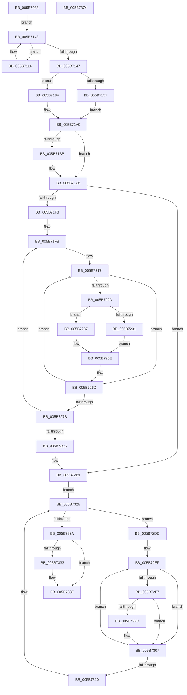

# KiAssignCooperativeIdleSearchContexts

- RVA: `0x005B7088`–`0x005B7375` (길이 `749` bytes)
- VA: `0x00000001405B7088`
- 실행 섹션: `.text`
- PDB 이름 있음: `예`; PDB Function 태그: `아니요`
- unwind 정보 RVA: `0x000C7A90`
- 디코드: `180`개 명령, `749/749` bytes 표시
- 미해석 바이트: `0` (있으면 어셈블리에 `.byte`로 보존)

> 이 문서는 커널 이미지의 기계어와 PDB 기호를 분석해 생성했습니다. 4번과 5번은 함수 원형과 자료형을 바이너리 사용 방식에서 추정한 C 해석이며 원본 소스 복구 결과는 아닙니다.

## 1. Dependencies

- 직접 호출 지점: **14**; 고유 호출 대상: **8**
- 직접 호출자로 확인된 함수: **1**
- RIP 상대 이미지 참조: **6**

### Outgoing calls
- `0x005B70DC` → [memset](../6C/memset_function_006C6C40.md) (function, `0x006C6C40`)
- `0x005B7106` → [KeEnumerateNextProcessor](../41/KeEnumerateNextProcessor_function_00415480.md) (function, `0x00415480`)
- `0x005B713E` → [KeEnumerateNextProcessor](../41/KeEnumerateNextProcessor_function_00415480.md) (function, `0x00415480`)
- `0x005B7188` → [KiMergeSmallSharedReadyQueueAssignments](../5C/KiMergeSmallSharedReadyQueueAssignments_function_005CA460.md) (function, `0x005CA460`)
- `0x005B719B` → [memset](../6C/memset_function_006C6C40.md) (function, `0x006C6C40`)
- `0x005B71C1` → [KiRaiseIrqlProcessIrqlFlags](../4F/KiRaiseIrqlProcessIrqlFlags_function_004F56FC.md) (function, `0x004F56FC`)
- `0x005B71EB` → [KeEnumerateNextProcessor](../41/KeEnumerateNextProcessor_function_00415480.md) (function, `0x00415480`)
- `0x005B7268` → [KiRegisterProcessorWithCooperativeIdleSearchContext](../5C/KiRegisterProcessorWithCooperativeIdleSearchContext_function_005C8F30.md) (function, `0x005C8F30`)
- `0x005B7285` → [KeEnumerateNextProcessor](../41/KeEnumerateNextProcessor_function_00415480.md) (function, `0x00415480`)
- `0x005B72D6` → [KeEnumerateNextProcessor](../41/KeEnumerateNextProcessor_function_00415480.md) (function, `0x00415480`)
- `0x005B72FF` → [ExFreePoolWithTag](../../poolcode/B8/ExFreePoolWithTag_function_00B82870.md) (function, `0x00B82870`)
- `0x005B731A` → [KeEnumerateNextProcessor](../41/KeEnumerateNextProcessor_function_00415480.md) (function, `0x00415480`)
- `0x005B733A` → [KiLowerIrqlProcessIrqlFlags](../4F/KiLowerIrqlProcessIrqlFlags_function_004F5698.md) (function, `0x004F5698`)
- `0x005B734E` → [_security_check_cookie](../6A/_security_check_cookie_function_006AC640.md) (function, `0x006AC640`)

### Direct callers
- [KiConfigureNodeSchedulingInformation](KiConfigureNodeSchedulingInformation_function_005B7A9C.md) at `0x005B7C08`

### Static image references
- `0x005B70AB` → RVA `0x00E0A740` (`.data`; read)
- `0x005B710B` → RVA `0x00FC8C40` (`ALMOSTRO`; read)
- `0x005B714D` → RVA `0x00F21AC8` (`.data`; read)
- `0x005B7163` → RVA `0x00FC5378` (`ALMOSTRO`; read)
- `0x005B71B2` → RVA `0x00FC6D20` (`ALMOSTRO`; read)
- `0x005B7237` → RVA `0x00F231B8` (`.data`; read)

## 2. Other-region calls and transfers

- 다른 실행 섹션으로 향하는 call: **1**
  - `0x005B72FF` → [ExFreePoolWithTag](../../poolcode/B8/ExFreePoolWithTag_function_00B82870.md) (`.text` → `POOLCODE`)
- 별도 외부 분기/꼬리 이동을 확인하지 못했습니다.

## 3. Assembly (complete function range)

```asm
005B7088  48 8B C4                        mov rax, rsp
005B708B  48 89 58 10                     mov qword ptr [rax + 0x10], rbx
005B708F  48 89 70 18                     mov qword ptr [rax + 0x18], rsi
005B7093  48 89 78 20                     mov qword ptr [rax + 0x20], rdi
005B7097  55                              push rbp
005B7098  41 54                           push r12
005B709A  41 55                           push r13
005B709C  41 56                           push r14
005B709E  41 57                           push r15
005B70A0  48 8D 68 A1                     lea rbp, [rax - 0x5f]
005B70A4  48 81 EC E0 00 00 00            sub rsp, 0xe0
005B70AB  48 8B 05 8E 36 85 00            mov rax, qword ptr [rip + 0x85368e]
005B70B2  48 33 C4                        xor rax, rsp
005B70B5  48 89 45 27                     mov qword ptr [rbp + 0x27], rax
005B70B9  45 33 ED                        xor r13d, r13d
005B70BC  BE FF 00 00 00                  mov esi, 0xff
005B70C1  48 8B D9                        mov rbx, rcx
005B70C4  44 89 6C 24 20                  mov dword ptr [rsp + 0x20], r13d
005B70C9  8B D6                           mov edx, esi
005B70CB  44 89 6D 91                     mov dword ptr [rbp - 0x6f], r13d
005B70CF  48 8D 4D A7                     lea rcx, [rbp - 0x59]
005B70D3  66 44 89 6D 95                  mov word ptr [rbp - 0x6b], r13w
005B70D8  44 8D 46 81                     lea r8d, [rsi - 0x7f]
005B70DC  E8 5F FB 10 00                  call 0x1406c6c40
005B70E1  48 8B 8B 80 00 00 00            mov rcx, qword ptr [rbx + 0x80]
005B70E8  48 8D 54 24 28                  lea rdx, [rsp + 0x28]
005B70ED  0F B7 83 88 00 00 00            movzx eax, word ptr [rbx + 0x88]
005B70F4  48 89 4D 87                     mov qword ptr [rbp - 0x79], rcx
005B70F8  48 8D 4C 24 20                  lea rcx, [rsp + 0x20]
005B70FD  66 89 45 8F                     mov word ptr [rbp - 0x71], ax
005B7101  4C 89 6C 24 28                  mov qword ptr [rsp + 0x28], r13
005B7106  E8 75 E3 E5 FF                  call 0x140415480
005B710B  48 8D 3D 2E 1B A1 00            lea rdi, [rip + 0xa11b2e]
005B7112  EB 2F                           jmp 0x1405b7143
005B7114  8B 44 24 20                     mov eax, dword ptr [rsp + 0x20]
005B7118  48 8B 0C C7                     mov rcx, qword ptr [rdi + rax*8]
005B711C  0F B6 91 D1 00 00 00            movzx edx, byte ptr [rcx + 0xd1]
005B7123  48 8B 81 48 8E 00 00            mov rax, qword ptr [rcx + 0x8e48]
005B712A  48 8D 4C 24 20                  lea rcx, [rsp + 0x20]
005B712F  8A 80 C1 02 00 00               mov al, byte ptr [rax + 0x2c1]
005B7135  88 44 15 A7                     mov byte ptr [rbp + rdx - 0x59], al
005B7139  48 8D 54 24 28                  lea rdx, [rsp + 0x28]
005B713E  E8 3D E3 E5 FF                  call 0x140415480
005B7143  85 C0                           test eax, eax
005B7145  74 CD                           je 0x1405b7114
005B7147  41 BF 01 00 00 00               mov r15d, 1
005B714D  66 44 39 3D 73 A9 96 00         cmp word ptr [rip + 0x96a973], r15w
005B7155  76 38                           jbe 0x1405b718f
005B7157  0F 28 45 A7                     movaps xmm0, xmmword ptr [rbp - 0x59]
005B715B  4C 8D 45 E7                     lea r8, [rbp - 0x19]
005B715F  0F 28 4D B7                     movaps xmm1, xmmword ptr [rbp - 0x49]
005B7163  8B 15 0F E2 A0 00               mov edx, dword ptr [rip + 0xa0e20f]
005B7169  48 8B 8B 80 00 00 00            mov rcx, qword ptr [rbx + 0x80]
005B7170  0F 29 45 E7                     movaps xmmword ptr [rbp - 0x19], xmm0
005B7174  0F 28 45 C7                     movaps xmm0, xmmword ptr [rbp - 0x39]
005B7178  0F 29 4D F7                     movaps xmmword ptr [rbp - 9], xmm1
005B717C  0F 28 4D D7                     movaps xmm1, xmmword ptr [rbp - 0x29]
005B7180  0F 29 45 07                     movaps xmmword ptr [rbp + 7], xmm0
005B7184  0F 29 4D 17                     movaps xmmword ptr [rbp + 0x17], xmm1
005B7188  E8 D3 32 01 00                  call 0x1405ca460
005B718D  EB 11                           jmp 0x1405b71a0
005B718F  41 B8 40 00 00 00               mov r8d, 0x40
005B7195  48 8D 4D E7                     lea rcx, [rbp - 0x19]
005B7199  8B D6                           mov edx, esi
005B719B  E8 A0 FA 10 00                  call 0x1406c6c40
005B71A0  44 0F 20 C6                     mov rsi, cr8
005B71A4  48 89 75 97                     mov qword ptr [rbp - 0x69], rsi
005B71A8  41 BE 02 00 00 00               mov r14d, 2
005B71AE  45 0F 22 C6                     mov cr8, r14
005B71B2  44 39 2D 67 FB A0 00            cmp dword ptr [rip + 0xa0fb67], r13d
005B71B9  74 0B                           je 0x1405b71c6
005B71BB  41 8A D6                        mov dl, r14b
005B71BE  40 8A CE                        mov cl, sil
005B71C1  E8 36 E5 F3 FF                  call 0x1404f56fc
005B71C6  48 8B 8B 80 00 00 00            mov rcx, qword ptr [rbx + 0x80]
005B71CD  48 8D 54 24 28                  lea rdx, [rsp + 0x28]
005B71D2  0F B7 83 88 00 00 00            movzx eax, word ptr [rbx + 0x88]
005B71D9  48 89 4D 87                     mov qword ptr [rbp - 0x79], rcx
005B71DD  48 8D 4C 24 20                  lea rcx, [rsp + 0x20]
005B71E2  66 89 45 8F                     mov word ptr [rbp - 0x71], ax
005B71E6  4C 89 6C 24 28                  mov qword ptr [rsp + 0x28], r13
005B71EB  E8 90 E2 E5 FF                  call 0x140415480
005B71F0  85 C0                           test eax, eax
005B71F2  0F 85 B9 00 00 00               jne 0x1405b72b1
005B71F8  49 8B F6                        mov rsi, r14
005B71FB  8B 44 24 20                     mov eax, dword ptr [rsp + 0x20]
005B71FF  4D 8B FD                        mov r15, r13
005B7202  4C 8B E6                        mov r12, rsi
005B7205  4C 8D 2D 34 1A A1 00            lea r13, [rip + 0xa11a34]
005B720C  4C 8B 34 C7                     mov r14, qword ptr [rdi + rax*8]
005B7210  49 8D BE 18 94 00 00            lea rdi, [r14 + 0x9418]
005B7217  41 0F B6 8E D1 00 00 00         movzx ecx, byte ptr [r14 + 0xd1]
005B721F  49 8D 04 0F                     lea rax, [r15 + rcx]
005B7223  0F B6 54 05 A7                  movzx edx, byte ptr [rbp + rax - 0x59]
005B7228  80 FA FF                        cmp dl, 0xff
005B722B  74 40                           je 0x1405b726d
005B722D  3A D1                           cmp dl, cl
005B722F  75 06                           jne 0x1405b7237
005B7231  48 8B 4F F0                     mov rcx, qword ptr [rdi - 0x10]
005B7235  EB 27                           jmp 0x1405b725e
005B7237  48 8B 05 7A BF 96 00            mov rax, qword ptr [rip + 0x96bf7a]
005B723E  0F B7 8B 88 00 00 00            movzx ecx, word ptr [rbx + 0x88]
005B7245  48 C1 E1 06                     shl rcx, 6
005B7249  48 03 CA                        add rcx, rdx
005B724C  8B 0C 88                        mov ecx, dword ptr [rax + rcx*4]
005B724F  48 8B C7                        mov rax, rdi
005B7252  49 2B C6                        sub rax, r14
005B7255  49 8B 4C CD 00                  mov rcx, qword ptr [r13 + rcx*8]
005B725A  48 8B 0C 08                     mov rcx, qword ptr [rax + rcx]
005B725E  4C 8B 47 10                     mov r8, qword ptr [rdi + 0x10]
005B7262  49 8B D6                        mov rdx, r14
005B7265  48 89 0F                        mov qword ptr [rdi], rcx
005B7268  E8 C3 1C 01 00                  call 0x1405c8f30
005B726D  48 83 C7 08                     add rdi, 8
005B7271  49 83 C7 40                     add r15, 0x40
005B7275  49 83 EC 01                     sub r12, 1
005B7279  75 9C                           jne 0x1405b7217
005B727B  48 8D 54 24 28                  lea rdx, [rsp + 0x28]
005B7280  48 8D 4C 24 20                  lea rcx, [rsp + 0x20]
005B7285  E8 F6 E1 E5 FF                  call 0x140415480
005B728A  45 33 ED                        xor r13d, r13d
005B728D  48 8D 3D AC 19 A1 00            lea rdi, [rip + 0xa119ac]
005B7294  85 C0                           test eax, eax
005B7296  0F 84 5F FF FF FF               je 0x1405b71fb
005B729C  48 8B 75 97                     mov rsi, qword ptr [rbp - 0x69]
005B72A0  45 8D 74 24 02                  lea r14d, [r12 + 2]
005B72A5  45 8D 7C 24 01                  lea r15d, [r12 + 1]
005B72AA  48 8D 3D 8F 19 A1 00            lea rdi, [rip + 0xa1198f]
005B72B1  48 8B 8B 80 00 00 00            mov rcx, qword ptr [rbx + 0x80]
005B72B8  48 8D 54 24 28                  lea rdx, [rsp + 0x28]
005B72BD  0F B7 83 88 00 00 00            movzx eax, word ptr [rbx + 0x88]
005B72C4  48 89 4D 87                     mov qword ptr [rbp - 0x79], rcx
005B72C8  48 8D 4C 24 20                  lea rcx, [rsp + 0x20]
005B72CD  66 89 45 8F                     mov word ptr [rbp - 0x71], ax
005B72D1  4C 89 6C 24 28                  mov qword ptr [rsp + 0x28], r13
005B72D6  E8 A5 E1 E5 FF                  call 0x140415480
005B72DB  EB 49                           jmp 0x1405b7326
005B72DD  8B 44 24 20                     mov eax, dword ptr [rsp + 0x20]
005B72E1  48 8B 1C C7                     mov rbx, qword ptr [rdi + rax*8]
005B72E5  49 8B FE                        mov rdi, r14
005B72E8  48 81 C3 08 94 00 00            add rbx, 0x9408
005B72EF  48 8B 0B                        mov rcx, qword ptr [rbx]
005B72F2  48 85 C9                        test rcx, rcx
005B72F5  74 10                           je 0x1405b7307
005B72F7  48 39 4B 10                     cmp qword ptr [rbx + 0x10], rcx
005B72FB  74 0A                           je 0x1405b7307
005B72FD  33 D2                           xor edx, edx
005B72FF  E8 6C B5 5C 00                  call 0x140b82870
005B7304  4C 89 2B                        mov qword ptr [rbx], r13
005B7307  48 83 C3 08                     add rbx, 8
005B730B  49 2B FF                        sub rdi, r15
005B730E  75 DF                           jne 0x1405b72ef
005B7310  48 8D 54 24 28                  lea rdx, [rsp + 0x28]
005B7315  48 8D 4C 24 20                  lea rcx, [rsp + 0x20]
005B731A  E8 61 E1 E5 FF                  call 0x140415480
005B731F  48 8D 3D 1A 19 A1 00            lea rdi, [rip + 0xa1191a]
005B7326  85 C0                           test eax, eax
005B7328  74 B3                           je 0x1405b72dd
005B732A  44 39 2D EF F9 A0 00            cmp dword ptr [rip + 0xa0f9ef], r13d
005B7331  74 0C                           je 0x1405b733f
005B7333  44 0F 20 C1                     mov rcx, cr8
005B7337  40 8A D6                        mov dl, sil
005B733A  E8 59 E3 F3 FF                  call 0x1404f5698
005B733F  40 0F B6 C6                     movzx eax, sil
005B7343  44 0F 22 C0                     mov cr8, rax
005B7347  48 8B 4D 27                     mov rcx, qword ptr [rbp + 0x27]
005B734B  48 33 CC                        xor rcx, rsp
005B734E  E8 ED 52 0F 00                  call 0x1406ac640
005B7353  4C 8D 9C 24 E0 00 00 00         lea r11, [rsp + 0xe0]
005B735B  49 8B 5B 38                     mov rbx, qword ptr [r11 + 0x38]
005B735F  49 8B 73 40                     mov rsi, qword ptr [r11 + 0x40]
005B7363  49 8B 7B 48                     mov rdi, qword ptr [r11 + 0x48]
005B7367  49 8B E3                        mov rsp, r11
005B736A  41 5F                           pop r15
005B736C  41 5E                           pop r14
005B736E  41 5D                           pop r13
005B7370  41 5C                           pop r12
005B7372  5D                              pop rbp
005B7373  C3                              ret
005B7374  CC                              int3
```

## 4. C-style interpretation (structured pseudocode)

```c
__int64 __fastcall KiAssignCooperativeIdleSearchContexts(__int64 a1)
{
    __int64 result;
    __int64 v_r12;
    __int64 v_r13;
    __int64 v_r15;
    __int64 v_rbx;
    __int64 v_rdi;
    __int64 v_rsp;
    unsigned __int64 v_stack_m28;
    unsigned __int64 v_stack_mE0;
    unsigned int v_stack_mE8;

    *(unsigned __int64 *)(v_rsp + 16) = v_rbx;
    *(unsigned __int64 *)(v_rsp + 24) = v_rsi;
    *(unsigned __int64 *)(v_rsp + 32) = v_rdi;
    v_rsp = (v_rsp) - (224);
    result = (*(unsigned __int64 *)(v_rip + 8730254)) ^ (v_rsp);
    *(unsigned __int64 *)(v_rsp - 95 + 39) = result;
    v_r13 = 0;
    v_stack_mE8 = 0;
    *(unsigned int *)(v_rsp - 95 - 111) = 0;
    *(unsigned __int16 *)(v_rsp - 95 - 107) = 0;
    result = memset(v_rsp - 95 - 89, 255, 255 - 127, a4);
    *(unsigned __int64 *)(v_rsp - 95 - 121) = *(unsigned __int64 *)(a1 + 128);
    *(unsigned __int16 *)(v_rsp - 95 - 113) = (unsigned __int16)(*(unsigned __int16 *)(a1 + 136));
    v_stack_mE0 = 0;
    result = KeEnumerateNextProcessor(v_stack_mE8, v_stack_mE0, 255 - 127, a4);
    goto loc_005B7143;
loc_005B7114:
    *(unsigned __int8 *)(v_rsp - 95 + *(unsigned __int8 *)(*(unsigned __int64 *)(v_rip + 10558254 + (unsigned int)(v_stack_mE8) * 8) + 209) * 1 - 89) = (unsigned __int8)(*(unsigned __int8 *)(*(unsigned __int64 *)(*(unsigned __int64 *)(v_rip + 10558254 + (unsigned int)(v_stack_mE8) * 8) + 36424) + 705));
    result = KeEnumerateNextProcessor(v_stack_mE8, v_stack_mE0, 255 - 127, a4);
loc_005B7143:
    if ((unsigned int)(result) == 0) goto loc_005B7114;
    if ((*(unsigned __int16 *)(v_rip + 9873779)) <= 1) goto loc_005B718F;
    *(unsigned __int64 *)(v_rsp - 95 - 25) = v_xmm0;
    *(unsigned __int64 *)(v_rsp - 95 - 9) = v_xmm1;
    *(unsigned __int64 *)(v_rsp - 95 + 7) = v_xmm0;
    *(unsigned __int64 *)(v_rsp - 95 + 23) = v_xmm1;
    result = KiMergeSmallSharedReadyQueueAssignments(*(unsigned __int64 *)(a1 + 128), (unsigned int)(*(unsigned int *)(v_rip + 10543631)), v_rsp - 95 - 25, a4);
    goto loc_005B71A0;
loc_005B718F:
    result = memset(v_rsp - 95 - 25, 255, 64, a4);
loc_005B71A0:
    *(unsigned __int64 *)(v_rsp - 95 - 105) = v_cr8;
    if ((*(unsigned int *)(v_rip + 10550119)) != 0) {
        a2 = 2;
        a1 = (unsigned __int8)(v_cr8);
        result = KiRaiseIrqlProcessIrqlFlags(a1, a2, 64, a4);
    }
    *(unsigned __int64 *)(v_rsp - 95 - 121) = *(unsigned __int64 *)(a1 + 128);
    *(unsigned __int16 *)(v_rsp - 95 - 113) = (unsigned __int16)(*(unsigned __int16 *)(a1 + 136));
    v_stack_mE0 = 0;
    result = KeEnumerateNextProcessor(v_stack_mE8, v_stack_mE0, 64, a4);
    if ((unsigned int)(result) != 0) goto loc_005B72B1;
loc_005B71FB:
loc_005B7217:
    if (((unsigned __int8)(*(unsigned __int8 *)(v_rsp - 95 + 0 + *(unsigned __int8 *)(*(unsigned __int64 *)(v_rip + 10558254 + (unsigned int)(v_stack_mE8) * 8) + 209) * 1 * 1 - 89))) == 255) goto loc_005B726D;
    if (((unsigned __int8)(*(unsigned __int8 *)(v_rsp - 95 + 0 + *(unsigned __int8 *)(*(unsigned __int64 *)(v_rip + 10558254 + (unsigned int)(v_stack_mE8) * 8) + 209) * 1 * 1 - 89))) != ((unsigned __int8)(*(unsigned __int8 *)(*(unsigned __int64 *)(v_rip + 10558254 + (unsigned int)(v_stack_mE8) * 8) + 209)))) goto loc_005B7237;
    goto loc_005B725E;
loc_005B7237:
    a1 = (*(unsigned __int16 *)(a1 + 136)) << (6);
    a1 = (a1) + (*(unsigned __int8 *)(v_rsp - 95 + 0 + *(unsigned __int8 *)(*(unsigned __int64 *)(v_rip + 10558254 + (unsigned int)(v_stack_mE8) * 8) + 209) * 1 * 1 - 89));
    result = (*(unsigned __int64 *)(v_rip + 10558254 + (unsigned int)(v_stack_mE8) * 8) + 37912) - (*(unsigned __int64 *)(v_rip + 10558254 + (unsigned int)(v_stack_mE8) * 8));
loc_005B725E:
    *(unsigned __int64 *)(*(unsigned __int64 *)(v_rip + 10558254 + (unsigned int)(v_stack_mE8) * 8) + 37912) = *(unsigned __int64 *)(result + *(unsigned __int64 *)(v_rip + 10558004 + (unsigned int)(*(unsigned int *)(*(unsigned __int64 *)(v_rip + 9879418) + a1 * 4)) * 8) * 1);
    result = KiRegisterProcessorWithCooperativeIdleSearchContext(*(unsigned __int64 *)(result + *(unsigned __int64 *)(v_rip + 10558004 + (unsigned int)(*(unsigned int *)(*(unsigned __int64 *)(v_rip + 9879418) + a1 * 4)) * 8) * 1), *(unsigned __int64 *)(v_rip + 10558254 + (unsigned int)(v_stack_mE8) * 8), *(unsigned __int64 *)(*(unsigned __int64 *)(v_rip + 10558254 + (unsigned int)(v_stack_mE8) * 8) + 37912 + 16), a4);
loc_005B726D:
    v_rdi = (*(unsigned __int64 *)(v_rip + 10558254 + (unsigned int)(v_stack_mE8) * 8) + 37912) + (8);
    v_r15 = (0) + (64);
    v_r12 = (2) - (1);
    if (condition_is_not_equal) goto loc_005B7217;
    result = KeEnumerateNextProcessor(v_stack_mE8, v_stack_mE0, *(unsigned __int64 *)(*(unsigned __int64 *)(v_rip + 10558254 + (unsigned int)(v_stack_mE8) * 8) + 37912 + 16), a4);
    v_r13 = 0;
    if ((unsigned int)(result) == 0) goto loc_005B71FB;
loc_005B72B1:
    *(unsigned __int64 *)(v_rsp - 95 - 121) = *(unsigned __int64 *)(a1 + 128);
    *(unsigned __int16 *)(v_rsp - 95 - 113) = (unsigned __int16)(*(unsigned __int16 *)(a1 + 136));
    v_stack_mE0 = 0;
    result = KeEnumerateNextProcessor(v_stack_mE8, v_stack_mE0, *(unsigned __int64 *)(*(unsigned __int64 *)(v_rip + 10558254 + (unsigned int)(v_stack_mE8) * 8) + 37912 + 16), a4);
    goto loc_005B7326;
loc_005B72DD:
    v_rbx = (*(unsigned __int64 *)(v_rip + 10557839 + (unsigned int)(v_stack_mE8) * 8)) + (0x9408ULL);
loc_005B72EF:
    if (*(unsigned __int64 *)(v_rbx) == 0) goto loc_005B7307;
    result = (unsigned int)(v_stack_mE8);
    if ((*(unsigned __int64 *)(v_rbx + 16)) != (*(unsigned __int64 *)(v_rbx))) {
        a2 = 0;
        result = ExFreePoolWithTag(*(unsigned __int64 *)(v_rbx), a2, *(unsigned __int64 *)(*(unsigned __int64 *)(v_rip + 10558254 + (unsigned int)(v_stack_mE8) * 8) + 37912 + 16), a4);
        *(unsigned __int64 *)(v_rbx) = 0;
    }
    v_rbx = (v_rbx) + (8);
    v_rdi = (v_r12 + 2) - (v_r12 + 1);
    if (condition_is_not_equal) goto loc_005B72EF;
    result = KeEnumerateNextProcessor(v_stack_mE8, v_stack_mE0, *(unsigned __int64 *)(*(unsigned __int64 *)(v_rip + 10558254 + (unsigned int)(v_stack_mE8) * 8) + 37912 + 16), a4);
loc_005B7326:
    if ((unsigned int)(result) == 0) goto loc_005B72DD;
    if ((*(unsigned int *)(v_rip + 10549743)) != 0) {
        a1 = 2;
        a2 = (unsigned __int8)(*(unsigned __int64 *)(v_rsp - 95 - 105));
        result = KiLowerIrqlProcessIrqlFlags(a1, a2, *(unsigned __int64 *)(*(unsigned __int64 *)(v_rip + 10558254 + (unsigned int)(v_stack_mE8) * 8) + 37912 + 16), a4);
    }
    a1 = (*(unsigned __int64 *)(v_rsp - 95 + 39)) ^ (v_rsp);
    result = _security_check_cookie(a1, a2, *(unsigned __int64 *)(*(unsigned __int64 *)(v_rip + 10558254 + (unsigned int)(v_stack_mE8) * 8) + 37912 + 16), a4);
    return result;
}
```

## 5. (Beta) C Style

```c
int64_t KiAssignCooperativeIdleSearchContexts(void *Arg1)
{
    uint8_t *arg1 = (uint8_t *)Arg1;

    int64_t result;
    int64_t local_r12;
    int64_t local_r13;
    int64_t local_r15;
    int64_t local_rbx;
    int64_t local_rdi;
    int64_t local_rsp;
    uint64_t v_stack_m28;
    uint64_t v_stack_mE0;
    uint32_t v_stack_mE8;

    *(uint64_t *)(local_rsp + 0x10) = local_rbx;
    *(uint64_t *)(local_rsp + 0x18) = local_rsi;
    *(uint64_t *)(local_rsp + 0x20) = local_rdi;
    local_rsp = (local_rsp) - (224);
    result = (*(uint64_t *)(v_rip + 0x85368E)) ^ (local_rsp);
    *(uint64_t *)(local_rsp - 0x5F + 0x27) = result;
    local_r13 = 0;
    v_stack_mE8 = 0;
    *(uint32_t *)(local_rsp - 0x5F - 0x6F) = 0;
    *(uint16_t *)(local_rsp - 0x5F - 0x6B) = 0;
    result = memset(local_rsp - 95 - 89, 255, 255 - 127, a4);
    *(uint64_t *)(local_rsp - 0x5F - 0x79) = *(uint64_t *)(arg1 + 0x80);
    *(uint16_t *)(local_rsp - 0x5F - 0x71) = (uint16_t)(*(uint16_t *)(arg1 + 0x88));
    v_stack_mE0 = 0;
    result = KeEnumerateNextProcessor(v_stack_mE8, v_stack_mE0, 255 - 127, a4);
    goto loc_005B7143;
loc_005B7114:
    *(uint8_t *)(local_rsp - 0x5F + *(uint8_t *)(*(uint64_t *)(v_rip + 0xA11B2E + (uint32_t)(v_stack_mE8) * 8) + 0xD1) * 1 - 0x59) = (uint8_t)(*(uint8_t *)(*(uint64_t *)(*(uint64_t *)(v_rip + 0xA11B2E + (uint32_t)(v_stack_mE8) * 8) + 0x8E48) + 0x2C1));
    result = KeEnumerateNextProcessor(v_stack_mE8, v_stack_mE0, 255 - 127, a4);
loc_005B7143:
    if ((uint32_t)(result) == 0) goto loc_005B7114;
    if ((*(uint16_t *)(v_rip + 0x96A973)) <= 1) goto loc_005B718F;
    *(uint64_t *)(local_rsp - 0x5F - 0x19) = v_xmm0;
    *(uint64_t *)(local_rsp - 0x5F - 0x9) = v_xmm1;
    *(uint64_t *)(local_rsp - 0x5F + 0x7) = v_xmm0;
    *(uint64_t *)(local_rsp - 0x5F + 0x17) = v_xmm1;
    result = KiMergeSmallSharedReadyQueueAssignments(*(uint64_t *)(arg1 + 0x80), (uint32_t)(*(uint32_t *)(v_rip + 0xA0E20F)), local_rsp - 95 - 25, a4);
    goto loc_005B71A0;
loc_005B718F:
    result = memset(local_rsp - 95 - 25, 255, 64, a4);
loc_005B71A0:
    *(uint64_t *)(local_rsp - 0x5F - 0x69) = v_cr8;
    if ((*(uint32_t *)(v_rip + 0xA0FB67)) != 0) {
        a2 = 2;
        Arg1 = (uint8_t)(v_cr8);
        result = KiRaiseIrqlProcessIrqlFlags(Arg1, a2, 64, a4);
    }
    *(uint64_t *)(local_rsp - 0x5F - 0x79) = *(uint64_t *)(arg1 + 0x80);
    *(uint16_t *)(local_rsp - 0x5F - 0x71) = (uint16_t)(*(uint16_t *)(arg1 + 0x88));
    v_stack_mE0 = 0;
    result = KeEnumerateNextProcessor(v_stack_mE8, v_stack_mE0, 64, a4);
    if ((uint32_t)(result) != 0) goto loc_005B72B1;
loc_005B71FB:
loc_005B7217:
    if (((uint8_t)(*(uint8_t *)(local_rsp - 0x5F + 0x0 + *(uint8_t *)(*(uint64_t *)(v_rip + 0xA11B2E + (uint32_t)(v_stack_mE8) * 8) + 0xD1) * 1 * 1 - 0x59))) == 255) goto loc_005B726D;
    if (((uint8_t)(*(uint8_t *)(local_rsp - 0x5F + 0x0 + *(uint8_t *)(*(uint64_t *)(v_rip + 0xA11B2E + (uint32_t)(v_stack_mE8) * 8) + 0xD1) * 1 * 1 - 0x59))) != ((uint8_t)(*(uint8_t *)(*(uint64_t *)(v_rip + 0xA11B2E + (uint32_t)(v_stack_mE8) * 8) + 0xD1)))) goto loc_005B7237;
    goto loc_005B725E;
loc_005B7237:
    Arg1 = (*(uint16_t *)(arg1 + 0x88)) << (6);
    Arg1 = (Arg1) + (*(uint8_t *)(local_rsp - 0x5F + 0x0 + *(uint8_t *)(*(uint64_t *)(v_rip + 0xA11B2E + (uint32_t)(v_stack_mE8) * 8) + 0xD1) * 1 * 1 - 0x59));
    result = (*(uint64_t *)(v_rip + 0xA11B2E + (uint32_t)(v_stack_mE8) * 8) + 37912) - (*(uint64_t *)(v_rip + 0xA11B2E + (uint32_t)(v_stack_mE8) * 8));
loc_005B725E:
    *(uint64_t *)(*(uint64_t *)(v_rip + 0xA11B2E + (uint32_t)(v_stack_mE8) * 8) + 0x9418) = *(uint64_t *)(result + *(uint64_t *)(v_rip + 0xA11A34 + (uint32_t)(*(uint32_t *)(*(uint64_t *)(v_rip + 0x96BF7A) + arg1 * 4)) * 8) * 1);
    result = KiRegisterProcessorWithCooperativeIdleSearchContext(*(uint64_t *)(result + *(uint64_t *)(v_rip + 0xA11A34 + (uint32_t)(*(uint32_t *)(*(uint64_t *)(v_rip + 0x96BF7A) + arg1 * 4)) * 8) * 1), *(uint64_t *)(v_rip + 0xA11B2E + (uint32_t)(v_stack_mE8) * 8), *(uint64_t *)(*(uint64_t *)(v_rip + 0xA11B2E + (uint32_t)(v_stack_mE8) * 8) + 0x9418 + 0x10), a4);
loc_005B726D:
    local_rdi = (*(uint64_t *)(v_rip + 0xA11B2E + (uint32_t)(v_stack_mE8) * 8) + 37912) + (8);
    local_r15 = (0) + (64);
    local_r12 = (2) - (1);
    if (condition_is_not_equal) goto loc_005B7217;
    result = KeEnumerateNextProcessor(v_stack_mE8, v_stack_mE0, *(uint64_t *)(*(uint64_t *)(v_rip + 0xA11B2E + (uint32_t)(v_stack_mE8) * 8) + 0x9418 + 0x10), a4);
    local_r13 = 0;
    if ((uint32_t)(result) == 0) goto loc_005B71FB;
loc_005B72B1:
    *(uint64_t *)(local_rsp - 0x5F - 0x79) = *(uint64_t *)(arg1 + 0x80);
    *(uint16_t *)(local_rsp - 0x5F - 0x71) = (uint16_t)(*(uint16_t *)(arg1 + 0x88));
    v_stack_mE0 = 0;
    result = KeEnumerateNextProcessor(v_stack_mE8, v_stack_mE0, *(uint64_t *)(*(uint64_t *)(v_rip + 0xA11B2E + (uint32_t)(v_stack_mE8) * 8) + 0x9418 + 0x10), a4);
    goto loc_005B7326;
loc_005B72DD:
    local_rbx = (*(uint64_t *)(v_rip + 0xA1198F + (uint32_t)(v_stack_mE8) * 8)) + (0x9408ULL);
loc_005B72EF:
    if (*(uint64_t *)(local_rbx) == 0) goto loc_005B7307;
    result = (uint32_t)(v_stack_mE8);
    if ((*(uint64_t *)(local_rbx + 0x10)) != (*(uint64_t *)(local_rbx))) {
        a2 = 0;
        result = ExFreePoolWithTag(*(uint64_t *)(local_rbx), a2, *(uint64_t *)(*(uint64_t *)(v_rip + 0xA11B2E + (uint32_t)(v_stack_mE8) * 8) + 0x9418 + 0x10), a4);
        *(uint64_t *)(local_rbx) = 0;
    }
    local_rbx = (local_rbx) + (8);
    local_rdi = (local_r12 + 2) - (local_r12 + 1);
    if (condition_is_not_equal) goto loc_005B72EF;
    result = KeEnumerateNextProcessor(v_stack_mE8, v_stack_mE0, *(uint64_t *)(*(uint64_t *)(v_rip + 0xA11B2E + (uint32_t)(v_stack_mE8) * 8) + 0x9418 + 0x10), a4);
loc_005B7326:
    if ((uint32_t)(result) == 0) goto loc_005B72DD;
    if ((*(uint32_t *)(v_rip + 0xA0F9EF)) != 0) {
        Arg1 = 2;
        a2 = (uint8_t)(*(uint64_t *)(local_rsp - 0x5F - 0x69));
        result = KiLowerIrqlProcessIrqlFlags(Arg1, a2, *(uint64_t *)(*(uint64_t *)(v_rip + 0xA11B2E + (uint32_t)(v_stack_mE8) * 8) + 0x9418 + 0x10), a4);
    }
    Arg1 = (*(uint64_t *)(local_rsp - 0x5F + 0x27)) ^ (local_rsp);
    result = _security_check_cookie(Arg1, a2, *(uint64_t *)(*(uint64_t *)(v_rip + 0xA11B2E + (uint32_t)(v_stack_mE8) * 8) + 0x9418 + 0x10), a4);
    return result;
}
```

### 관측된 메모리 오프셋

구조체 형식이 확인되지 않은 접근은 인자 기준의 오프셋으로만 기록했습니다.

| 기준 인자 | 오프셋 표현 | 폭 (bit) | 접근 |
|---|---:|---:|---|
| `Arg1` | `+ 0x80` | `64` | `R` |
| `Arg1` | `+ 0x88` | `16` | `R` |

## 6. Execution-region graph

[열기: 2D/3D 그래프와 함수 탐색 컨트롤 패널](../../../control-panel.html?section=text&rva=0x005B7088&view=graph)

- 2D 그래프는 위에서 아래로 흐르고, 3D 그래프는 빈 공간을 드래그해 회전합니다. Shift+드래그는 이동, 휠은 확대·축소, 함수 노드 선택은 대상 보고서 이동입니다.

### Static fallback


