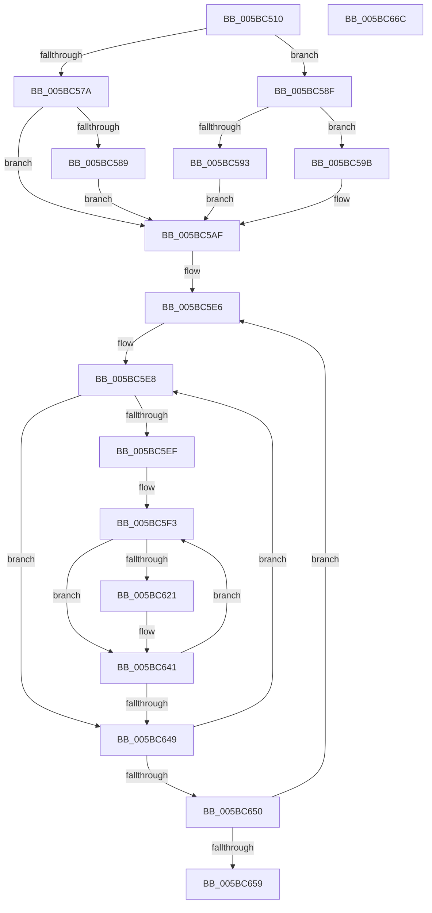

# KiAssignProcessorNumberToPrcb

- RVA: `0x005BC510`–`0x005BC66D` (길이 `349` bytes)
- VA: `0x00000001405BC510`
- 실행 섹션: `.text`
- PDB 이름 있음: `예`; PDB Function 태그: `아니요`
- unwind 정보 RVA: `0x000BF954`
- 디코드: `95`개 명령, `349/349` bytes 표시
- 미해석 바이트: `0` (있으면 어셈블리에 `.byte`로 보존)

> 이 문서는 커널 이미지의 기계어와 PDB 기호를 분석해 생성했습니다. 4번과 5번은 함수 원형과 자료형을 바이너리 사용 방식에서 추정한 C 해석이며 원본 소스 복구 결과는 아닙니다.

## 1. Dependencies

- 직접 호출 지점: **2**; 고유 호출 대상: **2**
- 직접 호출자로 확인된 함수: **2**
- RIP 상대 이미지 참조: **3**

### Outgoing calls
- `0x005BC53D` → [KiFindSubNodeForProcessorNumber](KiFindSubNodeForProcessorNumber_function_005BC9B8.md) (function, `0x005BC9B8`)
- `0x005BC59D` → [KeQueryActiveProcessorCountEx](../24/KeQueryActiveProcessorCountEx_function_00249EF0.md) (function, `0x00249EF0`)

### Direct callers
- [KiConfigureInitialNodes](KiConfigureInitialNodes_function_005BC738.md) at `0x005BC856`
- [KiInitializeProcessorState](../../page/74/KiInitializeProcessorState_function_00747390.md) at `0x007475EE`

### Static image references
- `0x005BC56A` → RVA `0x00FC6AF2` (`ALMOSTRO`; read)
- `0x005BC5C6` → RVA `0x00F231B0` (`.data`; read)
- `0x005BC5D4` → RVA `0x00F231B8` (`.data`; read)

## 2. Other-region calls and transfers

- 다른 실행 섹션으로 향하는 call: **0**
- 별도 외부 분기/꼬리 이동을 확인하지 못했습니다.

## 3. Assembly (complete function range)

```asm
005BC510  48 8B C4                        mov rax, rsp
005BC513  48 89 58 10                     mov qword ptr [rax + 0x10], rbx
005BC517  48 89 68 18                     mov qword ptr [rax + 0x18], rbp
005BC51B  56                              push rsi
005BC51C  57                              push rdi
005BC51D  41 56                           push r14
005BC51F  48 83 EC 20                     sub rsp, 0x20
005BC523  48 83 60 08 00                  and qword ptr [rax + 8], 0
005BC528  4C 8D 48 08                     lea r9, [rax + 8]
005BC52C  48 8B FA                        mov rdi, rdx
005BC52F  45 8B F0                        mov r14d, r8d
005BC532  48 8B D9                        mov rbx, rcx
005BC535  45 33 C0                        xor r8d, r8d
005BC538  48 8B CF                        mov rcx, rdi
005BC53B  33 D2                           xor edx, edx
005BC53D  E8 76 04 00 00                  call 0x1405bc9b8
005BC542  48 8B 6C 24 40                  mov rbp, qword ptr [rsp + 0x40]
005BC547  48 89 AB C0 00 00 00            mov qword ptr [rbx + 0xc0], rbp
005BC54E  8A 17                           mov dl, byte ptr [rdi]
005BC550  88 93 D0 00 00 00               mov byte ptr [rbx + 0xd0], dl
005BC556  8A 47 02                        mov al, byte ptr [rdi + 2]
005BC559  88 83 D1 00 00 00               mov byte ptr [rbx + 0xd1], al
005BC55F  B8 01 00 00 00                  mov eax, 1
005BC564  8A 4F 02                        mov cl, byte ptr [rdi + 2]
005BC567  48 D3 E0                        shl rax, cl
005BC56A  80 3D 81 A5 A0 00 00            cmp byte ptr [rip + 0xa0a581], 0
005BC571  48 89 83 C8 00 00 00            mov qword ptr [rbx + 0xc8], rax
005BC578  74 15                           je 0x1405bc58f
005BC57A  81 7B 24 FF 00 00 00            cmp dword ptr [rbx + 0x24], 0xff
005BC581  8A 43 24                        mov al, byte ptr [rbx + 0x24]
005BC584  88 43 04                        mov byte ptr [rbx + 4], al
005BC587  76 26                           jbe 0x1405bc5af
005BC589  C6 43 04 FF                     mov byte ptr [rbx + 4], 0xff
005BC58D  EB 20                           jmp 0x1405bc5af
005BC58F  84 D2                           test dl, dl
005BC591  75 08                           jne 0x1405bc59b
005BC593  8A 47 02                        mov al, byte ptr [rdi + 2]
005BC596  88 43 04                        mov byte ptr [rbx + 4], al
005BC599  EB 14                           jmp 0x1405bc5af
005BC59B  33 C9                           xor ecx, ecx
005BC59D  E8 4E D9 C8 FF                  call 0x140249ef0
005BC5A2  8B C8                           mov ecx, eax
005BC5A4  33 D2                           xor edx, edx
005BC5A6  0F B6 47 02                     movzx eax, byte ptr [rdi + 2]
005BC5AA  F7 F1                           div ecx
005BC5AC  88 53 04                        mov byte ptr [rbx + 4], dl
005BC5AF  0F B6 83 D1 00 00 00            movzx eax, byte ptr [rbx + 0xd1]
005BC5B6  0F B6 93 D0 00 00 00            movzx edx, byte ptr [rbx + 0xd0]
005BC5BD  44 8B 43 24                     mov r8d, dword ptr [rbx + 0x24]
005BC5C1  C1 E2 06                        shl edx, 6
005BC5C4  03 D0                           add edx, eax
005BC5C6  48 8B 05 E3 6B 96 00            mov rax, qword ptr [rip + 0x966be3]
005BC5CD  45 33 DB                        xor r11d, r11d
005BC5D0  42 89 14 80                     mov dword ptr [rax + r8*4], edx
005BC5D4  48 8B 05 DD 6B 96 00            mov rax, qword ptr [rip + 0x966bdd]
005BC5DB  44 89 04 90                     mov dword ptr [rax + rdx*4], r8d
005BC5DF  0F B6 BD B9 00 00 00            movzx edi, byte ptr [rbp + 0xb9]
005BC5E6  33 D2                           xor edx, edx
005BC5E8  45 33 D2                        xor r10d, r10d
005BC5EB  85 FF                           test edi, edi
005BC5ED  74 5A                           je 0x1405bc649
005BC5EF  42 8D 34 5A                     lea esi, [rdx + r11*2]
005BC5F3  0F B6 85 B9 00 00 00            movzx eax, byte ptr [rbp + 0xb9]
005BC5FA  4C 8B 8D C0 00 00 00            mov r9, qword ptr [rbp + 0xc0]
005BC601  48 8B 8B C8 00 00 00            mov rcx, qword ptr [rbx + 0xc8]
005BC608  0F AF C6                        imul eax, esi
005BC60B  41 03 C2                        add eax, r10d
005BC60E  4C 8D 04 40                     lea r8, [rax + rax*2]
005BC612  4B 0B 4C C1 10                  or rcx, qword ptr [r9 + r8*8 + 0x10]
005BC617  4B 89 4C C1 10                  mov qword ptr [r9 + r8*8 + 0x10], rcx
005BC61C  45 85 F6                        test r14d, r14d
005BC61F  75 20                           jne 0x1405bc641
005BC621  4B 8B 0C C1                     mov rcx, qword ptr [r9 + r8*8]
005BC625  48 0B 8B C8 00 00 00            or rcx, qword ptr [rbx + 0xc8]
005BC62C  4B 89 0C C1                     mov qword ptr [r9 + r8*8], rcx
005BC630  48 8B 8B C8 00 00 00            mov rcx, qword ptr [rbx + 0xc8]
005BC637  4B 0B 4C C1 08                  or rcx, qword ptr [r9 + r8*8 + 8]
005BC63C  4B 89 4C C1 08                  mov qword ptr [r9 + r8*8 + 8], rcx
005BC641  41 FF C2                        inc r10d
005BC644  44 3B D7                        cmp r10d, edi
005BC647  72 AA                           jb 0x1405bc5f3
005BC649  FF C2                           inc edx
005BC64B  83 FA 02                        cmp edx, 2
005BC64E  7C 98                           jl 0x1405bc5e8
005BC650  41 FF C3                        inc r11d
005BC653  41 83 FB 07                     cmp r11d, 7
005BC657  7C 8D                           jl 0x1405bc5e6
005BC659  48 8B 5C 24 48                  mov rbx, qword ptr [rsp + 0x48]
005BC65E  48 8B 6C 24 50                  mov rbp, qword ptr [rsp + 0x50]
005BC663  48 83 C4 20                     add rsp, 0x20
005BC667  41 5E                           pop r14
005BC669  5F                              pop rdi
005BC66A  5E                              pop rsi
005BC66B  C3                              ret
005BC66C  CC                              int3
```

## 4. C-style interpretation (structured pseudocode)

```c
__int64 __fastcall KiAssignProcessorNumberToPrcb(__int64 a1, __int64 a2, int a3)
{
    __int64 result;
    __int64 v_r10;
    __int64 v_r11;
    __int64 v_rsp;
    unsigned __int64 v_stack_p10;
    unsigned __int64 v_stack_p18;
    unsigned __int64 v_stack_p8;

    *(unsigned __int64 *)(v_rsp + 16) = v_rbx;
    *(unsigned __int64 *)(v_rsp + 24) = v_rbp;
    v_rsp = (v_rsp) - (32);
    a3 = 0;
    a2 = 0;
    result = KiFindSubNodeForProcessorNumber(a2, a2, a3, v_rsp + 8);
    *(unsigned __int64 *)(a1 + 192) = v_stack_p8;
    *(unsigned __int8 *)(a1 + 208) = (unsigned __int8)(*(unsigned __int8 *)(a2));
    *(unsigned __int8 *)(a1 + 209) = (unsigned __int8)(*(unsigned __int8 *)(a2 + 2));
    result = (1) << ((unsigned __int8)(*(unsigned __int8 *)(a2 + 2)));
    *(unsigned __int64 *)(a1 + 200) = result;
    if ((*(unsigned __int8 *)(v_rip + 10528129)) == 0) goto loc_005BC58F;
    *(unsigned __int8 *)(a1 + 4) = (unsigned __int8)(*(unsigned __int8 *)(a1 + 36));
    if ((*(unsigned int *)(a1 + 36)) <= 255) goto loc_005BC5AF;
    *(unsigned __int8 *)(a1 + 4) = 255;
    goto loc_005BC5AF;
loc_005BC58F:
    if ((unsigned __int8)(*(unsigned __int8 *)(a2)) != 0) goto loc_005BC59B;
    *(unsigned __int8 *)(a1 + 4) = (unsigned __int8)(*(unsigned __int8 *)(a2 + 2));
    goto loc_005BC5AF;
loc_005BC59B:
    a1 = 0;
    result = KeQueryActiveProcessorCountEx(a1, *(unsigned __int8 *)(a2), a3, v_rsp + 8);
    a2 = 0;
    *(unsigned __int8 *)(a1 + 4) = 0;
loc_005BC5AF:
    a2 = (unsigned int)((*(unsigned __int8 *)(a1 + 208)) << (6));
    a2 = (unsigned int)((a2) + ((unsigned int)(*(unsigned __int8 *)(a1 + 209))));
    v_r11 = 0;
    *(unsigned int *)(*(unsigned __int64 *)(v_rip + 9858019) + (unsigned int)(*(unsigned int *)(a1 + 36)) * 4) = (unsigned int)(a2);
    *(unsigned int *)(*(unsigned __int64 *)(v_rip + 9858013) + a2 * 4) = (unsigned int)((unsigned int)(*(unsigned int *)(a1 + 36)));
loc_005BC5E6:
    a2 = 0;
loc_005BC5E8:
    v_r10 = 0;
    if ((unsigned int)(*(unsigned __int8 *)(v_stack_p8 + 185)) == 0) goto loc_005BC649;
loc_005BC5F3:
    result = (unsigned int)((*(unsigned __int8 *)(v_stack_p8 + 185)) * ((unsigned int)(a2 + v_r11 * 2)));
    result = (unsigned int)((result) + (0));
    a1 = (*(unsigned __int64 *)(a1 + 200)) | (*(unsigned __int64 *)(*(unsigned __int64 *)(v_stack_p8 + 192) + result + result * 2 * 8 + 16));
    *(unsigned __int64 *)(*(unsigned __int64 *)(v_stack_p8 + 192) + result + result * 2 * 8 + 16) = a1;
    if ((unsigned int)((unsigned int)(a3)) == 0) {
        a1 = *(unsigned __int64 *)(*(unsigned __int64 *)(v_stack_p8 + 192) + result + result * 2 * 8);
        a1 = (a1) | (*(unsigned __int64 *)(a1 + 200));
        *(unsigned __int64 *)(*(unsigned __int64 *)(v_stack_p8 + 192) + result + result * 2 * 8) = a1;
        a1 = *(unsigned __int64 *)(a1 + 200);
        a1 = (a1) | (*(unsigned __int64 *)(*(unsigned __int64 *)(v_stack_p8 + 192) + result + result * 2 * 8 + 8));
        *(unsigned __int64 *)(*(unsigned __int64 *)(v_stack_p8 + 192) + result + result * 2 * 8 + 8) = a1;
    }
    v_r10 = (unsigned int)((v_r10) + 1);
    if (((unsigned int)(v_r10)) < ((unsigned int)(*(unsigned __int8 *)(v_stack_p8 + 185)))) goto loc_005BC5F3;
loc_005BC649:
    a2 = (unsigned int)((a2) + 1);
    if (((unsigned int)(a2)) < 2) goto loc_005BC5E8;
    v_r11 = (unsigned int)((v_r11) + 1);
    if (((unsigned int)(v_r11)) < 7) goto loc_005BC5E6;
    v_rsp = (v_rsp) + (32);
    return result;
}
```

## 5. (Beta) C Style

```c
int64_t KiAssignProcessorNumberToPrcb(void *Arg1, void *Arg2, int32_t Arg3)
{
    uint8_t *arg1 = (uint8_t *)Arg1;
    uint8_t *arg2 = (uint8_t *)Arg2;

    int64_t result;
    int64_t local_r10;
    int64_t local_r11;
    int64_t local_rsp;
    uint64_t v_stack_p10;
    uint64_t v_stack_p18;
    uint64_t v_stack_p8;

    *(uint64_t *)(local_rsp + 0x10) = local_rbx;
    *(uint64_t *)(local_rsp + 0x18) = local_rbp;
    local_rsp = (local_rsp) - (32);
    Arg3 = 0;
    Arg2 = 0;
    result = KiFindSubNodeForProcessorNumber(Arg2, Arg2, Arg3, local_rsp + 8);
    *(uint64_t *)(arg1 + 0xC0) = v_stack_p8;
    *(uint8_t *)(arg1 + 0xD0) = (uint8_t)(*(uint8_t *)(arg2));
    *(uint8_t *)(arg1 + 0xD1) = (uint8_t)(*(uint8_t *)(arg2 + 0x2));
    result = (1) << ((uint8_t)(*(uint8_t *)(arg2 + 0x2)));
    *(uint64_t *)(arg1 + 0xC8) = result;
    if ((*(uint8_t *)(v_rip + 0xA0A581)) == 0) goto loc_005BC58F;
    *(uint8_t *)(arg1 + 0x4) = (uint8_t)(*(uint8_t *)(arg1 + 0x24));
    if ((*(uint32_t *)(arg1 + 0x24)) <= 255) goto loc_005BC5AF;
    *(uint8_t *)(arg1 + 0x4) = 255;
    goto loc_005BC5AF;
loc_005BC58F:
    if ((uint8_t)(*(uint8_t *)(arg2)) != 0) goto loc_005BC59B;
    *(uint8_t *)(arg1 + 0x4) = (uint8_t)(*(uint8_t *)(arg2 + 0x2));
    goto loc_005BC5AF;
loc_005BC59B:
    Arg1 = 0;
    result = KeQueryActiveProcessorCountEx(Arg1, *(uint8_t *)(arg2), Arg3, local_rsp + 8);
    Arg2 = 0;
    *(uint8_t *)(arg1 + 0x4) = 0;
loc_005BC5AF:
    Arg2 = (uint32_t)((*(uint8_t *)(arg1 + 0xD0)) << (6));
    Arg2 = (uint32_t)((Arg2) + ((uint32_t)(*(uint8_t *)(arg1 + 0xD1))));
    local_r11 = 0;
    *(uint32_t *)(*(uint64_t *)(v_rip + 0x966BE3) + (uint32_t)(*(uint32_t *)(arg1 + 0x24)) * 4) = (uint32_t)(Arg2);
    *(uint32_t *)(*(uint64_t *)(v_rip + 0x966BDD) + arg2 * 4) = (uint32_t)((uint32_t)(*(uint32_t *)(arg1 + 0x24)));
loc_005BC5E6:
    Arg2 = 0;
loc_005BC5E8:
    local_r10 = 0;
    if ((uint32_t)(*(uint8_t *)(v_stack_p8 + 0xB9)) == 0) goto loc_005BC649;
loc_005BC5F3:
    result = (uint32_t)((*(uint8_t *)(v_stack_p8 + 0xB9)) * ((uint32_t)(Arg2 + local_r11 * 2)));
    result = (uint32_t)((result) + (0));
    Arg1 = (*(uint64_t *)(arg1 + 0xC8)) | (*(uint64_t *)(*(uint64_t *)(v_stack_p8 + 0xC0) + result + result * 2 * 8 + 0x10));
    *(void **)(*(uint64_t *)(v_stack_p8 + 0xC0) + result + result * 2 * 8 + 0x10) = Arg1;
    if ((uint32_t)((uint32_t)(Arg3)) == 0) {
        Arg1 = *(uint64_t *)(*(uint64_t *)(v_stack_p8 + 0xC0) + result + result * 2 * 8);
        Arg1 = (Arg1) | (*(uint64_t *)(arg1 + 0xC8));
        *(void **)(*(uint64_t *)(v_stack_p8 + 0xC0) + result + result * 2 * 8) = Arg1;
        Arg1 = *(uint64_t *)(arg1 + 0xC8);
        Arg1 = (Arg1) | (*(uint64_t *)(*(uint64_t *)(v_stack_p8 + 0xC0) + result + result * 2 * 8 + 0x8));
        *(void **)(*(uint64_t *)(v_stack_p8 + 0xC0) + result + result * 2 * 8 + 0x8) = Arg1;
    }
    local_r10 = (uint32_t)((local_r10) + 1);
    if (((uint32_t)(local_r10)) < ((uint32_t)(*(uint8_t *)(v_stack_p8 + 0xB9)))) goto loc_005BC5F3;
loc_005BC649:
    Arg2 = (uint32_t)((Arg2) + 1);
    if (((uint32_t)(Arg2)) < 2) goto loc_005BC5E8;
    local_r11 = (uint32_t)((local_r11) + 1);
    if (((uint32_t)(local_r11)) < 7) goto loc_005BC5E6;
    local_rsp = (local_rsp) + (32);
    return result;
}
```

### 관측된 메모리 오프셋

구조체 형식이 확인되지 않은 접근은 인자 기준의 오프셋으로만 기록했습니다.

| 기준 인자 | 오프셋 표현 | 폭 (bit) | 접근 |
|---|---:|---:|---|
| `Arg1` | `+ 0x4` | `8` | `W` |
| `Arg1` | `+ 0x24` | `8` | `R` |
| `Arg1` | `+ 0x24` | `32` | `R` |
| `Arg1` | `+ 0xC0` | `64` | `W` |
| `Arg1` | `+ 0xC8` | `64` | `R` |
| `Arg1` | `+ 0xC8` | `64` | `W` |
| `Arg1` | `+ 0xD0` | `8` | `R` |
| `Arg1` | `+ 0xD0` | `8` | `W` |
| `Arg1` | `+ 0xD1` | `8` | `R` |
| `Arg1` | `+ 0xD1` | `8` | `W` |
| `Arg2` | `+ 0x0` | `8` | `R` |
| `Arg2` | `+ 0x2` | `8` | `R` |

## 6. Execution-region graph

[열기: 2D/3D 그래프와 함수 탐색 컨트롤 패널](../../../control-panel.html?section=text&rva=0x005BC510&view=graph)

- 2D 그래프는 위에서 아래로 흐르고, 3D 그래프는 빈 공간을 드래그해 회전합니다. Shift+드래그는 이동, 휠은 확대·축소, 함수 노드 선택은 대상 보고서 이동입니다.

### Static fallback


