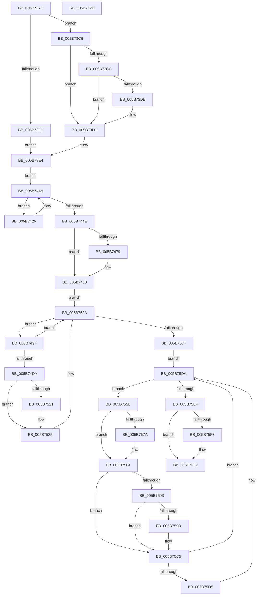

# KiAssignSubNodeSharedReadyQueues

- RVA: `0x005B737C`–`0x005B762E` (길이 `690` bytes)
- VA: `0x00000001405B737C`
- 실행 섹션: `.text`
- PDB 이름 있음: `예`; PDB Function 태그: `아니요`
- unwind 정보 RVA: `0x000C9E80`
- 디코드: `161`개 명령, `690/690` bytes 표시
- 미해석 바이트: `0` (있으면 어셈블리에 `.byte`로 보존)

> 이 문서는 커널 이미지의 기계어와 PDB 기호를 분석해 생성했습니다. 4번과 5번은 함수 원형과 자료형을 바이너리 사용 방식에서 추정한 C 해석이며 원본 소스 복구 결과는 아닙니다.

## 1. Dependencies

- 직접 호출 지점: **12**; 고유 호출 대상: **9**
- 직접 호출자로 확인된 함수: **1**
- RIP 상대 이미지 참조: **5**

### Outgoing calls
- `0x005B73D2` → [KeDetectHeterogeneousSets](../../page/74/KeDetectHeterogeneousSets_function_00744FA8.md) (function, `0x00744FA8`)
- `0x005B73F0` → [memset](../6C/memset_function_006C6C40.md) (function, `0x006C6C40`)
- `0x005B7417` → [KeEnumerateNextProcessor](../41/KeEnumerateNextProcessor_function_00415480.md) (function, `0x00415480`)
- `0x005B7445` → [KeEnumerateNextProcessor](../41/KeEnumerateNextProcessor_function_00415480.md) (function, `0x00415480`)
- `0x005B745F` → [KiComputeSharedReadyQueueAssignments](../5C/KiComputeSharedReadyQueueAssignments_function_005C9BB0.md) (function, `0x005C9BB0`)
- `0x005B747B` → [KiRaiseIrqlProcessIrqlFlags](../4F/KiRaiseIrqlProcessIrqlFlags_function_004F56FC.md) (function, `0x004F56FC`)
- `0x005B7525` → [KiInitializePriorityState](../5C/KiInitializePriorityState_function_005C4480.md) (function, `0x005C4480`)
- `0x005B7532` → [KeEnumerateNextProcessor](../41/KeEnumerateNextProcessor_function_00415480.md) (function, `0x00415480`)
- `0x005B75D5` → [KiFreeLocalSharedReadyQueue](KiFreeLocalSharedReadyQueue_function_005B7F0C.md) (function, `0x005B7F0C`)
- `0x005B75E2` → [KeEnumerateNextProcessor](../41/KeEnumerateNextProcessor_function_00415480.md) (function, `0x00415480`)
- `0x005B75FD` → [KiLowerIrqlProcessIrqlFlags](../4F/KiLowerIrqlProcessIrqlFlags_function_004F5698.md) (function, `0x004F5698`)
- `0x005B7610` → [_security_check_cookie](../6A/_security_check_cookie_function_006AC640.md) (function, `0x006AC640`)

### Direct callers
- [KiConfigureNodeSchedulingInformation](KiConfigureNodeSchedulingInformation_function_005B7A9C.md) at `0x005B7BB3`

### Static image references
- `0x005B7396` → RVA `0x00E0A740` (`.data`; read)
- `0x005B73A4` → RVA `0x00FC5374` (`ALMOSTRO`; read)
- `0x005B741C` → RVA `0x00FC8C40` (`ALMOSTRO`; read)
- `0x005B7471` → RVA `0x00FC6D20` (`ALMOSTRO`; read)
- `0x005B74C0` → RVA `0x00F231B8` (`.data`; read)

## 2. Other-region calls and transfers

- 다른 실행 섹션으로 향하는 call: **1**
  - `0x005B73D2` → [KeDetectHeterogeneousSets](../../page/74/KeDetectHeterogeneousSets_function_00744FA8.md) (`.text` → `PAGE`)
- 별도 외부 분기/꼬리 이동을 확인하지 못했습니다.

## 3. Assembly (complete function range)

```asm
005B737C  48 89 5C 24 10                  mov qword ptr [rsp + 0x10], rbx
005B7381  48 89 74 24 18                  mov qword ptr [rsp + 0x18], rsi
005B7386  55                              push rbp
005B7387  57                              push rdi
005B7388  41 57                           push r15
005B738A  48 8D 6C 24 B9                  lea rbp, [rsp - 0x47]
005B738F  48 81 EC E0 00 00 00            sub rsp, 0xe0
005B7396  48 8B 05 A3 33 85 00            mov rax, qword ptr [rip + 0x8533a3]
005B739D  48 33 C4                        xor rax, rsp
005B73A0  48 89 45 37                     mov qword ptr [rbp + 0x37], rax
005B73A4  8B 1D CA DF A0 00               mov ebx, dword ptr [rip + 0xa0dfca]
005B73AA  33 F6                           xor esi, esi
005B73AC  89 75 87                        mov dword ptr [rbp - 0x79], esi
005B73AF  48 8B F9                        mov rdi, rcx
005B73B2  89 75 A1                        mov dword ptr [rbp - 0x5f], esi
005B73B5  66 89 75 A5                     mov word ptr [rbp - 0x5b], si
005B73B9  44 8D 7E 40                     lea r15d, [rsi + 0x40]
005B73BD  85 DB                           test ebx, ebx
005B73BF  75 05                           jne 0x1405b73c6
005B73C1  8D 5E 01                        lea ebx, [rsi + 1]
005B73C4  EB 1E                           jmp 0x1405b73e4
005B73C6  0F BA E3 08                     bt ebx, 8
005B73CA  73 11                           jae 0x1405b73dd
005B73CC  33 C9                           xor ecx, ecx
005B73CE  0F BA F3 08                     btr ebx, 8
005B73D2  E8 D1 DB 18 00                  call 0x140744fa8
005B73D7  85 C0                           test eax, eax
005B73D9  74 02                           je 0x1405b73dd
005B73DB  03 DB                           add ebx, ebx
005B73DD  41 3B DF                        cmp ebx, r15d
005B73E0  41 0F 47 DF                     cmova ebx, r15d
005B73E4  4D 8B C7                        mov r8, r15
005B73E7  48 8D 4D B7                     lea rcx, [rbp - 0x49]
005B73EB  BA FF 00 00 00                  mov edx, 0xff
005B73F0  E8 4B F8 10 00                  call 0x1406c6c40
005B73F5  48 8B 8F 80 00 00 00            mov rcx, qword ptr [rdi + 0x80]
005B73FC  48 8D 55 8F                     lea rdx, [rbp - 0x71]
005B7400  0F B7 87 88 00 00 00            movzx eax, word ptr [rdi + 0x88]
005B7407  48 89 4D 97                     mov qword ptr [rbp - 0x69], rcx
005B740B  48 8D 4D 87                     lea rcx, [rbp - 0x79]
005B740F  66 89 45 9F                     mov word ptr [rbp - 0x61], ax
005B7413  48 89 75 8F                     mov qword ptr [rbp - 0x71], rsi
005B7417  E8 64 E0 E5 FF                  call 0x140415480
005B741C  4C 8D 3D 1D 18 A1 00            lea r15, [rip + 0xa1181d]
005B7423  EB 25                           jmp 0x1405b744a
005B7425  8B 45 87                        mov eax, dword ptr [rbp - 0x79]
005B7428  48 8D 55 8F                     lea rdx, [rbp - 0x71]
005B742C  49 8B 04 C7                     mov rax, qword ptr [r15 + rax*8]
005B7430  0F B6 88 D1 00 00 00            movzx ecx, byte ptr [rax + 0xd1]
005B7437  8A 80 08 8A 00 00               mov al, byte ptr [rax + 0x8a08]
005B743D  88 44 0D B7                     mov byte ptr [rbp + rcx - 0x49], al
005B7441  48 8D 4D 87                     lea rcx, [rbp - 0x79]
005B7445  E8 36 E0 E5 FF                  call 0x140415480
005B744A  85 C0                           test eax, eax
005B744C  74 D7                           je 0x1405b7425
005B744E  48 8B 8F 80 00 00 00            mov rcx, qword ptr [rdi + 0x80]
005B7455  4C 8D 4D F7                     lea r9, [rbp - 9]
005B7459  4C 8D 45 B7                     lea r8, [rbp - 0x49]
005B745D  8B D3                           mov edx, ebx
005B745F  E8 4C 27 01 00                  call 0x1405c9bb0
005B7464  44 0F 20 C3                     mov rbx, cr8
005B7468  BA 02 00 00 00                  mov edx, 2
005B746D  44 0F 22 C2                     mov cr8, rdx
005B7471  39 35 A9 F8 A0 00               cmp dword ptr [rip + 0xa0f8a9], esi
005B7477  74 07                           je 0x1405b7480
005B7479  8A CB                           mov cl, bl
005B747B  E8 7C E2 F3 FF                  call 0x1404f56fc
005B7480  48 8B 8F 80 00 00 00            mov rcx, qword ptr [rdi + 0x80]
005B7487  0F B7 87 88 00 00 00            movzx eax, word ptr [rdi + 0x88]
005B748E  66 89 45 9F                     mov word ptr [rbp - 0x61], ax
005B7492  48 89 4D 97                     mov qword ptr [rbp - 0x69], rcx
005B7496  48 89 75 8F                     mov qword ptr [rbp - 0x71], rsi
005B749A  E9 8B 00 00 00                  jmp 0x1405b752a
005B749F  8B 45 87                        mov eax, dword ptr [rbp - 0x79]
005B74A2  49 8B 14 C7                     mov rdx, qword ptr [r15 + rax*8]
005B74A6  0F B6 82 D1 00 00 00            movzx eax, byte ptr [rdx + 0xd1]
005B74AD  0F B6 4C 05 F7                  movzx ecx, byte ptr [rbp + rax - 9]
005B74B2  0F B7 87 88 00 00 00            movzx eax, word ptr [rdi + 0x88]
005B74B9  48 C1 E0 06                     shl rax, 6
005B74BD  48 03 C8                        add rcx, rax
005B74C0  48 8B 05 F1 BC 96 00            mov rax, qword ptr [rip + 0x96bcf1]
005B74C7  8B 0C 88                        mov ecx, dword ptr [rax + rcx*4]
005B74CA  49 8B 0C CF                     mov rcx, qword ptr [r15 + rcx*8]
005B74CE  4C 8B 81 48 8E 00 00            mov r8, qword ptr [rcx + 0x8e48]
005B74D5  48 3B CA                        cmp rcx, rdx
005B74D8  74 50                           je 0x1405b752a
005B74DA  48 8B 82 C8 00 00 00            mov rax, qword ptr [rdx + 0xc8]
005B74E1  4C 89 82 48 8E 00 00            mov qword ptr [rdx + 0x8e48], r8
005B74E8  49 09 80 C8 02 00 00            or qword ptr [r8 + 0x2c8], rax
005B74EF  41 FE 80 C4 02 00 00            inc byte ptr [r8 + 0x2c4]
005B74F6  41 0F B6 80 C1 02 00 00         movzx eax, byte ptr [r8 + 0x2c1]
005B74FE  49 81 C0 40 02 00 00            add r8, 0x240
005B7505  0F B6 8A D1 00 00 00            movzx ecx, byte ptr [rdx + 0xd1]
005B750C  48 2B C8                        sub rcx, rax
005B750F  8B C9                           mov ecx, ecx
005B7511  49 03 C8                        add rcx, r8
005B7514  4C 8B 42 10                     mov r8, qword ptr [rdx + 0x10]
005B7518  48 89 4A 38                     mov qword ptr [rdx + 0x38], rcx
005B751C  4D 85 C0                        test r8, r8
005B751F  75 04                           jne 0x1405b7525
005B7521  4C 8B 42 08                     mov r8, qword ptr [rdx + 8]
005B7525  E8 56 CF 00 00                  call 0x1405c4480
005B752A  48 8D 55 8F                     lea rdx, [rbp - 0x71]
005B752E  48 8D 4D 87                     lea rcx, [rbp - 0x79]
005B7532  E8 49 DF E5 FF                  call 0x140415480
005B7537  85 C0                           test eax, eax
005B7539  0F 84 60 FF FF FF               je 0x1405b749f
005B753F  48 8B 8F 80 00 00 00            mov rcx, qword ptr [rdi + 0x80]
005B7546  0F B7 87 88 00 00 00            movzx eax, word ptr [rdi + 0x88]
005B754D  66 89 45 9F                     mov word ptr [rbp - 0x61], ax
005B7551  48 89 4D 97                     mov qword ptr [rbp - 0x69], rcx
005B7555  48 89 75 8F                     mov qword ptr [rbp - 0x71], rsi
005B7559  EB 7F                           jmp 0x1405b75da
005B755B  8B 45 87                        mov eax, dword ptr [rbp - 0x79]
005B755E  49 8B 0C C7                     mov rcx, qword ptr [r15 + rax*8]
005B7562  4C 8B 81 48 8E 00 00            mov r8, qword ptr [rcx + 0x8e48]
005B7569  41 80 B8 C4 02 00 00 01         cmp byte ptr [r8 + 0x2c4], 1
005B7571  49 8D 90 C8 02 00 00            lea rdx, [r8 + 0x2c8]
005B7578  76 0A                           jbe 0x1405b7584
005B757A  48 8B 02                        mov rax, qword ptr [rdx]
005B757D  48 89 81 40 8E 00 00            mov qword ptr [rcx + 0x8e40], rax
005B7584  8A 81 D1 00 00 00               mov al, byte ptr [rcx + 0xd1]
005B758A  41 3A 80 C1 02 00 00            cmp al, byte ptr [r8 + 0x2c1]
005B7591  75 32                           jne 0x1405b75c5
005B7593  41 80 B8 C4 02 00 00 01         cmp byte ptr [r8 + 0x2c4], 1
005B759B  76 28                           jbe 0x1405b75c5
005B759D  C7 81 50 8E 00 00 01 00 00 00   mov dword ptr [rcx + 0x8e50], 1
005B75A7  41 88 80 C5 02 00 00            mov byte ptr [r8 + 0x2c5], al
005B75AE  48 8B 02                        mov rax, qword ptr [rdx]
005B75B1  48 0F BD D0                     bsr rdx, rax
005B75B5  41 2A 90 C1 02 00 00            sub dl, byte ptr [r8 + 0x2c1]
005B75BC  FE C2                           inc dl
005B75BE  41 88 90 C0 02 00 00            mov byte ptr [r8 + 0x2c0], dl
005B75C5  48 8B 81 00 94 00 00            mov rax, qword ptr [rcx + 0x9400]
005B75CC  48 39 81 48 8E 00 00            cmp qword ptr [rcx + 0x8e48], rax
005B75D3  74 05                           je 0x1405b75da
005B75D5  E8 32 09 00 00                  call 0x1405b7f0c
005B75DA  48 8D 55 8F                     lea rdx, [rbp - 0x71]
005B75DE  48 8D 4D 87                     lea rcx, [rbp - 0x79]
005B75E2  E8 99 DE E5 FF                  call 0x140415480
005B75E7  85 C0                           test eax, eax
005B75E9  0F 84 6C FF FF FF               je 0x1405b755b
005B75EF  39 35 2B F7 A0 00               cmp dword ptr [rip + 0xa0f72b], esi
005B75F5  74 0B                           je 0x1405b7602
005B75F7  44 0F 20 C1                     mov rcx, cr8
005B75FB  8A D3                           mov dl, bl
005B75FD  E8 96 E0 F3 FF                  call 0x1404f5698
005B7602  0F B6 C3                        movzx eax, bl
005B7605  44 0F 22 C0                     mov cr8, rax
005B7609  48 8B 4D 37                     mov rcx, qword ptr [rbp + 0x37]
005B760D  48 33 CC                        xor rcx, rsp
005B7610  E8 2B 50 0F 00                  call 0x1406ac640
005B7615  4C 8D 9C 24 E0 00 00 00         lea r11, [rsp + 0xe0]
005B761D  49 8B 5B 28                     mov rbx, qword ptr [r11 + 0x28]
005B7621  49 8B 73 30                     mov rsi, qword ptr [r11 + 0x30]
005B7625  49 8B E3                        mov rsp, r11
005B7628  41 5F                           pop r15
005B762A  5F                              pop rdi
005B762B  5D                              pop rbp
005B762C  C3                              ret
005B762D  CC                              int3
```

## 4. C-style interpretation (structured pseudocode)

```c
__int64 __fastcall KiAssignSubNodeSharedReadyQueues(__int64 a1)
{
    __int64 result;
    __int64 v_rbx;
    __int64 v_rsi;
    __int64 v_rsp;
    unsigned __int64 v_stack_m18;
    unsigned __int64 v_stack_m28;
    unsigned __int64 v_stack_m5F;
    unsigned __int64 v_stack_m68;
    unsigned __int64 v_stack_mA8;
    unsigned __int16 v_stack_mBA;
    unsigned int v_stack_mBE;
    unsigned __int16 v_stack_mC0;
    unsigned __int64 v_stack_mC8;
    unsigned __int64 v_stack_mD0;
    unsigned int v_stack_mD8;
    unsigned __int64 v_stack_p10;
    unsigned __int64 v_stack_p18;

    v_stack_p10 = v_rbx;
    v_stack_p18 = v_rsi;
    v_rsp = (v_rsp) - (224);
    result = (*(unsigned __int64 *)(v_rip + 8729507)) ^ (v_rsp);
    v_stack_m28 = result;
    v_rsi = 0;
    v_stack_mD8 = 0;
    v_stack_mBE = 0;
    v_stack_mBA = 0;
    if ((unsigned int)((unsigned int)(*(unsigned int *)(v_rip + 10543050))) != 0) goto loc_005B73C6;
    goto loc_005B73E4;
loc_005B73C6:
    if (condition_is_above_or_equal) goto loc_005B73DD;
    a1 = 0;
    result = KeDetectHeterogeneousSets(a1, a2, a3, a4);
    v_rbx = v_rsi + 1;
    if ((unsigned int)(result) != 0) {
        v_rbx = (unsigned int)((v_rsi + 1) + ((unsigned int)(v_rsi + 1)));
    }
    if (((unsigned int)(v_rbx)) > ((unsigned int)(v_rsi + 64))) { v_rbx = (unsigned int)(v_rsi + 64); }
loc_005B73E4:
    result = memset(v_stack_mA8, 255, v_rsi + 64, a4);
    v_stack_mC8 = *(unsigned __int64 *)(a1 + 128);
    v_stack_mC0 = (unsigned __int16)(*(unsigned __int16 *)(a1 + 136));
    v_stack_mD0 = 0;
    result = KeEnumerateNextProcessor(v_stack_mD8, v_stack_mD0, v_rsi + 64, a4);
    goto loc_005B744A;
loc_005B7425:
    *(unsigned __int8 *)(v_stack_m5F + *(unsigned __int8 *)(*(unsigned __int64 *)(v_rip + 10557469 + (unsigned int)(v_stack_mD8) * 8) + 209) * 1 - 73) = (unsigned __int8)(*(unsigned __int8 *)(*(unsigned __int64 *)(v_rip + 10557469 + (unsigned int)(v_stack_mD8) * 8) + 35336));
    result = KeEnumerateNextProcessor(v_stack_mD8, v_stack_mD0, v_rsi + 64, a4);
loc_005B744A:
    if ((unsigned int)(result) == 0) goto loc_005B7425;
    result = KiComputeSharedReadyQueueAssignments(*(unsigned __int64 *)(a1 + 128), (unsigned int)((unsigned int)(v_rbx)), v_stack_mA8, v_stack_m68);
    if ((*(unsigned int *)(v_rip + 10549417)) != 0) {
        a1 = (unsigned __int8)(v_cr8);
        result = KiRaiseIrqlProcessIrqlFlags(a1, 2, v_stack_mA8, v_stack_m68);
    }
    v_stack_mC0 = (unsigned __int16)(*(unsigned __int16 *)(a1 + 136));
    v_stack_mC8 = *(unsigned __int64 *)(a1 + 128);
    v_stack_mD0 = 0;
    goto loc_005B752A;
loc_005B749F:
    result = (*(unsigned __int16 *)(a1 + 136)) << (6);
    a1 = (*(unsigned __int8 *)(v_stack_m5F + *(unsigned __int8 *)(*(unsigned __int64 *)(v_rip + 10557469 + (unsigned int)(v_stack_mD8) * 8) + 209) * 1 - 9)) + (result);
    if ((*(unsigned __int64 *)(v_rip + 10557469 + (unsigned int)(*(unsigned int *)(*(unsigned __int64 *)(v_rip + 9878769) + a1 * 4)) * 8)) == (*(unsigned __int64 *)(v_rip + 10557469 + (unsigned int)(v_stack_mD8) * 8))) goto loc_005B752A;
    *(unsigned __int64 *)(*(unsigned __int64 *)(v_rip + 10557469 + (unsigned int)(v_stack_mD8) * 8) + 36424) = *(unsigned __int64 *)(*(unsigned __int64 *)(v_rip + 10557469 + (unsigned int)(*(unsigned int *)(*(unsigned __int64 *)(v_rip + 9878769) + a1 * 4)) * 8) + 36424);
    a3 = (*(unsigned __int64 *)(*(unsigned __int64 *)(v_rip + 10557469 + (unsigned int)(*(unsigned int *)(*(unsigned __int64 *)(v_rip + 9878769) + a1 * 4)) * 8) + 36424)) + (576);
    a1 = (*(unsigned __int8 *)(*(unsigned __int64 *)(v_rip + 10557469 + (unsigned int)(v_stack_mD8) * 8) + 209)) - (*(unsigned __int8 *)(*(unsigned __int64 *)(*(unsigned __int64 *)(v_rip + 10557469 + (unsigned int)(*(unsigned int *)(*(unsigned __int64 *)(v_rip + 9878769) + a1 * 4)) * 8) + 36424) + 705));
    a1 = ((unsigned int)((unsigned int)(a1))) + (a3);
    *(unsigned __int64 *)(*(unsigned __int64 *)(v_rip + 10557469 + (unsigned int)(v_stack_mD8) * 8) + 56) = a1;
    if (*(unsigned __int64 *)(*(unsigned __int64 *)(v_rip + 10557469 + (unsigned int)(v_stack_mD8) * 8) + 16) == 0) {
        a3 = *(unsigned __int64 *)(*(unsigned __int64 *)(v_rip + 10557469 + (unsigned int)(v_stack_mD8) * 8) + 8);
    }
    result = KiInitializePriorityState(a1, *(unsigned __int64 *)(v_rip + 10557469 + (unsigned int)(v_stack_mD8) * 8), a3, v_stack_m68);
loc_005B752A:
    result = KeEnumerateNextProcessor(v_stack_mD8, v_stack_mD0, a3, v_stack_m68);
    if ((unsigned int)(result) == 0) goto loc_005B749F;
    v_stack_mC0 = (unsigned __int16)(*(unsigned __int16 *)(a1 + 136));
    v_stack_mC8 = *(unsigned __int64 *)(a1 + 128);
    v_stack_mD0 = 0;
    goto loc_005B75DA;
loc_005B755B:
    result = (unsigned int)(v_stack_mD8);
    if ((*(unsigned __int8 *)(*(unsigned __int64 *)(*(unsigned __int64 *)(v_rip + 10557469 + (unsigned int)(v_stack_mD8) * 8) + 36424) + 708)) >= = 1) {
        result = *(unsigned __int64 *)(*(unsigned __int64 *)(*(unsigned __int64 *)(v_rip + 10557469 + (unsigned int)(v_stack_mD8) * 8) + 36424) + 712);
        *(unsigned __int64 *)(*(unsigned __int64 *)(v_rip + 10557469 + (unsigned int)(v_stack_mD8) * 8) + 36416) = result;
    }
    if (((unsigned __int8)(*(unsigned __int8 *)(*(unsigned __int64 *)(v_rip + 10557469 + (unsigned int)(v_stack_mD8) * 8) + 209))) != (*(unsigned __int8 *)(*(unsigned __int64 *)(*(unsigned __int64 *)(v_rip + 10557469 + (unsigned int)(v_stack_mD8) * 8) + 36424) + 705))) goto loc_005B75C5;
    result = *(unsigned __int8 *)(*(unsigned __int64 *)(v_rip + 10557469 + (unsigned int)(v_stack_mD8) * 8) + 209);
    if ((*(unsigned __int8 *)(*(unsigned __int64 *)(*(unsigned __int64 *)(v_rip + 10557469 + (unsigned int)(v_stack_mD8) * 8) + 36424) + 708)) >= = 1) {
        *(unsigned int *)(*(unsigned __int64 *)(v_rip + 10557469 + (unsigned int)(v_stack_mD8) * 8) + 36432) = 1;
        *(unsigned __int8 *)(*(unsigned __int64 *)(*(unsigned __int64 *)(v_rip + 10557469 + (unsigned int)(v_stack_mD8) * 8) + 36424) + 709) = (unsigned __int8)(*(unsigned __int8 *)(*(unsigned __int64 *)(v_rip + 10557469 + (unsigned int)(v_stack_mD8) * 8) + 209));
        result = *(unsigned __int64 *)(*(unsigned __int64 *)(*(unsigned __int64 *)(v_rip + 10557469 + (unsigned int)(v_stack_mD8) * 8) + 36424) + 712);
        a2 = (unsigned __int8)((*(unsigned __int64 *)(*(unsigned __int64 *)(v_rip + 10557469 + (unsigned int)(v_stack_mD8) * 8) + 36424) + 712) - (*(unsigned __int8 *)(*(unsigned __int64 *)(*(unsigned __int64 *)(v_rip + 10557469 + (unsigned int)(v_stack_mD8) * 8) + 36424) + 705)));
        a2 = (unsigned __int8)((a2) + 1);
        *(unsigned __int8 *)(*(unsigned __int64 *)(*(unsigned __int64 *)(v_rip + 10557469 + (unsigned int)(v_stack_mD8) * 8) + 36424) + 704) = (unsigned __int8)(a2);
    }
    result = *(unsigned __int64 *)(*(unsigned __int64 *)(v_rip + 10557469 + (unsigned int)(v_stack_mD8) * 8) + 37888);
    if ((*(unsigned __int64 *)(*(unsigned __int64 *)(v_rip + 10557469 + (unsigned int)(v_stack_mD8) * 8) + 36424)) != (*(unsigned __int64 *)(*(unsigned __int64 *)(v_rip + 10557469 + (unsigned int)(v_stack_mD8) * 8) + 37888))) {
        result = KiFreeLocalSharedReadyQueue(*(unsigned __int64 *)(v_rip + 10557469 + (unsigned int)(v_stack_mD8) * 8), a2, *(unsigned __int64 *)(*(unsigned __int64 *)(v_rip + 10557469 + (unsigned int)(v_stack_mD8) * 8) + 36424), v_stack_m68);
    }
    result = KeEnumerateNextProcessor(v_stack_mD8, v_stack_mD0, *(unsigned __int64 *)(*(unsigned __int64 *)(v_rip + 10557469 + (unsigned int)(v_stack_mD8) * 8) + 36424), v_stack_m68);
    if ((unsigned int)(result) == 0) goto loc_005B755B;
    if ((*(unsigned int *)(v_rip + 10549035)) != 0) {
        a1 = 2;
        a2 = (unsigned __int8)(v_cr8);
        result = KiLowerIrqlProcessIrqlFlags(a1, a2, *(unsigned __int64 *)(*(unsigned __int64 *)(v_rip + 10557469 + (unsigned int)(v_stack_mD8) * 8) + 36424), v_stack_m68);
    }
    a1 = (v_stack_m28) ^ (v_rsp);
    result = _security_check_cookie(a1, a2, *(unsigned __int64 *)(*(unsigned __int64 *)(v_rip + 10557469 + (unsigned int)(v_stack_mD8) * 8) + 36424), v_stack_m68);
    return result;
}
```

## 5. (Beta) C Style

```c
int64_t KiAssignSubNodeSharedReadyQueues(void *Arg1)
{
    uint8_t *arg1 = (uint8_t *)Arg1;

    int64_t result;
    int64_t local_rbx;
    int64_t local_rsi;
    int64_t local_rsp;
    uint64_t v_stack_m18;
    uint64_t v_stack_m28;
    uint64_t v_stack_m5F;
    uint64_t v_stack_m68;
    uint64_t v_stack_mA8;
    uint16_t v_stack_mBA;
    uint32_t v_stack_mBE;
    uint16_t v_stack_mC0;
    uint64_t v_stack_mC8;
    uint64_t v_stack_mD0;
    uint32_t v_stack_mD8;
    uint64_t v_stack_p10;
    uint64_t v_stack_p18;

    v_stack_p10 = local_rbx;
    v_stack_p18 = local_rsi;
    local_rsp = (local_rsp) - (224);
    result = (*(uint64_t *)(v_rip + 0x8533A3)) ^ (local_rsp);
    v_stack_m28 = result;
    local_rsi = 0;
    v_stack_mD8 = 0;
    v_stack_mBE = 0;
    v_stack_mBA = 0;
    if ((uint32_t)((uint32_t)(*(uint32_t *)(v_rip + 0xA0DFCA))) != 0) goto loc_005B73C6;
    goto loc_005B73E4;
loc_005B73C6:
    if (condition_is_above_or_equal) goto loc_005B73DD;
    Arg1 = 0;
    result = KeDetectHeterogeneousSets(Arg1, a2, a3, a4);
    local_rbx = local_rsi + 1;
    if ((uint32_t)(result) != 0) {
        local_rbx = (uint32_t)((local_rsi + 1) + ((uint32_t)(local_rsi + 1)));
    }
    if (((uint32_t)(local_rbx)) > ((uint32_t)(local_rsi + 64))) { local_rbx = (uint32_t)(local_rsi + 64); }
loc_005B73E4:
    result = memset(v_stack_mA8, 255, local_rsi + 64, a4);
    v_stack_mC8 = *(uint64_t *)(arg1 + 0x80);
    v_stack_mC0 = (uint16_t)(*(uint16_t *)(arg1 + 0x88));
    v_stack_mD0 = 0;
    result = KeEnumerateNextProcessor(v_stack_mD8, v_stack_mD0, local_rsi + 64, a4);
    goto loc_005B744A;
loc_005B7425:
    *(uint8_t *)(v_stack_m5F + *(uint8_t *)(*(uint64_t *)(v_rip + 0xA1181D + (uint32_t)(v_stack_mD8) * 8) + 0xD1) * 1 - 0x49) = (uint8_t)(*(uint8_t *)(*(uint64_t *)(v_rip + 0xA1181D + (uint32_t)(v_stack_mD8) * 8) + 0x8A08));
    result = KeEnumerateNextProcessor(v_stack_mD8, v_stack_mD0, local_rsi + 64, a4);
loc_005B744A:
    if ((uint32_t)(result) == 0) goto loc_005B7425;
    result = KiComputeSharedReadyQueueAssignments(*(uint64_t *)(arg1 + 0x80), (uint32_t)((uint32_t)(local_rbx)), v_stack_mA8, v_stack_m68);
    if ((*(uint32_t *)(v_rip + 0xA0F8A9)) != 0) {
        Arg1 = (uint8_t)(v_cr8);
        result = KiRaiseIrqlProcessIrqlFlags(Arg1, 2, v_stack_mA8, v_stack_m68);
    }
    v_stack_mC0 = (uint16_t)(*(uint16_t *)(arg1 + 0x88));
    v_stack_mC8 = *(uint64_t *)(arg1 + 0x80);
    v_stack_mD0 = 0;
    goto loc_005B752A;
loc_005B749F:
    result = (*(uint16_t *)(arg1 + 0x88)) << (6);
    Arg1 = (*(uint8_t *)(v_stack_m5F + *(uint8_t *)(*(uint64_t *)(v_rip + 0xA1181D + (uint32_t)(v_stack_mD8) * 8) + 0xD1) * 1 - 0x9)) + (result);
    if ((*(uint64_t *)(v_rip + 0xA1181D + (uint32_t)(*(uint32_t *)(*(uint64_t *)(v_rip + 0x96BCF1) + arg1 * 4)) * 8)) == (*(uint64_t *)(v_rip + 0xA1181D + (uint32_t)(v_stack_mD8) * 8))) goto loc_005B752A;
    *(uint64_t *)(*(uint64_t *)(v_rip + 0xA1181D + (uint32_t)(v_stack_mD8) * 8) + 0x8E48) = *(uint64_t *)(*(uint64_t *)(v_rip + 0xA1181D + (uint32_t)(*(uint32_t *)(*(uint64_t *)(v_rip + 0x96BCF1) + arg1 * 4)) * 8) + 0x8E48);
    a3 = (*(uint64_t *)(*(uint64_t *)(v_rip + 0xA1181D + (uint32_t)(*(uint32_t *)(*(uint64_t *)(v_rip + 0x96BCF1) + arg1 * 4)) * 8) + 0x8E48)) + (576);
    Arg1 = (*(uint8_t *)(*(uint64_t *)(v_rip + 0xA1181D + (uint32_t)(v_stack_mD8) * 8) + 0xD1)) - (*(uint8_t *)(*(uint64_t *)(*(uint64_t *)(v_rip + 0xA1181D + (uint32_t)(*(uint32_t *)(*(uint64_t *)(v_rip + 0x96BCF1) + arg1 * 4)) * 8) + 0x8E48) + 0x2C1));
    Arg1 = ((uint32_t)((uint32_t)(Arg1))) + (a3);
    *(void **)(*(uint64_t *)(v_rip + 0xA1181D + (uint32_t)(v_stack_mD8) * 8) + 0x38) = Arg1;
    if (*(uint64_t *)(*(uint64_t *)(v_rip + 0xA1181D + (uint32_t)(v_stack_mD8) * 8) + 0x10) == 0) {
        a3 = *(uint64_t *)(*(uint64_t *)(v_rip + 0xA1181D + (uint32_t)(v_stack_mD8) * 8) + 0x8);
    }
    result = KiInitializePriorityState(Arg1, *(uint64_t *)(v_rip + 0xA1181D + (uint32_t)(v_stack_mD8) * 8), a3, v_stack_m68);
loc_005B752A:
    result = KeEnumerateNextProcessor(v_stack_mD8, v_stack_mD0, a3, v_stack_m68);
    if ((uint32_t)(result) == 0) goto loc_005B749F;
    v_stack_mC0 = (uint16_t)(*(uint16_t *)(arg1 + 0x88));
    v_stack_mC8 = *(uint64_t *)(arg1 + 0x80);
    v_stack_mD0 = 0;
    goto loc_005B75DA;
loc_005B755B:
    result = (uint32_t)(v_stack_mD8);
    if ((*(uint8_t *)(*(uint64_t *)(*(uint64_t *)(v_rip + 0xA1181D + (uint32_t)(v_stack_mD8) * 8) + 0x8E48) + 0x2C4)) >= = 1) {
        result = *(uint64_t *)(*(uint64_t *)(*(uint64_t *)(v_rip + 0xA1181D + (uint32_t)(v_stack_mD8) * 8) + 0x8E48) + 0x2C8);
        *(uint64_t *)(*(uint64_t *)(v_rip + 0xA1181D + (uint32_t)(v_stack_mD8) * 8) + 0x8E40) = result;
    }
    if (((uint8_t)(*(uint8_t *)(*(uint64_t *)(v_rip + 0xA1181D + (uint32_t)(v_stack_mD8) * 8) + 0xD1))) != (*(uint8_t *)(*(uint64_t *)(*(uint64_t *)(v_rip + 0xA1181D + (uint32_t)(v_stack_mD8) * 8) + 0x8E48) + 0x2C1))) goto loc_005B75C5;
    result = *(uint8_t *)(*(uint64_t *)(v_rip + 0xA1181D + (uint32_t)(v_stack_mD8) * 8) + 0xD1);
    if ((*(uint8_t *)(*(uint64_t *)(*(uint64_t *)(v_rip + 0xA1181D + (uint32_t)(v_stack_mD8) * 8) + 0x8E48) + 0x2C4)) >= = 1) {
        *(uint32_t *)(*(uint64_t *)(v_rip + 0xA1181D + (uint32_t)(v_stack_mD8) * 8) + 0x8E50) = 1;
        *(uint8_t *)(*(uint64_t *)(*(uint64_t *)(v_rip + 0xA1181D + (uint32_t)(v_stack_mD8) * 8) + 0x8E48) + 0x2C5) = (uint8_t)(*(uint8_t *)(*(uint64_t *)(v_rip + 0xA1181D + (uint32_t)(v_stack_mD8) * 8) + 0xD1));
        result = *(uint64_t *)(*(uint64_t *)(*(uint64_t *)(v_rip + 0xA1181D + (uint32_t)(v_stack_mD8) * 8) + 0x8E48) + 0x2C8);
        a2 = (uint8_t)((*(uint64_t *)(*(uint64_t *)(v_rip + 0xA1181D + (uint32_t)(v_stack_mD8) * 8) + 0x8E48) + 712) - (*(uint8_t *)(*(uint64_t *)(*(uint64_t *)(v_rip + 0xA1181D + (uint32_t)(v_stack_mD8) * 8) + 0x8E48) + 0x2C1)));
        a2 = (uint8_t)((a2) + 1);
        *(uint8_t *)(*(uint64_t *)(*(uint64_t *)(v_rip + 0xA1181D + (uint32_t)(v_stack_mD8) * 8) + 0x8E48) + 0x2C0) = (uint8_t)(a2);
    }
    result = *(uint64_t *)(*(uint64_t *)(v_rip + 0xA1181D + (uint32_t)(v_stack_mD8) * 8) + 0x9400);
    if ((*(uint64_t *)(*(uint64_t *)(v_rip + 0xA1181D + (uint32_t)(v_stack_mD8) * 8) + 0x8E48)) != (*(uint64_t *)(*(uint64_t *)(v_rip + 0xA1181D + (uint32_t)(v_stack_mD8) * 8) + 0x9400))) {
        result = KiFreeLocalSharedReadyQueue(*(uint64_t *)(v_rip + 0xA1181D + (uint32_t)(v_stack_mD8) * 8), a2, *(uint64_t *)(*(uint64_t *)(v_rip + 0xA1181D + (uint32_t)(v_stack_mD8) * 8) + 0x8E48), v_stack_m68);
    }
    result = KeEnumerateNextProcessor(v_stack_mD8, v_stack_mD0, *(uint64_t *)(*(uint64_t *)(v_rip + 0xA1181D + (uint32_t)(v_stack_mD8) * 8) + 0x8E48), v_stack_m68);
    if ((uint32_t)(result) == 0) goto loc_005B755B;
    if ((*(uint32_t *)(v_rip + 0xA0F72B)) != 0) {
        Arg1 = 2;
        a2 = (uint8_t)(v_cr8);
        result = KiLowerIrqlProcessIrqlFlags(Arg1, a2, *(uint64_t *)(*(uint64_t *)(v_rip + 0xA1181D + (uint32_t)(v_stack_mD8) * 8) + 0x8E48), v_stack_m68);
    }
    Arg1 = (v_stack_m28) ^ (local_rsp);
    result = _security_check_cookie(Arg1, a2, *(uint64_t *)(*(uint64_t *)(v_rip + 0xA1181D + (uint32_t)(v_stack_mD8) * 8) + 0x8E48), v_stack_m68);
    return result;
}
```

### 관측된 메모리 오프셋

구조체 형식이 확인되지 않은 접근은 인자 기준의 오프셋으로만 기록했습니다.

| 기준 인자 | 오프셋 표현 | 폭 (bit) | 접근 |
|---|---:|---:|---|
| `Arg1` | `+ 0x80` | `64` | `R` |
| `Arg1` | `+ 0x88` | `16` | `R` |

## 6. Execution-region graph

[열기: 2D/3D 그래프와 함수 탐색 컨트롤 패널](../../../control-panel.html?section=text&rva=0x005B737C&view=graph)

- 2D 그래프는 위에서 아래로 흐르고, 3D 그래프는 빈 공간을 드래그해 회전합니다. Shift+드래그는 이동, 휠은 확대·축소, 함수 노드 선택은 대상 보고서 이동입니다.

### Static fallback


