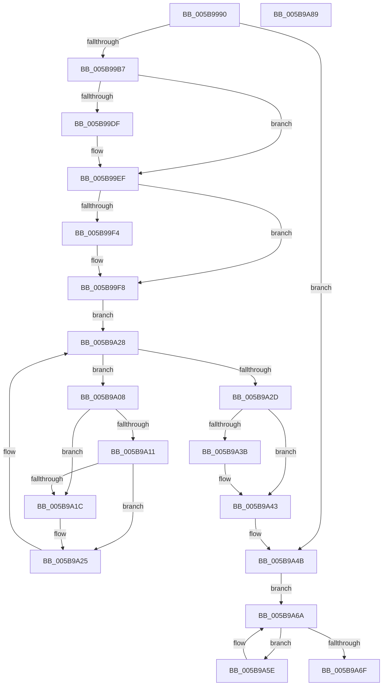

# KiAvailableCpusPartitionWorkItemCallback

- RVA: `0x005B9990`–`0x005B9A8A` (길이 `250` bytes)
- VA: `0x00000001405B9990`
- 실행 섹션: `.text`
- PDB 이름 있음: `예`; PDB Function 태그: `아니요`
- unwind 정보 RVA: `0x00099F10`
- 디코드: `72`개 명령, `250/250` bytes 표시
- 미해석 바이트: `0` (있으면 어셈블리에 `.byte`로 보존)

> 이 문서는 커널 이미지의 기계어와 PDB 기호를 분석해 생성했습니다. 4번과 5번은 함수 원형과 자료형을 바이너리 사용 방식에서 추정한 C 해석이며 원본 소스 복구 결과는 아닙니다.

## 1. Dependencies

- 직접 호출 지점: **8**; 고유 호출 대상: **8**
- 직접 호출자로 확인된 함수: **0**
- RIP 상대 이미지 참조: **3**

### Outgoing calls
- `0x005B99C6` → [KeAbPreAcquire](../21/KeAbPreAcquire_function_00210230.md) (function, `0x00210230`)
- `0x005B99EA` → [ExfAcquirePushLockSharedEx](../21/ExfAcquirePushLockSharedEx_function_0021044C.md) (function, `0x0021044C`)
- `0x005B9A20` → [KiAvailableCpusSubscriptionQueueWorkItem](../4F/KiAvailableCpusSubscriptionQueueWorkItem_function_004FCE5C.md) (function, `0x004FCE5C`)
- `0x005B9A3E` → [ExfReleasePushLockShared](../26/ExfReleasePushLockShared_function_00263440.md) (function, `0x00263440`)
- `0x005B9A46` → [KeAbPostRelease](../2E/KeAbPostRelease_function_002E1600.md) (function, `0x002E1600`)
- `0x005B9A50` → [KiAcquireCpuPartitionAssignmentLock](../43/KiAcquireCpuPartitionAssignmentLock_function_0043F974.md) (function, `0x0043F974`)
- `0x005B9A62` → [KiNotifyAvailableCpusChangeProcess](../4F/KiNotifyAvailableCpusChangeProcess_function_004FCE30.md) (function, `0x004FCE30`)
- `0x005B9A73` → [KiReleaseCpuPartitionAssignmentLock](../43/KiReleaseCpuPartitionAssignmentLock_function_0043F9C0.md) (function, `0x0043F9C0`)

### Direct callers
- 이 함수 시작 RVA로 연결되는 직접 call은 확인되지 않았습니다. 간접 호출은 완전히 역산할 수 없습니다.

### Static image references
- `0x005B99A5` → RVA `0x00FC6C20` (`ALMOSTRO`; read)
- `0x005B99B7` → RVA `0x00F22FA8` (`.data`; read)
- `0x005B99F8` → RVA `0x00F22FB0` (`.data`; read)

## 2. Other-region calls and transfers

- 다른 실행 섹션으로 향하는 call: **0**
- 별도 외부 분기/꼬리 이동을 확인하지 못했습니다.

## 3. Assembly (complete function range)

```asm
005B9990  48 89 5C 24 18                  mov qword ptr [rsp + 0x18], rbx
005B9995  55                              push rbp
005B9996  56                              push rsi
005B9997  57                              push rdi
005B9998  41 56                           push r14
005B999A  41 57                           push r15
005B999C  48 83 EC 20                     sub rsp, 0x20
005B99A0  33 F6                           xor esi, esi
005B99A2  48 8B F9                        mov rdi, rcx
005B99A5  48 3B 0D 74 D2 A0 00            cmp rcx, qword ptr [rip + 0xa0d274]
005B99AC  40 88 74 24 50                  mov byte ptr [rsp + 0x50], sil
005B99B1  0F 85 94 00 00 00               jne 0x1405b9a4b
005B99B7  48 8D 2D EA 95 96 00            lea rbp, [rip + 0x9695ea]
005B99BE  45 33 C0                        xor r8d, r8d
005B99C1  48 8B CD                        mov rcx, rbp
005B99C4  33 D2                           xor edx, edx
005B99C6  E8 65 68 C5 FF                  call 0x140210230
005B99CB  48 8B D8                        mov rbx, rax
005B99CE  44 8D 7E 11                     lea r15d, [rsi + 0x11]
005B99D2  33 C0                           xor eax, eax
005B99D4  F0 4C 0F B1 3D CB 95 96 00      lock cmpxchg qword ptr [rip + 0x9695cb], r15
005B99DD  74 10                           je 0x1405b99ef
005B99DF  4C 8B CD                        mov r9, rbp
005B99E2  4C 8B C3                        mov r8, rbx
005B99E5  33 D2                           xor edx, edx
005B99E7  48 8B CD                        mov rcx, rbp
005B99EA  E8 5D 6A C5 FF                  call 0x14021044c
005B99EF  48 85 DB                        test rbx, rbx
005B99F2  74 04                           je 0x1405b99f8
005B99F4  C6 43 0A 01                     mov byte ptr [rbx + 0xa], 1
005B99F8  48 8B 1D B1 95 96 00            mov rbx, qword ptr [rip + 0x9695b1]
005B99FF  4C 8D 35 AA 95 96 00            lea r14, [rip + 0x9695aa]
005B9A06  EB 20                           jmp 0x1405b9a28
005B9A08  48 8B 43 E8                     mov rax, qword ptr [rbx - 0x18]
005B9A0C  48 85 C0                        test rax, rax
005B9A0F  74 0B                           je 0x1405b9a1c
005B9A11  48 05 B0 01 00 00               add rax, 0x1b0
005B9A17  48 39 00                        cmp qword ptr [rax], rax
005B9A1A  75 09                           jne 0x1405b9a25
005B9A1C  48 8D 4B 10                     lea rcx, [rbx + 0x10]
005B9A20  E8 37 34 F4 FF                  call 0x1404fce5c
005B9A25  48 8B 1B                        mov rbx, qword ptr [rbx]
005B9A28  49 3B DE                        cmp rbx, r14
005B9A2B  75 DB                           jne 0x1405b9a08
005B9A2D  49 8B C7                        mov rax, r15
005B9A30  F0 48 0F B1 35 6F 95 96 00      lock cmpxchg qword ptr [rip + 0x96956f], rsi
005B9A39  74 08                           je 0x1405b9a43
005B9A3B  48 8B CD                        mov rcx, rbp
005B9A3E  E8 FD 99 CA FF                  call 0x140263440
005B9A43  48 8B CD                        mov rcx, rbp
005B9A46  E8 B5 7B D2 FF                  call 0x1402e1600
005B9A4B  48 8D 4C 24 50                  lea rcx, [rsp + 0x50]
005B9A50  E8 1F 5F E8 FF                  call 0x14043f974
005B9A55  48 83 C7 10                     add rdi, 0x10
005B9A59  48 8B 1F                        mov rbx, qword ptr [rdi]
005B9A5C  EB 0C                           jmp 0x1405b9a6a
005B9A5E  48 8B 4B F0                     mov rcx, qword ptr [rbx - 0x10]
005B9A62  E8 C9 33 F4 FF                  call 0x1404fce30
005B9A67  48 8B 1B                        mov rbx, qword ptr [rbx]
005B9A6A  48 3B DF                        cmp rbx, rdi
005B9A6D  75 EF                           jne 0x1405b9a5e
005B9A6F  8A 4C 24 50                     mov cl, byte ptr [rsp + 0x50]
005B9A73  E8 48 5F E8 FF                  call 0x14043f9c0
005B9A78  48 8B 5C 24 60                  mov rbx, qword ptr [rsp + 0x60]
005B9A7D  48 83 C4 20                     add rsp, 0x20
005B9A81  41 5F                           pop r15
005B9A83  41 5E                           pop r14
005B9A85  5F                              pop rdi
005B9A86  5E                              pop rsi
005B9A87  5D                              pop rbp
005B9A88  C3                              ret
005B9A89  CC                              int3
```

## 4. C-style interpretation (structured pseudocode)

```c
__int64 __fastcall KiAvailableCpusPartitionWorkItemCallback(__int64 a1, int a2, int a3)
{
    __int64 result;
    __int64 v_rdi;
    __int64 v_rsi;
    __int64 v_rsp;
    unsigned __int64 v_stack_p18;
    unsigned __int8 v_stack_p8;

    v_stack_p18 = v_rbx;
    v_rsp = (v_rsp) - (32);
    v_rsi = 0;
    v_stack_p8 = 0;
    if (a1 != (*(unsigned __int64 *)(v_rip + 10539636))) goto loc_005B9A4B;
    a3 = 0;
    a2 = 0;
    result = KeAbPreAcquire(v_rip + 9868778, a2, a3, a4);
    result = 0;
    if (!(condition_is_equal)) {
        a4 = v_rip + 9868778;
        a3 = 0;
        a2 = 0;
        a1 = v_rip + 9868778;
        result = ExfAcquirePushLockSharedEx(a1, a2, a3, a4);
    }
    if (result != 0) {
        *(unsigned __int8 *)(result + 10) = 1;
    }
    goto loc_005B9A28;
loc_005B9A08:
    if (*(unsigned __int64 *)(*(unsigned __int64 *)(v_rip + 9868721) - 24) == 0) goto loc_005B9A1C;
    result = (*(unsigned __int64 *)(*(unsigned __int64 *)(v_rip + 9868721) - 24)) + (432);
    if ((*(unsigned __int64 *)(result)) == result) {
        a1 = *(unsigned __int64 *)(v_rip + 9868721) + 16;
        result = KiAvailableCpusSubscriptionQueueWorkItem(a1, a2, a3, a4);
    }
loc_005B9A28:
    if ((*(unsigned __int64 *)(*(unsigned __int64 *)(v_rip + 9868721))) != (v_rip + 9868714)) goto loc_005B9A08;
    result = v_rsi + 17;
    if ((*(unsigned __int64 *)(*(unsigned __int64 *)(v_rip + 9868721))) != (v_rip + 9868714)) {
        a1 = v_rip + 9868778;
        result = ExfReleasePushLockShared(a1, a2, a3, a4);
    }
    result = KeAbPostRelease(v_rip + 9868778, a2, a3, a4);
loc_005B9A4B:
    result = KiAcquireCpuPartitionAssignmentLock(v_stack_p8, a2, a3, a4);
    v_rdi = (a1) + (16);
    goto loc_005B9A6A;
loc_005B9A5E:
    result = KiNotifyAvailableCpusChangeProcess(*(unsigned __int64 *)(*(unsigned __int64 *)(v_rdi) - 16), a2, a3, a4);
loc_005B9A6A:
    if ((*(unsigned __int64 *)(*(unsigned __int64 *)(v_rdi))) != v_rdi) goto loc_005B9A5E;
    result = KiReleaseCpuPartitionAssignmentLock(v_stack_p8, a2, a3, a4);
    v_rsp = (v_rsp) + (32);
    return result;
}
```

## 5. (Beta) C Style

```c
int64_t KiAvailableCpusPartitionWorkItemCallback(void *Arg1, int32_t Arg2, int32_t Arg3)
{
    uint8_t *arg1 = (uint8_t *)Arg1;

    int64_t result;
    int64_t local_rdi;
    int64_t local_rsi;
    int64_t local_rsp;
    uint64_t v_stack_p18;
    uint8_t v_stack_p8;

    v_stack_p18 = local_rbx;
    local_rsp = (local_rsp) - (32);
    local_rsi = 0;
    v_stack_p8 = 0;
    if (Arg1 != (*(uint64_t *)(v_rip + 0xA0D274))) goto loc_005B9A4B;
    Arg3 = 0;
    Arg2 = 0;
    result = KeAbPreAcquire(v_rip + 9868778, Arg2, Arg3, a4);
    result = 0;
    if (!(condition_is_equal)) {
        a4 = v_rip + 9868778;
        Arg3 = 0;
        Arg2 = 0;
        Arg1 = v_rip + 9868778;
        result = ExfAcquirePushLockSharedEx(Arg1, Arg2, Arg3, a4);
    }
    if (result != 0) {
        *(uint8_t *)(result + 0xA) = 1;
    }
    goto loc_005B9A28;
loc_005B9A08:
    if (*(uint64_t *)(*(uint64_t *)(v_rip + 0x9695B1) - 0x18) == 0) goto loc_005B9A1C;
    result = (*(uint64_t *)(*(uint64_t *)(v_rip + 0x9695B1) - 0x18)) + (432);
    if ((*(uint64_t *)(result)) == result) {
        Arg1 = *(uint64_t *)(v_rip + 0x9695B1) + 16;
        result = KiAvailableCpusSubscriptionQueueWorkItem(Arg1, Arg2, Arg3, a4);
    }
loc_005B9A28:
    if ((*(uint64_t *)(*(uint64_t *)(v_rip + 0x9695B1))) != (v_rip + 9868714)) goto loc_005B9A08;
    result = local_rsi + 17;
    if ((*(uint64_t *)(*(uint64_t *)(v_rip + 0x9695B1))) != (v_rip + 9868714)) {
        Arg1 = v_rip + 9868778;
        result = ExfReleasePushLockShared(Arg1, Arg2, Arg3, a4);
    }
    result = KeAbPostRelease(v_rip + 9868778, Arg2, Arg3, a4);
loc_005B9A4B:
    result = KiAcquireCpuPartitionAssignmentLock(v_stack_p8, Arg2, Arg3, a4);
    local_rdi = (Arg1) + (16);
    goto loc_005B9A6A;
loc_005B9A5E:
    result = KiNotifyAvailableCpusChangeProcess(*(uint64_t *)(*(uint64_t *)(local_rdi) - 0x10), Arg2, Arg3, a4);
loc_005B9A6A:
    if ((*(uint64_t *)(*(uint64_t *)(local_rdi))) != local_rdi) goto loc_005B9A5E;
    result = KiReleaseCpuPartitionAssignmentLock(v_stack_p8, Arg2, Arg3, a4);
    local_rsp = (local_rsp) + (32);
    return result;
}
```

### 관측된 메모리 오프셋

구조체 형식이 확인되지 않은 접근은 인자 기준의 오프셋으로만 기록했습니다.

| 기준 인자 | 오프셋 표현 | 폭 (bit) | 접근 |
|---|---:|---:|---|
| `Arg1` | `+ 0x0` | `64` | `R` |

## 6. Execution-region graph

[열기: 2D/3D 그래프와 함수 탐색 컨트롤 패널](../../../control-panel.html?section=text&rva=0x005B9990&view=graph)

- 2D 그래프는 위에서 아래로 흐르고, 3D 그래프는 빈 공간을 드래그해 회전합니다. Shift+드래그는 이동, 휠은 확대·축소, 함수 노드 선택은 대상 보고서 이동입니다.

### Static fallback


