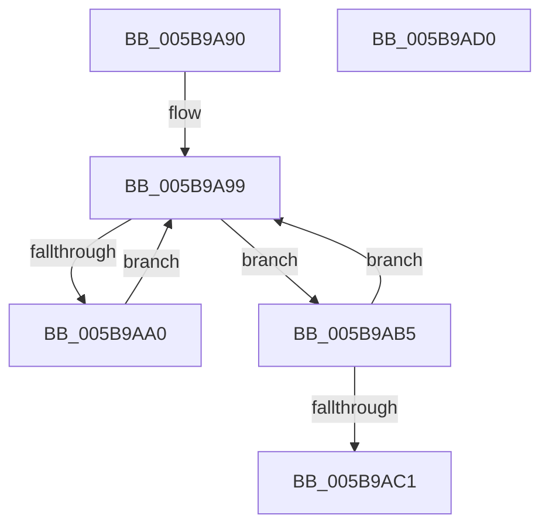

# KiAvailableCpusWorkItemCallbackWrapper

- RVA: `0x005B9A90`–`0x005B9AD1` (길이 `65` bytes)
- VA: `0x00000001405B9A90`
- 실행 섹션: `.text`
- PDB 이름 있음: `예`; PDB Function 태그: `아니요`
- unwind 정보 RVA: `0x0005CF00`
- 디코드: `21`개 명령, `65/65` bytes 표시
- 미해석 바이트: `0` (있으면 어셈블리에 `.byte`로 보존)

> 이 문서는 커널 이미지의 기계어와 PDB 기호를 분석해 생성했습니다. 4번과 5번은 함수 원형과 자료형을 바이너리 사용 방식에서 추정한 C 해석이며 원본 소스 복구 결과는 아닙니다.

## 1. Dependencies

- 직접 호출 지점: **2**; 고유 호출 대상: **2**
- 직접 호출자로 확인된 함수: **0**
- RIP 상대 이미지 참조: **0**

### Outgoing calls
- `0x005B9AAE` → [guard_dispatch_icall](../6B/guard_dispatch_icall_function_006BAAD0.md) (function, `0x006BAAD0`)
- `0x005B9AC5` → [ExReleaseRundownProtection](../34/ExReleaseRundownProtection_function_00349E80.md) (function, `0x00349E80`)

### Direct callers
- 이 함수 시작 RVA로 연결되는 직접 call은 확인되지 않았습니다. 간접 호출은 완전히 역산할 수 없습니다.

### Static image references
- 디코드된 RIP-relative 메모리 참조가 없습니다.

## 2. Other-region calls and transfers

- 다른 실행 섹션으로 향하는 call: **0**
- 별도 외부 분기/꼬리 이동을 확인하지 못했습니다.

## 3. Assembly (complete function range)

```asm
005B9A90  40 53                           push rbx
005B9A92  48 83 EC 20                     sub rsp, 0x20
005B9A96  48 8B D9                        mov rbx, rcx
005B9A99  8B 43 28                        mov eax, dword ptr [rbx + 0x28]
005B9A9C  A8 02                           test al, 2
005B9A9E  74 15                           je 0x1405b9ab5
005B9AA0  F0 0F BA 73 28 01               lock btr dword ptr [rbx + 0x28], 1
005B9AA6  48 8B 43 30                     mov rax, qword ptr [rbx + 0x30]
005B9AAA  48 8B 4B 38                     mov rcx, qword ptr [rbx + 0x38]
005B9AAE  E8 1D 10 10 00                  call 0x1406baad0
005B9AB3  EB E4                           jmp 0x1405b9a99
005B9AB5  8B C8                           mov ecx, eax
005B9AB7  83 E1 FE                        and ecx, 0xfffffffe
005B9ABA  F0 0F B1 4B 28                  lock cmpxchg dword ptr [rbx + 0x28], ecx
005B9ABF  75 D8                           jne 0x1405b9a99
005B9AC1  48 8D 4B 20                     lea rcx, [rbx + 0x20]
005B9AC5  E8 B6 03 D9 FF                  call 0x140349e80
005B9ACA  48 83 C4 20                     add rsp, 0x20
005B9ACE  5B                              pop rbx
005B9ACF  C3                              ret
005B9AD0  CC                              int3
```

## 4. C-style interpretation (structured pseudocode)

```c
__int64 __fastcall KiAvailableCpusWorkItemCallbackWrapper(__int64 a1)
{
    __int64 result;
    __int64 v_rsp;

    v_rsp = (v_rsp) - (32);
loc_005B9A99:
    if ((((unsigned __int8)((unsigned int)(*(unsigned int *)(a1 + 40)))) & (2)) == 0) goto loc_005B9AB5;
    result = guard_dispatch_icall(*(unsigned __int64 *)(a1 + 56), a2, a3, a4);
    goto loc_005B9A99;
loc_005B9AB5:
    a1 = (unsigned int)(((unsigned int)((unsigned int)(result))) & (0xFFFFFFFEULL));
    if (condition_is_not_equal) goto loc_005B9A99;
    result = ExReleaseRundownProtection(a1 + 32, a2, a3, a4);
    v_rsp = (v_rsp) + (32);
    return result;
}
```

## 5. (Beta) C Style

```c
int64_t KiAvailableCpusWorkItemCallbackWrapper(void *Arg1)
{
    uint8_t *arg1 = (uint8_t *)Arg1;

    int64_t result;
    int64_t local_rsp;

    local_rsp = (local_rsp) - (32);
loc_005B9A99:
    if ((((uint8_t)((uint32_t)(*(uint32_t *)(arg1 + 0x28)))) & (2)) == 0) goto loc_005B9AB5;
    result = guard_dispatch_icall(*(uint64_t *)(arg1 + 0x38), a2, a3, a4);
    goto loc_005B9A99;
loc_005B9AB5:
    Arg1 = (uint32_t)(((uint32_t)((uint32_t)(result))) & (0xFFFFFFFEULL));
    if (condition_is_not_equal) goto loc_005B9A99;
    result = ExReleaseRundownProtection(Arg1 + 32, a2, a3, a4);
    local_rsp = (local_rsp) + (32);
    return result;
}
```

### 관측된 메모리 오프셋

구조체 형식이 확인되지 않은 접근은 인자 기준의 오프셋으로만 기록했습니다.

| 기준 인자 | 오프셋 표현 | 폭 (bit) | 접근 |
|---|---:|---:|---|
| `Arg1` | `+ 0x20` | `64` | `R` |
| `Arg1` | `+ 0x28` | `32` | `R` |
| `Arg1` | `+ 0x28` | `32` | `R/W` |
| `Arg1` | `+ 0x30` | `64` | `R` |
| `Arg1` | `+ 0x38` | `64` | `R` |

## 6. Execution-region graph

[열기: 2D/3D 그래프와 함수 탐색 컨트롤 패널](../../../control-panel.html?section=text&rva=0x005B9A90&view=graph)

- 2D 그래프는 위에서 아래로 흐르고, 3D 그래프는 빈 공간을 드래그해 회전합니다. Shift+드래그는 이동, 휠은 확대·축소, 함수 노드 선택은 대상 보고서 이동입니다.

### Static fallback


